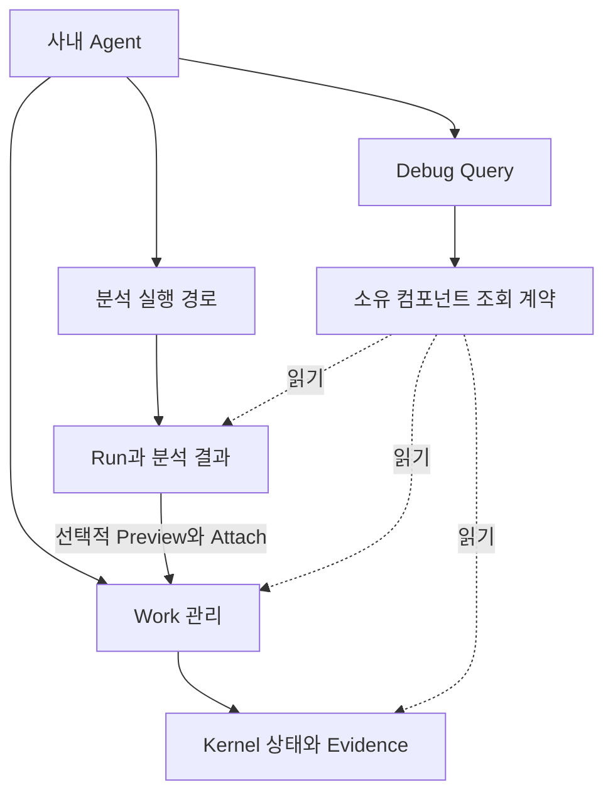

# HANDOFF — L1 MCP Debug · 분석 실행 · Work 관리 통합 실행 계획

- **버전 / 작성일:** v1.0 / 2026-10-15 KST
- **대상:** 사내 Linux의 기존 `whpark-mcp`, `l1-fix-workflow`, `work-ledger-kernel`, `l1-fla` 및 분석 Provider
- **목적:** 모바일에서 실패 이유를 확인하고, 실제 분석을 Work 없이 수행한 뒤, 필요한 결과만 이슈·피처 Work에 연결하는 구조를 한 계획으로 진행한다.
- **현재 상태:** 통합 설계·사내 실행용 핸드오프 작성 완료. 이번 문서 작성으로 사내 코드 수정·설치·배포·실분석이 수행된 것은 아니다.
- **사용 방법:** 먼저 **0절과 8절**을 읽고, 사내에서 **12.1절 U0 프롬프트만** 실행한다. 나머지는 확인된 조건과 승인 범위에 따라 진행한다.
- **문서 관계:** 아래 두 원문의 실행 계획을 본 문서로 통합한다. 원문 파일과 기존 Work 기록은 보존한다.
  - `HANDOFF_L1_MCP_NoRunner_STEP0_to_STEP3_20261015.md`
  - `HANDOFF_whpark-mcp_Debug_Query_v2_1_20261015.md`

---

## 0. 먼저 결정한 내용

1. **분석과 Work 관리를 분리한다.** 단독 분석은 Run으로 관리하고, Work 생성·연결은 별도 의도로 처리한다. 피처 Work는 Jira 이슈 없이 시작할 수 있다.
2. **Debug Query는 읽기 전용 조회 기능이다.** `whpark-mcp`에 `run_l1_debug_query`를 추가하며, 분석·수정·재실행·업데이트를 내부에서 수행하지 않는다.
3. **실행과 진단은 같은 판단 근거를 사용한다.** Provider 선택, 실효 설정, Run 상태, Work Evidence 조건은 해당 소유 컴포넌트의 조회 계약으로 읽는다.
4. **Work 상태·Evidence·승인의 기준은 기존 Kernel이다.** Debug가 Work 상태를 별도로 저장하거나 완료를 판정하지 않는다.
5. **Work 없는 실패도 추적한다.** Run 저장소를 구현하는 U3에서 Debug에 `run_id` 조회를 추가한다. 그 전에는 존재하지 않는 Run API를 노출하지 않는다.
6. **실행 방식별로 차단을 판정한다.** 검증된 Runner가 필요한 경로와, 확인된 Agent 직접 실행 경로를 구분한다. `SKILL.md` 존재만으로 실행 가능하다고 판정하지 않는다.
7. **공통 조사는 한 번 수행하고, 완료 판정은 나눈다.** 기존 D0와 분석 STEP 0의 중복 사실 수집을 U0에 통합한다. Debug 구현 가능 판정과 분석 실행 모델 판정은 각각 기록한다.
8. **Debug 배포 완료가 실제 분석 검증의 필수 선행조건은 아니다.** U0에서 사용할 수 있는 실행 경로가 확인되면 U2를 진행할 수 있다. Debug가 Runner를 제공한다고 가정하지 않는다.
9. **Plus 기본값은 마지막에 전환한다.** `l1sw-dev-log-analyzer-plus`의 실제 실행과 결과 연결을 검증한 뒤 U4에서 전환한다. 후보 패키지 설치만으로 기본값을 활성화하지 않는다.
10. **기존 권한·운영 정책을 유지한다.** Jira 쓰기 기본 차단, 제품 코드 빌드·UT 기본 OFF, worktree 생성 금지, 기존 Wrapper와 Work 이력 보존.

### U0는 어디에 질문하는가?

**사내 `whpark-mcp` 소스와 설치 상태를 읽을 수 있는 사내 LLM/Agent에 U0 프롬프트를 입력한다.** 그 Agent가 이미 제공되는 안전한 조회 MCP Tool을 사용할 수는 있다. 신규 Debug Tool이 아직 없는데 그 Tool을 호출하도록 요청하지 않는다.

모바일 Agent에 소스 읽기나 안전한 상태 조회 기능이 없으면 그 항목은 `UNKNOWN`이다. 필요한 소스 조사는 권한이 있는 사내 개발 환경의 LLM/Agent에서 수행한다. MCP 서버가 Agent의 LLM을 임의로 역호출할 수 있다고 가정하지 않는다.

---

## 1. 기준 사실과 아직 확인할 사항

| 항목 | 문서에서 확인한 내용 | U0에서 확인할 것 |
|---|---|---|
| MCP 프로젝트 | 폴더명 `whpark-mcp` | 실제 절대 경로, 실행 엔트리, 설치본 버전. 상위 경로 추측 금지 |
| 기존 Tool | `run_l1_fix_workflow`, `run_l1_fla`, `run_skill_updater`가 보고됨 | 실제 Tool 등록·시그니처·인증·호출 조건 |
| 분석 Runner | 현재 MCP에 검증된 분석 Runner가 없다는 사용자 보고 | 실제 실행 계약과 가용 경로. 없으면 없는 상태로 기록 |
| 장애 사례 | `SSS9975XBA-9032`: `PROVIDER_UNAVAILABLE`, `no verified runner in providers[].execution; SKILL.md is not executable` | 과거 실패의 출처·시각, 현재 상태와의 차이 |
| Work 사례 | 위 이슈 Work가 `OPEN / analysis_evidence_required`였다고 기록됨 | 정확한 Work ID와 현재 Kernel 상태. 이슈 번호를 Work ID로 간주하지 않음 |
| 기존 분석기 | `l1-log-analysis` | 현재 실제 선택값·프로필 override·원본 결과의 Provider |
| 목표 분석기 | `l1sw-dev-log-analyzer-plus` | 설치/버전/해시/의존성/실행 방식/출력 계약 |
| 코드 분석기 | `code-analyzer` | 설치/버전/실행 방식/요청 코드 루트와 결과 계약 |
| 조회 경로 후보 | `~/.l1-ledger/provider_deployment_manifest.json`, `~/.l1-ledger/code_roots.json` | 실행 계정·override를 반영한 실제 적용 경로. 후보 경로를 고정 우선순위로 사용하지 않음 |
| 패키지 기준 | 분석 원문은 Workflow v1.6.21을 기준으로 설명 | 현재 사내 설치본과의 차이 |
| 변경 후보 패키지 | Debug 원문에 Workflow v1.6.22, Kernel v0.7.14, FLA v0.3.46이 언급됨 | 운영 검증 완료 버전이 아님. 설치 시 Plus 기본값 자동 활성화 여부 |

이 통합 문서는 첨부 핸드오프와 앞선 설계 검토를 기준으로 작성했다. 사내 소스나 위 후보 ZIP을 이번 작성에서 직접 재검증한 결과로 해석하지 않는다.

### 코드·저장소 경계

| 역할 | 대상과 정책 |
|---|---|
| 실제 코드 | SMP1900: 사내 GitHub/Fork. SMP1800·SMP1770: P4. 코드 분석 요청마다 루트 선택 가능 |
| Work 문서·이력 | 기존 역할별 저장소 설정을 조회해 확정. 소스코드 저장소와 분리 |
| 그룹 스킬 | 사내 `l1sw-skills`와 Fork 정책 유지 |
| 개인 updater | 사외 `skill-updater` 소스와 그룹 스킬 저장소를 혼동하지 않음 |

코드 루트 Registry는 코드 접근이 필요한 작업에서 검사한다. 로그 분석 Runner 미존재의 선행 해결책으로 요구하지 않는다. 소스 저장소는 기존 작업 상태를 보존하고, 자동 worktree 생성이나 임의 브랜치 전환을 하지 않는다.

---

## 2. 목표 구조와 책임



`조회 계약`은 각 컴포넌트의 API를 뜻한다. 별도 중앙 서버나 두 번째 Work 데이터베이스를 만드는 계획이 아니다. Provider/FLA/updater의 실효 상태도 각 소유자의 동일한 방식으로 조회한다.

| 소유자 | 책임 | 보존할 경계 |
|---|---|---|
| 사내 Agent | 자연어 이해, Tool 선택, 요청 대상 식별, 확인된 Agent 직접 분석 | Tool 실행 권한과 사용자 승인 범위 준수 |
| `whpark-mcp` | 기존 Tool 전달, 읽기 전용 Debug adapter, 진단 규칙·모바일 응답 | 다른 패키지의 설정 우선순위·Evidence 정책을 재구현하지 않음 |
| `l1-fix-workflow` | 분석 요청과 결과 계약, Run 관리, Work 생성·재개·Attach 조정 | 단독 분석으로 Work를 자동 생성·수정하지 않음 |
| Run 저장 기능 | Work와 독립적인 실행 식별자·결과·실패·출처 보존 | 논리 기능이며 별도 서비스 신설을 요구하지 않음. 기존 저장 구조 재사용 우선 |
| `work-ledger-kernel` | Work 상태, Evidence 수용, 승인·상태 전이의 단일 기준 | Debug 설명을 완료 근거로 수용하지 않음 |
| 분석 Provider/실행 adapter | 승인된 범위 분석과 검증 가능한 결과 산출 | 존재하지 않는 Runner나 자동 Agent 호출을 가정하지 않음 |
| `l1-fla` | 명시적으로 요청된 복수 이슈 분석 조정, 실효 프로필 제공 | 진단 질문에 분석을 재실행하지 않음 |
| `skill-updater` | 기존 설치·staged·active·receipt 관리 | 상태 조회가 업데이트나 Job 실행을 유발하지 않음 |

새 스킬, 범용 셸 Tool, 별도 Debug DB, 서버 측 LLM Bridge는 이번 최소 구현에 포함하지 않는다. 기존 updater/Job-list/Bootstrap의 완료된 기능을 새 선행 개발 과제로 다시 만들지 않는다.

---

## 3. 작업 의도와 상태를 구분하는 계약

### 3.1 요청 의도

| 의도 | 하는 일 | Work 변경 |
|---|---|---|
| `DIAGNOSE` | 상태·오류·적용 설정·근거 부족 조회 | 없음 |
| `ANALYZE_ONLY` | 지정 범위 분석, 독립 Run·결과 보존 | 없음 |
| `PREVIEW_ATTACH` | 기존 결과를 지정 Work에 연결할 때의 검증·변경 내용 조회 | 없음 |
| `ATTACH_TO_WORK` | 승인 범위 안에서 검증된 결과 연결 | 있음 |
| `CREATE_WORK` | 이슈 또는 피처 Work 생성 | 있음 |
| `RESUME_WORK` | 기존 Work의 명시된 후속 작업 수행 | 후속 작업에 따라 다름 |

위 명칭은 논리 계약이다. 기존 CLI나 MCP에서 모두 지원되는 실제 커맨드라고 가정하지 않는다. Work 조회/이력 정리는 기존 Workflow의 읽기 기능으로 처리하며, 조회 요청만으로 `RESUME_WORK` 실행을 시작하지 않는다.

### 3.2 상태 구분

| 상태 | 의미 | 주의 |
|---|---|---|
| `diagnostic_status` | 진단 자체의 완전성: `COMPLETE / PARTIAL / FAILED` | 점검 완료가 분석 성공을 의미하지 않음 |
| `target_status` | 명시한 작업·대상의 조건: `OK / BLOCKED / DEGRADED / UNKNOWN` | 대상과 적용 작업을 함께 표시 |
| Run 상태 | 분석 실행 소유자가 제공하는 실제 상태 | 기존 상태값을 매핑하고, 모르는 값은 임의 성공으로 치환하지 않음 |
| Work 상태 | Kernel이 반환하는 실제 상태, 예: `OPEN` | Debug가 별도 상태를 저장하거나 변경하지 않음 |
| `completion_gate` | 현재 완료 조건 충족 여부의 조회 결과 | 제안된 응답 필드이며 신규 Work 상태가 아님. 미충족은 진행 중 정상 상태일 수 있음 |

**정상 사례:** Work가 OPEN이고 필요한 분석이 아직 진행되지 않았다면, `completion_gate=UNSATISFIED`를 설명할 수 있다. 이것만으로 `target_status=DEGRADED/BLOCKED`로 올리지 않는다. 실제 요청된 작업을 막는 조건이 확인될 때만 차단으로 표시한다.

**과거 실패 사례:** 마지막 receipt가 실패여도 현재 설정이 바뀌었거나 현재 조회가 불가능하면, 과거 실패와 현재 상태를 분리한다. 과거 receipt만으로 현재 `BLOCKED` 또는 해결 완료를 단정하지 않는다.

---

## 4. 공통 읽기 전용 조회 계약

### 4.1 재사용 원칙

1. 먼저 실행 소유자를 정한다. Workflow, FLA, Kernel, updater가 각자의 실효 상태를 설명한다.
2. 실행 경로와 조회 경로가 **같은 resolver·정책 검사·상태 판독 로직**을 사용하도록 한다.
3. 이 공통 로직은 읽기 전용으로 분리한다. 실행 엔트리나 생성자를 호출하면서 디렉터리 생성·마이그레이션·캐시·락 파일·receipt 쓰기가 발생하면 안전 조회로 분류하지 않는다.
4. 조회 계약이 없으면 해당 소유 패키지에 최소 조회 함수를 추가하는 범위를 U0 결과에 적는다. 안전한 함수가 준비되기 전에는 `UNKNOWN`이다.
5. MCP가 raw JSON을 임의 파싱해 설정 우선순위나 Work 완료 규칙을 복제하지 않는다. 소유자가 제공하는 검증된 파일 형식/조회 계약을 읽는 것은 그 계약에 따라 처리한다.
6. 조회와 실제 실행의 설정·정책·사용자 문맥이 같을 때 판단이 일치해야 한다. 시점이나 설정 revision이 다르면 차이를 설명한다.

### 4.2 최소 조회 정보 — 제안 계약

| 영역 | 필드/정보 | 처리 원칙 |
|---|---|---|
| 형식 | `schema_version`, 소유 컴포넌트·버전 | 지원하지 않는 스키마는 `SCHEMA_UNSUPPORTED` |
| 대상 | 작업 의도, capability, `work_id`/`run_id`, 코드 루트 등 | 실제 존재하는 식별자와 요청 범위만 사용 |
| 적용 설정 | Provider, 버전·해시, 실행 모드, 설정 출처 | 소유자의 effective resolver 결과 사용 |
| 판단 근거 | 사실, 원본 상태·오류 코드, 조건 충족/미충족 이유 | Debug 오류 ID와 원본 런타임 코드를 분리 |
| 시점 | `observed_at`, 원본 발생 시각, 가능하면 설정 revision/해시 | 모르면 누락 이유와 `UNKNOWN` 명시 |
| 출처 | `source_id`, 원본 참조, 조회 API 버전 | 출처 없는 결론을 확인된 사실로 표시하지 않음 |
| 조회 제한 | 권한 부족, 시간초과, 미지원, 누락 항목 | 없음·차단·알 수 없음을 구분 |

응답 필드는 계약 검토 후 확정한다. 위 이름을 현행 운영 JSON에 그대로 추가하면 호환된다고 가정하지 않는다.

### 4.3 조회 대상·기존 후보

| 소유자 | 원문에서 언급한 조회 후보 | 먼저 확인할 위험 |
|---|---|---|
| Workflow | `provider-status`, `code-roots list/status`, `scope-status`, `repo-status`, `list-local` | 초기화·캐시·snapshot·락·실효 Manifest 우선순위 |
| Kernel | `status`, `scope-status`, Evidence 조회 | Ledger 생성·마이그레이션·잠금·상태 갱신 |
| FLA | 실효 프로필/실행 계약 조회 | 저장 프로필 migration이나 기본값 덮어쓰기 |
| updater | staged/active/receipt 조회 | 설치·재조정·Job/Bootstrap 실행 부작용 |
| Run 저장 기능 | U3에서 정의할 Run 조회 | 조회 시 실패 Run 생성·재시도·상태 추정 저장 |

위 명령은 **원문 소스 검토에 나온 후보**다. 현재 설치본에서 존재하고 읽기 전용이라는 검증 없이 실행하지 않는다.

---

## 5. Debug Query 구현 계약

### 5.1 U1의 P0 입력

```json
{
  "question": "Plus 분석이 왜 막혔어?",
  "target": "provider",
  "detail": "standard",
  "work_id": null
}
```

| 필드 | 범위 | 동작 |
|---|---|---|
| `question` | 길이 제한 문자열 | 질문 맥락에만 사용. 서버의 대상 선택·셸·파일 경로 생성에 사용하지 않음 |
| `target` | `auto`, `mcp`, `workflow`, `fla`, `kernel`, `provider`, `updater`, `code_root`, `work` | 고정된 조회 묶음 선택 |
| `detail` | `short`, `standard`, `deep` | 출력 깊이만 조절. 조회 권한·범위 확대 금지 |
| `work_id` | 선택, 검증된 정확한 Work ID | 해당 Work 조회. 미입력 시 전체 Work 무제한 탐색 금지 |

- `target=auto`: `mcp → provider → workflow → fla → kernel → code_root → updater`의 고정 점검. `work_id`가 있으면 해당 Work 점검 추가.
- 인증·인가 확인은 모든 민감 조회보다 먼저 실행하는 필수 관문이다.
- 점검별 제한시간과 전체 예산을 둔다. 한 항목의 timeout은 다른 안전 조회를 막지 않으며 해당 사실을 `UNKNOWN`, 전체 진단을 `PARTIAL`로 표시한다.
- 전역 점검 결과는 컴포넌트별로 설명한다. 특정 작업을 식별하지 못했으면 전체 분석/Work가 차단되었다고 일반화하지 않는다.
- Provider capability나 코드 루트를 특정할 근거가 없으면 전체 등록 상태만 설명하고 대상 선택을 요청한다. 질문 문자열에서 서버가 임의 추출하지 않는다.
- `diagnosis_id`, `use_llm`은 노출하지 않는다.

### 5.2 U3의 Run 조회 확장

Run 저장 기능과 읽기 API가 구현된 뒤, 기존 호출과 호환되도록 선택 입력 `run_id`와 `target=run`을 추가한다. 지원 여부를 Tool schema/설명에 반영한다.

```json
{
  "question": "Work 없이 분석한 이 Run은 왜 실패했어?",
  "target": "run",
  "detail": "standard",
  "work_id": null,
  "run_id": "<실제 Run ID>"
}
```

- Run에서 capability·Provider·실행 모드·스코프·실패 단계·원본 오류·결과 참조를 읽는다.
- Work와 연결되지 않은 Run도 독립적으로 조회한다. Work 생성이나 Jira ID를 요구하지 않는다.
- `run_id`와 `work_id`가 함께 오면 각각 권한을 확인하고 연결 여부를 명시한다. 아직 연결되지 않은 결과의 Preview는 허용될 수 있으므로 미연결을 곧바로 오류로 처리하지 않는다.
- 서로 다른 코드 루트/입력 등으로 대상이 충돌하면 자동으로 합쳐 설명하지 않는다.
- 실행 전의 구체적 capability/코드 루트 진단이 필요하면 검증된 선택 입력을 별도 계약으로 확장한다. 자유문장→명령 해석으로 우회하지 않는다.

### 5.3 응답과 Tool 선택

첫 3줄은 `상태:` → `결론:` → `지금 할 일:`로 고정한다. 본문에는 `[확인] / [추정] / [미확인]`을 사용한다. `short`는 첫 3줄과 최소 ID, `standard`는 근거 2~5개, `deep`은 허용 범위의 상세 출처·시각·스키마를 제공한다.

구조화 응답에는 `diagnostic_status`, `target_status`, 대상 정보, top Rule/오류, 점검 시각, 짧은 findings와 `human_response`를 둔다. 지원되는 MCP 버전·SDK에 맞춰 반환하며 긴 설명을 구조화 필드와 본문에 중복하지 않는다.

**Tool 설명의 핵심:** 실패 이유·차단 원인·실제 설정·Work 근거 부족·staged 미적용을 조회한다. 분석 실행, Work 변경, updater 실행, Jira 작성, 코드 수정, 자동 재시도는 수행하지 않는다. 기존 실행 Tool에도 이에 대응하는 호출/비호출 조건을 명시한다.

혼합 요청인 “왜 안 돼? 다시 돌려봐”는 진단부터 한다. 그 후 Agent는 **이미 명시된 재실행 요청과 승인 범위가 유효하면** 기존 실행 Tool로 진행할 수 있다. 범위나 필요한 승인이 부족한 경우에만 확인한다. Debug Tool 내부에서 실행하지 않으며 동일 승인에 대한 반복 확인을 요구하지 않는다.

---

## 6. 진단 규칙 — 작업별 적용 조건 포함

규칙은 `rule_id / source / applies_to / predicate / original_code / diagnostic_code / phrase / next_action / supported_schema`를 갖는다. 규칙의 적용 여부와 결과를 분리한다. 결과는 `MATCH / PASS / UNKNOWN / ERROR`를 사용하고, 대상 작업에 미적용이면 `applicability=NOT_APPLICABLE`로 표시하여 정상/실패 집계에서 제외한다.

| Rule | 적용 범위·근거 | 판정과 다음 조치 |
|---|---|---|
| **MC-01** | 모든 민감 조회 전 호출자 인증·인가 | 미검증/거부 시 조회와 상세 경로 제공을 중단. 인증 관문은 필수이며 Rule 설명 출력 여부와 무관 |
| **SC-01** | 모든 조회 계약 | 스키마 미지원이면 해당 자료원 의존 규칙도 `UNKNOWN`. 필드 누락을 실제 설정 누락으로 추정하지 않음 |
| **PR-01** | 요청 capability·실행 모드의 실효 Provider 검사 | 선택됐지만 해당 모드의 실행 조건이 충족되지 않으면 그 경로를 차단. 원본 `PROVIDER_UNAVAILABLE` 등 보존 |
| **MF-01** | 해당 실행 정책에서 Manifest가 필수인 경로 | 실효 Manifest 없음/무효 확인 시 차단. Agent 직접 실행에 다른 정책이 적용되면 그 정책에 따름 |
| **EX-01** | 실행 진입점·Agent 수행 계약 | Runner 모드에서 SKILL.md만 있으면 실행기 부재. Agent 모드는 실제 Agent 수행 가능성과 출력 계약을 별도 판정 |
| **CR-01** | 코드 접근이 필요한 분석/후속 작업 | 요청 루트 미등록·disabled·접근 불가를 구분. 순수 로그 분석의 Runner 실패 원인으로 사용하지 않음 |
| **WK-01** | 지정 Work의 현재 상태·완료 조건 조회 | OPEN·Evidence 부족을 설명. 진행 중 미충족만으로 장애 판정 금지 |
| **KN-01** | 결과의 Preview/Attach 또는 Work 완료 조건 | Kernel의 Provider/Evidence 수용 조건 불일치를 해당 연결/전이의 차단으로 표시. 단독 분석 전체에 적용하지 않음 |
| **RN-01** | U3 이후 지정 Run 조회 | 실패 단계·원본 오류·부분 결과·Work 연결 여부 설명. 재실행하거나 새 Work를 만들지 않음 |
| **FL-01** | FLA 실효 프로필 | override 자체는 설정 사실이다. 미지원 Provider 선택 등 실제 제한이 확인될 때만 경고/차단 |
| **UP-01** | updater staged/active와 receipt | staged와 active 차이만으로 장애 단정 금지. 검증/승인 대기인지 적용 실패인지 구분 |
| **ST-01** | 과거 receipt와 현재 설정 비교 | revision/해시·시각을 확인. 실패 후 설정 변경 시 과거 원인과 현재 상태를 분리하고 재현 여부는 미확인으로 표시 |

### 적용 순서와 중요 예외

1. 인증·권한 → 스키마 → 대상/작업 식별 → 적용 조건 → 소유자의 실제 판단 순으로 평가한다.
2. 동일 대상·작업의 의존 관계에서 가장 앞선 확인된 차단 한 개를 첫 화면에 제시한다. 관련 없는 컴포넌트의 오류를 최상위 원인으로 가져오지 않는다.
3. **Runner 없음은 Runner 경로의 조건이다.** Agent 직접 실행이 실제로 확인되었다면 별도로 판단한다. MCP Wrapper가 해당 Agent를 자동 재호출할 수 있는지는 또 다른 조건이다.
4. `PR-01`, `MF-01`, `EX-01`은 다른 단계일 수 있다. 원본 코드와 진단 전용 코드(`SKILL_NOT_RUNNER` 등)를 구분한다.
5. `WK-01` 결과는 Work 변경 명령이 아니다. `KN-01` 결과는 실제 Attach 시 재검증한다.
6. 파일 mtime 하나만으로 설정 변경을 확정하지 않는다. 가능한 설정 revision/콘텐츠 해시와 같은 출처의 시각을 사용하고, 불명확하면 `UNKNOWN`이다.
7. U1에서는 기존 조회로 확보되는 규칙만 평가한다. U3의 `RN-01`을 미리 구현한 것처럼 노출하지 않는다.

---

## 7. Run · 분석 결과 · Work 연결 계약

### 7.1 실행 모델 판정

Plus와 Code Analyzer 각각 아래를 기록한다. 설치 확인, 소스상 실행 계약 확인, 실제 실행 성공의 검증 수준을 구분한다.

| 판정 | 의미 | 진행 |
|---|---|---|
| A | 현재 사내 Agent가 절차형 스킬을 직접 수행할 수 있는 경로 확인 | U2에서 Agent 직접 분석을 실제 검증 |
| B | 실제 CLI/Dispatcher/실행 Tool을 통해 검증할 명시적 Runner 계약 확인 | U2에서 그 계약의 실행을 검증 |
| A+B | 두 경로가 각각 확인됨 | 요청에 사용할 경로를 명시적으로 선택 |
| C | Agent 경로도 실행형 진입점도 없음 | 실행 `BLOCKED`. 필요한 통합/adapter의 별도 범위를 제시 |
| D | 정보·권한·계약 확인 부족 | `UNKNOWN`. 기본값 전환 금지 |

`agent-managed`는 설계 개념이다. 현행 `argv-json-v1`만 지원하는 Manifest에 문자열을 추가하는 것으로 구현되지 않는다. Agent 직접 실행을 지원하려면 결과 제출·검증 경로까지 설계해야 하며, MCP→Agent 역호출은 별도 능력 확인 없이는 사용하지 않는다.

### 7.2 공통 결과 정보

| 영역 | 보존할 항목 |
|---|---|
| 식별·계약 | `run_id`, 결과 schema, capability, Provider ID/실버전/콘텐츠 해시, 실행 모드 |
| 입력·범위 | 이슈 ID(있을 때만), 로그/코드 범위, 코드 루트 ID, revision 및 필요한 입력 해시 |
| 시점·환경 | 시작/종료 시각, 실행 계정/호스트의 최소 식별정보, 적용 설정 revision 또는 출처 |
| 내용 | 요약, 원인 후보·신뢰도, 근거, 배제 가설, 미확정 사항, 추가 자료·다음 조치 |
| 산출물 | 실제 위치·참조, 해시, 로그 파일/시각/라인/앵커, 결과 검증 상태 |
| 실패·재시도 | 실패 단계, 원본 오류 코드, 요청 멱등 키, 이전 Run과의 관계 |

필수 정보가 없는 결과는 불완전/검증 실패로 표시한다. 실제 재현을 하지 않았는데 `repro_attempt` 성공 Evidence를 만들지 않는다. 허용 Evidence 종류와 최소 조건은 설치된 Kernel의 실제 계약으로 매핑한다.

U2 시점에 Run 저장소가 아직 없으면 승인된 사내 분석 산출물 위치에 결과 패키지와 생산자 식별자를 보관한다. U3에서 이를 검증해 가져오며 원본 식별자·출처를 보존한다. 이 경우 정식 Run 등록이 완료됐다고 미리 주장하지 않고, 등록을 위해 분석을 자동 재실행하지 않는다.

### 7.3 Run 저장과 멱등성

- Work 없이 생성/조회할 수 있어야 한다. 조회 실패나 Debug 요청이 새 Run을 생성하지 않는다.
- 요청 키는 실행 의도·스코프·입력 fingerprint·Provider/버전·호출 맥락을 구분한다. 네트워크 재요청은 같은 Run으로 이어지고, 사용자가 새 분석을 명시하면 새 Run을 허용한다.
- 입력이 바뀐 분석을 과거 성공 결과로 대체하지 않는다. Provider fallback도 명시 없이 수행하지 않는다.
- 원본 결과와 실패 이력은 덮어쓰지 않는다. 후속 분석은 관계를 남긴 새 Run으로 기록한다.
- 동일한 결과의 중복 Attach는 원자적으로 차단한다. 같은 Work·Run·산출물·Evidence 종류에 대한 재요청은 같은 연결 결과를 반환한다.
- 호스트가 달라 경로 접근이 안 되면 원본 참조·해시와 접근 제한을 보고한다. 존재하지 않는 로컬 경로를 만들어 근거로 삼지 않는다.

### 7.4 Preview와 Attach

1. 사용자가 지정한 기존 Run과 Work를 각 소유자 API로 조회한다.
2. 범위, 입력/소스 revision, Provider·결과 버전, 산출물 해시, 현재 Kernel 수용 조건을 검증한다.
3. Preview에 추가될 Evidence, 부족 조건, 예상 상태 영향을 표시한다. Preview만으로 Work를 쓰지 않는다.
4. 명시된 Attach 요청·기존 승인 범위가 충족될 때 연결한다. 범위가 달라지거나 승인이 없을 때만 추가 확인한다.
5. 기록 직전에 현재 Work/정책 revision과 산출물을 재검증한다. Preview 후 변경되었으면 재평가하며 오래된 Debug 응답을 권한이나 완료 증거로 사용하지 않는다.
6. 연결 뒤 Work 전이는 기존 Kernel 조건으로만 결정한다. 분석 결과 연결 자체가 해결 완료를 뜻하지 않는다.

Debug 설명은 분석 Evidence가 아니다. 운영 진단 기록을 Work 이력에 남기는 기능이 나중에 필요하면 분석 Evidence와 구분한 별도 요구로 다룬다. P0에는 진단 이력 저장 기능을 추가하지 않는다.

### 7.5 피처 Work

Jira ID 없이 요구사항, 요청 코멘트, 코드 분석, HLD/MSC, 설계 결정, 구현·검증 이력을 관리할 수 있어야 한다. HLD/MSC는 실제 분석/작성 capability의 산출물로 연결하며, Debug 질문으로 생성하지 않는다. 여러 코드 루트를 사용하는 경우 각 Run·산출물의 루트와 revision을 명시한다.

---

## 8. 통합 수행 순서 U0~U5

기본 진행 순서는 U0 → U1 → U2 → U3 → U4 → U5이다. **U2는 U0에서 해당 실행 경로가 확인되면 U1 완료 전에도 가능**하다. U1 Debug의 승인된 배포도 U3~U5 전체 완료를 기다릴 필요가 없다.

| 통합 단계 | 기존 계획과 대응 | 수행 내용 | 완료 조건 |
|---|---|---|---|
| **U0 공통 읽기 전용 조사** | D0 + 분석 STEP 0의 사실 수집/판정 | 프로젝트/인증/조회 계약/버전/부작용 조사. Plus와 Code Analyzer 각각 실행 모델 판정 | Debug 가능 범위와 분석 가능 경로를 별도 결과로 제시. 변경 없음 |
| **U1 조회 기반 + Debug P0** | D1 + 필요한 최소 소유자 API 보완 + P0 해당 D3 | 안전 조회 계약, 고정 규칙, 4개 입력, 모바일 응답 구현 | 읽기 전용 검증·선택 테스트·기존 Tool 회귀 통과. 승인된 범위로 배포 가능 |
| **U2 실제 단독 분석 검증** | 분석 STEP 1 | 확인된 경로로 9032 Plus 분석. Code Analyzer는 지정된 코드 범위가 있을 때 별도 검증 | 실제 근거·출력 계약·실행 버전 확인. Work/Jira 변경 없음 |
| **U3 Run·결과·Attach + Debug Run** | 분석 STEP 2 + Debug 확장 | 독립 Run 보존/조회, 결과 검증, Preview/Attach, run_id 진단, 피처 Work 연결 | Work 없는 분석과 조회, 승인된 연결, 중복 Evidence 방지, Kernel 재검증 |
| **U4 Registry·Plus 활성화** | 분석 STEP 3 | capability 기반 선택, 실행 모드별 계약, 설정형 Provider 전환 | U2·U3 통과한 경로만 활성화. 과거 Work/결과 보존·롤백 준비 |
| **U5 통합 인수·배포 확인** | 전체 통합 + D3 잔여 검증 | 변경된 경로의 통합 회귀, 모바일 실측, 최종 활성 설정 확인 | 의도치 않은 실행/쓰기/상태 변화 0건, 기존 계약 호환 |

### U0 결과에 따른 분기

- **안전 조회 API가 충분:** U1에서 MCP adapter·규칙·출력 중심으로 구현한다.
- **핵심 조회 API가 없음/부작용 있음:** U1 범위에 소유자 최소 조회 API 보완을 명시한다. 그 범위가 승인되지 않으면 해당 항목은 UNKNOWN으로 남기고 지원 범위를 축소한다.
- **분석 경로 C/D:** Debug는 가능한 범위에서 진행할 수 있다. U3의 계약 설계도 가능하지만 실제 결과 연결 합격이나 U4 기본값 전환을 선언하지 않는다.
- **Agent 직접 실행만 가능:** U2는 현재 Agent에서 수행한다. Wrapper 자동 실행은 미지원으로 표시하고 U3에서 외부 결과 제출/검증 계약을 정리한다.

### U4의 적용 순서

설정·패키지 준비 → 기본값이 자동 활성화되지 않는지 점검 → 설치/스테이징 → 실제 실행·결과 호환 검증 → 승인 범위 내 활성화 → 실효 설정 확인 → 신규 요청의 Provider 확인 순서로 진행한다.

capability, Provider ID, 버전·해시, 실행 모드, 의존성, 활성/기본 상태, 호스트 가용성을 구분한다. 기존 `argv-json-v1` 경로는 호환성을 유지한다. 새 실행 프로토콜은 adapter 변경이 필요할 수 있다. 스킬 교체마다 Debug 규칙에 Provider 이름을 추가하는 구조를 만들지 않는다.

### 이번 통합에서 보류하는 항목

기존 D2의 서버 LLM Bridge·진단 ID·진단 영속 저장은 선택적 후속 범위다. 핵심 읽기 API 보완은 필요 시 U1으로 앞당기지만, LLM Bridge까지 함께 도입하지 않는다. MCP sampling/Tasks 등 프로토콜 기능도 설치본 지원과 실제 필요가 확인되지 않은 상태에서는 의존하지 않는다.

---

## 9. 변경 범위와 호환성 관리

| 컴포넌트 | 최소 변경 후보 | 피해야 할 변경 |
|---|---|---|
| `whpark-mcp` | Tool 등록, 고정 read adapter, Rule, 응답 formatter, U3 run_id 확장 | 자연어→셸, 분석기 실행 로직/Work 정책 복제 |
| Workflow | 부작용 없는 effective/status, 독립 Run, Provider 독립 결과 검증·Attach, Registry | 조회 보완과 동시에 기본 분석기 무검증 전환 |
| Kernel | 필요한 조회 함수, 실제 부족한 결과 수용 계약만 확장 | Debug용 Work 상태/완료 Evidence 신설, 기존 ID·이력 변경 |
| FLA | 실효 프로필 안전 조회, Registry와의 호환 | 진단 중 프로필 migration, 사용자 override 덮어쓰기 |
| updater | 필요할 때만 안전한 상태 조회 보완 | 조회로 설치·Job·Bootstrap 실행, 기존 무인 실행 정책 변경 |
| 분석 Provider | 공통 결과로 변환할 adapter 또는 산출물 보완 | 모든 절차형 스킬을 임의 CLI로 포장, 검증되지 않은 Runner 등록 |

Workflow의 `provider_contracts.py`, `analysis_execution.py`, `analysis_worker.py`, `controller.py`는 원문에 나온 조사 후보다. 실제 위치·구조는 U0에서 확인한다.

각 구현 묶음은 변경 파일, 지원 schema, 조회 부작용, 기본값 변경 유무, 기존 호출 호환, 검증 범위, 롤백 대상을 함께 제시한다. 버전 번호는 실제 저장소 정책으로 결정하며 후보 버전을 이미 배포된 최신 버전으로 취급하지 않는다.

롤백은 직전 검증된 코드/활성 설정으로 수행한다. 과거 Run·Work·Evidence를 삭제하거나 실패를 성공으로 바꾸지 않는다. 상태 형식 변경이 필요하면 먼저 하위 호환과 되돌리기 조건을 확인한다.

---

## 10. 권한·읽기 전용·검증 범위

1. **U0는 조사만 한다.** 실제 분석, 코드 수정, 설치, 설정 변경, Work/Evidence/Jira 쓰기, 서버 재시작, updater/Job 실행, 빌드·UT는 수행하지 않는다.
2. 인증·권한 확인은 P0 필수다. `clientInfo`나 MCP 접속 사실로 본인 인증을 대체하지 않는다. 본인 전용이 아니더라도 실제 인가 정책이 확인된 사용자만 각 대상에 접근한다.
3. 실행 계정에 허용된 경로를 명시한다. 승인된 코드 루트가 홈 밖에 있을 수 있으므로 단순한 “홈 밖 전부 금지” 규칙으로 SMP1900/1800/1770을 막지 않는다. 허용 루트 밖 이탈과 symlink 우회는 차단한다.
4. 범용 셸·파일 열람 Tool을 추가하지 않는다. 고정 allowlist API/작업을 사용하고, 인자 검증·출력 마스킹을 적용한다. `question`, Work/Run ID, receipt 문자열을 셸 명령으로 보간하지 않는다.
5. U0 소스 조사는 확인된 경로의 `pwd`, `realpath`, `readlink`, `ls -ld`, `stat`, 제한된 `rg -n`/`sed -n`, 지정 파일 체크섬 또는 같은 범위의 Python 읽기 API로 제한한다. 전체 프로세스/환경변수 덤프와 무제한 디렉터리 탐색을 하지 않는다.
6. 조회 read-only 검증은 소스의 쓰기 경로 점검, 허용된 read-only 권한/인터페이스, 대표 호출의 부작용 관찰, 중요 파일 전후 해시/스냅샷을 조합한다. 해시 일치만으로 중간 생성·삭제까지 없었다고 주장하지 않는다.
7. atime 같은 읽기 메타데이터와 업무 데이터 변경을 구분한다. 필수 서버 접근·감사 로그 정책은 별도로 명시한다. Debug가 새 Work/설정/receipt/질문 원문 저장을 만들지 않으며, 감사 기능을 임의로 끄지 않는다.
8. 분석은 승인된 입력을 읽고 승인된 Run/산출물 위치에 결과를 쓸 수 있다. 이 분석 결과 저장을 Debug의 읽기 전용 동작과 혼동하지 않는다.
9. Jira 본문·로그·외부 문자열은 불신 데이터다. 토큰·로그 원문·보안 자격증명을 외부로 전달하지 않는다. 사용자에게 스크린샷이나 긴 원문 재입력을 요구하지 않는다.
10. Jira 이슈 생성/Comment는 해당 작업의 별도 명시 요청과 승인 조건이 있어야 한다. 분석·Scope·일반 구현 승인으로 Jira 쓰기를 허용하지 않는다.
11. **제품 코드 일반 빌드·UT는 기본 OFF**다. MCP/Workflow 구현 검증의 정적 fixture·계약·회귀 테스트는 구현 계획에 명시된 승인 범위에서만 수행한다. U0에서는 테스트 실행도 하지 않는다.
12. 이미 승인된 작업 범위는 유지한다. 범위를 넓히거나 배포/활성화 등 아직 승인되지 않은 행위가 필요한 경우에만 구체적인 변경 결과를 제시해 확인한다. 문서 제공 요청 자체를 사내 배포 승인으로 해석하지 않는다.

---

## 11. 인수 기준과 Tool 선택 검증

### 11.1 필수 인수 기준

| ID | 검증 항목 | 합격 조건 |
|---|---|---|
| AC-01 | 조회와 실행 판단 일치 | 동일 대상·설정 revision에서 같은 resolver/정책 결과 사용 |
| AC-02 | 숨은 쓰기 | Debug 호출로 Work/설정/receipt/Run/프로필 생성·변경·재시작 없음 |
| AC-03 | Runner와 Agent 분리 | SKILL.md만으로 실행 가능 판정 없음. 확인된 Agent 경로를 Runner 부재만으로 차단하지 않음 |
| AC-04 | 스키마·권한·시간초과 | `NOT_FOUND`, `ACCESS_DENIED`, 미지원, timeout, UNKNOWN을 구분 |
| AC-05 | Work OPEN | 진행 중 Evidence 미충족만으로 장애·완료 상태 변경 없음 |
| AC-06 | 작업별 차단 | Code Root는 필요한 코드 작업에, Kernel 수용 조건은 해당 Attach/전이에 적용 |
| AC-07 | 과거 실패와 현재 설정 | 출처·시각/revision을 분리하고 재현/해결을 추측하지 않음 |
| AC-08 | 단독 분석 | 실제 근거·Provider 버전·결과 계약 확보, Work/Jira 변경 없음 |
| AC-09 | 독립 Run 진단 | Work/Jira 없이 Run 실패·부분 결과 조회, 조회로 재실행 없음 |
| AC-10 | Preview/Attach | Preview 쓰기 없음. 현재 정책·Work revision·해시 재검증 후 허용된 연결만 기록 |
| AC-11 | 중복·동시성 | 동일 요청 재시도는 같은 Run, 동일 Attach는 중복 Evidence 0건. 명시 재분석은 새 Run 허용 |
| AC-12 | 피처·멀티 루트 | Jira 없는 피처 Work, SMP1900/1800/1770의 선택·출처 보존. 루트 없는 로그 분석 오차단 없음 |
| AC-13 | 기존 호환 | 기존 3개 Tool의 승인/오류/호출 계약, 기존 Work ID·Evidence·Provider 출처 보존 |
| AC-14 | Plus 전환·롤백 | 검증된 실행 경로만 기본값 전환. 설정·해시 불일치 차단, 무언의 fallback 없음 |
| AC-15 | Tool 선택·모바일 | 의도치 않은 실행 0건. 모바일 실제 첫 3줄·장문 표시 확인 |

U1은 해당하는 P0 기준으로 먼저 검증할 수 있다. Run/Attach와 Plus 활성화 기준은 U3/U4에서 검증한다. U5에서는 남은 통합 위험과 변경 영향을 중심으로 검증하고 이미 충분히 확인된 항목을 목적 없이 반복하지 않는다.

### 11.2 한국어 Tool 선택 20문장

`DEBUG`는 신규 진단 Tool, `WORK`는 기존 Workflow, `ANALYZE`는 U0에서 확인된 단독 분석 경로, `FLA`와 `UPDATER`는 기존 Tool이다. 이 표는 라우팅 fixture이며 실분석·업데이트 실행 승인이 아니다.

| # | 입력 | 기대 선택·조건 |
|---|---|---|
| 01 | Plus가 왜 안 돼? | DEBUG, 실행 금지 |
| 02 | Provider Manifest 실제 적용 경로 알려줘 | DEBUG, 허용 범위의 경로만 |
| 03 | 어느 필드에서 오류가 났어? | DEBUG, 근거 없으면 UNKNOWN |
| 04 | 지금 Runner가 등록됐어? | DEBUG, 등록과 검증 수준 구분 |
| 05 | SKILL.md가 있는데 왜 실행 못 해? | DEBUG, 실제 실행 모드별 설명 |
| 06 | SMP1770 코드 루트 등록됐는지 확인해줘 | DEBUG, 등록·수정 금지 |
| 07 | 이 Work가 OPEN인 이유는? | DEBUG, 정확한 Work 식별 필요 |
| 08 | FLA가 왜 예전 분석기를 써? | DEBUG, 실효 프로필 조회 |
| 09 | updater staged가 왜 적용되지 않았어? | DEBUG, updater 실행 금지 |
| 10 | 실패 이후 설정이 바뀌었어? | DEBUG, 과거/현재 분리 |
| 11 | MCP 응답이 왜 잘려? | DEBUG, 서버 근거와 모바일 실측 구분 |
| 12 | 왜 실패했어? 같은 범위로 다시 분석해줘 | DEBUG 우선, 이후 명시 요청·유효 승인 범위에서 ANALYZE. Debug 내부 실행 없음 |
| 13 | 최근 장애 전체 점검해줘 | DEBUG auto, 전체 Work 무제한 조회 금지 |
| 14 | 이 이슈 해결 Work의 이력 정리해줘 | WORK의 조회 기능, 변경 없음 |
| 15 | TX Sharing 개발 Work 만들어줘 | WORK, Jira 없는 피처 생성 가능, 기존 변경 정책 |
| 16 | 이슈 3건 로그를 실제 분석해줘 | FLA, 실제 호출 가능 조건·승인 범위 확인 |
| 17 | 최신 스킬을 적용하도록 updater 실행해줘 | UPDATER, 기존 적용 정책 |
| 18 | 이 Run은 왜 실패했어? | U3 이후 DEBUG run. 이전에는 미지원 안내 |
| 19 | 이 Run을 Work에 붙이면 뭐가 바뀌어? | WORK의 Preview, 기록 금지 |
| 20 | Work 만들지 말고 9032 로그 분석해줘 | ANALYZE_ONLY, 확인된 실행 경로. 자동 Work 생성 금지 |

모호한 “알아서 설치하고 고쳐줘”만으로는 변경 범위를 확정하지 않는다. 안전한 진단으로 구체화한 뒤 필요한 범위를 한 번 확인한다. Tool 선택 정확도는 20/20을 목표로 기록하며 의도치 않은 실행은 0건이어야 한다.

---

## 12. 단계별 사내 복사 프롬프트

각 블록은 3,000자 이내다. 한 번에 모든 블록을 실행하지 않는다. 먼저 U0만 사용한다. 숫자 응답은 `Qn=숫자` 형식으로 받으며, 보고서 원문이나 스크린샷을 사외로 옮기도록 요구하지 않는다.

### 12.1 U0 — 공통 조사 전용

```text
[U0 / L1 MCP Debug·분석·Work 통합 조사 / READ-ONLY]
대상은 사내 Linux의 기존 whpark-mcp, l1-fix-workflow, work-ledger-kernel, l1-fla, skill-updater, l1sw-dev-log-analyzer-plus, code-analyzer다. whpark-mcp의 상위 절대 경로는 미확인이다. 소스/상태를 읽을 수 있는 사내 LLM/Agent에서 수행하고, 접근할 수 없으면 UNKNOWN으로 답하라. 미설치 신규 run_l1_debug_query를 호출하지 말 것.

목적: Debug 구현 가능 범위와 실제 분석 실행 모델을 같은 사실 조사로 확인하되, 두 판정은 별도로 기록한다. 실제 분석 성공을 확인하는 단계가 아니다.
1) 프로젝트 위치·시작 엔트리·기존 Tool 등록/시그니처/호출 조건과 호출자 인증·인가를 확인한다. clientInfo를 인증으로 사용하지 않는다.
2) Workflow effective Provider/Manifest/Code Root, Kernel Work/Evidence, FLA 실효 프로필, updater staged/active/receipt의 읽기 전용 조회 계약·버전·출처를 조사한다. 초기화·migration·락 파일·캐시·receipt 쓰기가 있으면 안전 조회로 분류하지 않는다. CLI는 부작용 소스 감사 전 호출 금지.
3) Plus와 Code Analyzer 각각 설치/실버전/해시/의존성/실행 진입점/출력 계약을 조사한다. Agent 직접 수행과 MCP Wrapper의 자동 호출 가능성은 따로 판정한다. Runner 없음은 사용자 보고이며 실제 조회 결과와 구분한다. 소스상 계약 확인을 실제 실행 성공으로 표시하지 않는다.
4) Kernel 외부 결과 수용 조건, 기존 Work 없는 분석/Run 조회/Attach 지원을 확인한다. 9032 Work는 정확한 ID가 확인되고 안전 조회가 가능할 때만 현재 상태와 과거 실패를 구분해 읽는다.
5) SMP1900/1800/1770 Registry는 실제 적용 경로와 등록 상태만 확인한다. 로그 Runner 문제의 선행 조건으로 요구하지 않는다.
6) MCP만 수정할지 소유 패키지의 최소 read-only API가 필요한지 판단하고, 변경 파일 후보·지원 schema·검증/롤백 범위를 제시한다. 후보 패키지 설치가 Plus를 자동 활성화하는지도 소스로 점검한다.

허용: 확인된 경로의 제한된 rg/sed/stat/realpath/readlink, 지정 파일 체크섬 또는 같은 범위 Python 읽기 API. 전체 환경변수/프로세스/디렉터리 덤프와 외부 전송 금지. 비밀 값·로그 전문 출력 금지.
금지: 코드/설정/Work/Evidence/Jira 쓰기, 설치·재시작·updater/Job 실행, Git/P4 쓰기·worktree 생성, 실제 분석, 빌드/UT·테스트 실행. 기존 승인 범위 밖 작업을 시작하지 말 것.

출력은 한국어 5줄 요약과 아래 숫자 한 줄이다. 상세 근거는 응답에 필요한 부분만 남기며 U0에서 새 보고서 파일을 쓰지 않는다. 출처·위치·다음 범위 제안은 민감 정보 없이 짧게 표시한다. 0=확인 불가.
Q1 프로젝트 소스: 1확인/2접근불가/0
Q2 호출자 권한: 1본인한정확인/2복수지만인가확인/3미검증/0
Q3 Workflow 안전조회: 1가능/2보완필요/3없음/0
Q4 Kernel 안전조회: 1가능/2부작용가능/3없음/0
Q5 FLA·updater 안전조회: 1둘다/2일부/3없음/0
Q6 Plus 설치: 1있음/2없음/0
Q7 Plus 실행후보: 1Agent/2Runner/3둘다/4없음/0
Q8 Code Analyzer 실행후보: 1Agent/2Runner/3둘다/4없음/0
Q9 MCP 검증된 분석Runner: 1확인/2없음/0
Q10 Kernel 외부결과연결: 1지원/2제한적/3미지원/0
Q11 코드루트등록: 1세루트/2일부/3없음/0
Q12 Debug 권장범위: 1MCP만/2소유자조회API보완/3보류/0
마지막 줄은 Q1=1 Q2=0 ... 형식. BLOCKER_CODE가 있으면 바로 위에 한 줄만 추가한다.
```

### 12.2 U1 — 조회 기반과 Debug P0

```text
[U1 / READ QUERY + DEBUG P0]
첨부 통합 핸드오프와 U0 결과를 기준으로 승인된 범위를 구현하라. 기존 승인 범위가 있으면 반복 확인하지 말고, 범위 밖 변경만 파일·이유·검증 계획을 제시하라.
기존 whpark-mcp의 3개 Tool 계약을 보존하고 run_l1_debug_query를 추가한다. 입력은 question/target/detail/work_id 4개다. question으로 실행 분기·셸·파일 경로를 생성하지 않는다. auto는 고정 전체 점검이다.
실행 소유자의 부작용 없는 status/effective/resolve를 재사용한다. 없으면 승인된 최소 조회 API를 소유 패키지에 추가하고, 미승인·미지원 항목은 UNKNOWN으로 남긴다. MCP에 raw 설정 우선순위나 Evidence 정책을 복제하지 않는다.
인증과 schema 검사를 필수로 적용하고, Rule 적용 작업을 명시한다. Runner 모드와 Agent 모드를 구분하고 OPEN/Evidence 부족만으로 장애 판정하지 않는다. 과거 실패는 현재 상태와 분리한다. 첫 3줄은 상태/결론/지금 할 일이다.
승인된 fixture·계약·회귀 검증만 수행한다. 실제 분석/Provider 기본값 변경/Jira·Work 쓰기/updater·Job 실행/제품 빌드·UT/worktree 생성 금지. run_id와 LLM Bridge를 미리 노출하지 않는다.
응답: 변경 범위, 지원/UNKNOWN 항목, 검증 결과, 남은 차단, 배포 가능한 버전·롤백 대상을 간략히 제시한다. 배포·재시작은 해당 승인 범위가 있을 때만 수행한다.
```

### 12.3 U2 — Plus 실제 단독 분석 검증

```text
[U2 / ANALYZE_ONLY / SSS9975XBA-9032]
U0에서 확인한 실제 실행 경로와 승인된 입력 범위로 l1sw-dev-log-analyzer-plus를 사용해 SSS9975XBA-9032 로그를 분석하라. Agent 직접 수행만 가능하면 현재 Agent에서 수행하고 MCP가 자동 재호출할 수 있다고 주장하지 않는다. 실행 경로 미확인/접근 불가면 BLOCKED 또는 UNKNOWN과 필요한 입력을 보고한다.
Work 생성·변경, Evidence 첨부, Jira 작성, 소스 수정, 빌드/UT, 자동 Provider fallback, 설정 변경 금지. 승인된 사내 분석 산출물 위치에 결과를 보존할 수 있다. Run 저장소가 없으면 생산자 식별자·출처를 남기고 정식 Run 등록 완료로 표현하지 않는다.
응답: 결론 1줄, 원인 후보/신뢰도, 실제 로그 근거(파일·시각·앵커), 배제 가설, 미확정 사항, 다음 조치, Provider/실버전/실행모드, 산출물 참조. 실제 근거 없는 결론은 부분/실패 결과로 표시한다.
Code Analyzer 검증은 대상 코드 루트와 파일/기능 범위가 별도로 지정된 경우에만 수행한다. 로그 분석에 코드 루트 등록을 불필요하게 요구하지 않는다.
```

### 12.4 U3 — Run·결과·Work 연결과 Run 디버그

```text
[U3 / RUN + RESULT + ATTACH + DEBUG RUN]
U0~U2 근거와 통합 핸드오프를 사용해 승인된 범위의 공통 결과 계약·Run 보존/조회·Preview/Attach를 구현하라. 실제 분석 미성공이면 계약 설계까지만 가능함을 명시하고 통합 합격을 선언하지 않는다.
run_id와 work_id를 분리하고 Work/Jira 없는 분석 결과를 조회할 수 있게 한다. 기존 결과를 검증해 가져올 때 원본 출처를 보존하고 재분석하지 않는다. Provider 이름·실행 방식별 하드코딩을 결과 adapter와 계약으로 분리한다.
Run API 구현 후 Debug에 선택 run_id와 target=run을 호환 추가한다. 조회는 새 Run/Work를 만들거나 재실행하지 않는다. Work OPEN과 완료조건 부족을 구분한다.
Attach는 Preview를 제공하고 명시 요청·유효 승인 범위에서만 기록한다. 기록 직전 현재 Work/정책 revision·산출물 해시·스코프를 다시 검증한다. 동일 요청 재시도와 동시 Attach에서 중복 Evidence를 원자적으로 막는다. Debug 설명을 분석 Evidence로 사용하지 않는다.
Jira 없는 피처 Work의 요구사항·코드분석·HLD/MSC 연결을 보존한다. 기존 Kernel 상태/ID/이력 보존, Jira 쓰기·제품 빌드/UT·worktree 생성 금지. 승인된 계약·회귀 테스트 결과와 남은 미지원 범위를 보고하라.
```

### 12.5 U4 — 설정형 선택과 검증된 Plus 활성화

```text
[U4 / PROVIDER REGISTRY + PLUS ACTIVATION]
U2의 실제 실행과 U3의 결과 연결이 합격한 경로만 대상으로 capability→Provider→실행모드→결과계약을 설정형으로 관리하라. 기존 Manifest/Registry와 argv-json-v1 호환성을 우선한다. agent-managed를 현행 구현에 문자열만 추가해 실행된다고 가정하지 않는다.
Plus와 Code Analyzer 각각 실제 가용 경로·버전·해시·의존성·호스트·활성/기본 상태를 구분한다. 설치/업데이트 중 기본값 자동 활성화가 없는지 점검하고, 준비·검증 후 승인된 범위에서만 Plus 기본값을 전환한다. 이미 승인된 동일 범위는 반복 확인하지 않는다.
Debug가 같은 실효 resolver와 실행모드별 조건을 사용하는지 검증한다. 코드 루트는 코드 작업에 필요한 대상만 승인 범위로 등록하고 접근 정책을 확인한다. 미등록·비활성·해시 불일치 Provider 차단, 무언의 fallback 금지.
과거 Run/Work/Evidence의 Provider·출처를 보존하고 직전 검증 설정으로 롤백 가능하게 한다. Jira 쓰기·제품 빌드/UT·worktree 생성 금지. 최종 실효 Provider·검증 범위·롤백 대상을 짧게 보고하라.
```

### 12.6 U5 — 최종 통합 확인

```text
[U5 / INTEGRATION ACCEPTANCE]
통합 핸드오프의 AC-01~15와 한국어 Tool 선택 20문장을 기준으로, 이미 승인된 검증 범위에서 변경 영향과 남은 위험을 확인하라. 기존 확인을 목적 없이 반복하거나 테스트를 위해 실분석/업데이트를 임의 실행하지 않는다.
핵심: Debug 읽기 전용, 실행과 동일한 설정 판단, Runner/Agent 구분, 과거/현재 구분, Work 없는 Run 조회, Preview 무변경, Attach 현재조건 재검증·중복 방지, Jira 없는 피처 Work, 코드루트별 적용, 기존 Tool/Work 호환, Plus 활성값·롤백.
모바일 첫 3줄과 장문 잘림은 실제 모바일에서 확인하되 화면 캡처 외부 공유를 요구하지 않는다. 미실측은 UNKNOWN이다. 최종 배포·재시작은 해당 승인 범위에 있을 때만 수행한다.
응답: 완료/부분/차단 중 하나, 변경된 패키지·활성 설정, 남은 조치 한 개. 숫자는 V1=읽기전용 V2=실행/진단일치 V3=Run조회 V4=Attach V5=기존호환 V6=Plus실행 V7=모바일 V8=롤백 순서로 1통과/2실패/0미확인으로 답한다. 의도치 않은 실행·Work/Jira 쓰기 건수를 별도로 표시한다.
```

---

## 13. 진행 기록 양식

아래는 사용자가 진행 상황을 정리하기 위한 양식이다. U0/Debug가 이 표나 새 보고서를 자동 저장하라는 뜻은 아니다. 구현·검증 단계에서 기록 저장이 승인된 경우 기존 작업 기록 방식으로 관리한다.

| 단계 | 상태: 미착수/진행/완료/부분/차단 | 핵심 근거·버전 | 다음 행동 |
|---|---|---|---|
| U0 | 미착수 |  | 사내 U0 프롬프트 실행 |
| U1 | 미착수 |  | 안전 조회/API 범위 확정 |
| U2 | 미착수 |  | 확인된 경로의 단독 분석 |
| U3 | 미착수 |  | Run·Attach·Run 진단 연결 |
| U4 | 미착수 |  | 검증된 Provider 활성화 |
| U5 | 미착수 |  | 남은 통합·모바일 검증 |

보고 시 **현재 구현됨 / 소스상 지원 확인 / 실제 실행 통과 / 미확인**을 구분한다. 사용자는 `Q1=… Q12=…` 또는 `V1=… V8=…`와 오류 코드 한 줄만 전달해도 다음 단계를 판단할 수 있어야 한다.

---

## 14. 통합 변경 요약과 참고

| 원문 항목 | 통합 반영 |
|---|---|
| D0와 분석 STEP 0의 별도 조사 | U0에서 사실 수집 통합, Debug와 분석의 판정·실행 gate는 구분 |
| P0는 MCP만 변경 목표 | 안전 조회가 충분할 때 적용. 부족하면 U1에 소유자 최소 조회 API 범위 명시 |
| Debug 입력은 work_id만 있음 | U3 Run API와 함께 run_id 조회 추가 |
| Runner 중심 차단 규칙 | 실제 실행 모드·capability·요청 작업별 조건으로 수정 |
| OPEN/Evidence 부족에 DEGRADED 가능 | 진행 중 정상 미충족과 실제 차단 구분 |
| 전체 점검의 단일 차단 표시 | 작업/대상별 적용 조건 명시, 무관한 오류 전파 방지 |
| 실패 receipt와 현재 설정 | 출처·시각·revision/해시를 분리해 설명 |
| Attach Preview | 기록 직전 정책·Work revision·산출물 재검증 명시 |
| 읽기 전용을 체크섬으로 확인 | 소스·권한·부작용 관찰과 함께 검증. 감사 로그 정책은 별도로 보존 |
| 혼합 요청마다 별도 승인 | 진단 우선, 이미 유효한 명시 실행 요청·승인은 재사용 |
| D2 조회 API·LLM Bridge 확장 | 필요한 최소 조회 API는 U1, LLM Bridge·진단 이력은 후속 선택 범위 |

참고 원문은 문서 첫머리의 두 핸드오프다. MCP Tool annotation은 권한을 강제하는 기능이 아니라 동작 힌트이므로, read-only 보장은 구현·권한 경계에서 확보한다: [MCP 공식 설명 — Tool Annotations as Risk Vocabulary](https://blog.modelcontextprotocol.io/posts/2026-03-16-tool-annotations/).

**완료된 사용자 경험:** “왜 안 돼?”에는 실제 근거와 다음 조치가 나오고, “분석해줘”에는 확인된 경로의 분석 결과가 나오며, “이 결과를 Work에 연결해줘”에는 검증·승인된 연결만 수행된다. 각 동작의 출처와 상태는 같은 소유자 계약으로 설명된다.
