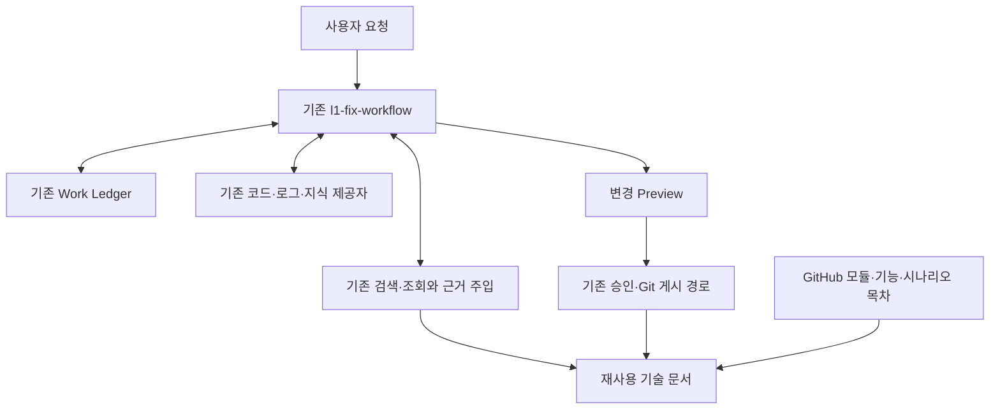

# l1-fix-workflow 기반 개인 L1 Knowledge — RAG·GitHub 문서 포털 검토 요청서

> **문서 유형:** 사내 LLM 검토용 요구사항·현행 기능 조사·최소 변경 설계 가이드
> **문서 버전:** v1.3 / 2026-11-06
> **기준 문서:** `L1_Fix_Workflow_Knowledge_Usecase_Inhouse_Review_v1_2_20261106.md`
> **목표:** 기존 `l1-fix-workflow`를 활용해 담당 module/feature의 **이슈·HLD·상세설계·시나리오별 MSC·feature 개발 진행 이력**을 축적·갱신하고, LLM은 **RAG로 관련 근거를 검색·재사용**, 사용자는 **GitHub에서 module → feature → scenario로 탐색**하는 개인 L1 지식 관리 체계를 정한다.
> **변경 원칙:** U01~U15와 기존 Work/GitHub 계약을 유지하고, 기존 기능 재사용 → 필요한 연결 → 기존 구성요소의 최소 확장 순으로 판정한다. **신규 독립 스킬 개발을 기본안으로 삼지 않는다.**
> **이번 요청의 범위:** 현행 설치본·코드·기존 시험 결과에 대한 읽기 전용 조사와 설계 제안. 허용되는 신규 파일은 검토 결과 MD 2개다. 실제 코드·설정·기존 문서 변경, 설치, 게시, 인덱스 재구축 및 새 파일럿 실행은 이번 요청에 포함하지 않는다.

## 0. 사내 LLM이 먼저 읽을 핵심 요청

1. **목표를 개인 L1 지식 관리의 순환으로 평가한다.** 업무 요청 → 기존 지식 검색·근거 주입 → 기존 전문 스킬 분석 → Work 기록 → 지식 갱신안 → 허용된 반영·게시 → 다음 요청에서 재사용 → GitHub 탐색까지 연결되는지 확인한다.
2. **기존 `l1-fix-workflow`를 중심으로 설계한다.** `module-library scan/lookup/index/preview`, Work 검색·조회·이력, 전문 분석 스킬, `docs-sync`, `l1-github`, 기존 지식 제공자의 실제 구현을 먼저 확인한다. 알려진 명령명은 후보 정보이며 정확한 설치본 계약으로 대체한다.
3. **U01~U15의 ID·의도·기존 활용 시나리오를 유지한다.** RAG와 포털은 이 시나리오를 잇는 공통 경로로 평가한다. 기존 Work/GitHub 기능을 별도 새 체계로 이관하거나 다시 구현하지 않는다.
4. **검색과 RAG를 구분해 실증한다.** 문서 목록을 찾는 것 외에 관련 문서 절을 실제 읽고, 적용 범위를 검사하고, LLM 입력에 주입하고, 답변에 출처를 돌려주는 경로까지 조사한다. 벡터 DB·임베딩·새 검색 서버를 선행 조건으로 고정하지 않는다.
5. **GitHub 문서 포털의 기본안은 기존 저장소의 Markdown 목차·상대 링크·기존 MSC 표시 방식이다.** module → feature → scenario의 실제 탐색과 Work 연결을 우선한다. GitHub Pages나 별도 웹앱은 필요성이 입증된 뒤 선택한다.
6. Work 원장, 재사용 기술 문서, 검색 인덱스, GitHub 표시의 책임을 구분한다. **검색 인덱스는 재생성 가능한 파생 데이터**다. Work 상태와 기술 사실을 검색 결과나 GitHub 문서만으로 자동 확정하지 않는다.
7. **Work ID → `l1-workspace` 문서화·동기화·다른 PC 조회**, 제목+한 줄 요약+유형별 4절 사용자 보기를 필수 조사 범위로 유지한다. 기존 repo role·브랜치·원격 주소·충돌 처리·권한 계약을 그대로 존중한다.
8. 신규 독립 스킬이 필요하다는 결론을 내리기 전에 기존 기능 재사용이 불가능한 구체적인 코드·계약상 근거를 적는다. `BUILD`는 우선 **기존 구성요소 안의 작은 확장**을 의미하며, 신규 스킬 개발 승인으로 해석하지 않는다.
9. 이슈가 없는 기능 개발·설계·학습도 기존 Work 경로로 지원할 수 있는지 확인한다. 이슈/Jira 등록을 지식 관리의 필수 조건으로 만들지 않는다.
10. 실제 업무 1건으로 축적→갱신→검색 재사용→GitHub 탐색을 검증할 **파일럿 계획**과 정확성·검색 시간·수동 개입 측정 방법을 제시한다. 이번에는 새 실행을 하지 않고 기존 실행 근거가 없으면 `NOT_RUN`으로 둔다.
11. 결과는 **사내 상세 검토 MD와 공유 가능한 판정 요약 MD**로 나눈다. 판단 불가·미실행을 명시하고, 후속 결정을 요약 MD 하나로 할 수 있게 작성한다. 개인 GitHub의 실제 사내/사외 구분과 정보 취급 정책은 기존 기준에 따라 확인한다.

## 1. v1.3의 목표와 v1.2에서 유지하는 범위

### 1.1 목표 사용자 경험

사용자는 담당 module/feature를 기준으로 현재 설계와 근거를 확인하고, 새로운 이슈나 기능 개발을 시작할 때 이전 결과를 다시 활용한다. `l1-fix-workflow`는 기존 Work와 전문 분석 경로를 조합하고, 분석에서 얻은 재사용 가능한 사실을 관련 기술 문서의 갱신안으로 연결한다.

- **사용자:** GitHub의 모듈 목차에서 feature를 고르고, HLD·상세설계·시나리오별 MSC·관련 이슈·진행 이력을 한 경로에서 읽는다.
- **LLM:** 관련 문서를 범위에 맞게 검색하고 필요한 절을 입력으로 받아, 답변·분석에 재사용하고 근거 위치를 제시한다.
- **갱신:** 코드·설계·Work의 변경을 기존 문서와 비교해 필요한 부분만 갱신하고, 다음 검색과 포털에서 어느 revision까지 반영됐는지 확인한다.

| 구분 | v1.3의 결정 |
|---|---|
| 추진 단위 | 기존 `l1-fix-workflow` 활용·최소 연결·필요한 내부 확장 |
| 유지 | U01~U15, Work ID/원장/이력/Evidence, Work 사용자 보기, docs-sync, GitHub repo role·승인·충돌·호스트 연속성 |
| 명확화 | 개인 L1 Knowledge의 관리 범위, RAG의 실제 근거 주입, module → feature → scenario 탐색 |
| 기본안에서 제외 | 신규 독립 지식 관리 스킬, Work 원장 교체, 전체 문서 이관, 신규 웹앱·검색 서버·벡터 DB의 의무 도입 |
| 최소 변경의 기준 | 기존 API·ID·폴더·생성기·문서 양식 우선, 부족한 연결만 추가, 변경 대상·이유·회귀 범위 제시 |

### 1.2 후보 코드·리뷰 현황 — v1.2에서 승계한 검증 대상 정보

아래는 **기준 문서에 기록된 2026-11-06 시점의 보고**다. 이 문서에서 최신 ZIP·사내 설치·실행·배포 상태를 새로 확인하지 않았다. 사내 실제 설치본이 다르면 확인된 현행 근거로 표를 갱신한다.

**이 문서는 전달받은 후보 코드·정적 리뷰 보고를 바탕으로 작성한 검토 입력물이며, 사내 설치·실행을 확인한 결과가 아니다.** 아래는 기존 v1.1 이후 추가로 알려진 *후보 코드*의 변경 사항이다.

| 구분 | 확인된 변경/현황 | 검증 한계 |
| --- | --- | --- |
| Workflow 개발 후보 | `l1-fix-workflow v1.6.63` ZIP 후보. 선행 v1.6.61의 module-library 탐색·조회·Preview 설계와 구별 | **사내 설치·공식 배포 미확인**. v1.6.61 → v1.6.63 모든 중간 수정의 실제 사내 반영도 확인 필요 |
| 사용자 기본 Work 화면 | 새 `work_user_view.py`를 기존 조회·Controller·MCP·context resume의 기본 사용자 요약 경로에 연결한 코드가 보고됨 | 사내 Agent가 실제로 이 `user_summary`를 그대로 출력하는지 미검증 |
| 표현 구조 | **제목 + 한 줄 요약(현재 결과/상태와 다음 행동) + 업무 유형별 4절**. 내부 추적 ID·해시·Evidence 건수는 상세/진단으로 이동 | 제목·업무 유형이 실제 작업 내용과 맞는지 별도 확인. 표시 개선이 Work 원장/메타데이터를 자동 정정하지는 않음 |
| 독립 코드 리뷰 | 최신 후보 v1.6.63 **신규 BLOCKING 0**, 비차단: 상태 enum의 자유 문장 내 무차별 치환, 중요 검증 실패 첫 줄 미노출, 전체 길이·모바일 표시 문제 등 | **정적 리뷰**이며 시험 실행·사내 E2E가 아님. 기존 4개 테스트 실패·배포 차단 유지. 앞선 v1.6.61 검색/MCP 차단 결함이 실제 설치본에서 해소됐는지는 별도 판정 |
| GPT 회귀시험 보고 | 신규 18 PASS, 관련 98 PASS/4 FAIL, 26 subtests PASS (독립 리뷰어가 실행하지 않음) | 전체 회귀 미완료. 해당 실패 4개는 기준 버전에서 재현됐다고 보고됐으나 해결·면제가 아님 |
| 운영 우선순위 | 신규 연결/스킬 개발보다 **실제 사내 업무 1건 파일럿**으로 기존 스킬의 정확성·시간·사용자 개입 측정 | 설치/실행·성능 향상 증거를 갖추기 전 자동화 효과를 확정하지 않음 |
| GitHub Work 공유 | `work_docs`와 Work 원장/`module-library` 구분 원칙은 유지 | 현행 `docs-sync`, push, remote readback, Windows/Linux 연속성·보안 승인 실증 필요 |

## 2. 기존 기능을 재사용하는 책임 구조



이 그림의 검색·근거 주입과 목차는 **논리적 역할**이다. 새 스킬·서비스·데이터베이스의 생성 단위로 해석하지 않는다. 현행 구현을 조사해 같은 역할을 맡는 기존 경로에 매핑한다.

| 구성 | 유지·재사용할 책임 | 경계 |
|---|---|---|
| `l1-fix-workflow` | 의도 판별, 기존 Work 선택·연결, 지식 조회, 전문 스킬 위임, 진행·결과 요약, 갱신안 연결 | 코드/로그 엔진과 Work 원장을 재구현하지 않음 |
| 코드·로그·이슈 분석 스킬 | 코드 사실·호출·IPC·상태·타임라인·검증 근거와 문서 초안 | 실제 설치된 정확한 스킬명/API 확인; 단순 조회에서 전체 재분석하지 않음 |
| Work Ledger/Kernel | Work ID·상태·journal·Evidence·결정·다음 행동의 정본 | GitHub 요약이나 feature 이력으로 원장을 대체하지 않음 |
| 기존 모듈·공통 지식 제공자 | 모듈 자료 탐색·조회·scope·Preview, 기존 공통 지식 참조 | 이미 있는 지식의 복제·자동 승격 방지 |
| 기술 문서 정본 | 승인된 이슈 지식·HLD·상세설계·MSC·feature 이력의 재사용 본문 | `module-library/`는 현행 확인 후 쓰는 논리 영역; 실제 기존 위치 우선 |
| 검색 인덱스·검색 어댑터 | 정본에서 생성한 제목·별칭·문서 절·필터·참조 매핑, 검색 결과와 원문 연결 | 원장·기술 사실의 정본 아님; 기존 구현을 먼저 재사용 |
| GitHub 문서 포털 | 동일 기술 문서와 Work 요약의 목차·상대 링크·MSC 미리보기 | 별도 콘텐츠 사본이나 필수 웹서비스를 만들지 않음 |
| 기존 `docs-sync`·`l1-github` | 기존 Work 문서 생성, 검토된 변경 반영, commit/push/readback, 호스트 연속성 | 기술 사실의 진위 판단과 검색 엔진 역할을 대신하지 않음 |

**저장소 역할 유지:** `work_docs`, `source_code`, `knowledge`의 실제 매핑을 먼저 조회한다. `l1-workspace`가 어느 역할에 연결돼 있는지 확인하고, Work 문서·소스 코드·공통 지식의 목적지를 임의로 바꾸지 않는다. 기존 canonical 설정을 재사용하며 새 repo registry나 별도 설정 파일을 먼저 만들지 않는다.

## 3. 개인 L1 Knowledge의 관리 단위와 GitHub 탐색

### 3.1 module → feature → scenario와 Work의 관계

- **module:** 담당 코드/설계 영역과 책임 경계를 설명하는 탐색 단위다. 기존 module ID·명칭·별칭을 먼저 사용한다.
- **feature:** 모듈 안에서 목적·동작·개발 상태를 추적하는 기능 단위다. 여러 Work가 하나의 feature에 연결될 수 있다.
- **scenario:** 특정 진입 조건·상태·이벤트에서의 동작 단위다. 정상/예외 조건과 해당 MSC·상세 동작을 연결한다.
- **Work:** 이슈 해결·기능 개발·설계·학습의 수행 이력 단위다. 하나의 Work가 여러 module/feature/scenario를 참조할 수 있다. 분류 변경으로 Work ID나 기존 경로를 바꾸지 않는다.

여러 모듈에 걸친 feature/scenario는 기존 문서의 대표 위치를 정해 링크한다. 각 모듈에 같은 본문을 복제하지 않는다. 표시 제목 변경 시 안정 ID와 기존 링크의 호환성을 유지한다. module/feature/scenario 분류를 새 Kernel enum으로 추가한다고 전제하지 않는다.

### 3.2 축적할 내용과 소유권

| 지식 종류 | 재사용 기술 문서에 남길 핵심 | Work·다른 자료와의 연결 |
|---|---|---|
| 이슈 지식 | 현상·발생 조건·확인 원인/가설·조치·검증 범위·재발 조건 | 상세 조사·진행 상태의 정본은 기존 Work; feature에서는 기술 제목과 관련 Work를 연결 |
| HLD | 목적·책임·주요 구성·모듈 간 관계·인터페이스·핵심 동작 | 기존 코드 분석/HLD 결과 우선 사용, 근거 코드 revision과 관련 Work 연결 |
| 상세설계 | 상태·조건·데이터·API/IPC·예외·타이밍·설계 결정 | HLD에서 해당 절로 이동, 코드 사실·계획·추론·미검증을 구분 |
| 시나리오별 MSC | 시작 조건·참여 모듈·호출/IPC 순서·핵심 분기·종료/예외 조건 | scenario 본문과 MSC 원본/표시본을 연결, 관련 상세설계·Work와 같은 적용 범위 명시 |
| feature 개발 진행 이력 | 요구·결정·설계 변경·구현·시험·미해결·다음 행동의 의미 있는 변화 | 기존 Work journal·PR·commit에서 요약/링크; 원장을 복사하거나 전체 원시 이벤트를 중복 보관하지 않음 |

기능 개발·개선 Work와 이슈 Work 모두 이 구조를 활용한다. 이력이 쌓일 때 **현재 유효한 설명**과 **과거 판단/구현**을 구분한다. Git commit 이력만으로 설계 결정의 이유나 시험 완료를 대신하지 않는다.

### 3.3 기본 포털 — 기존 Markdown과 상대 링크

아래는 **논리 경로 예시**다. 이미 동등한 파일·템플릿·폴더가 있으면 그 위치를 링크하고, 신규 파일을 중복 생성하지 않는다. 기존 파일을 일괄 이동·이름 변경하거나 모든 feature에 빈 문서를 만들지 않는다.

| 논리 위치 예시 | 사용자가 보는 내용 | 최소 변경 원칙 |
|---|---|---|
| `README.md` | 개인 L1 Knowledge 진입점: module 목록, 최근 유효 문서, 진행 중 Work로 이동 | 기존 최상위 README에 목차 링크 추가 우선 |
| `module-library/README.md` | 기술 제목·별칭으로 찾는 module 목록 | 현행 module-library index/목차 재사용 |
| `module-library/<module_id>/README.md` | 모듈 목적·범위·feature 목록·공통 인터페이스 | 기존 모듈 문서에 feature 링크 연결 |
| `module-library/<module_id>/<feature_id>/README.md` | feature 목적·현재 유효 동작·HLD·상세설계·scenario·이슈/Work·진행 이력 | 기존 feature 문서가 있으면 같은 진입점 사용 |
| `.../<feature_id>/HLD.md` / `DETAIL_DESIGN.md` | HLD와 상세설계 본문 또는 기존 문서 링크 | 한 문서의 절로 이미 관리하면 분리 강제하지 않음 |
| `.../<feature_id>/HISTORY.md` | 여러 Work를 가로지르는 주요 개발 결정·진행·검증 변화 | 기존 이력 절·문서 우선; 현재 상태와 과거 이벤트 구분 |
| `.../<feature_id>/<scenario_id>/README.md` | 시작 조건·동작·예외·관련 상세설계·MSC·Work | 조건이 다른 시나리오는 구분, 공통 설명은 링크 |
| `.../<scenario_id>/MSC.md` | GitHub에서 읽는 시퀀스와 설명, 생성 기준·미검증 | 기존 변환/렌더링 결과 재사용 |
| `.../<scenario_id>/FLOW.puml` 등 | 재생성 가능한 기존 MSC 소스 | 현행 파일명이 있으면 보존; 표시본을 수작업으로 따로 유지하지 않음 |
| `works/<work_id>/` | 해당 Work의 제목·현황·결과·다음 행동·근거/문서 링크 | 기존 docs-sync 생성물과 안정 ID 보존 |

**탐색 수락 기준:** 최상위 진입점에서 module → feature → scenario를 순서대로 선택해 해당 MSC와 설명에 도달하고, 각 단계에 상위·관련 문서 링크가 있어야 한다. feature에서 관련 Work의 기술 제목·최근 결과·다음 행동을 열고, Work에서 관련 feature/scenario로 돌아갈 수 있어야 한다. 필요한 경로만큼 클릭해 도달하는지를 실제로 측정한다.

**GitHub에서 MSC 읽기:** 기존 Mermaid를 사용하면 Markdown 내 시퀀스를, 기존 PlantUML을 사용하면 검증된 변환/렌더링 경로의 SVG/PNG 등 표시본과 원본 링크를 검토한다. `.puml` 파일을 올린 사실만으로 GitHub 미리보기가 된다고 판정하지 않는다. 표시본·원본·설명의 기준 revision이 일치해야 한다. GitHub Pages·별도 프론트엔드·신규 변환기는 초기 필수 범위에 넣지 않는다.

**목차 품질:** ID만 나열하지 않고 기술 제목·범위·관련 항목을 표시한다. 문서가 없거나 미검증이면 해당 상태를 표시한다. 생성 목차가 있다면 생성기와 수동 편집 영역을 구분하고, 목차 재생성으로 수동 설명을 덮어쓰지 않는지 확인한다.

## 4. RAG 검색·재사용과 지식 갱신의 최소 계약

### 4.1 RAG의 필수 동작

RAG는 **검색된 근거를 LLM 입력에 포함해 답변·분석에 사용하는 경로**를 말한다. 현재 검색 방식은 키워드/메타정보/전문 검색/의미 검색 중 무엇인지 실제 구현으로 구분한다. 기존 키워드·메타정보 검색과 문서 절 읽기만으로 요구를 충족하면 이를 먼저 연결한다. 임베딩·하이브리드 검색·벡터 DB는 정확도나 성능의 구체적인 GAP이 있을 때 비교한다.

1. **의도·범위 확인:** 질의에서 module/별칭, feature, scenario, RAT/stack, 코드 루트·브랜치·revision·빌드 등 기존 입력을 해석한다. 정확한 식별자가 있으면 그 범위를 우선한다.
2. **기존 경로로 검색:** 모듈 문서·관련 Work·허용된 공통 지식에서 후보를 찾는다. 접근 권한과 적용 범위를 우선 필터하고, 제목·별칭·본문/절·연관 링크로 관련도를 판단한다.
3. **필요한 원문 절 읽기:** 후보 제목/스니펫에 그치지 않고 답변에 필요한 본문 절과 앞뒤 조건을 읽는다. MSC는 시작 조건·핵심 순서·분기 설명을 함께 읽고 이미지에만 의존하지 않는다.
4. **현재성·충돌 검사:** 문서 revision, 코드 기준, 검증 수준, index 기준을 대조한다. 범위 불일치·미확인·오래된 자료·상충된 주장은 표시하고, 최신 사실처럼 합치지 않는다.
5. **근거 묶음 주입:** 실제 기존 LLM/전문 스킬의 입력에 관련 절·조건·출처를 전달하는 지점을 확인한다. 입력 크기를 제한하고 요약으로 생략한 조건을 표시한다. 단순 문서 링크 나열은 주입 완료가 아니다.
6. **근거 있는 응답:** 답변의 핵심 사실에 문서/절·revision·관련 Work 근거를 연결한다. 문서로 확인된 사실, 코드/로그로 확인한 사실, 추론, 미확인을 구분한다.
7. **필요할 때만 후속 분석:** 근거가 부족하면 미발견/부족 이유와 기존 분석 경로를 제안한다. 조회 요청을 임의의 Work 생성·전체 코드 재분석·게시로 확장하지 않는다.

**최소 근거 묶음(개념 계약):** 질의·대상 범위, 문서 식별자/상대 경로, 관련 절 ID/제목, 실제 원문 발췌, 문서 revision, 적용 코드 범위, 검증 상태, 관련 Work, 검색·읽기 실패/제외 이유. 현행 반환 객체·Evidence·메타정보 필드를 먼저 재사용한다. 새 객체/필드를 일괄 신설하는 요구가 아니다.

**표시 경로:** LLM 답변에는 읽은 문서의 링크와 기준 revision을 연결하고, GitHub 원격 링크는 해당 문서가 실제 반영된 commit/readback 근거가 있을 때 제공한다. 로컬 초안은 로컬 초안으로 표시한다. 현재 브랜치 링크만으로 과거 답변의 근거를 고정했다고 간주하지 않는다.

**빈 결과·불일치·인덱스 장애:** 미발견/권한 부족/범위 불일치/오래된 인덱스를 구분한다. 허용된 원문 직접 조회로 대체할 수 있으면 제한된 범위에서 진행한다. 실패한 검색을 정상 기준으로 사용하거나 없는 근거를 생성하지 않는다. 지식 조회 실패가 기존 Work 조회·코드/로그 분석을 불필요하게 막지 않도록 영향 범위를 분리한다.

**"즉시 검색"의 검증:** 모든 요청마다 전체 분석·전체 인덱스 재구축을 시작하지 않고 기존 지식에서 필요한 근거를 회수하는 것을 우선한다. 현재 질의→관련 근거 준비 시간, 관련 문서 회수 여부, 실제 주입 여부, 근거 없는 주장, 수동 개입을 측정한다. 성능 목표는 파일럿 기준값을 본 뒤 정하며 이번 문서만으로 응답 시간을 보장하지 않는다.

### 4.2 정본과 파생 데이터의 메타정보

| 구분 | 재사용할 메타정보 개념 | 보존 원칙 |
|---|---|---|
| 식별·분류 | 안정 문서 ID 또는 기존 상대 경로, 제목·별칭, module/feature/scenario 참조, 문서 종류 | 기존 ID·경로·메타 형식 우선; 제목과 내부 식별자 분리 |
| 적용 범위 | RAT/stack, 플랫폼/제품, 코드 루트, 브랜치, 코드 revision·빌드 | 모르면 UNKNOWN; 서로 다른 코드 루트/브랜치의 사실을 혼합하지 않음 |
| 근거·상태 | source Work/Evidence/코드 참조, 사실/추론/미확인, 검토·검증 범위 | 문서 승인·게시와 제품 동작 검증은 다른 상태 |
| 버전·현재성 | 문서 revision/해시, 코드 기준, 마지막 확인 시각, 대체된 문서 참조 | 문서 revision과 소스 코드 revision을 별개로 기록 |
| 인덱스·게시 | 인덱스가 읽은 문서 revision, 로컬/원격 기준, published commit, readback 결과 | 별도 상태를 파생 기록; 기존 Kernel 정본 스키마를 임의 확장하지 않음 |

위 항목은 논리적으로 필요한 정보다. 현재 front matter·index·manifest·Git 메타·Ledger 참조에 이미 있으면 재사용하고, 없는 정보 중 실제 수락 시나리오에 필요한 항목만 최소 추가한다. 새 메타정보 파일을 문서마다 반드시 만들지 않는다.

### 4.3 축적·갱신·재사용 순환

1. 기존 Work에서 이슈/feature 개발·분석·설계 결과와 근거를 기록한다.
2. 관련 module/feature/scenario의 기존 문서를 찾아 사실·설계 의도·코드 기준·중복·충돌을 비교한다.
3. 변경이 필요한 절, 연결 Work, 목차·MSC 영향, 기준 revision을 기존 Preview로 제시한다. 재사용 가치가 없는 원시 이벤트는 Work에만 둔다.
4. 실제 적용 권한과 기존 승인 계약을 확인해 허용된 게시 경로로 반영한다. 이미 받은 승인을 그 범위에서 재사용하며 같은 변경에 불필요한 승인을 반복하지 않는다. Preview 자체는 반영/게시가 아니다.
5. 바뀐 문서와 영향을 받는 목차·참조만 갱신한다. 기존 증분 처리 기능을 우선하며, 불가피한 전체 갱신은 대상·비용·이유를 별도 제시한다.
6. 검색 인덱스의 문서 revision을 갱신하고 같은 질의를 다시 확인한다. Git 게시와 인덱싱의 순서는 기존 구조에 맞추되, 로컬 초안/게시본을 섞어 최신본으로 보고하지 않는다.
7. 다음 질의에서 수정된 근거가 실제 주입되고 GitHub 목차·링크·MSC가 같은 게시 기준을 가리키는지 확인한다.

**실패·변경 처리:** 문서 반영·commit·push·remote readback·목차 갱신·인덱스 갱신은 각각 판정한다. 게시 성공 후 인덱싱이 실패하면 미동기화 범위와 revision을 표시하고 기존 유효 지식 조회를 유지한다. 삭제·이동·대체된 문서의 오래된 검색 결과는 현재 지식에서 제외하거나 대체 경로로 연결하고, 기존 Work/Git 이력은 보존한다. 동시 수정에서는 기준 revision 불일치를 감지해 해당 변경 적용을 멈추고 diff를 제시한다.

**기본 검색 범위:** 승인·검토 상태와 게시 여부를 별도로 표시한다. 확정 지식과 작업 초안을 구분하고, 초안까지 검색하는 경우 이를 명시한다. 게시됐다는 이유로 기술 검증 완료로 승격하지 않는다.

## 5. 기존 Work/GitHub 기능과 사용자 보기를 유지하는 계약

### 5.1 Work 원장·Git 문서·기술 지식

| 계층 | 정본·표시 역할 | 유지할 계약 |
|---|---|---|
| Work Ledger/Kernel | Work ID·상태·journal·Evidence·다음 행동의 원장 | 기존 생성·조회·변경·승인 경로 유지 |
| `works/<work_id>/` | 사람용 요약·인계·결정·관련 링크 | 실제 docs-sync 산출 파일명·필드 우선; README/HANDOFF/HISTORY/LINKS 등을 중복 생성하지 않음 |
| module/feature/scenario 기술 문서 | 여러 Work가 재사용하는 현재 동작·설계·MSC | `source_work_ids` 등 기존 참조 우선; 링크와 코드 기준으로 연결 |
| feature 진행 이력 | 여러 Work의 주요 변화·결정·현재 미해결 요약 | 원장 사건을 의미 있는 단위로 연결; Work 종료와 feature 전체 완료를 동일시하지 않음 |
| GitHub 목차·검색 인덱스 | 같은 문서 정본을 사람과 LLM에 제공하는 파생 보기 | 별도 지식 본문·새 Work 원장으로 만들지 않음 |

Work 등록 → 기존 문서 투영 → 승인된 commit/push → remote readback → 다른 PC에서 같은 ID 조회라는 경로를 조사한다. **Work 등록·문서 생성·commit·push·readback**을 별도 결과로 남긴다. GitHub MD를 내려받았다는 이유로 다른 PC의 Kernel 재수화/import까지 완료됐다고 판정하지 않는다.

Windows/Linux 연속성에서는 동일 remote/branch/Work ID·코드 루트·revision을 비교한다. 변경 전 dirty/diverged·상대 수정·권한을 확인하고 기존 충돌 해결 절차를 유지한다. 임의의 reset/stash/rebase/force-push·기존 Work 경로 재구성은 이번 범위에 없다.

### 5.2 사용자 보기와 두 가지 탐색

- **업무 중심 보기:** 기술 제목·필요시 실제 Jira 번호·현재 결과·다음 행동·차단 사유·마지막 확인 시각으로 기존 Work를 찾는다.
- **지식 중심 보기:** module → feature → scenario에서 HLD·상세설계·MSC·이슈·개발 이력·관련 Work를 연다.
- 같은 데이터의 연결을 사용한다. 상태·업무 목적이 바뀌어도 Work 경로는 안정적으로 유지한다. 제목이 없거나 부정확하면 내용을 임의 추정하지 않고 확인 필요로 표시한다.

단건 Work의 기존 **기술 제목 → 한 줄 요약(현재 결과/상태 + 다음 행동) → 유형별 4절** 계약을 유지한다. 후보 구현 `user_summary`를 사내 Agent/MCP/CLI가 실제 사용하는지는 별도 확인한다.

| 업무 목적 | 유지할 4개 절 | 판정 주의 |
|---|---|---|
| 이슈 해결 | 문제 / 현상 / 원인 / 진행상황 | 원인 승인·근거 사람 검토·제품 검증 분리 |
| 기능 개발·개선 | 목적 / 현재 동작 / 변경 내용 / 진행상황 | 설계·구현·시험·납품·게시를 별도 판단 |
| 기능 이해·지식 정리 | 대상 / 핵심 동작 / 근거와 미확인 / 진행상황 | 소스 사실·추론·미확인·문서 게시 분리 |

내부 Work/Evidence ID·건수·해시·enum·실행 로그는 기존 상세/진단에 유지한다. 실패·차단은 첫 화면에서 보이게 하고, 자유 문장의 `VERIFIED`/`FAILED` 같은 문자열을 무차별 치환하지 않는지 확인한다. 포털 추가로 기존 사용자 요약 UI를 중복 개발하지 않는다.

### 5.3 반드시 확인할 Work/GitHub 구현 항목

| 조사 항목 | 확인할 근거·판정 |
|---|---|
| repo role·목적지 | `work_docs`/`source_code`/`knowledge` 실제 설정, remote/branch/visibility; 역할 혼동·무단 변경 여부 |
| Work 등록·문서 생성 | Kernel 생성/조회 API, docs-sync 실제 파일·템플릿·책임, 중복 생성 방지 |
| 문서 정합성 | 원장→요약 투영의 기준·오류·재현성; 지식 갱신으로 원장 데이터가 변하지 않는지 |
| 게시 | Preview·승인 범위, commit/push/readback, 허용 경로·권한·실패 보고 |
| 호스트 연속성 | READ_ONLY_HANDOFF / TRUE_RESUME / UNKNOWN; Kernel import/연결 근거를 별도 확인 |
| 양방향 추적 | Work↔feature/scenario·지식 링크, 존재하지 않는 참조·같은 제목·다중 모듈 처리 |
| 충돌·보안 | dirty/diverged·동시 수정·반출 분류·권한 오류 시 기존 동작 유지 |

개인 GitHub가 사외 호스팅이면 private 여부와 별개로 허용 자료·저장소·권한을 확인한다. 제한된 소스·로그·원본 Evidence를 자동 게시하지 않는다. 게시가 제한되면 승인된 사내 위치의 정본을 유지하고, 허용되는 최소 문서만 연결하거나 GitHub 게시를 보류한다.

## 6. 현재 파악된 l1-fix-workflow 기능과 검증 수준

**참고 기준:** `v1.6.61`은 모듈 라이브러리 기능의 선행 후보이며, **최신 확인 후보는 `l1-fix-workflow v1.6.63`**이다. v1.6.62를 기준으로 사용자 화면 기능이 추가됐다는 보고만 있으며, 현재 사내 설치본의 버전/중간 수정·테스트는 반드시 직접 확인한다.

| 기능 영역 | 현재 파악된 내용 | 현행 판정 | 사내에서 반드시 확인할 사실 |
|---|---|---|---|
| 자연어 업무 흐름 | 이슈/분석/개선 요청을 Work 중심으로 다루는 기존 경로 | 기존 기반(환경 검증 필요) | 실제 intent 분류, 호출 경로, 누락 분기 |
| Work ID·이력 | 기존 Work 검색·조회·상태·근거·다음 작업 연계 | 기존 기반(환경 검증 필요) | 등록/조회/검색 API, 예외, 저장 위치, 출력 품질 |
| **기본 Work 사용자 요약** | v1.6.63 후보 `work_user_view`의 제목+한 줄 요약+유형별 4절; 상세/진단 분리 | **후보 코드 구현·정적 리뷰 완료, 사내 E2E 미검증** | 사내 Agent/MCP/CLI 실제 출력, 승인·검증 구분, 실패 경고, 모바일 가독성 |
| 개인 GitHub `l1-workspace` Work 인계 | `work_docs`의 `works/<work_id>/` 문서화·docs-sync·원격 게시/다른 PC 조회 연결 | **현재 사내 구현 재검증 필요** | repo role/remote/보안정책/생성자/commit·push·readback/Windows·Linux 재개 |
| 전문 스킬 연계 | 코드·로그·이슈 분석 제공자 선택 및 위임 경로 | 부분 지원 추정 | 자동 라우팅인지, 사용자 선택인지, 실제 스킬 이름 |
| `module-library scan` | 로컬 모듈 자료 탐색·검사 후보 | **v1.6.61 후보 구현** | 커맨드 진입·인덱싱 범위·사내 저장소 연결 |
| `module-library lookup` | 모듈 ID/제목/조건 기반 조회 후보 | **v1.6.61 후보 구현** | 검색 방식·필터 조건·누락/중복 처리 |
| `module-library index` | 모듈 목차/메타정보 생성 후보 | **v1.6.61 후보 구현** | 출력 포맷·정렬·범위·안정성 |
| `module-library preview` | 변경 초안·기준 revision 등 비교 후보 | **v1.6.61 후보 구현, 읽기 전용** | 파일 무수정, Git write 없음, 기준 불일치 시 차단 |
| 자동 모듈 지식 주입 | 모든 Work/분석 진입에서 적절한 지식 자동 검색·선택 | **미연결/미검증** | CLI, Controller, MCP의 경로 차이 |
| 지식 자동 저장·승인·게시 | 분석→Evidence→Preview→승인→Git 반영 | **통합 미완성** | 구현 제공자 존재 여부·승인 계약 |
| Work 목록 및 MCP 읽기 경로 | 과거 v1.6.61 리뷰에서 차단 결함 2건 지적, 이후 후보 버전 존재 | **현행 설치본/중간 수정에서 해소 여부 확인 필요** | Work 검색 건수/has_more와 MCP `plan --read-only`가 동일 보기를 사용하는지 |
| 사용자 요약 비차단 검토 사항 | 자유 문장 enum 치환, 전달 검증 실패의 요약 누락, 모바일 분량 | **v1.6.63 독립 정적 리뷰 발견** | 현재 구현·실제 화면 재현/보완 필요성 판단 |

### 중요 품질 경고

- `v1.6.61`에 대한 독립 코드 리뷰에서는 `module-library` 주요 정적 검사 경로에서 신규 차단 결함이 발견되지 않았다고 보고되었으나, **Work 검색 결과 건수 처리와 MCP 읽기 전용 경로에서 차단 결함 2건**이 지적되었다. 따라서 `v1.6.61 전체가 배포·운영 가능`하다는 의미가 아니다.
- CLI `plan`을 통해 가능한 의도 분류와 Controller 직접 호출 경로의 연동 수준은 다를 수 있다.
- `preview`는 **쓰기 동작이 아닌 비교·제안**으로 다룬다.
- 최신 v1.6.63 독립 리뷰는 **신규 차단 결함 0건**이며 **시험 실행이 아닌 정적 리뷰**다. 기존 배포 차단과 알려진 실패 4건은 유지된다. 실제 설치 버전/패치로 과거 결함이 해소됐을 가능성은 있으므로 **사내 현행 코드와 회귀시험 결과로 재판정**한다.
- 신규 사용자 화면 코드는 `user_summary`를 기본 조회/Controller/MCP/resume에 연결하도록 작성됐지만, **사내 Agent의 렌더러가 이를 실제 이용하는지**는 별도 E2E 확인이 필요하다.

## 7. U01~U15 유지와 v1.3 적용

### 7.1 기존 시나리오 매핑

아래 U01~U15의 ID·목표·세부 흐름은 v1.2에서 유지한다. **기존 지원 수준은 현행 조사 전의 가설**이다. RAG·포털·feature 이력은 다음 연결을 공통으로 평가한다.

- **검색·재사용:** U01/U04/U05/U12/U13/U14에서 검색→관련 절 읽기→scope 검사→근거 주입→출처 응답을 확인한다.
- **문서 축적:** U02/U03/U07/U15 결과를 HLD·상세설계·시나리오 MSC로 연결한다.
- **갱신·이력:** U06/U08/U09/U10/U11에서 변경 Preview·부분 갱신·feature 진행 이력·목차/인덱스 정합성을 확인한다.
- **기존 Work/GitHub:** 모든 U에서 기존 Work의 필요 여부·연결·표시·동기화 계약을 유지한다. RAG 검색을 새 이슈/Work 생성의 의무 조건으로 만들지 않는다.

> 상태 용어: **기존 기반**=기존 처리 경로가 알려졌으나 현행 운영 검증 필요, **후보 구현**=개발 후보 코드 기능, **부분 지원**=관련 도구는 있으나 목표 시나리오 전체 미완성, **설계·연계**=통합 연결이 핵심 미구현. 아래는 사내 재검증을 위한 **초기 가설**이다.

| ID | 사용자가 달성하려는 일 | 기존 후보 기능 | 현재 초기 판정 | 핵심 GAP |
|---|---|---|---|---|
| U01 | TX Switching 자료 찾기 | module-library `lookup/index` | 후보 구현 | 설치·정확도·적용 범위 확인 |
| U02 | 모듈 전체 구조 이해 | 코드 분석 제공자 | 부분 지원 | 구조 문서와 최신 근거의 연결 |
| U03 | DRX 복귀 등 상세 동작 분석 | 함수/상태/IPC 코드 분석 | 부분 지원 | 런타임 근거/조건 누락 방지 |
| U04 | 유사 이슈/기존 Work 찾기 | Work 검색·이슈 분석 | 부분 지원 | 모듈 지식과 의미 기반 재사용 |
| U05 | 신규 로그를 정상 동작과 비교 | 로그 분석+Work | 부분 지원 | 기준 지식 자동 선택·범위 검사 |
| U06 | 기능 변경의 영향 분석 | 코드 분석+변경 작업 관리 | 부분 지원 | 문서/모듈 자동 영향 연결 |
| U07 | 이슈 없는 사전 코드 분석 | 코드 분석→초안 | 기존 기반 | 산출물 양식 및 Work 유무 정책 |
| U08 | 분석 결과를 모듈 지식에 저장 | Evidence+`preview` | 설계·연계 | 승인·실제 저장·게시 트랜잭션 |
| U09 | HLD·Work·코드 자료 통합 | 읽기·분석 기능 | 설계·연계 | 출처·중복·충돌·승인 처리 |
| U10 | 최신 코드로 지식 갱신 | revision 비교+`preview` | 후보 구현 | 안전한 반영·배포 검증 |
| U11 | 코드 변경으로 영향받는 문서 찾기 | 코드 분석/리비전 참조 | 부분 지원 | 자동 역방향 인덱스 |
| U12 | RAT/빌드/적용 코드 범위 확인 | 문서 메타정보 필터 | 후보 구현 | 실행 환경의 권위 있는 값 확인 |
| U13 | 모듈 지식↔관련 Work 추적 | Work 조회·Evidence | 기존 기반(연결은 조건부) | 양방향 링크·유효성 확인 |
| U14 | 공통 지식→모듈 상세 지식 이동 | 기존 지식 제공자 | 설계·연계 | 링크·검색·버전 정합성 |
| U15 | HLD가 없는 블록의 최초 HLD 작성 | 코드 분석→문서 초안 | 부분 지원 | 종합 검증·초안 리뷰·등록 절차 |

### 7.2 시나리오별 상세 사용 흐름 및 검증 질문

#### U01 — 모듈 지식 검색·목차 확인

- **예시 요청:** “TX Switching 모듈 관련 최신 기술 자료와 목차를 찾아줘.”
- **입력:** 모듈명/별칭, 선택적 RAT/브랜치/빌드.
- **기대 처리:** 모듈 식별 → 후보 문서 검색 → 제목·버전·scope·갱신 시점 표시 → 상세 조회 선택.
- **기대 출력:** 문서 후보 목록, 정확한 근거 위치(사내), 검증된 적용 범위, 못 찾은 이유.
- **검토:** `scan/lookup/index`가 실제 사용 가능한가? 동명이인 모듈, scope 미일치, 오래된 문서를 어떻게 처리하는가?

#### U02 — 블록 전체 구조 이해

- **예시 요청:** “NR TX ON Procedure 전체를 현재 코드 기준으로 함수 호출과 IPC까지 설명해줘.”
- **입력:** 기능명, 기준 브랜치/리비전, 탐색 시작 코드.
- **기대 처리:** 기존 지식 후보 조회 → 코드 구조 분석 전문 스킬 → 문서와 코드 차이 비교.
- **기대 출력:** 주요 컴포넌트, Call Flow/MSC 초안, 코드 근거, 불확실 항목.
- **검토:** 이미 구현된 코드 분석·HLD 생성 스킬은 무엇인가? Workflow가 결괏값을 Work와 연결하는가?

#### U03 — 상세 상태·타이밍·IPC 분석

- **예시 요청:** “DRX 복귀 시 TX 재개 조건과 IPC 순서를 분석해줘.”
- **입력:** RAT/stack, 실행 조건, 관련 코드·로그(접근 허용 범위).
- **기대 처리:** 상태 전이, 조건분기, 시간 의존성, 상위/하위 IPC를 코드 근거로 추적.
- **기대 출력:** 단계별 시퀀스, 정상/예외 분기, 재현·검증 필요 조건.
- **검토:** 정적 분석만으로 확인된 사실과 런타임 미확인 가설을 구분하는가?

#### U04 — 유사 이슈 및 과거 분석 재사용

- **예시 요청:** “이번 TX ON 이상과 비슷한 과거 Work를 찾아줘.”
- **입력:** 증상, 코드/모듈 범위, 선택적 이슈 식별자.
- **기대 처리:** Work 검색 → 후보 사건의 현상·원인·조치·검증 근거 비교 → 관련 지식 제안.
- **기대 출력:** 유사 후보, 유사/차이 근거, 재사용 가능/불가 판단.
- **검토:** 키워드 검색과 의미 기반 검색 중 어떤 수준인가? 잘못된 Work 건수/중복/권한 문제는 없는가?

#### U05 — 신규 로그와 기존 정상 동작 비교

- **예시 요청:** “새 로그의 TX ON 이후 RF 동작을 기존 정상 시퀀스와 비교해줘.”
- **입력:** 승인된 로그 위치, 분석 범위, 정상 기준 코드·문서 버전.
- **기대 처리:** 로그 제공자 선택 → 타임라인 분석 → 적용 가능한 정상 지식 식별 → 차이·가설 정리.
- **기대 출력:** 차이점, 증상 타임라인, 근거 출처, 재현·추가 로그 요청, Work 기록.
- **검토:** 현행 로그 분석 스킬과 Workflow가 연결됐는가? 기준 지식은 자동 주입되는가?

#### U06 — 변경 영향 분석

- **예시 요청:** “TX ON 수정이 DRX, TxSwitchMngr, IPC 경로에 미치는 영향을 검토해줘.”
- **입력:** 변경 diff 또는 변경 요청, 기준 리비전, 관련 모듈.
- **기대 처리:** 호출·데이터 흐름 영향 분석 → 관련 테스트·HLD/지식 후보 탐색.
- **기대 출력:** 직접/간접 영향, 위험 조건, 권장 회귀시험, 관련 Work.
- **검토:** 코드 영향과 문서 영향이 각각 어느 범위까지 자동으로 연결되는가?

#### U07 — 이슈가 없는 사전 코드 분석

- **예시 요청:** “문제가 없어도 NR TX Config 구조를 정리해줘.”
- **입력:** 모듈, 브랜치, 분석 목적.
- **기대 처리:** Work 신규 생성 정책 확인 → 코드 분석 스킬 실행 → 사실/추정/공백 구분.
- **기대 출력:** 구조 설명, HLD 초안 후보, 확인되지 않은 조건, 재사용 가능 결과.
- **검토:** Jira 이슈가 없어도 Work 등록/조회가 가능한가? 불필요한 Work 생성을 막는가?

#### U08 — 분석 결과를 모듈 기술 지식으로 축적 (최중요)

- **예시 요청:** “이번 분석에서 확인한 사실을 기존 TX ON 지식과 비교해 갱신안을 보여줘.”
- **입력:** Work Evidence, 확인된 코드 기준, 기존 모듈 문서.
- **기대 처리:** 사실 추출 → scope/중복/충돌 검사 → 변경 Preview → 사용자 승인 → 승인된 게시 제공자 반영.
- **기대 출력:** 변경 diff 요약, 근거, 승인/거절 기록, 반영 결과 또는 보류 이유.
- **검토:** 현재 구현된 것은 조회·Preview뿐인가? 실제 쓰기/게시 주체와 승인 게이트는 있는가?

#### U09 — 흩어진 자료를 하나의 지식으로 통합

- **예시 요청:** “기존 HLD와 여러 Work에서 검증된 내용을 모듈 문서로 정리해줘.”
- **입력:** 관련 HLD, Work, 코드 근거, 출처 메타정보.
- **기대 처리:** 출처 수집 → 버전·scope별 그룹화 → 중복 제거 → 충돌 탐지 → 통합 초안 작성.
- **기대 출력:** 일치/충돌/근거 부족 표와 통합 초안.
- **검토:** 원문 연결과 버전 간 정합성 검사가 가능한가? 자동 병합은 승인 없이 하지 않는가?

#### U10 — 현재 코드 기준 지식 갱신

- **예시 요청:** “현재 코드에서 바뀐 TX Switching 동작을 기존 문서에 반영하기 전에 비교해줘.”
- **입력:** 이전 문서 리비전, 비교할 코드 리비전/브랜치.
- **기대 처리:** 기준 유효성 → 변경 사실 식별 → 지식 변경 Preview → 승인된 반영.
- **기대 출력:** 유지/수정/삭제 권고, 근거, 변경 영향, 보류 사유.
- **검토:** 코드 변경을 실제로 추적하는가, 아니면 제공된 메타정보를 비교하는 수준인가?

#### U11 — 코드 변경과 연결된 문서 영향 탐색

- **예시 요청:** “이번 IPC 변경으로 수정이 필요한 HLD/모듈 문서를 찾아줘.”
- **입력:** 변경 파일·함수·API, 코드 리비전.
- **기대 처리:** 코드 요소→지식 문서 참조 매핑 → 영향 후보 분류.
- **기대 출력:** 문서별 영향 후보, 근거 매핑, 자동 확정 불가 항목.
- **검토:** 참조 역인덱스가 있는가? 미참조 문서에 대한 누락 경고가 있는가?

#### U12 — RAT/빌드/적용 범위 검사

- **예시 요청:** “이 TX 동작 설명이 NR/LTE, 특정 빌드와 브랜치에서도 유효한가?”
- **입력:** RAT, 제품/플랫폼, 브랜치, 빌드, 코드 리비전.
- **기대 처리:** 문서 scope와 현재 입력 범위 비교; 불일치는 명시.
- **기대 출력:** 적용 가능/조건부/불일치/알 수 없음 판정과 근거.
- **검토:** 실제 환경 정보를 신뢰 가능한 데이터 소스에서 조회하는가, 사용자 입력만 반영하는가?

#### U13 — 모듈 지식과 Work 이력의 양방향 추적

- **예시 요청:** “이 모듈 설명의 근거가 된 Work들과 이후 수정 이력을 보여줘.”
- **입력:** 지식 문서/절 ID 또는 Work ID.
- **기대 처리:** 참조 링크 확인 → Work 근거/승인/개정 이력 조회 → 문서 scope 비교.
- **기대 출력:** 근거 Work 목록, 관련성, 링크가 끊긴 항목.
- **검토:** 참조 관계를 어디에 저장하는가? Work와 지식 문서 간 소유권은 분리됐는가?

#### U14 — 그룹 공통 지식에서 모듈 상세로 탐색

- **예시 요청:** “공통 L1 개념을 본 뒤 해당 TX 상세 모듈 구현으로 이동하고 싶어.”
- **입력:** 공통 개념/기술 키워드, RAT.
- **기대 처리:** 공통 지식 검색 → 구현 모듈 후보 탐색 → 범위/버전 검사 → 세부 문서 제시.
- **기대 출력:** 개념→모듈→실제 코드/관련 Work 탐색 경로.
- **검토:** 현재 관련 지식 제공자 사이 링크 계약이 정의·구현돼 있는가?

#### U15 — HLD가 없는 블록의 최초 기술 문서 작성

- **예시 요청:** “HLD가 없는 모듈을 분석해 최초 HLD 초안을 만들어줘.”
- **입력:** 모듈명, 관련 코드 범위, 기존 Work/검증 로그.
- **기대 처리:** 코드 분석 → 근거 수집 → 누락 확인 → 구조/시퀀스/HLD 초안 → 리뷰.
- **기대 출력:** 검토 가능한 HLD 초안, 확인/미확인 구분, 승인 대기 상태.
- **검토:** 초안 생성 스킬이 이미 있는가? 초안과 권위 있는 확정 HLD가 분리되는가?

## 8. 교차 검토 항목

1. **진입점 일관성:** CLI `plan`, Controller, MCP, 사내 Agent의 지원 범위와 검색·근거 주입·사용자 표시가 같은 계약인가?
2. **읽기 전용:** 조회/Preview 요청이 기존 지식·원장·Git을 수정하거나 인덱스를 재구축하지 않는가? 이름이 `index`여도 생성/쓰기 명령이면 이번에는 실행하지 않고 코드·기존 결과만 읽는다.
3. **범위·근거:** 코드 루트·RAT/stack·브랜치·revision·빌드·문서 검증 수준을 구분하고 모르는 정보는 미확인으로 남기는가?
4. **지식 재사용:** 원문 절을 실제 LLM 입력으로 전달하는가? 출처·적용 조건·분석과의 차이를 추적할 수 있는가?
5. **지식 신뢰:** 검색 문서의 내용은 업무 근거로 취급하며 그 안의 지시문이 도구 권한이나 승인 정책을 바꾸지 않는가?
6. **실패 격리:** 잘못된 문서·빈 검색·오래된 인덱스가 기존 Work/전문 스킬 흐름 전체를 불필요하게 막지 않는가?
7. **갱신 정합성:** 문서 정본·MSC 원본/표시본·목차·인덱스·게시 commit이 서로 어느 기준인지 보이는가?
8. **기능 개발:** 이슈 없이 HLD/상세설계/MSC/feature 진행 이력을 축적·갱신할 수 있는가?
9. **현재와 과거:** feature의 현재 설명, Work 진행 상태, 과거 설계 결정, 과거 검증 결과가 구분되는가?
10. **제공자 선택:** 이미 적합한 기본 제공자가 있으면 재사용하고, 실질적으로 선택이 필요한 경우에만 후보·차이·권장안을 제시하는가?
11. **GitHub 탐색:** module→feature→scenario·상위 이동·관련 Work·MSC가 실제 상대 링크로 연결되는가?
12. **원장·호스트:** Git 요약과 Kernel 정본이 구분되고 Windows/Linux에서 같은 Work를 찾고 재개하는 수준이 명확한가?
13. **승인·권한:** 기존 승인 범위·게시 권한·정보 취급 정책을 유지하고 기술 승인·검증·게시를 혼동하지 않는가?
14. **회귀:** 기존 Work 검색 건수·has_more·조회/수정·유형별 4절·MCP 읽기·docs-sync·Git 동작이 유지되는가?
15. **최소 변경:** 모든 제안이 재사용 대상·부족한 연결·변경 파일/계약·필요성·회귀 영향·보류 범위를 구체적으로 갖는가?

## 9. 사내 조사 순서와 판정 기준

### 9.1 한 번의 조사에서 끝낼 범위

1. 설치된 정확한 스킬·버전·진입점, 기존 문서 저장소/폴더/생성기·repo role을 읽는다. 문서상 기능·실제 코드·기존 실행 결과를 구분한다.
2. U01~U15와 Work/GitHub를 현행 함수·명령·출력·시험 근거에 매핑한다. 등록만 있고 실제 진입 함수/의존 제공자가 없는 경우를 구분한다.
3. 기존 문서 1개와 관련 Work/feature/scenario를 표본으로 **이미 존재하는** 검색·조회·근거 주입·목차·게시·재개 근거를 추적한다. 없으면 GAP으로 남긴다.
4. RAG·GitHub 탐색·feature 이력에서 REUSE/CONNECT/BUILD/DEFER를 판정하고 변경 대상을 한정한다. 현행 코드 구조와 비교한 최소 변경안을 적는다.
5. 후속 파일럿과 회귀시험 계획을 적고 상세본·요약본을 저장한다. 승인이나 현장 확인이 필요한 질문은 핵심 항목으로 모아 최대 3개만 적는다. 결과 전달을 위해 장문의 수동 답변을 요구하지 않는다.

### 9.2 기능·증거·개선 판정

| 분류 | 값 | 의미 |
|---|---|---|
| 기능 충족 | FULL / PARTIAL / NONE / UNKNOWN | 요구 충족 / 일부 / 미지원 / 정보 부족 |
| 증거 E3 | 사내 실제 흐름 시험 근거 | 환경·조건·결과·시점 확인; 이번 실행과 과거 결과 구분 |
| 증거 E2 | 실제 코드 경로 확인 | 구현은 있으나 해당 경로 실행 검증 부족 |
| 증거 E1 | 문서·스킬 설명만 확인 | 구현/동작을 보증하지 않음 |
| 증거 E0 | 확인 자료 없음 | 미확인과 미구현을 구분해 기술 |
| 개선 REUSE | 기존 기능 그대로 활용 | 필요한 설정·운영 조건만 명시 |
| 개선 CONNECT | 기존 경로 사이 연결 | 라우팅·근거 입력·링크·목차·메타 매핑 등 최소 변경 |
| 개선 BUILD | 기존 구성요소의 필요한 확장 | 재사용 불가 근거·최소 범위·회귀 영향 필수; 신규 독립 스킬은 별도 판단 |
| 개선 DEFER | 보류 | 필요성/권한/근거가 부족하거나 초기 목표에 불필요 |

같은 U에서도 세부 기능별 판정이 다를 수 있다. FULL/E1을 운영 완료로 보고하지 않는다. 후보 코드·정적 리뷰·GPT 시험 보고·사내 실행·설치·공식 배포는 별개다. 표의 값은 검토용이며 새 Kernel enum 정의가 아니다.

### 9.3 우선순위와 단계별 완료 기준

| 단계 | 우선 범위 | 완료 기준 |
|---|---|---|
| P0 현행·품질 확인 | 설치본, 기존 검색/MCP 차단 이력·실패 4건, Work 사용자 보기·repo role·파일럿 조건 | 현재 영향과 증거·미확인을 정리; 신규 UI/인프라 개발을 선행 조건으로 삼지 않음 |
| P1 최소 지식 순환 | 담당 module/feature 1개, scenario 1개, 기존 Work·HLD/설계/MSC 활용, RAG 실제 근거 주입, Markdown 탐색 | 축적/갱신 근거가 다음 질의에서 재사용되고 포털에서 같은 기준으로 도달하는 파일럿 설계 |
| P2 갱신·연속성 보강 | U08/U10/U12/U13, feature 이력, 부분 갱신·인덱스/목차 현재성·호스트 연속성 | 기존 Work/Git 계약을 유지하면서 필요한 연결과 회귀 범위를 확정 |
| P3 필요성 확인 후 확대 | U09/U11/U14/U15의 넓은 자동 통합·역추적·최초 HLD 자동화, 의미 검색·별도 포털 옵션 | 측정된 GAP이 기존 기능으로 해결되지 않을 때만 범위 확정 |

P3는 해당 U를 제외한다는 뜻이 아니다. U01~U15는 이번에 모두 조사하고, 기존 기능으로 가능한 부분은 즉시 재사용 대상으로 판정한다. 추가 자동화 규모만 뒤 단계로 둔다.

**파일럿 계획:** 결과를 아는 허용된 L1 이슈 또는 기존 feature 개발 Work 1건을 고른다. module/feature와 정상·예외 scenario 중 1개를 정하고, HLD·상세설계·MSC·이슈/Work·개발 이력이 어디서 연결되는지 본다. 첫 질의와 관련 두 번째 질의의 근거 정확성·범위 오류·검색/근거 준비 시간·수동 개입·GitHub 탐색 경로를 측정한다. 새 파일럿은 이번에는 `NOT_RUN`이며, 기존 기록이 있을 때만 실제 시험 근거로 인용한다. 로그 부재 등은 기존 분석 재요청 선택 경로와 차단 사유를 제시하고 임의로 재실행하지 않는다.

## 10. 산출물 계약 — 상세본과 공유 요약본

### 10.1 사내 상세 검토본

**권장 파일명:** `L1_KNOWLEDGE_RAG_PORTAL_INTERNAL_AUDIT_v1_3_20261106.md`

1. 조사 일자·환경·설치 스킬/버전·실제 진입점과 후보 보고와의 차이.
2. U01~U15 전체의 기능/증거/개선 판정, 코드·기존 시험·예외·GAP.
3. Work/GitHub의 실제 폴더·생성기·repo role·commit/push/readback·Windows/Linux 재개·충돌/권한 계약.
4. 기술 문서의 현행 위치와 이슈/HLD/상세설계/MSC/feature 이력의 소유권·양방향 링크.
5. RAG의 실제 검색 방식·원문 읽기·scope 검사·근거 입력 지점·답변 출처·실패 처리·index 기준. 제목 검색만 확인되면 그 수준을 명시.
6. GitHub의 실제 module→feature→scenario 경로·상위/관련 Work 링크·MSC 표시와 누락.
7. 기존 기능 재사용 목록과 최소 변경 명세: **대상 구성요소/기존 계약 → 부족한 연결 → 변경 파일/필드 → 이유 → 호환성/회귀 → 보류 범위**.
8. 파일럿·회귀 계획, 실행 여부·미해결·필요한 핵심 결정과 다음 한 동작.

내부 코드 경로·함수·정확한 Work/Jira/로그/내부 URL 등 상세 근거는 필요할 때 이 파일에만 둔다.

### 10.2 공유 가능한 판정 요약본

**권장 파일명:** `L1_KNOWLEDGE_RAG_PORTAL_DECISION_SUMMARY_v1_3_20261106.md`

**분량 목표:** 약 5~8KB, 최대 약 160줄. 요약본 하나로 다음 설계 판단이 가능하게 한다. 정보 취급 정책을 통과한 내용만 포함하고 허용되지 않으면 공유하지 않는다. 아래 템플릿의 핵심 행을 채운다.

```markdown
# 개인 L1 Knowledge — 기존 Workflow RAG·GitHub 포털 검토 요약

- 검토 일자 / 현행 Workflow 버전:
- 범위: 읽기 전용 조사 / 기존 실행 근거와 이번 조사 구분
- 목표: 기존 Workflow 활용, 지식 축적·갱신·RAG 재사용·module→feature→scenario 탐색
- 신규 독립 스킬: 기본안 제외 / 예외 제안 시 이유와 별도 판정
- 근거 수준: E3 __ / E2 __ / E1 __ / E0 __

## 1. 결론

- 그대로 재사용:
- 최소 연결:
- 필요한 기존 기능 확장 / 보류:
- 기존 차단·현재 영향·미확인:

## 2. U01~U15 판정

| ID | 충족 FULL/PARTIAL/NONE/UNKNOWN | 증거 E0~E3 | 개선 REUSE/CONNECT/BUILD/DEFER | 핵심 GAP |
|---|---|---|---|---|
| U01 | | | | |
| U02 | | | | |
| U03 | | | | |
| U04 | | | | |
| U05 | | | | |
| U06 | | | | |
| U07 | | | | |
| U08 | | | | |
| U09 | | | | |
| U10 | | | | |
| U11 | | | | |
| U12 | | | | |
| U13 | | | | |
| U14 | | | | |
| U15 | | | | |

## 3. 지식·RAG·포털

- 정본 / Work / index 책임:
- 이슈·HLD·상세설계·scenario MSC·feature 이력 현행 지원:
- 검색 방식 / 원문 절 읽기 / 실제 근거 주입 지점 / 답변 출처:
- scope·오래된 문서·충돌·빈 결과 처리:
- 문서 갱신→index/목차 반영 / revision 확인:
- GitHub module→feature→scenario 실제 경로 / MSC 표시 / Work 왕복 링크:

## 4. 기존 Work/GitHub 유지

- repo role·목적지 확인: VERIFIED / MISMATCH / UNKNOWN
- docs-sync / commit / push / readback 지원 수준:
- Windows/Linux: READ_ONLY_HANDOFF / TRUE_RESUME / UNKNOWN
- 제목+요약+유형별 4절 실제 표시 / 실패·차단 노출:
- 충돌·권한·반출 정책: ALLOWED / LIMITED / BLOCKED / UNKNOWN

## 5. 최소 변경과 검증

| 대상 기존 기능 | 재사용 / 필요한 작은 변경 | 이유·완료 기준 | 회귀 범위 |
|---|---|---|---|
| | | | |
- 파일럿 계획 / 기존 실행 근거 / 이번 NOT_RUN 항목:
- 검색·정확성·수동 개입·GitHub 탐색 측정:
- 미해결 / 필요한 핵심 결정(최대 3개):

## 6. 다음 한 동작

- [기존 기능을 활용하는 구체적인 후속 1개]
```

**공유 요약 규칙:** 사내 소스·로그 원문, 상세 IPC/시스템 파라미터, 사용자/장비 식별정보, 계정·토큰·키·인증, 사내 전체 경로·내부 URL·제한 설계는 제외한다. 정책상 불명확한 제품/플랫폼명·스킬 버전·재현법은 익명화하거나 생략한다. 익명 표기와 상세 근거의 매핑은 사내 상세본에만 남긴다. 짧은 요약도 공유 허용 판정을 대신하지 않는다.

## 11. 수락 조건과 회귀시험 계획

### 11.1 v1.2의 기존 T01~T21 유지

다음은 시험 **계획/수락 조건**이며, 이 문서 작성으로 실행·통과한 시험이 아니다. 기존 실행 결과를 인용할 때 대상 버전·환경·시점을 함께 적는다.

| 테스트 | 예시 | 수락 기준 |
|---|---|---|
| T01 검색 | 모듈명·별칭 조회 | 올바른 문서/유효 범위 반환; 없으면 명시적 미발견 |
| T02 진입점 차이 | 같은 의도 CLI/Controller/MCP 요청 | 지원·미지원 경로와 결과가 명확히 구분됨 |
| T03 기존 Work | 검색/조회/연결 | 건수·중복·정렬·링크 무결성 확인 |
| T04 잘못된 범위 | RAT/빌드/리비전 불일치 | 확정 지식으로 오용하지 않고 조건부/불일치 표기 |
| T05 분석 재사용 | 기존 지식 조회 후 신규 로그 분석 | 적용 가능한 지식의 근거와 분석 차이 추적 가능 |
| T06 읽기 전용 | `scan/lookup/index/preview` | 데이터 파일·Git 변경 0건 |
| T07 승인 단계 | 지식 변경안 작성 | 승인 전 쓰기 0건, 승인 경계 구분 |
| T08 결함 회귀 | Work 검색 건수/MCP 읽기 | 실패 격리와 올바른 오류·결과 반환 |
| T09 제공자 선택 | 기능 중복 전문 스킬 2개 이상 | 옵션과 이유 제시; 사용자가 선택 가능 |
| T10 안전 요약 | 공유용 MD 생성 | 민감정보·내부 경로·원문 미노출 |
| T11 Work 등록→문서 투영 | Kernel Work ID와 `works/<id>` | 정본 변경 없이 동일 Work로 연결 |
| T12 개인 GitHub 게시 근거 | docs-sync→commit→push→readback | 단계별 결과·승인·반출 제한이 구분됨 |
| T13 Windows/Linux 재개 | 양 호스트 동일 Work 조회·다음 행동 | Git 문서와 로컬 Kernel 상태 차이를 숨기지 않음 |
| T14 카테고리·제목 중심 UX | Work·모듈·업무 목적 분류 | 제목·최근 결과·다음 행동으로 탐색, ID는 보조 |
| T15 Git 충돌·보안 | dirty/diverged/민감자료 예제 | 무단 push/force/원본 업로드 없이 차단 |
| T16 사용자 요약 | 같은 Work 이슈/기능 개선/지식 정리 | 제목+한 줄 요약+유형별 4절, 상세/진단 분리 |
| T17 승인·검증 구분 | 원인 승인 있으나 근거 사람 미확정 | 기술 검증 완료로 승격하지 않음 |
| T18 중요 경고 | 전달 검증 실패·실행 실패·차단 | 첫 줄 또는 즉시 볼 수 있는 위치에 실패 노출 |
| T19 서술 데이터 무결성 | 본문에 `VERIFIED`·`FAILED` 등 문자열 포함 | 자유 문장 의미를 오염시키는 치환 없음 |
| T20 모바일 가독성 | 동일 Work 2건 비교 | 첫 화면에서 상태·결론·다음 행동 파악 가능 |
| T21 실제 파일럿 | 결과를 아는 허용된 L1 이슈 1건 | 실측 시간·개입·담당자 정확성 판정·우선 개선 1건; 미실시 시 NOT_RUN |

### 11.2 v1.3의 RAG·포털·진행 이력 확인

| 테스트 | 예시 | 수락 기준 |
|---|---|---|
| T22 RAG 실제 주입 | feature 질문에 기존 문서 활용 | 관련 원문 절·조건이 실제 입력에 포함되고 핵심 답변에 출처·revision이 연결됨; 목록 검색만으로 통과하지 않음 |
| T23 갱신 후 재검색 | 동일 문서 일부 변경 후 같은 질문 | 새 기준이 조회·주입되고 이전 근거와 혼동 없음; 게시/index 중 어느 단계가 미완료인지 표시 |
| T24 scope·검색 실패 | 다른 코드 루트/브랜치·빈 결과·오래된 index | 확정 지식 오용 없이 불일치·부족·오래된 기준을 구분; 기존 Work/분석 경로 유지 |
| T25 포털 탐색 | 최상위→module→feature→scenario | 기술 제목으로 해당 HLD·상세설계·MSC·이슈·이력에 도달; 상위·Work 왕복 링크 유효 |
| T26 MSC 표시 정합성 | 기존 변환 결과로 GitHub 열기 | GitHub에서 실제 읽을 수 있고 원본·표시본·설명·코드 기준 연결; 원본 업로드만으로 통과하지 않음 |
| T27 feature 개발 이력 | 이슈 없는 개발 Work의 설계·구현·시험 변화 | 기존 Work 경로 사용, 여러 Work의 주요 결정·미해결·다음 행동 연결; 원장 대체·중복 복제 없음 |
| T28 부분 갱신·동시 수정 | 관련 scenario만 수정, 다른 PC 동시 변경 | 영향 문서·목차/index만 갱신; 기준 충돌 감지·기존 수동 설명/원문 보존 |
| T29 파생 데이터 복구 | index 실패·문서 이동/대체 | 정본 보존, 잘못된 최신 선언 없음, 대체 경로/제한 조회 가능, 복구 범위 명확 |
| T30 최소 변경·성능 | 관련 두 번째 질문과 기존 업무 흐름 | 실제 재사용 여부·근거 준비 시간·수동 개입 측정; U01~U15·Work/GitHub 회귀 없음; 신규 인프라 없이 가능한 범위 확인 |

W01 등록, W02 중복 회피, W03 게시 단계 구분, W04 호스트 연속성, W05 충돌/권한, W06 지식 연계, W07 제목/분류, W08 반출 정책의 기존 수락 의도도 유지한다. 각각 T11/T03/T12/T13/T15/T25/T14/T10·T15에 매핑한다.

**이번 검토에서의 실행 범위:** 기존 코드·기존 시험 기록·부작용 없는 조회만 확인한다. T01~T30의 새로운 데이터 변경/분석/게시/인덱스 생성·파일럿 실행은 후속 범위다. 실행 근거가 없으면 `NOT_RUN` 또는 UNKNOWN이며 통과로 기재하지 않는다. 검토 결과 MD 2개 신규 저장은 허용된다.

## 12. 사내 LLM에게 전달할 최종 원샷 프롬프트

아래 프롬프트와 이 문서 v1.3을 함께 전달한다. 본문 기준과 요약 프롬프트가 다르게 해석되면 **기존 기능 유지·최소 변경·읽기 전용** 범위를 우선한다.

```text
첨부 v1.3을 기준으로 사내 현행 l1-fix-workflow의 활용·최소 변경안을 읽기 전용으로 검토해 주세요.

목표는 기존 Workflow를 활용한 개인 L1 Knowledge 관리입니다. 담당 module/feature의 이슈·HLD·상세설계·시나리오별 MSC·feature 개발 진행 이력을 축적·갱신하고, LLM은 RAG로 관련 근거를 즉시 검색·재사용하며, 사용자는 GitHub에서 module→feature→scenario로 쉽게 탐색해야 합니다. 신규 독립 스킬 개발을 기본안으로 제안하지 마세요.

1. 실제 설치 버전·진입점·코드·기존 시험 결과를 확인하세요. v1.6.61 module-library와 v1.6.63 Work 사용자 보기 등은 기준 문서의 후보 보고이며 현행 설치/배포 완료로 간주하지 마세요. 기존 검색/MCP 차단 이력·실패 4건의 현재 영향도 근거로 재판정하세요.
2. U01~U15 전부를 기존 기능에 매핑하고 FULL/PARTIAL/NONE/UNKNOWN, E0~E3, REUSE/CONNECT/BUILD/DEFER를 기록하세요. module-library scan/lookup/index/preview, Work, 코드·로그·지식 제공자, docs-sync, l1-github를 먼저 재사용하세요. BUILD는 우선 기존 구성요소의 최소 확장입니다.
3. RAG는 검색 방식, 원문 절 읽기, scope/현재성 검사, 실제 LLM 입력에 근거를 넣는 지점, 답변 출처·revision, 빈 결과/오래된 index 처리까지 조사하세요. 문서 목록 검색을 RAG 완료로 보지 말고, 벡터 DB·임베딩·새 서버를 필수 조건으로 두지 마세요.
4. 기존 문서 위치와 생성기를 유지해 module→feature→scenario의 Markdown 목차·상대 링크·MSC 표시·Work 왕복 링크를 제안하세요. 이슈/HLD/상세설계/MSC/개발 이력의 소유권을 정하고 중복 복사·일괄 이관·별도 웹앱 개발을 기본안으로 두지 마세요.
5. Work Ledger 정본, 기술 문서 정본, 파생 index·목차를 구분하세요. 갱신 Preview→기존 승인/반영→문서·목차·index 정합성→다음 질문 재사용을 연결하고, 문서 revision·코드 revision·published commit을 구분하세요.
6. 기존 Work ID·이력·Evidence·제목+요약+유형별 4절, repo role, docs-sync, commit/push/readback, Windows/Linux 이어하기, dirty/diverged·권한·정보 취급 정책을 유지하세요. GitHub 요약을 Kernel 원장이나 재수화 완료로 오인하지 마세요. 이슈 없는 feature 개발도 기존 경로로 평가하세요.
7. 변경안마다 재사용 대상, 부족한 연결, 최소 변경 파일/계약, 필요성, 회귀 범위, 보류 항목을 제시하세요. 기존 업무 1건의 축적→갱신→RAG 재사용→GitHub 탐색 파일럿과 정확성·근거 준비 시간·수동 개입 측정 계획을 적으세요.

새 파일럿/전문분석·인덱스 재구축, 소스/설정/기존 문서 변경, 설치·배포·게시·삭제는 하지 마세요. 기존 시험 근거와 이번 조사를 구분하고 미실행은 NOT_RUN으로 남기세요. 검토 결과 MD 2개 신규 저장만 허용합니다.

출력: ① 사내 상세 검토 MD ② 정책상 공유 가능한 간결한 판정 요약 MD. 요약본 하나로 후속 설계 판단이 가능하게 하고 민감 원문·내부 경로/URL·인증정보를 제외하세요. 추가 결정은 핵심 최대 3개로 모으고 마지막에는 다음 한 동작을 적어 주세요.
```

## 13. 검토 결과 이후의 다음 단계

1. 상세본을 사내에 보존하고 허용된 판정 요약본을 기준으로 재사용·최소 연결·필요한 기존 기능 확장·보류를 정한다.
2. 담당 module/feature·scenario 1개와 기존 Work를 대상으로 최소 파일럿 범위·예상 결과·변경 계약·회귀 범위를 구체화한다.
3. 필요한 변경만 수행하고 기존 Work/GitHub 회귀, 지식 갱신 후 재검색·실제 근거 주입, 포털 탐색을 검증한다. 독립 검토·시험·패키징·게시·설치·공식 배포는 각각 별도 판정한다.
4. 검색 품질·속도·갱신 비용·사용자 개입에서 측정된 부족이 있을 때 검색 고도화나 추가 포털 기능을 비교한다. 신규 스킬·서비스의 도입은 이 근거를 갖춘 별도 결정으로 남긴다.

**현재 상태:** v1.3은 기존 U01~U15·Work/GitHub를 유지하면서 RAG 기반 재사용과 GitHub 문서 포털을 목표로 구체화한 **검토 요청서**다. 사내 기능 조사·실제 시험·코드 수정·인덱싱·게시·설치·운영 검증을 완료했다는 뜻이 아니다.
