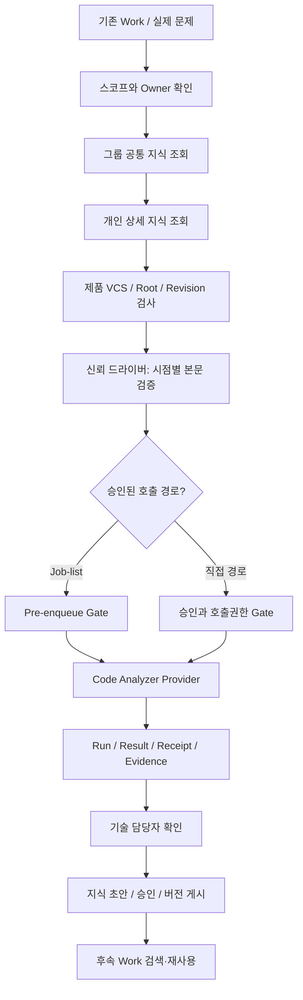

# L1 지식 설계 로드맵 — 사내 GPT 공유·검토용 상세 인계서

- 문서 버전: `HANDOFF-r0001` / 2026-11-09 KST
- 대상: 사내 GPT 및 승인된 L1 개발 도구 운영자
- 목적: 기존 L1 Workflow 기반 지식 검색·분석 활용·생성·재사용의 로드맵과 실행 전 안전 요건을 **한 번에 이해**하고, 실제 사내 코드·설치본 기준으로 구현 가능성과 최소 수정안을 검토하도록 하는 것
- 설계 기준: **ROADMAP r0003에 대한 심층 정적 설계 검토 결과 및 이번 GPT 판정을 반영한 실행 요구사항**
- 상태: **DESIGN_ACCEPTED_WITH_CHANGES / IMPLEMENTATION_GAPS_OPEN / G0_BLOCKED / M1_NOT_VERIFIED**
- 주의: 이 문서는 사내 스킬 설치, 소스 분석 실행, Job 활성화, Git/P4 쓰기, 지식 게시의 승인이 아니다. 실환경 분석 결과나 기술 사실을 포함하지 않는다.
- 정보 분류: 사내 업무 설계 공유용. 실제 제품 소스·로그·고객 정보·인증정보는 이 문서에 넣지 않았다. 세부 증거는 사내 인가된 위치에서만 확인한다.

## 1. 왜 이 로드맵이 필요한가 — 배경과 사용자 목표

현재 L1 이슈 수정·신규 기능 개발 시 HLD, 코드 상세 동작, 함수 관계, RRC↔L1C↔HAL↔PHY 연계, MSC, 이슈 원인·해결, 변경 이력이 개별 문서·Work·소스와 도구 결과에 나뉘어 있다. 과거에 같은 문제를 분석했어도 다음 작업에서 해당 사실을 자동으로 찾아 **정확한 제품/브랜치/리비전/담당 범위**와 함께 사용하기 어렵다. 그 결과 같은 코드베이스를 반복 조사하거나, 다른 제품·팀의 지식을 잘못 내 담당 범위로 간주하고, 분석 근거가 검증되지 않은 채 문서가 늘어나는 위험이 있다.

이 프로젝트의 최종 목표는 L1 Workflow가 실제 이슈 분석을 수행하면서 **기존 기술 지식 검색 → 적용 조건 검증 → Code Analyzer 입력에 원문 사용 → 새로운 근거의 초안 생성 → 승인된 개인 저장소 갱신 → 다른 Work에서 재사용**하는 선순환을 구축하는 것이다.

핵심 성공 지표는 '문서 수'나 '벡터 DB 구축'이 아니라 다음과 같다.
1. 같은 질문을 다시 조사하는 시간을 줄이고 과거 검증 근거를 실제 분석에 사용한다.
2. 담당 모듈과 비담당 연동 모듈을 혼동하지 않는다.
3. SMP1900 Git과 SMP1800/1770 P4의 서로 다른 소스 정합성을 보장한다.
4. 실제 Provider에 지식 원문이 투입됐다는 독립 증거를 확보한다.
5. 새로 확인한 사실만 승인·출처·유효 범위를 가진 지식으로 누적한다.
6. 후속 Work에서도 검색·인용과 적용/거부 결정을 재현할 수 있다.

**하지 않는 것**: 기존 L1-Fix-Workflow를 새 제품으로 재구축, 독립 코드 분석 엔진 재구현, 새로운 감시 서비스/별도 자동 스케줄러 개발, 첫 단계부터 임베딩 DB 구축, 회사 전체 코드를 자동 훑기, 승인 없는 지식/소스 쓰기.

## 2. 지금까지의 설계 진행과 현재 상태

### 2.1 기존 설계에서 이어받는 것

- 기존 **L1 지식 설계 v0.6.1** 및 이전 v0.4/사내 설계 지침의 기능 계약을 폐기하지 않는다. U01~U15, F01~F08, I00~I09, V/T 식별자와 ROAD-KR-01~12를 연결하되 번호를 덮어쓰지 않는다.
- Work Ledger/Kernel은 작업/승인/Evidence 원장, `l1-workspace`는 상세 기술 지식 정본, 그룹 `l1sw-dev-knowledge`는 공통 구조·기본지식 계층이다.
- 기존 `module-library` 독자와 새 `knowledge/` 포털이 서로 다른 마커·frontmatter를 가질 수 있으므로 호환성을 먼저 점검한다. 포털 골격이나 문서 링크만으로 본문을 분석기에 공급했다고 판단하지 않는다.
- 구현 경로는 **방식 A: 허용된 범위에서 기존 스킬 소스를 직접 수정·시험·패키징**과 **방식 B: 내부 전용 소스/환경이 필요할 때 사내 개발 주체가 제한 범위 구현·검증**을 병행할 수 있다. 기본 방식 삭제나 무단 전환을 요구하지 않는다. 같은 수정 범위를 양쪽에서 동시에 변경하지 않는다.

### 2.2 기능 로드맵 보강과 심층 검토 결과

- 로드맵은 **ROAD-KR-01~12**, 실행 단계는 **G0→M1→M2→M3→M4**로 정리됨.
- 그룹 공통지식 우선 조회, 개인 상세지식 후조회, owner/비담당 경계, 제품별 Git/P4 기준 고정을 P0으로 올림.
- 첫 설계 검토에서 발견된 네 가지(B-1 Job-list gate, N-1 충돌 owner, N-2 본문 무결성, N-3 code root registry)를 r0003에 '문서 계약'으로 구체화함.
- r0003 심층 정적 리뷰는 큰 구조를 **조건부 수용**했지만, 집행 주체와 실제 신뢰 경계가 불명확하다는 **차단 지적 7건, 후속 권고 4건**을 발견함. 본 문서는 해당 7건을 구현 요건으로 명시하되 **코드가 이미 수정된 것으로 간주하지 않는다**.
- 정적 문서 검증이 성공하더라도 Linux 실사용 E2E, 사내 Provider 결과, owner 신원, 실제 설치 버전은 대체할 수 없다.

### 2.3 마지막으로 확인된 의존 구성 상태(역사적 스냅샷, 현행 재조회 필수)

| 구성 | 확인된 기록 | 사용/검증 판정 |
| --- | --- | --- |
| `l1-fix-workflow` | v1.6.65 개발용 후보; 개인 본문 연결 관련 v1.6.64 부분 로컬 시험 이력 | 설치 승인 없음, 실제 목표 설치 버전과 API 확인 필요 |
| `code-analyzer` | v0.15.2 리뷰 후보 | 사내 설치/Provider 실소비 미검증 |
| `work-ledger-kernel` | 0.7.38 관련 소스 계약은 기존 대조 기록 존재 | 실제 설치 버전/응답 계약은 미확인 |
| `job-list` | v0.4.34 정적 리뷰 후보. 이전 설치 관측 v0.4.32 | v0.4.34의 F1/F2 미해결. 현재 설치본·해시 실측 전까지 사용 가능 판정 불가 |
| `skill-updater`/Runner | 승인된 신규 릴리스 설치·Job 처리 경로 | 단순 업데이터 호출 ≠ Worker 실행 성공 |
| `l1-github`/개인 repo | 상세지식/Work 이력의 분리 관리가 목표 | 원격 push/readback 성공 여부는 별도 확인 |
| `doc-converter` | HLD/MSC 표현·가독성에 재사용 | 실제 최신 설치/문서 변환 연계는 확인 필요 |
| 사내 MCP / Run Catalog | 조회·증거 연계의 기존 도구를 재사용하는 설계 | 실제 action/schema/권한·검색 노출은 탐색 후 확인 |

G0 후보 Work: `20261007-SOC-411668`. 기존 진단 기록은 `VERSION_MISMATCH`를 포함하고 숫자 응답에 잘못된 `22` 토큰이 있었다. **이 Work는 읽기 전용 적격성 확인용**이며 Provider 실행·신규 Job 활성화 승인이 아니다. 이미 검증한 사실은 재사용하되 신선도 기준이 달라졌거나 증거가 없는 항목만 읽기 전용으로 재확인한다.

## 3. 최종 아키텍처: 정본·책임 분리

| 계층/컴포넌트 | 책임 | 하지 말아야 할 일 |
| --- | --- | --- |
| 그룹 `l1sw-dev-knowledge` | module/블록 공통 개요·용어·주의사항의 1차 조회 | 개인 상세의 원문·검증 근거를 자동 대체/덮어쓰기 |
| 개인 GitHub `l1-workspace` | module→feature→scenario, issue/feature 분류, HLD, MSC, 구현·원인·해결 상세 지식 정본 | 승인되지 않은 지식을 자동 게시, Work 원장 전체 복제 |
| `l1-fix-workflow` | Work 문맥·스코프·사용할 지식·분석 경로 오케스트레이션 | 실제 내부 분석/승인/권한 확인을 생략 |
| `code-analyzer` | 지정된 소스·실제 공급된 지식 본문을 Provider 입력에 소비하고 분석 근거 기록 | 단순 검색/요약을 실제 지식 소비 PASS로 보고 |
| `work-ledger-kernel` | Work/Task 상태·승인·Evidence 정본 | 기술 내용의 독립 정본으로 둔갑 |
| `job-list` Runner/Worker | 설치·Profile/Job ID·의존성·권한 사전 검증, 유효 one-shot Queue/Run/terminal Receipt | 미검증 profile을 다른 Job ID로 우회, 사용한 Queue를 새 ID로 재소진 |
| 사내 지식 조회/검증 드라이버 | 그룹·개인 2계층 검색, 본문/리비전/적용 조건 검증, Provider 호출 전 digest 계산 | Provider 자기보고만으로 증거 성립 선언 |
| code root registry / owner authority | 제품/VCS/root·담당 scope·신선도·승인자 참조의 신뢰 정본 | 제품명/폴더명/일회성 작성자 주장만으로 권한 결정 |
| Run Catalog/Evidence | 실제 Run, Worker 결과, terminal Receipt, 증거 링크를 조회/색인 | Job Catalog나 원본 실행을 대체/가장 |
| HTML 포털/인덱스 | 사람의 탐색과 관계 시각화, 원문 역추적 | 렌더 완료를 검색 가능·지식 정확성 PASS로 승격 |



그림은 **의도한 논리 흐름**이며 현재 모든 컴포넌트가 구현되어 있다는 뜻이 아니다. 없는 API·컴포넌트는 `NOT_IMPLEMENTED`로 표시하고 인가된 기존 기능을 먼저 찾는다.

## 4. L1 담당 블록과 외부 의존 경계

후보 담당 영역(업무 맥락상 후보이며 공식 조직 소유권이 확정됐다는 뜻은 아님): **Front Controller, MMCIF Controller, Measure Controller(IRAT/SCell/Gap), DRX/CDRX, TxSwitchMngr, AitMngr, ObserverDb, TxCfgMngr/TxCmdMngr**. 실제 module owner/maintainer/collaborator/external_dependency를 현행 조직·모듈 담당 정본에서 검증해야 한다.

- owner: 설계/정본 승인 및 변경권이 있는 공식 책임자
- maintainer: 구현·유지보수에 참여하나 owner 역할과 동일하지 않을 수 있음
- collaborator: 공동 분석·협업 범위
- external_dependency: 호출/호출당하는 다른 팀 블록. API/IPC·시나리오 경계 사실만 필요한 만큼 조사하며, 그 팀의 모듈 전체를 내 담당으로 추정하지 않음

비담당 모듈 내부에 호출이 있다는 이유로 자동 책임 귀속·개인 상세 정본 변경·무제한 심층 분석을 하지 않는다. 교차 모듈 시나리오의 주관 owner 하나와 나머지 참조 관계를 구분한다. **폴더명은 MSC participant 단위에 사용할 수 있어도 조직적 소유권 증거는 아니다.**

### Owner Authority 수락 계약 (차단 지적 F-N1-01/F-N3-01)

반드시 실제 접근 가능한 사내 정본(조직 담당 매핑/승인된 모듈 소유권 문서/권한 API 중 무엇인지 현지 확인)에 대해 아래 논리 필드를 맵핑한다.

`principal_id`, `module_id`, `product_scope`, `rat_scope`, `role`, `authority_ref`, `verified_at`, `expires_at`, `authority_revision`, `verification_method`.

- 조회 가능한 실제 권한 원천을 못 찾으면 `OWNER_AUTHORITY_NOT_FOUND`/`OWNERSHIP_UNKNOWN`, **PREVIEW_ONLY**.
- 만료·서명 검증 실패·제품/RAT 불일치면 충돌 판정 또는 registry 등록·Provider 호출 거부.
- 그룹 default 동작과 개인 RAT 예외가 충돌해도 단순 최신 문서 우선 아님. owner가 실제 근거/적용 범위를 판정하고 원장에 남긴 후에만 사용.
- Root registry의 `module owner` 서명 검증은 정확히 같은 owner authority 원천을 재사용하고, 해당 제품 **VCS root 관리자 승인**은 별도로 확인. 하나라도 불명확하면 등록 및 사용 금지.
- 위 권한 필드와 신뢰 원천은 **설계 요구사항**이며 현재 MCP/스킬에 이미 구현됐다고 가정하지 말 것.

## 5. 제품과 VCS 스코프 가드

| 제품 | 형상관리 기준 | 코드 확인 시 필요한 사실 | 금지되는 혼용 |
| --- | --- | --- | --- |
| SMP1900 | Git | repo identity, root_id, checkout branch, HEAD SHA, dirty/clean, RAT/build | 브랜치 이름을 commit SHA로 사용; 다른 branch 사실 자동 승계 |
| SMP1800 | Perforce | P4 client/workspace, depot↔local mapping, 파일별 haveRev, 관련 CL 범위, local edit, RAT/build | CL 한 개로 모든 파일 haveRev가 동일하다고 가정 |
| SMP1770 | Perforce | SMP1800과 다른 root/client/depot/file revisions, RAT/build | SMP1800의 revision/owner/지식 scope 복사 |
| 그 외 legacy | 사내 registry 확인 | 제품별 실제 VCS와 검증된 root/revision | 미등록 제품에 대해 추정 root를 자동 선택 |

Code root registry 기본 필드(논리 모델): `product_id, root_id, vcs_kind, repo_or_depot, rat, build_scope, source_revision_fact, owner_authority_ref, root_admin_approval_ref, verification_time, expiry_or_invalidation_rule`.

필수 결과: 실제 등록·유효·권한이 확인된 root가 아니면 `ROOT_UNREGISTERED` 또는 `ROOT_OR_REVISION_UNVERIFIED`, Preview-only; root 자동 확대, 인접 폴더 추측, 무승인 코드 분석/정본 게시를 하지 않는다. Git HEAD와 P4 haveRev/CL은 타입이 다르므로 하나의 문자열 `revision`으로 동일화하지 말고 **분별된 typed fields**를 사용한다.

## 6. 기능 로드맵: ROAD-KR-01~12

| ID | 우선 | 기능 | 선행 조건 | 실제 DONE 수락 증거 |
| --- | --- | --- | --- | --- |
| ROAD-KR-01 | P0 | module/feature/scenario + issue/feature + owner/product/VCS/source anchor/validation schema | 없음 | 데이터 형식 계약 + owner/root 필드 실제 검증 + 역추적 |
| ROAD-KR-02 | P0(부분) | 기존 이슈/HLD/설계/코드 근거를 출처 보존하며 지식 초안 수집 | 01 | M1에서는 provenance-only. 전체 후보 생성 E2E는 M2 이후 |
| ROAD-KR-03 | P0 | 그룹 공통 1차 → 개인 module-library 상세 2차 조회 | 01 | 그룹 조회 시도 성공/실패 기록 + 개인 원문/조건 독립 조회 |
| ROAD-KR-04 | P0 | 검증된 지식 본문을 Workflow/Code Analyzer Provider의 실제 입력으로 소비 | 01,03,05, 실행 게이트 | 호출 직전 실제 payload SHA/anchor와 Provider 입력 증거/Run 매칭 |
| ROAD-KR-05 | P0 | owner/비담당, RAT·stack, 제품 root/Git·P4, 현재성·digest·경계 오용 차단 | 01, owner/registry authority | mismatch/dirty/미등록 등 부정 사례를 호출 전에 실제 차단 |
| ROAD-KR-06 | P1 | 분석 결과를 원인·해결/기능 상세/HLD·MSC 포함 구조화 후보로 전환 | 01,02, 실제 분석 근거 | source anchors + 기술 내용 재검증 + 정본 초안 |
| ROAD-KR-07 | P1 | NEW/ENHANCE/DUPLICATE/CONFLICT/RECHECK 및 경쟁 수정 판정 | 06, owner authority | Preview·중복·충돌·승인/원본변경 반례 PASS |
| ROAD-KR-08 | P1 | 승인 지식을 개인 저장소에 게시·버전관리·원격 readback | 07, 권한/검증 | commit/원격 rev/readback/Work 역링크·재시도 안전성 |
| ROAD-KR-09 | P1 | 모듈→피처→시나리오 탐색 포털·읽기 쉬운 MSC·근거 표시 | 06 (일부 병행 가능) | 사용자 탐색/원문 링크/MSC 렌더/anchor 확인 |
| ROAD-KR-10 | P1 | **다른 Work**에서 지식 검색→적용/거부→인용 재사용 | 08, 03~05 | 독립 Work의 적용 1건 + 부적합 거부 1건 + 일치 근거 |
| ROAD-KR-11 | P1 | 지식 품질·owner·개정/피드백·활용 지표 | 10 | 누락율/정확도/시간/수동 개입·수정 필요성 실측 |
| ROAD-KR-12 | P2 선택 | 청크/하이브리드/임베딩/재순위화 고도화 | 11의 측정 gap | 기본 검색 대비 검색 평가셋에서 개선 입증; 무조건 선행하지 않음 |

모든 아이템의 **현재 DONE 승격: 불가**. 문서 설계와 정적 검토만 존재하는 축은 `NOT_VERIFIED`로 유지한다. P0라고 해서 해당 기능이 이미 구현됐다는 뜻은 아니다.

### G0~M4 로드맵

**G0 — 사내 Read-only 사전점검**: 설치본/리비전/권한/기존 Work/지식 문서/사용 가능 Provider/Job 소진 상태를 한 번에 조사. `G0=PASS`도 실실행 승인은 아님. 현재 BLOCKED.

**M1 — 최초 업무 가치 검증**: ROAD-KR-01/03/05/04, ROAD-KR-02 provenance-only. 기존 이슈 1건에서 그룹·개인 조회→owner/VCS/digest 검증→실 Provider 본문 소비→Run/Receipt/Result/Evidence/기술 사실 확인. **F1, 설치 드리프트, owner/registry, digest actor 등 7가지 차단 해결 이후에만** 진행.

**M2 — 지식 생성/승인/게시**: ROAD-KR-06/07/08. Preview·중복·기존 정본 병합·원본 동시 변경 재검증·owner 승인·원격 Git readback. 무승인/충돌 시 DRAFT_ONLY.

**M3 — 포털/새 Work 재사용**: ROAD-KR-09/10/11. 다른 Work가 지식을 검색해 실제 인용한 증거와, 잘못된 제품/branch 지식을 거부한 증거를 함께 확보. HTML 생성 자체는 완료 아님.

**M4 — 선택적 RAG 고도화**: ROAD-KR-12. 검색 누락과 부정확성이 실측으로 입증된 경우에만 최소한으로 추진.

## 7. 신규 심층 리뷰 차단 지적 7건: 구현 책임과 확인 사항

아래 책임 주체는 **권장 집행 위치**이며, 실제 사내 API가 존재하는지는 이번 Read-only inventory에서 확인해야 한다. 없는 기능을 구현된 것으로 승격하지 않는다.

| ID | 차단 원인 | 집행 주체(제안) | 반드시 구현/확인할 동작 | 실패 코드·시험 |
| --- | --- | --- | --- | --- |
| F-B1-01 | 검토한 Job-list와 실제 설치본 버전 불일치 가능 | 사내 G0 version verifier + Job-list activation | 실제 설치 경로의 version/hash/release_status를 승인 릴리스와 대조. 과거 검토된 특정 숫자에 무조건 고정하지 말고 **해당 설치본의 검토·회귀근거**를 요구 | `JOB_LIST_VERSION_UNVERIFIED`; 설치본 0.4.32 vs 검토후보 0.4.34 불일치 반례 |
| F-B1-02 | `provider_invocation_path` 선언만 있고 실제 실행 차단 주체 없음 | Job-list pre-enqueue guard + Workflow/skill-driver pre-call guard | `JOB_LIST_ENQUEUE`/`APPROVED_DIRECT`만 허용, 필수 근거 검증, 미검증 경로는 Queue 변경/Provider 호출 **이전** 거부 | `INVOCATION_PATH_UNVERIFIED` / `ENFORCEMENT_NOT_IMPLEMENTED`; 필드 누락·위조 테스트 |
| F-N2-01 | D_call 계산이 Provider 자기보고일 수 있음 | Provider 호출 발행 전 **독립 input verifier** | 실제 공급할 원문 bytes/전송 payload의 digest를 사전 계산, verifier version/ID 기록. Provider가 보고한 digest만 신뢰하지 않음 | `PAYLOAD_DIGEST_UNVERIFIED`; Provider 자기보고 조작 테스트 |
| F-N2-02 | BOM/UTF-8/CRLF/LF/frontmatter 정규화 미정 | 지식 본문 reader + input verifier 공통 `BODY-CANON` 규약 | raw 파일 hash와 canonical body hash 모두 보존, 구현 플랫폼과 관계없이 재현 가능한 스펙/버전 정립. 원본 변경 은폐 방지 | `CANONICALIZATION_UNVERIFIED`/`DIRTY_SOURCE`; CRLF/LF, BOM, Unicode, 끝공백 반례 |
| F-N1-01 | 충돌 판정 owner 권한 원천·신선도 불명 | 사내 module authority resolver | 승인된 owner 정본 ID, principal, scope, verified_at/expiry 검증; 위조·만료 시 Preview-only | `OWNER_AUTHORITY_NOT_FOUND`/`OWNERSHIP_UNKNOWN`; 위조·만료 반례 |
| F-N3-01 | Root registry의 owner 이중서명도 같은 권한 공백 | Registry validator + VCS root 관리자 승인 검증 | F-N1-01과 **동일 owner authority** 재사용 + VCS root 승인 독립 확인 | `ROOT_UNREGISTERED`/`REGISTRY_APPROVAL_UNVERIFIED`; 위조 owner 서명 반례 |
| F-VERS-01 | 승인 금지가 특정 버전 번호 예시에만 적용될 위험 | G0 release/status gate + installation guard | 버전 불문 `development_not_for_deployment`, `review-candidate`, `unknown`/미설치 상태면 설치 및 M1 PASS 금지 | `RELEASE_STATUS_BLOCKED`; 새 버전이 같은 금지 상태 테스트 |

별도 중요 조건: **APPROVED_DIRECT는 실제 승인 ID의 진위를 대조하는 기존 승인 원천/검증기가 있을 때만 허용**한다. 형식만 맞는 임의 ID는 차단(`APPROVAL_NOT_VERIFIED`). 기존 사내 경로에 이 기능이 없으면 direct는 미지원으로 두고 무단 대체 스크립트를 만들지 않는다.

### F1/F2: Job-list 코드 결함과 로드맵 설계 결함 구별

- **F1**: `profile=l1-knowledge-input-verify-linux`를 다른 `job_id`로 enqueue하면 특정 sentinel ID에만 적용되는 사전점검을 우회해 Queue를 소진할 수 있는 문제. 현재 코드 수정/설치 확인되지 않음. **모든 해당 Profile 진입**에서 승인된 Job ID/의존성 preflight를 거부하도록 수정·반례 시험이 필요.
- **F2**: 의존성이 설치되지 않은 경우와 설치 버전이 다른 경우가 같은 진단 코드로 합쳐지는 문제. fail-closed 경로는 유지되나 `DEPENDENCY_NOT_INSTALLED`와 `DEPENDENCY_VERSION_MISMATCH`를 구분해야 반복 디버깅이 줄어듦. 어떤 경우든 Queue/Receipt를 변경하지 않아야 함.
- 패치 후에는 신규 코드의 릴리스 검토·적격성, 실제 설치본 확인, Profile 우회 반례 재시험까지 해야 해결로 선언 가능. 문서에서 단순히 "게이트 있음"을 기록한 것으로 해결되지 않는다.

## 8. 본문 무결성 및 시간 경계 — 구현 수준의 권고 스펙

### 8.1 서로 구분할 값

- `file_sha256`: 원문 파일 바이트를 그대로 SHA-256. 동일 파일을 조회·호출할 때 변경되면 원본 변경 사건으로 기록.
- `body_sha256`: **명시된 parser/canonicalization version**에 따라 frontmatter 뒤에 추출한 실제 지식 본문 bytes의 SHA-256.
- `D_retrieve`: retrieval 시점의 canonical body digest.
- `D_call`: Provider 호출 **직전**, 신뢰 가능한 호출 드라이버가 독립적으로 원문을 재조회/검증한 body digest.
- `D_payload`: **Provider로 실제 보내는 본문 payload bytes**를 드라이버가 측정한 digest. 전체 prompt를 해시한 값과 본문만 해시한 값을 혼용하지 않음.
- `source_snapshot`: 동일 root_id/branch+HEAD 또는 P4 client·파일별 haveRev/CL, RAT/build, dirty/local edit 상태.
- `verifier_id`, `verifier_version`, `canon_spec_id`: 검증 주체·정규화 스펙·호환성 확인 근거.

정규화 스펙 예: `BODY-CANON-v1`을 별도 명세로 고정하고 **UTF-8 strict decoding, BOM 처리, frontmatter delimiter/본문 시작점, 줄바꿈(CRLF/LF), 후행 개행/공백 처리 정책**을 일관되게 결정. 단, 실제 보유 reader/parser가 무엇을 사용하는지 먼저 확인하고 공통 규칙으로 통일한다. 여기 제시한 이름은 **제안 ID**이지 이미 구현됐다는 뜻이 아니다.

### 8.2 안전한 통과 규칙

1. 동일 source identity/revision의 `file_sha256`이 retrieval↔call 시점 모두 같아야 한다. 정규화 결과가 같더라도 raw 파일 변경을 조용히 무시하지 않는다.
2. 같은 canon spec version을 적용한 `D_retrieve == D_call == D_payload`가 성립해야 한다.
3. Source HEAD/haveRev·dirty 및 owner/registry authority는 두 시점 모두 동일/유효해야 한다.
4. payload는 검증한 **동일 메모리 버퍼/불변 파일 스냅샷**을 사용. 검증 후 재로딩으로 TOCTOU를 재도입하지 않는다.
5. Provider가 보낸 digest 자기보고는 참고값이며 PASS의 단독 근거가 아니다.
6. 이상 시 `DIRTY_SOURCE`/`SOURCE_REVISION_CHANGED`/`CANONICALIZATION_UNVERIFIED`로 호출을 차단하고, 소스가 바뀌었으면 승인된 재조회/재결정 절차로 이동.
7. 변경 후 원복을 2회 조회만으로 완전히 검출할 수 없음을 인정. 초기 파일럿은 승인된 clean checkout·동시쓰기 금지·실행 전 고정 revision을 요구하고, 필요한 경우에만 기존 잠금/스냅샷 기능을 검토한다.

## 9. 실제 실행 경로와 책임 있는 집행

### 9.1 `JOB_LIST_ENQUEUE`

1. 신청/승인된 work_id, profile, **고정 job_id**, release/bundle digest 및 실행 모드를 검증한다.
2. 활성화 이전에 **profile 기반** 의존성·버전·입력 스코프 검사를 수행한다. ID만 검사하면 F1 우회 가능.
3. 실패 시 Queue/Receipt/worker 소비가 **0건**인지 재현·확인한다(진단/activation 실패 이력은 별도여도 무방).
4. 성공한 경우에만 one-shot Queue/Runner/Worker를 연결하며 terminal Receipt와 Worker semantic result를 분리한다.
5. `job_run_id`는 Runner 원본 그대로 저장; `analysis_run_id`와 혼합하지 않는다. `Run Catalog/find` 등록 실패 시 **원래 분석을 재실행하지 않고** 링크 후처리만 멱등 복구한다.

### 9.2 `APPROVED_DIRECT`

- 기존에 독립 검증된 실제 호출 방법이 존재하는 경우에만 검토. 사용자가 실행 대상·작업 범위·승인 ID·승인된 바이너리/설치본·기간을 허용하고, verifier가 실제 승인 정본을 읽어 일치 판정해야 한다.
- 호출 드라이버가 owner/root/revision/source snapshot/body digest를 독립 검사하고 Result/Receipt/Evidence와 Run ID를 연결해야 한다.
- 단순 shell/script, 임의 명령, 허위 승인 ID, Job-list F1 우회를 위한 대체 경로는 지원하지 않는다. 검증된 direct 경로가 없다면 `APPROVED_DIRECT_NOT_AVAILABLE`.

## 10. G0 1회 읽기 전용 사전점검 — 사용자 반복 입력 최소화

이미 정해진 후보 Work `20261007-SOC-411668`을 기준으로 실제 사내 도구가 **이미 제공하는 읽기 전용 API/파일**만 사용하여 항목을 한 번에 점검한다. 새 도구가 없으면 `NOT_EXPOSED`라고 답하고 같은 질문 10개를 사용자에게 반복 요구하지 않는다.

| 번호 | 검사 | 증거/출력 핵심 | 실패/미확인 |
| --- | --- | --- | --- |
| G0-01 | Work 존재·상태 | exact work_id + 조회 성공 | `WORK_NOT_FOUND` |
| G0-02 | 설치 및 승인 릴리스 | 각 스킬 실제 version, digest, release_status, entrypoint | `VERSION_MISMATCH` / `RELEASE_STATUS_BLOCKED` |
| G0-03 | 신규 Job 필요/중복 | fixed job_id, profile, queue 상태, terminal run 여부 | `JOB_ALREADY_CONSUMED` / `STAGED_NO_ACTIVE_JOB` |
| G0-04 | Owner authority | scope/실제 원천/verified_at/expiry | `OWNERSHIP_UNKNOWN` |
| G0-05 | Root registry | product/RAT/build/VCS/root/관리자 승인 | `ROOT_UNREGISTERED` |
| G0-06 | 지식 원문 | 그룹 조회 결과, 개인 상세 문서 후보의 유일성 | `DETAIL_UNAVAILABLE` / `CONFLICT_UNRESOLVED` |
| G0-07 | 문서 및 코드 snapshot | file/body hash 가능, Git HEAD 또는 P4 haveRev/CL/clean | `SOURCE_REVISION_CHANGED` / `KNOWLEDGE_HASH_UNVERIFIED` |
| G0-08 | Provider 계약 | 현행 Provider manifest/API/호출 전 독립 verifier | `PROVIDER_UNVERIFIED` |
| G0-09 | 호출 경로 | 실제 Job-list guard 또는 direct 승인 검증기의 존재 | `ENFORCEMENT_NOT_IMPLEMENTED` |
| G0-10 | Evidence 연결 | Run ID/Receipt/Result/Catalog/find 가용성 | `CATALOG_LINK_PENDING` / `NOT_EXPOSED` |

**재사용 정책**: 기존 증거는 설치 버전·해시/owner authority revision/source HEAD·P4 haveRev·문서 SHA/승인 ID·Profile/Job ID가 그대로라는 명확한 fingerprint가 있을 때만 부분 재사용. 호스트 설치 상태·process/Queue 상태·권한 만료는 재확인. 어느 항목도 미확인이면 전체 G0 PASS 금지.

### 권장 반환 형식(사내 상세와 외부 요약을 분리)

```text
G0_STATUS=BLOCKED | READY_FOR_APPROVAL | NEED_INFO
PRIMARY_CODE=<확인된 한 가지 원인코드>
INSTALLED_RUNTIME_MATCH=PASS|FAIL|UNKNOWN
OWNER_REGISTRY=PASS|FAIL|UNKNOWN
KNOWLEDGE_SCOPE=PASS|FAIL|UNKNOWN
CALL_PATH_GUARD=PASS|FAIL|UNKNOWN
EVIDENCE_LINKAGE=PASS|FAIL|UNKNOWN
EXECUTION_AUTHORIZED=NO
NEXT_ACTION=<실제 수행 가능하고 권한에 맞는 한 가지 조치>
```

상세 source revision, 파일경로·코드·로그·토큰·원문은 반드시 인가된 사내 저장소에만 보존한다. 요약에 해시·절대경로/회사 코드 등을 통째로 복사하지 않는다. **G0 사전점검은 read-only**이고 실행 승인과 무관하다.

## 11. 정상·반례 회귀시험 카탈로그

M1 설계의 실행 안전성을 입증하기 위한 최소 시험. 기존 테스트 프레임워크에 가급적 추가하고, 이전 실패 baseline과 신규 회귀 실패를 구분한다.

| 시험 ID | 시나리오 | 기대 결과 |
| --- | --- | --- |
| T01 | 같은 profile + 다른 job_id, dependency mismatch | enqueue 전 거부, Queue/Receipt 소진 0 |
| T02 | Job-list 실제 설치 버전이 승인된 릴리스와 불일치 | `JOB_LIST_VERSION_UNVERIFIED`; 실행 차단 |
| T03 | `provider_invocation_path` 누락/위조 | `INVOCATION_PATH_UNVERIFIED`; 실제 Provider 호출 0 |
| T04 | 가짜 APPROVED_DIRECT 승인 ID | `APPROVAL_NOT_VERIFIED`; 실제 Provider 호출 0 |
| T05 | 설치 없음 vs 버전 오류 | 구분된 코드, 두 경우 모두 fail-closed |
| T06 | 새 버전인데 `release_status=review-candidate` | 버전과 무관하게 차단 |
| T07 | Provider가 digest를 허위 보고 | 독립 verifier 값과 불일치하여 차단 |
| T08 | 원문 읽기 이후 실제 파일/본문 변경 | raw SHA 또는 body SHA mismatch로 차단 |
| T09 | BOM/CRLF/LF/본문 경계/후행 공백 변경 | canonical spec에 따라 재현성·raw 변경 추적, 안전 판정 |
| T10 | 모듈 owner 증빙 만료/위조 | `OWNERSHIP_UNKNOWN`; Preview-only |
| T11 | 가짜 owner 동의와 정상 VCS 관리자 승인 | registry 등록 거절 |
| T12 | SMP1900 다른 branch/HEAD 지식 | 제품 같아도 source revision mismatch 차단 |
| T13 | SMP1800↔SMP1770 P4 client/CL/haveRev 혼동 | root mismatch 차단 |
| T14 | 비담당 모듈 호출 API만 존재 | 경계만 참조, 전체 소유권/쓰기 권한 자동 귀속 없음 |
| T15 | 그룹 일반 RAT와 개인 RAT 예외 상충 | 스코프 분해/owner 판정; 미해결 Provider 입력 금지 |
| T16 | Provider는 지식을 검색했으나 본문 payload 누락 | `PROVIDER_CONSUMPTION_NOT_VERIFIED` |
| T17 | 실제 Result 존재, Run Catalog만 누락 | 재분석 없이 멱등 링크 복구 |
| T18 | Active Job 없음 `jobs: []` | `STAGED_NO_ACTIVE_JOB`, 실행 실패로 오진하지 않음 |
| T19 | 같은 Job 소진 후 새 ID로 재시도 | 중복 차단/이력 유지 |
| T20 | 지식 게시 뒤 다른 Work에서 유효 적용 + 다른 버전 거부 | M3 objective PASS 증거; 인용/범위/리비전 일치 |

시험 판정은 `DESIGN_DEFINED` / `LOCAL_PASS` / `HOST_PASS` / `DOMAIN_PASS`로 구분하고, 아직 실행하지 않은 것은 전부 `NOT_RUN`이라고 명시한다.

## 12. M1 완료 기준: 실증거와 독립 판정 축

`DESIGN`, `CODE`, `REVIEW`, `PACKAGE`, `INSTALL`, `EXECUTION`, `PROVIDER_INPUT`, `RECEIPT`, `RESULT`, `CATALOG`, `EVIDENCE`, `DOMAIN_VALIDATION`, `PUBLISH/REUSE`를 독립 기록한다.

M1 PASS는 다음 모든 항목의 실제 근거가 필요하다: 유효한 사용자 실행 승인, G0 통과, owner+root authority, 실제 설치본 승인 상태, Profile/Job ID 안전검사 또는 direct 승인 검증, 단일 Work의 그룹 조회 시도/개인 상세 조회, source snapshot과 digest 검증, **실제 Provider가 해당 body를 입력받은 증거**, 정확한 Run↔Result↔terminal Receipt↔Evidence 관계, 기술 담당자 사실 확인.

불가능한 증거는 `NOT_VERIFIED`, 미구현 API는 `NOT_EXPOSED`, 승인 없음은 `NEEDS_APPROVAL`로 구분한다. 한 단계 성공(예: ZIP/정적 리뷰/Updater 설치/HTML 생성)은 다음 단계 성공의 증거가 아니다.

## 13. 사내 GPT에게 요청할 수행 범위와 산출물

### 13.1 현재 요청 단계 (읽기·설계·사전점검 중심)

1. **실제 스킬 사용 계획부터 제시**: `l1-fix-workflow`, `work-ledger-kernel`, `l1sw-dev-knowledge`, `code-analyzer`, `job-list`, `l1-github`, `doc-converter`, 현재 인가된 MCP 중 어떤 스킬/함수/API를 이용할 것인지 선택·이유를 명시한다. 없는 API를 만든 것처럼 말하지 않는다.
2. 로드맵 본문의 각 집행 actor를 **현행 사내 파일·CLI·MCP action에 매핑**한다. 접근할 수 없으면 `UNKNOWN/NOT_EXPOSED`로 남기고 허가 없이 스캔 범위를 확대하지 않는다.
3. F-B1-01~F-VERS-01의 7건을 각각 **기존 구현 여부 / 최소 변경 위치 / 반례 테스트 / 필수 설치·승인 조건**으로 판정한다.
4. 이미 존재하는 Job-list v0.4.34 후보 결함 F1/F2는 그 사실과 실제 사내 설치본을 구분하고, 같은 결함을 새로운 Job ID로 반복 진단하지 않는다.
5. G0 후보 Work에 대해 접근 가능한 범위에서 **읽기 전용 원샷 preflight**를 수행할 수 있는지 확인한다. 실행이 불가하면 제한과 예상 결과 코드를 기록한다.
6. 실제 코드 변경/설치/Job 활성화/Provider 입력/쓰기 실행이 필요하면 **별도 승인 필요**로 표시하고 멈춘다. 무단 실코드 분석이나 Git/P4 변경은 하지 않는다.

### 13.2 요청 결과 형식

```text
1) CURRENT_STATE: VERIFIED / BLOCKED / NEED_INFO
2) INSTALLED_SKILLS: 실제 관측 버전·승인 상태·미확인(사내 보존)
3) ACTOR_MAPPING: 요구 guard → 실제 기존 API/파일/없음
4) FINDINGS: 7건 각각 VERIFIED_IMPLEMENTED / GAP / NOT_EXPOSED + 근거
5) G0_READ_ONLY: PASS 항목, BLOCKED 항목, UNKNOWN 항목, 우선 blocker
6) MINIMAL_PATCH_PLAN: 변경 대상 스킬·모듈·계약 및 T01~T20 매핑
7) SECURITY_AND_APPROVAL: 금지/허용 작업, 사용자 승인 필요 항목
8) NEXT_ONE_ACTION: 현 시점 가장 작은 한 가지 작업
```

### 13.3 사내 GPT에 그대로 전달할 원샷 작업 요청

> 이 문서를 L1 지식 설계 로드맵의 현행 인계 기준으로 검토해줘. 아직 실제 동작 PASS가 아닌 점을 전제로, 사내 실제 설치 스킬과 MCP 목록을 읽기 전용으로 확인하고 **기존 구현을 최대한 재사용할 것**. 먼저 사용할 스킬과 기능을 명시하고, ROAD-KR-01~12/G0~M4의 실제 구현 가능성을 평가해줘. 가장 중요한 일은 신규 차단 지적 7건의 집행 주체를 기존 CLI/Job-list/Workflow/Provider/authority/registry에 구체적으로 연결하는 것이다. 각 항목에 현행 구현 여부·최소 수정 지점·부정 회귀시험·현재 미검증을 구분해줘. 필요하면 G0 후보 Work `20261007-SOC-411668`을 **읽기 전용**으로 한 번만 점검해줘. 없는 기능이나 승인 상태를 가정하지 말고, 코드 변경·설치·Job 활성화·Provider 실행·Git/P4 write·지식 정본 게시를 수행하지 마. 결과는 위 8개 섹션 형식으로 제공하고, 마지막에는 다음 한 동작만 제안해줘.

## 14. 성공 조건·후속 우선순위·미검증 경계

### P0: 즉시 설계와 실행 게이트 정합성

1. 실제 설치본·릴리스 상태/해시·호환성 정보 한 번에 확보
2. Profile/Job ID 우회 F1을 활성화 이전에서 막는 정확한 기존 코드 지점과 최소 수정안 검증
3. 호출 경로별 집행 주체/승인 verifier 매핑; 불명확한 direct path는 미지원 처리
4. Owner authority/registry 실제 신뢰 원천과 verified_at/expiry 규칙 확인
5. body reader/canon spec와 독립 verifier 신뢰 경계 확정
6. 같은 파일럿 사례 G0 read-only 결과 집계(반복 질문/재실행 최소화)

### P1: 증거가 통과한 뒤의 실제 지식 활용·축적

- 승인된 1개 Work에서 실제 Provider 입력과 독립 Evidence를 연결한다.
- 기술 검증 후 초안·중복/충돌·승인·repo readback·HTML 포털을 점진적으로 검증한다.
- M3 재사용 지표와 Queue 소진/Job ID churn 가시성을 추가한다.

### P2: 선택 최적화

- 실제 검색 누락·지연·오인용이 계량되기 전까지 새로운 RAG 인덱스/임베딩/재순위화 엔진 구축은 보류.

**현재 결론**: 기능 방향과 요구 계약은 정적 검토상 조건부 수용되었으나, M1은 `G0 BLOCKED`, F1·엔포스먼트 actor·Owner authority·digest/canonicalization의 미구현/미검증이 남아 있다. 이 문서는 실사용 완료 보고가 아니라 **사내 실제 구현·검증 검토를 시작하기 위한 상세 기준서**다. 누군가 이 문서의 모든 문장을 읽었다고 해서 어떤 테스트나 설치가 완료되는 것은 아니다.
