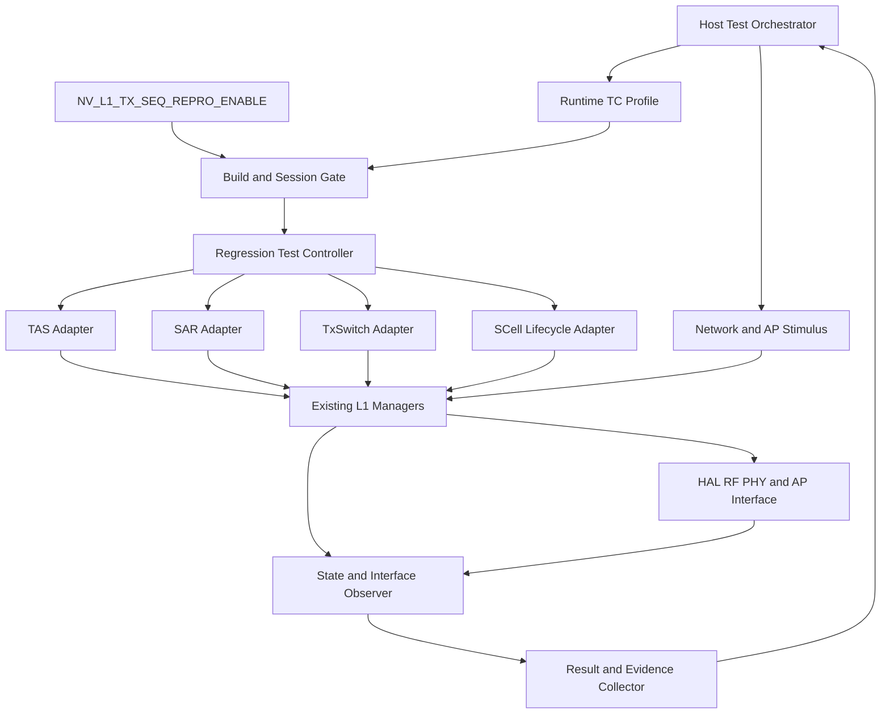

# TX Abnormal / SAR·TAS Postmortem 기반 L1 Regression Test 구축 — 1차 계획보고서 작성 준비 문서

- **버전:** v1.5 / 2026-10-15
- **기준 문서:** v1.4 준비 문서에 사용자 확정 목적·활용처·보고 대상을 반영한 후속 버전
- **현재 단계:** **1차 계획보고서 작성 준비** — 목적·범위·대상 사례·검증 방향·후속 보강 과제를 정리하는 단계
- **추진 범위:** L1 TX 관점의 NR ULCA TX, Dual SIM TxSwitch/Abnormal TX, NR SAR, NR TAS/Combined TAS
- **계획 대상:** 사용자 선정 **4개 Jira / 수정 CL 5개 / 초기 TC 초안 5개**
- **핵심 목표:** 반복되는 L1 TX 결함과 상용 단계의 뒤늦은 발견을 줄이기 위해, 과거 결함의 발생·미검출 원인을 분석하고 재현 가능한 TC를 **빌드·릴리즈 정기검증에 편입**
- **착수 계기 `[사용자 확정]`:** 유사 결함의 반복 발생 / 상용 단계에서 뒤늦게 발견 / 실험실에서 결함 재현이 어려움
- **우선 활용처 `[사용자 확정]`:** 빌드·릴리즈 단계의 정기검증
- **주요 보고 대상 `[사용자 확정]`:** 그룹장 등 상위 리더
- **확정 NV 명칭:** `NV_L1_TX_SEQ_REPRO_ENABLE`
- **실행 상태:** 실제 Fix Diff 검증·TC 상세 확정·HLD 구현·Regression 실행은 후속 수행 항목이며, 이번 개정으로 완료된 것으로 보지 않음

> **v1.4 사용자 방향 확정**
> 1. 첫 번째 문서 `PROMPT_L1_TX_SAR_TAS_Postmortem_Workflow_20261013.md`는 **폐기 방침에 따라 적용 종료**한다. 해당 프롬프트와의 단계·산출물 정합성 작업은 수행하지 않는다.
> 2. 기존에 논의한 **39건은 사용자 판단상 관심 대상인 L1 TX가 아닌 다른 모듈 관련 이슈**다. 이번 계획의 분석·선별·집계·재검토 범위에서 제외한다.
> 3. 본 문서는 **1차 계획보고서 작성을 위한 준비 자료**다. 실제 분석·구현·시험 완료 보고서가 아니다.
> 4. 기존 5개 TC 초안은 유지하고, 검토 의견은 **후속 분석·설계에서 보강해야 할 내용**으로 추가한다. 미확인 조건을 새 필수 재현 조건으로 확정하지 않는다.

> **v1.5 추가 확정:** 세 가지 착수 계기와 빌드·릴리즈 정기검증 우선 적용, 그룹장 등 상위 리더 보고를 반영한다. v1.4에서 정한 대상 범위·TC 보강 과제·NV 명칭은 유지한다.

**읽는 순서:** 왜 추진하는가 → 어떤 품질·검증 문제를 개선할 것인가 → 선정 사례 → Postmortem·TC 보강 → 정기검증 편입 방법 → 기대 효과·추진 계획·그룹장 협의 사항.

**근거 표기:** `[사용자 확정]`은 범위·명칭·선정 또는 사용자 제공 설명, `[기존 자료]`는 v1.3에 수록된 화면·설명 기반 정보, `[설계 초안]`은 구현 전 구상, `[후속 확인]`은 코드·로그·시험으로 확인할 내용이다. 사용자 선정 확정과 실제 코드·로그 검증 완료는 구분한다.

---

## 0. 변경 이력과 이번 개정 범위

| 버전 | 변경 내용 |
|---|---|
| v1.0 | 선정 사례와 초기 TC, 공통 NV Test Mode 구상 작성 |
| v1.1 | Red-Green, 결함 노출 조건, Oracle, 검증 계층, Host 제어, 일정·Owner·KPI 검토 추가 |
| v1.2 | 사용자 요청으로 당시 §3.4·§3.5 삭제 및 관련 참조 정리 |
| v1.3 | 공통 NV 명칭 `NV_L1_TX_SEQ_REPRO_ENABLE` 확정 |
| **v1.4** | **1차 계획보고서 준비 단계로 목적 재정의. 첫 번째 프롬프트 적용 종료, 39건 타 모듈 이슈를 현 범위에서 제외. TC별 후속 보강 항목 추가. 순차/전이 중 재현, 판정·관측·복구 기준 보완. 계획보고서 준비 사항과 후속 실행 완료 조건 분리** |
| **v1.5** | **사용자 답변 반영: 반복 결함·상용 후발견·실험실 재현 어려움을 추진 배경으로 명시. 발생 원인·미검출 원인·재현·정기검증 연결을 목적에 보강. 빌드·릴리즈 정기검증을 우선 활용처로 설정하고, 상위 리더 보고용 기대 효과·지표·결정 사항 추가** |

v1.3의 39건 선별 통계·NON_L1/PENDING 세부·비대상 Jira 목록·재스캔 요구·구버전 평가 점수는 이전 버전 이력으로 남기고 현재 본문과 추진 과제에서는 제외했다. 이전 선별 수치를 새로 재계산하거나 현재 선정 4개 Jira와 합산하지 않는다. 기존 NV 확정명, 선정 Jira/CL, TC ID와 기본 시나리오는 유지한다.

---

## 1. 포스트모템의 목적과 추진 방향

### 1.1 착수 계기와 문제 인식 `[사용자 확정 — 2026-10-15]`

| 착수 계기 | 이번 활동에서 확인·개선할 내용 |
|---|---|
| **유사 결함이 반복 발생** | 개별 수정 이력에서 반복되는 상태·자원·인터페이스 취약 조건을 찾아, 관련 TC와 설계 점검 항목으로 남김 |
| **상용 단계에서 뒤늦게 발견** | 기존 개발·검증에서 어떤 조건을 관측·판정하기 어려웠는지 확인하고, 빌드·릴리즈 단계에서 검출할 수 있는 검증 항목으로 전환 |
| **실험실에서 결함 재현이 어려움** | 실제 발생 조건·이벤트 순서·자원 조합을 재현하고 중간 상태로 판정할 수 있는 자극·관측 수단을 정리 |

위 세 가지는 사용자가 제시한 추진 배경이다. 반복 빈도, 재현 소요 시간, 상용 영향 규모의 정량값은 아직 확보하지 않았으며, 후속 분석에서 확인한다. 모든 선정 사례가 세 조건에 각각 해당한다고 가정하지 않는다.

선정 사례 설명에는 RF TX 자원 정리, Stack 간 AS 상태, SAR CMD Completion, Callback/IPC, TxPath 대상 정합성이 등장한다. 이들 경로가 실제 원 증상에 어떻게 연결되는지와 기존 검증의 한계는 코드·로그·검증 이력을 통해 확인한다.

### 1.2 포스트모템의 목적

**L1 TX에서 반복되는 유사 결함과 상용 단계의 뒤늦은 발견을 줄이는 것이 목적이다.** 이를 위해 과거 결함의 발생 원인과 사전 미검출 원인을 함께 분석하고, 실험실에서 재현·판정 가능한 Regression TC로 전환한다. 확보한 TC를 빌드·릴리즈 정기검증에 편입하여 이후 변경으로 같은 결함이나 관련 취약 조건이 다시 나타나는지를 지속적으로 확인한다.

공통 NV `NV_L1_TX_SEQ_REPRO_ENABLE`, Test Controller, Adapter, Observer는 재현성과 반복 실행을 지원하는 구현 수단이다. 기대하는 결과는 **재현 가능한 조건의 확보, 상용 적용 전 검출 기회의 확대, 정기검증의 지속 운영**이다.

### 1.3 추진 방향 — 발생·미검출 원인에서 정기검증까지

| 축 | 핵심 질문 | 남길 결과 |
|---|---|---|
| **발생 원인** | 어떤 상태·자원·명령 계약이 어디에서 처음 깨졌는가? | 근거가 연결된 결함 메커니즘과 Fix 차단 지점 |
| **미검출 원인** | 기존 검증에서 어떤 조건·순서·관측·판정·환경이 부족하거나 제한되었는가? | 확인된 검증 공백과 보완 방향. 근거가 없으면 UNKNOWN |
| **재현·판정** | 실험실에서 필요한 조건을 반복 만들고 원 결함을 구별해 검출할 수 있는가? | TC Profile, 자극·Oracle·복구, Red-Green 증거 |
| **정기검증 편입** | 어떤 빌드·릴리즈 환경에서 누가 실행·판정하고 실패를 추적할 것인가? | 운영 대상·주기·환경·담당·결과 관리 기준 |

기본 흐름은 `과거 결함 → 발생·미검출 원인 분석 → 실험실 재현·판정 확보 → TC 유효성 확인 → 빌드·릴리즈 정기검증 편입 → 결과와 재발 이력으로 개선`이다.

우선 대상은 기존 선정 4개 Jira·TC 초안 5개다. 이웃 시나리오는 해당 결함 메커니즘과 연결된 범위에서 상세화한다. 초기 5개 TC로 L1 TX 전체 결함을 검증한다고 표현하지 않는다. 개발자 자체검증·설계 리뷰·교육은 분석 결과를 재사용할 수 있는 연계 활용처이며, 이번 계획의 우선 활용처는 빌드·릴리즈 정기검증이다.

### 1.4 1차 계획보고서의 목적과 준비 수준

**그룹장 등 상위 리더에게 추진 필요성·기대 효과·범위·단계와 필요한 역할·환경을 설명하고, 우선순위와 추진 조건을 협의한다.**

| 보고에서 설명할 것 | 현재 준비 내용 | 후속으로 확인할 것 |
|---|---|---|
| 왜 추진하는가 | 반복 발생·상용 후발견·재현 어려움이라는 사용자 제시 배경 | 사례별 영향·빈도·재현 및 검증 이력 |
| 무엇을 대상으로 하는가 | 선정 Jira 4개·수정 CL 5개·TC 초안 5개 | 코드·로그로 확인한 메커니즘과 적용 범위 |
| 어떻게 개선하는가 | Postmortem→재현·TC→PoC→정기검증 편입 | 자극·관측 수단, 자동화 가능 범위·실행 비용 |
| 무엇이 필요한가 | 도메인·검증 담당, Target/Host·AP/RF 환경, 단계별 계획 | 실제 담당·일정·장비 가용성 |
| 어떻게 효과를 볼 것인가 | 재현성·정기 수행·사전 검출·재발 지표 | 기준값·관측 기간·실행 증거 |

현재는 계획보고서 준비 단계다. Fix Diff, Red-Green, 구현 완료는 후속 완료 조건이며 1차 계획보고서 작성의 선행 완료 조건이 아니다. 일정·인력·장비·효과 수치는 확인 후 구체화한다.

### 1.5 후속 추진의 성공 기준

1. 선정 결함의 발생 원인·미검출 원인과 확인 한계를 근거로 정리한다.
2. 필요한 조건과 이벤트 순서를 실험실에서 재현하고, 유효한 중간 상태·출력으로 판정한다.
3. 수정 전후 비교로 해당 TC가 원 결함을 실제로 검출함을 확인한다.
4. 검증된 TC가 대상 빌드·릴리즈의 정기검증 목록에 등록되고, 담당·환경·실행 및 결과 이력이 유지된다.
5. 정기검증 중 발견한 실제 회귀 결함과 상용 재발을 추적하여 TC·조건·판정 기준을 보완한다.

---

## 2. 현재 추진 범위와 관리 원칙

### 2.1 포함 범위

- NR ULCA SCell Lifecycle과 RF TX 자원 정리
- Dual SIM LO Switching과 공유 TX 경로의 상태 정합성
- NR Suspend 상태의 SAR CMD Completion과 Queue 진행
- Combined TAS Callback 및 AP-CP 정보 전달
- Abnormal TAS Backoff의 TxPath 대상 정합성과 복귀

### 2.2 제외 범위와 범위 변경의 의미

`[사용자 확정 — 2026-10-15]` 기존 39건은 L1 TX 관심 범위 밖의 다른 모듈 관련 이슈로 정리한다. 다음 작업은 이번 계획에 포함하지 않는다.

- 해당 39건의 재선별·원장 복원·개별 Root Cause 분석
- NON_L1/PENDING 수치 재정합, 자동 선별 성능 평가, 비대상 이슈 재스캔
- 39건을 분모로 하는 대상 선정 비율·TC Coverage·결함 분포 보고
- 폐기 예정인 첫 번째 프롬프트와의 단계 번호·산출물 정합성 작업

이번 대상은 §4의 선정 사례로 관리한다. 과거 39건과의 포함 관계를 다시 추론하거나 총건수를 합산하지 않는다. 본 범위 제외는 다른 모듈에 대한 기술적 무관성 판정을 추가하는 작업이 아니라, 사용자가 정한 이번 계획의 관심 범위를 적용하는 것이다.

### 2.3 후속 분석 시 근거 관리

- 선정 목록의 Jira·CL·TC 연결은 유지하되, `선정 상태`와 `근거 확인 상태`를 분리한다.
- 기술 메커니즘은 실제 코드·로그로, 발생 영향·조치 경과는 Jira·검증 기록으로 확인한다. 자료별 역할을 구분한다.
- P4에서는 대상 Branch의 파일 Revision·Diff·Integration 적용 이력을 확인한다. Git 반영이 관련되면 해당 PR/Commit도 연결한다.
- 관련 이력 조회가 필요해도 분석 대상과 TC 수를 자동으로 늘리지 않는다.
- 확인되지 않은 사항은 후속 확인 항목으로 남기고, 담당·증거·완료 기준을 연결한다.

---

## 3. 1차 계획보고서에 사용할 내용과 후속 Postmortem 형식

### 3.1 계획보고서 구성 요소

| 구성 요소 | 현재 준비 내용 | 추가로 정리할 내용 |
|---|---|---|
| 추진 배경·목표 | §1 | 반복 발생·상용 후발견·재현 어려움과 사전 검출 목표를 연결 |
| 추진 범위·대상 | §2·§4 | L1 TX 선정 사례 기준으로 고정 |
| 결함 사례와 공통 관찰 | §4·§6 | 사용자 설명 기반임을 표시하고 실제 분석 계획 연결 |
| 검증 방향 | §5·§7·§8.4 | TC 초안·보강 항목·공통 NV 구상과 빌드·릴리즈 정기검증 적용 |
| 추진 계획·자원 | §8 | 도메인 담당과 일정·장비 협의 항목 |
| 기대 산출물·지표 | §9 | 기술 준비도와 재현성·정기 수행·사전 검출 효과를 구분 |

### 3.2 후속 Jira별 Postmortem에 보강할 내용

| 항목 | 분석 내용 |
|---|---|
| 영향과 조건 | 제품·Branch·Build·RAT·Band·Stack·구성·증상, 확인된 영향 범위 |
| 주요 타임라인 | 최초 확인, 원인 분석, Fix, Backout/Re-fix, 적용, 검증의 주요 사건만 정리 |
| 결함 발생 원인 | 상태·자원·명령 계약이 처음 깨지는 지점과 그 조건 |
| 증상 전파 | 최초 위반이 Crash·FBRX·Tput·Backoff 고착으로 이어지는 과정 |
| 수정 효과 | 수정 전후 흐름과 Fix가 차단하는 실패 경로; 변경 코드 존재만으로 효과 확정 금지 |
| 기존 검증의 미검출 원인 | 누락된 상태·이벤트 조합, 관측 신호, 판정 기준, 환경 제약을 실제 검증 이력으로 확인 |
| Side Effect와 이웃 시나리오 | 기존 정상 경로·공유 자원·다른 Stack/Path·전이 경계 영향 |
| 재발 방지 | Regression TC, 정기검증에 추가할 조건·관측·판정, 설계 리뷰 항목, 개선 과제·담당·완료 기준 |

원인 신뢰도는 `CONFIRMED / PROBABLE / UNKNOWN`으로 관리한다. 기존 테스트 이력이 확보되지 않은 경우에는 '테스트 누락'으로 단정하지 않고 미확인으로 남긴다.

### 3.3 후속 확인 항목 관리 형식

`항목 ID / 관련 Jira·TC / 보강할 내용 / 필요한 근거 / 담당 / 수행 단계 / 완료 기준 / 상태`를 공통 필드로 둔다. 계획 단계의 기본 상태는 **후속 확인**이며, 코드·시험 완료를 대신하는 표시가 아니다. TC별 보강 항목은 §5.1~5.5, 공통 항목은 §5.6에 정리한다.

---

## 4. 계획 대상 — 선정 Jira 4개 / 수정 CL 5개 / TC 초안 5개

아래는 사용자 선정 및 기존 자료에 근거한 계획 대상이다. **수정 CL 5개의 실제 Diff와 모든 Jira 연결이 검증 완료되었다는 의미는 아니다.**

| # | 관리 Jira | 영역 | 수정 CL | 사용자 제공 결함 설명 요약 | TC ID |
|---|---|---|---|---|---|
| 1 | SSS9975XBA-7745 | NR ULCA TX | 5322160 | SCell Deactivation 후 Release 없는 ALL STOP → RF TX Release/DB 정리 누락 → 신규 SCell Config 실패·Data Abort | `L1_REG_TX_001` |
| 2 | SOC-417026 | Dual SIM TxSwitch / Abnormal TX | 5359626 | 동일 TX DAC 공유 조건에서 Stack AS 상태 불일치 → Coupler 오설정·FBRX 비정상 → 강제 Crash | `L1_REG_TXSW_001` |
| 3 | SOC-415399 | NR SAR | 5347442 | NR RAT Suspend 중 SAR CMD CmdDone 누락 → CMD Queue 정체 | `L1_REG_SAR_001` |
| 4A | SOC-417498 | Combined TAS / SAR | 5358982 | Callback `functionType` 오류 → `COMBINED_TAS_INFO_IND` 미전송 → Throughput 저하 | `L1_REG_CTAS_001` |
| 4B | SOC-417498 | TAS Abnormal Backoff / SAR | 5362081 | Abnormal Backoff와 SAR IPC의 TxPath 대상 불일치 → Backoff/No-Backoff 복귀 실패 | `L1_REG_TAS_001` |

- `SOC-417498`은 Jira 1개에 수정 경로와 TC가 2개다. 두 CL의 독립성·의존성 및 적용 순서는 후속 확인하며, 공통 원인으로 단정하지 않는다.
- `SOC-417026` 수정 CL은 사용자 정정값 **5359626**을 유지한다.
- `SSS9975XBA-7745`는 **RF TX Release/RF DB 정리 누락 Sequence**를 중심으로 분석한다.
- SAR 사례의 관리 Jira는 사용자 선정값을 유지한다. 기존 자료의 `CPR-181974`와 `5347442`의 연결은 **후속 확인 항목**으로 표시한다. 연결 확인을 이유로 1차 계획보고서 전체 작성을 보류하지 않는다.
- 발표·보고 시에는 '선정 사례', '사용자 제공 결함 설명', 'TC 초안', '추진 구상'으로 현재 상태를 표시한다.

---

## 5. 개별 TC 초안과 후속 보강 항목

기존 5개 TC의 목적·Sequence·Oracle 초안은 유지한다. **이 절은 후속 상세 분석·설계의 출발점**이며 실행 가능한 최종 TC Spec이 아니다. `[v1.1 검토]`의 결함 노출·마스킹 조건과 `[v1.4 후속 보강]`의 의견은 코드·로그 확인 전까지 후보 또는 확인 과제로 관리한다.

### 5.0 후속 TC 유효성·설계 규칙

| 규칙 | 후속 수행 기준 | 현재 계획보고서에서의 의미 |
|---|---|---|
| R1. 결함 검출력 | 원 결함에 대응하는 수정 전 FAIL·수정 후 PASS 확인. 다른 이유의 Crash/Timeout은 해당 결함의 FAIL 증거로 대체하지 않음 | 검증된 회귀 TC의 향후 등록 기준 |
| R2. 노출·마스킹 조건 | 조건별 근거와 실제 충족 여부 기록. 코드 확인 전 제안 조건을 필수 조건으로 고정하지 않음 | TC별 보강 과제 |
| R3. 반복 횟수 | 수정 전 재현율과 독립성·조건 안정성을 검토한 뒤 산정 | 반복 수·주기·Timeout은 아직 미확정 |
| R4. 전이 중 재현 | 실제 경합 관여가 확인되면 허용되는 전이 구간에서 상대 타이밍 조절 | 모든 결함을 Race로 가정하지 않음 |
| R5. 이웃 시나리오 | 상태×이벤트×자원 조합 중 위험에 대응하는 사례 추가 | 기존 5개 대표 TC의 파생 시나리오로 관리 |
| R6. Reference Trace | 원 결함 로그 또는 코드·인터페이스 계약으로 가능한 이벤트 순서 확인 | 원 로그 미확보는 미확인으로 표시 |
| R7. 관측 영향 | 기존 Trace·카운터를 우선 활용. 신호 부족 시 최소 관측 추가와 타이밍 영향 검토 | 관측 부족 상태를 PASS로 처리하지 않음 |
| R8. 실패와 복구 | 실패 직전·직후 증거 보존 → 주입 중단 → 정상 경로 기반 정리 → 잔존 상태 확인 | Fail-Fast와 복구가 원 결함 증거를 지우지 않도록 설계 |

**Red-Green 비교 조건:** 같은 대상 Branch·기능 설정·HW 조건·시험 자극·관측 조건을 기준으로 비교한다. 수정 전 빌드는 원 결함 빌드 또는 해당 Branch의 실제 수정 전 Revision/구성으로 확인한다. 전역 CL 번호만으로 비교 기준을 결정하지 않는다. Revert 빌드는 의존 변경과 차이를 기록하며 원 결함 빌드와 구분한다. 수정 전 빌드 확보가 어려운 TC는 초안/잠정 상태로 보존하고, 검증된 TC 수에는 포함하지 않는다.

**반복 횟수 참고:** 독립적이고 동일한 실패 확률 p를 갖는 시행이라는 전제가 성립할 때 `n ≥ ln(0.05)/ln(1−p)`를 검출 확률 95%의 참고식으로 사용할 수 있다. 작은 p에서는 약 `3/p`, 무실패 n회 후 실패율 상한의 근사는 `3/n`이다. p 추정의 불확실성, 누적 상태, 타이밍 스윕으로 조건이 바뀌는 시험에는 이 식을 그대로 적용하지 않는다. 실제 반복 기준은 후속 검증 계획에서 정한다.

### 5.1 `L1_REG_TX_001` — NR ULCA SCell ALL STOP / RF TX Resource Release

- **Jira / Fix:** `SSS9975XBA-7745` / DEV `5322160`
- **사용자 제공 결함 메커니즘:** NR ULCA에서 SCell Deactivation 후 **SCell Release 없이 ALL STOP REQ**가 수신되면 Band 정보가 0으로 초기화되고 RF TX Release가 수행되지 않는다. RF DB가 정리되지 않은 상태에서 새 NR UL SCell Config가 진행되면 새 SCell RF TX를 할당하지 못하며, 이후 PHY TX 중 Data Abort가 발생한다.
- **수정 의도:** ALL STOP 시 **SCell이 Config 상태이면 RF TX Release**를 수행하도록 수정.

**시나리오/관측/판정**

| 순서 | 자극/전제 조건 | 필수 Observability / 기대 결과 |
|---:|---|---|
| P1 | NR ULCA PCell + UL SCell 구성 완료 | 초기 SCell Config State, RF TX Allocation 기록 |
| 1 | SCell Deactivation 수행 | Deactivated 상태/구성 상태 구분 기록 |
| 2 | SCell Release 없이 `ALL_STOP_REQ` 전달 | ALL STOP 수신 시점에 해당 SCell이 Config 상태임을 확인 |
| 3 | ALL STOP 처리 경로 관측 | **RF TX Release 호출/완료**와 올바른 대상 경로 확인. Band=0 이후 무효 정보 사용 금지 |
| 4 | RF DB 정리 결과 관측 | 기존 SCell 자원 소유/할당 정보가 다음 Config를 막지 않음 |
| 5 | 새로운 UL SCell Config/Activation 진행 | 새 SCell RF TX Alloc/Config 성공 |
| 6 | PHY TX 동작 및 상태 관측 | 유효한 RF TX Path 사용, Data Abort 미발생 |
| 7 | 복귀 후 다시 반복 | 초기 상태 회복, 자원 누수·Stale DB 누적 없음 |

- **Primary Oracle:** Config SCell의 ALL STOP 시 Release 완료 + 재Config 시 RF TX 재할당 성공.
- **Secondary Oracle:** PHY TX의 유효 Path / Data Abort 없음 / 연속 Loop 후 Resource Leak 없음.
- **Test Hook:** `SCell Deactivation → ALL STOP → New Config` 시퀀스 구동. 기본 TAS/SAR/TxSwitch 이벤트 Adapter **이외에 SCell Lifecycle Scenario Adapter**가 필요할 수 있다.
- **Automation:** `PARTIAL`(초안). 실제 RF DB 상태를 관측/제어할 수 있는 HW·테스트 환경 확인 후 `AUTO` 여부 판정.
- **관련 API·정확한 Event 구조 및 최소 간격:** `5322160` 수정 Diff, HAL/RF 호출 흐름 분석 후 확정.

**`[v1.1 검토]` TX_001 보강**

| 항목 | 내용 |
|---|---|
| 결함 노출 조건 | ALL STOP 수신 시 SCell이 `Config + Deactivated`인 시나리오. 신규 Config가 누수된 RF TX 자원을 필요로 하는 조건은 **자원 관리 단위 확인 후 구체화할 후보** |
| 마스킹 조건 | 신규 SCell이 누수 자원과 무관한 RF 자원을 쓰는 Band 조합 → 수정 전 코드도 PASS 가능 |
| 추가 Oracle (Negative) | ALL STOP 이후 SCell Release 또는 ALL STOP 재수신 시 **중복 Release 없음**, PCell·타 SCell 자원 **오해제 없음** |
| 이웃 시나리오 | ALL STOP × SCell 상태(Activated / Deactivated / Released), 복수 UL SCell, Deactivation 처리 완료 전 ALL STOP 도착(경합) |
| 확인 필요 | RF TX 자원의 관리 단위(Band/Path 단위인지 SCell 슬롯 단위인지)를 `5322160` Diff로 확정해 노출 조건을 구체화 |

**`[v1.4 후속 보강]` TX-01~03 — 자원 소유권과 정리 시점**

| ID | 보강할 내용 | 필요한 근거·완료 기준 |
|---|---|---|
| TX-01 | Release 호출·완료, SCell 소유권 정리, 다음 할당 가능 여부를 구분 | 수정 전후 자원 소유·참조 정보와 RF DB 흐름으로 각 판정 지점을 정의 |
| TX-02 | 공유 자원 사용 시 다른 Stack/PCell/SCell 소유 자원의 유지 확인 | 자원 관리 단위와 공유 정책을 확인해 정상 유지·오해제 조건을 명시 |
| TX-03 | Band/Path 정보 초기화와 Release 순서, 중복 ALL STOP/후행 Release 처리 검토 | 실제 호출 순서와 대상 식별 정보의 생존 구간을 확인. 신규 Config가 같은 자원을 요구해야 하는지도 근거로 결정 |

계획보고서에는 'SCell Lifecycle 정리 및 재할당 검증'으로 요약하고, 특정 슬롯·Path 조건은 후속 TC 상세화 항목으로 제시한다.

### 5.2 `L1_REG_TXSW_001` — DS Conn-Conn LO Switching / Cross-Stack AS Consistency

- **Jira / Fix:** `SOC-417026` / DEV `5359626` (이후 MAIN `5362634`는 화면상의 적용 이력)
- **환경:** **SASA DS Conn-Conn, n28+n28**, 두 Stack이 **동일 TX DAC Path** 공유, LO Switching 동작.
- **사용자 제공 결함 메커니즘:** 두 Stack에서 TxSwitch AS Switch Status 불일치 → Front-End Coupler 설정 불일치 → FBRX 비정상 측정 → Abnormal TX(FBRX) 약 20회 반복 → RF Stabilization 강제 Crash.
- **수정 의도:** DS LO Switching 시 **양쪽 Stack의 AS Switch Status를 일치**시키도록 수정.

| 순서 | 자극/전제 조건 | 필수 Observability / 기대 결과 |
|---:|---|---|
| P1 | 두 Stack Conn-Conn, n28+n28, 동일 DAC 공유 확인 | Stack0/1 PCell AS, TX DAC 소유 상태, Coupler Baseline |
| 1 | LO Switching이 가능한 조건 구성 | DS/LO Switching Trigger 충족 여부 |
| 2 | LO Switch/Event 반복 | 양쪽 Stack의 AS Switch Status 수집(동일 시점/동일 Path 기준) |
| 3 | FE Coupler 재설정 동작 확인 | 공유 DAC 경로의 Coupler 설정 **동일 정책/유효 구성** 유지 |
| 4 | FBRX 측정 확인 | FBRX 결과 유효, Abnormal Counter 증가 원인 없음 |
| 5 | 복수 Loop 수행 및 종료 | Crash/강제 Stabilization Recovery 없이 상태 정상 유지 |

- **Primary Oracle:** LO Switching 완료 뒤 두 Stack의 AS 상태와 Coupler 정책 정합성.
- **Secondary Oracle:** FBRX 유효 측정 및 Abnormal Counter 비증가, Crash 미발생.
- **Early Fail:** 20회 누적 Crash를 기다리지 않고 **AS 불일치/Coupler Misconfig/FBRX 연속 오류 최초 검출 시 Fail**.
- **Test Hook:** DS LO Switching 및 각 Stack 상태/Peer Event를 기존 TxSwitch Production Path로 전달해야 함. `Evaluate → ConflictResolver → CommandRunner` 구조는 이전 설계 개념이며 실제 코드 검증 필요.
- **Automation:** `PARTIAL`(초안). DS HW/LO Switching/FBRX 계측 의존도가 높아 실장비 기반 반복 검증 가능성 확인 필요.

**`[v1.1 검토]` TXSW_001 보강**

| 항목 | 내용 |
|---|---|
| 결함 노출 조건 | 두 Stack의 동일 DAC Path 공유(n28+n28) + LO Switching 발생. **상대 타이밍이 결함에 관여하는지는 후속 확인** |
| 마스킹 조건 | DAC 비공유 Band 조합·단일 Stack 활성은 후보. 고정 주기 반복의 마스킹 여부는 Race 관여가 확인된 경우 검토 |
| 판정 시점 | AS 상태 비교는 **양 Stack의 Switching 완료(Settle) 이후**에 수행. 전환 중 일시적 불일치는 정상일 수 있어 오탐을 막기 위함 |
| 자극 방식 | Race 관여가 확인되면 §5.0 R4에 따라 Stack0/1 이벤트 **offset 스윕**을 상세화 |
| 관측 원칙 | §5.0 R7에 따라 기존 Trace·카운터 기반 비개입 관측 |

- **리팩토링 연계:** TxModeChange 핸들러 리팩토링(as/ps/dac 통합)이 SOC-417026 결함 영역(AS Switch Status·공유 DAC)과 겹칠 수 있다. 겹친다면 TXSW_001의 **UT 버전(AS 정합 판단 로직)**을 리팩토링 회귀 안전망으로 우선 확보한다.
- **Hook 위치 정합:** 실제 구현이 TxSwitchMngr HLD v2.7.0(Evaluate-only / Resolve-only / Apply-only) 구조라면, 주입은 **Evaluate 입력**, 판정은 **Apply 결과(양 Stack AS·Coupler 적용 값)**에서 수행한다. Resolve 단계는 순수 판단이므로 UT 대상으로 적합하다. 본문의 `Evaluate → ConflictResolver → CommandRunner` 표기는 실제 코드와 현행 HLD 용어로 정리한다.

**`[v1.4 후속 보강]` TXSW-01~03 — 결함 종류와 판정 구간**

| ID | 보강할 내용 | 필요한 근거·완료 기준 |
|---|---|---|
| TXSW-01 | 단순 AS 상태 갱신 누락인지, 타이밍 경합인지, 두 원인이 함께 있는지 구분 | `5359626` Diff와 전후 Trace로 원인 유형을 분류. 확인 전 Race 창 진입을 필수 조건으로 두지 않음 |
| TXSW-02 | 비교 대상과 판정 시점 정의 | 동일 공유 Path·전환 건·유효 시점의 양 Stack 상태를 연결. 전환 중 허용 차이와 적용 완료/실제 TX 전에 요구되는 정합성을 구분 |
| TXSW-03 | 상태 값과 실제 Coupler/FBRX 결과 연결 | AS 필드의 의미·Coupler 적용 값·유효 FBRX 조건을 확인. 다른 의미의 상태 값을 단순 동등 비교하지 않음 |

기존 '최초 불일치 검출 시 Fail'은 **정합성이 요구되는 구간의 위반**에 적용한다. 정상 전이 중 허용되는 차이와 구분하고, 완료 후 상태만으로 전이 중 잘못된 적용을 놓치지 않도록 관측 지점을 설계한다.

### 5.3 `L1_REG_SAR_001` — NR RAT Suspend / SAR CMD CmdDone

- **관리 Jira / Fix:** 사용자 최종 기준 `SOC-415399` / `5347442`; 과거 자료의 수정 항목 `CPR-181974`는 관련 이력으로 보존, 연결 확인은 §11 참조.
- **문제:** NR RAT Suspend 상태에서 `SAR_LIMIT_POLICY_NR_CMD`를 수신해도 `CmdDone`을 전송하지 않아 CMD Queue가 정체됨.
- **수정 의도:** NR Suspend 상태에서도 해당 CMD의 `CmdDone`이 누락되지 않도록 처리.

| 순서 | 자극/전제 조건 | 필수 Observability / 기대 결과 |
|---:|---|---|
| P1 | NR RAT Suspend 진입 | RAT State = Suspend 확인 |
| 1 | `SAR_LIMIT_POLICY_NR_CMD` 전달 | IPC CMD 수신/Trace ID/Seq ID 확인 |
| 2 | CMD 처리/완료 경로 관측 | **대응하는 CmdDone 전송**, 누락·중복 없음 |
| 3 | 후속 SAR CMD 또는 다른 Queue 항목 전달 | 앞선 CMD가 Queue Head에 남아 후속 처리를 막지 않음 |
| 4 | Suspend 상태에서 반복 | Queue Depth 장기 증가 없음, Timeout 없음 |
| 5 | NR Resume 후 정상 처리 검증 | 상태 복귀와 SAR CMD 처리 정상 |

- **Primary Oracle:** 수신 CMD 1개에 대해 올바른 Completion이 정해진 정책에 따라 1개 기록되며, Queue가 정상 진행.
- **Secondary Oracle:** Suspend/Resume 전이 후 Queuing Stall 없음.
- **Test Hook:** NR Suspend 조건 제공 + 합법적 CMD Injection. SAR 제한 값을 무력화하거나 전송 출력 상승을 유발하는 테스트는 제외.
- **Automation:** `AUTO` 후보(초안). 단, 실제 Suspend 유도/IPC 관측 지점 확인 필요.

**`[v1.1 검토]` SAR_001 보강**

| 항목 | 내용 |
|---|---|
| 결함 노출 조건 | 후속 CMD를 대기시켜 Queue Stall을 관측. **첫 CMD의 Completion 누락은 별도 Oracle**로 관리. Suspend 진입 경계(CMD 처리 중 Suspend 진입)는 추가 시나리오 후보 |
| 마스킹/관측 제약 후보 | 후속 CMD가 없으면 Queue Stall 관측이 제한됨. 첫 CMD Completion 누락 판정은 별도. Suspend가 아닌 상태에서만 전달하면 해당 경로 미노출 |
| 추가 Safety Oracle | Suspend 중 수신한 SAR Limit Policy의 **보존·거절·적용 계약과 Resume 후 유효 정책**을 확인. CmdDone 기록만으로 정책 반영을 정상 판정하지 않음 |
| 정책 확인 | Suspend 중 CmdDone의 결과 코드(성공/보류/거절)와 수신 정책의 보존·폐기 중 무엇이 설계 의도인지 `5347442` Diff로 확인 |
| 이웃 시나리오 | Suspend × **전체 NR SAR CMD 종류**(특정 상태에서 Completion이 누락되는 동일 결함 클래스), Resume 전이 중 CMD 도착 |

**`[v1.4 후속 보강]` SAR-01~03 — Completion과 정책 반영의 분리**

| ID | 보강할 내용 | 필요한 근거·완료 기준 |
|---|---|---|
| SAR-01 | 문서의 NR RAT Suspend가 가리키는 실제 내부 상태와 CMD 계약 정의 | 상태·진입/이탈 이벤트·요청 수락/거절·Completion 결과와 기한을 확인 |
| SAR-02 | Completion 누락과 Queue Stall을 별도 판정 | 요청 식별자에 대응하는 완료/중복/지연, 후속 Queue 진행을 각각 관측. 실제 식별자 가용성도 확인 |
| SAR-03 | 완료 통보와 정책 적용/보존/거절, Resume 후 유효 정책 연결 | `5347442`의 수정 의도와 SAR 정책 계약으로 기대 동작을 정의. CmdDone만으로 성공 판정하지 않음 |

계획보고서에는 'Suspend 상태의 CMD 처리 완결성과 정책 연속성 검증'으로 제시한다. SAR Jira/CPR 연결 확인은 §4의 후속 확인 항목으로 관리한다.

### 5.4 `L1_REG_CTAS_001` — AP(Wi-Fi)↔CP(NR TAS) Combined TAS Callback

- **Jira / Fix:** `SOC-417498` / `5358982`
- **기능 정의 [사용자 제공]:** Combined TAS는 **AP의 Wi-Fi와 CP의 NR TAS 모듈이 동일 주파수 대역을 사용하는 조합 동작**에서 **Time-Averaged SAR** 요구사항을 만족하기 위한 기능이다.
- **문제:** C-TAS 동작 중 SAR CMD Callback의 `functionType` 오류 → `COMBINED_TAS_INFO_IND` 미전송 → Throughput 저하.
- **수정 의도:** Callback의 올바른 Function Type 흐름을 통해 해당 IND가 정상 전달되도록 보장.

| 순서 | 자극/전제 조건 | 필수 Observability / 기대 결과 |
|---:|---|---|
| P1 | 지원되는 Wi-Fi/NR 동일 대역 조합 구성 | AP Wi-Fi Active, CP NR TAS/Combined TAS 조건 만족 |
| 1 | Combined TAS 시나리오 시작 | Combined TAS 상태 및 SAR Policy Baseline |
| 2 | SAR CMD Event 및 Callback 유도 | CMD ID / Callback ID / **functionType 기대값** 기록 |
| 3 | CP 내부 Callback 분기 검증 | `functionType`이 정확한 경로에 매핑됨 |
| 4 | AP-CP Interface 관측 | 필요한 조건에서 **`COMBINED_TAS_INFO_IND` 전송** |
| 5 | AP 측 반영 여부 확인 | IND 수신·상태 동기화(확인 가능한 경우) |
| 6 | SAR/Throughput 영향 각각 관측 | Time-Averaged SAR 준수와 Throughput Baseline 대비 영향 **독립 판정** |
| 7 | Event 반복/복귀 | IND 누락, 상태 누적, 비정상 Throughput 저하 없음 |

- **Primary Oracle:** 정확한 `functionType` → 조건에 맞는 IND 발행/수신의 종단 추적.
- **Separate Safety Oracle:** 실제 평균 SAR 정책 적용을 검증하며 Throughput 정상화만으로 SAR 준수 판정 금지.
- **Automation:** `PARTIAL` 후보. AP/Wi-Fi와 CP 간 동작/계측 환경 필요.
- **확인 필요:** `5358982`의 실제 기대 `functionType` 값, IND 필드/타이밍/ACK, 기준 Throughput과 Time-Averaged SAR 윈도우.

**`[v1.1 검토]` CTAS_001 보강**

| 항목 | 내용 |
|---|---|
| 결함 노출 조건 | C-TAS 활성 중 **오류 `functionType` 경로를 타는 SAR CMD 유형/Callback** 발생 |
| 마스킹 조건 | C-TAS 비활성, 해당 Callback을 타지 않는 CMD 유형만 발생 |
| 추가 Oracle | IND **존재뿐 아니라 필드 내용** 정합성, **조건 미충족 시 IND 미발행**(Negative) |
| Throughput 판정 | Conducted(케이블 연결) 환경에서 Baseline 반복 측정 기반 통계 판정. 채널 변동 노이즈로 인한 오판을 막기 위해 IND 종단 추적을 결정적 Primary Oracle로 유지 |

**`[v1.4 후속 보강]` CTAS-01~03 — Callback과 종단 전달의 의미**

| ID | 보강할 내용 | 필요한 근거·완료 기준 |
|---|---|---|
| CTAS-01 | 현재 초안의 Wi-Fi/NR 동일 대역 조건과 실제 지원 조합 확인 | 제품 사양·Capability·활성 조건을 확인. 사용자 제공 정의를 제품 범위 밖의 일반 조건으로 확대하지 않음 |
| CTAS-02 | CMD 종류 → Callback/functionType → IND 조건·필드 → AP 반영 연결 | `5358982` Diff와 AP-CP 계약으로 종단 기대값을 정의. ACK의 존재를 가정하지 않음 |
| CTAS-03 | 누락·잘못된 내용·오래된 정보와 Throughput/SAR 정책 관측 구분 | IND 내용·유효 시점·AP 반영 근거 확보. 직접 관측이 어려운 부분과 별도 계측 범위를 명시 |

Throughput은 영향 지표로 관리하고, 메시지 경로 정상화나 Throughput 정상화만으로 실제 SAR 준수 검증을 대체하지 않는다.

### 5.5 `L1_REG_TAS_001` — NR Attach Abnormal TAS Backoff / SAR TxPath Consistency

- **Jira / Fix:** `SOC-417498` / `5362081` (**같은 Jira 내 다른 결함/다른 TC**)
- **문제:** NR Attach에서 Abnormal Table에 따른 AP Event 발생 후 **Abnormal Backoff 함수와 SAR IPC가 서로 다른 `txpath index`**를 사용해 SAR Limit 기반 Backoff/No-Backoff 상태가 정상 복귀하지 않음.
- **수정 의도:** SAR Limit 처리에서 **올바른 TxPath Index**를 설정하도록 수정.

| 순서 | 자극/전제 조건 | 필수 Observability / 기대 결과 |
|---:|---|---|
| P1 | NR Attach 환경, Abnormal Table의 해당 조건 활성 | RAT/Stack/TxPath Allocation 및 SAR Limit Baseline |
| 1 | NR Attach 및 AP Event 주입/유도 | AP Event, Abnormal Backoff 조건 트리거 |
| 2 | Abnormal Backoff 수행 | Backoff 함수가 사용하는 TxPath Index 기록 |
| 3 | SAR IPC 전송/적용 | SAR IPC의 TxPath Index가 **실제 대상 Path와 동일** |
| 4 | SAR Limit에 따른 Backoff 상태 변경 | 제한이 올바른 TX Path에 반영 |
| 5 | AP Event/Limit 정상 복귀 조건 제공 | Backoff → No-Backoff 또는 원래 Policy 상태 복귀 |
| 6 | 연속 이벤트 및 반복 검증 | 잘못된 Path 잔존·Backoff 고착·SAR 제한 우회 없음 |

- **Primary Oracle:** 동일 대상 TxPath 사용, 올바른 SAR Limit 적용, 정책에 따른 Backoff/No-Backoff 복귀.
- **Safety Oracle:** 해제 시에도 실제 적용해야 하는 SAR Limit를 초과하지 않음.
- **Automation:** `PARTIAL` 후보. Abnormal Table/AP Event 주입의 가용성, RF/TxPath 관측이 필요.
- **확인 필요:** `5362081`에서 수정된 Index 소스, 대상 TxPath Mapping, AP Event 타이밍 및 Backoff 해제 조건.

**`[v1.1 검토]` TAS_001 보강**

| 항목 | 내용 |
|---|---|
| 결함 노출 조건 | Backoff 함수와 SAR IPC의 **대상 불일치가 발생하는 구성**을 확인. 다중 TxPath는 검토 후보이며 필수 조건으로 확정하지 않음 |
| 마스킹 조건 | 대상이 우연히 같아지는 구성에서 마스킹되는지 확인. Index의 번호 체계와 매핑을 먼저 검토 |
| 추가 Oracle (Negative) | **비대상 Path에 SAR Limit 오적용 없음** |
| 이웃 시나리오 | Backoff 중 TxPath 재할당(Path 변경) 시 Limit 추종, AP Event 연속 입력 |

**`[v1.4 후속 보강]` TAS-01~03 — Index 의미와 복귀 정책**

| ID | 보강할 내용 | 필요한 근거·완료 기준 |
|---|---|---|
| TAS-01 | 두 Index의 번호 체계와 논리→물리 Path 매핑 확인 | `5362081` 전후의 Index 출처를 추적. 숫자가 아니라 실제 대상이 일치하는지 판정 |
| TAS-02 | 대상 식별과 재할당 구간의 유효성 정의 | 필요한 Stack/domain/CC·Path·할당 세대 정보를 확인. 오래된 매핑/후행 이벤트가 다른 Path에 적용되지 않도록 조건 정의 |
| TAS-03 | Abnormal Backoff 복귀와 다른 제한 조건의 유지 구분 | AP Event 해제 시 기대 유효 제한을 명시. No-Backoff가 모든 제한의 해제를 뜻하는 것으로 해석하지 않음 |

기존 초안의 '동일 TxPath/Index'는 **매핑을 거친 실제 대상 정합성**으로 구체화한다. 다중 TxPath 환경은 불일치 노출 후보이며 코드 확인 전 필수 전제로 고정하지 않는다.

### 5.6 공통 후속 보강 항목

| ID | 보강 항목 | 완료 기준 | 수행 단계 |
|---|---|---|---|
| COM-01 | 인과관계와 수정 효과 | 원 증상·최초 위반·전파·Fix 차단 지점을 코드/로그에 연결 | Postmortem |
| COM-02 | 기존 검증에서 놓친 이유 | 실제 테스트 이력으로 누락 조건·관측·환경 제약을 확인하거나 UNKNOWN 기록 | Postmortem |
| COM-03 | 자극 지점·판정 구간·시간 기준 | 합법적 입력과 관측 Signal, 요청/전환 식별자, 공통 시간 기준·Timeout 정의 | TC 상세화 |
| COM-04 | 순차 재현/전이 중 재현 분리 | 각 TC의 필요한 실행 방식과 실제 가능한 순서 정의 | TC·HLD |
| COM-05 | 실패 증거와 복구 | Fail 상태 보존, 주입 중단, Pending/후행 응답 정리, 생산 경로 기반 복구 기준 | HLD·PoC |
| COM-06 | Red-Green 비교 가능성 | 기준 빌드·설정·관측 조건, 원 결함 Failure Signature와 시험 결과 연결 | TC·PoC |
| COM-07 | 관측과 가속의 영향 | 관측 추가 오버헤드, 허용 Timer/주기, NV=0·Session 없음 동작 점검 | HLD·PoC |

보강 항목의 담당은 도메인 담당과 협의해 지정한다. 현재는 모두 후속 확인 과제이며, 이번 문서 보강만으로 분석·검증 완료로 전환하지 않는다.

---

## 6. 공통 관찰과 재발 방지 방향

| 관찰 패턴 | 관련 사례 | 후속 검증에서 확인할 기준 | 개선 방향 |
|---|---|---|---|
| Resource Lifecycle | 7745 / 5322160 | 해당 SCell 소유권 정리와 다음 Config 가능 여부, 다른 소유자 자원 유지 | 종료·재할당 Sequence 검증 |
| Cross-Stack State | 417026 / 5359626 | 공유 경로에서 필요한 시점의 상태·Coupler 적용 정합성 | 상태 전파·전이 구간 검증 |
| Command Completion | SAR / 5347442 | Completion이 요구되는 요청의 완료 계약, Queue 진행, 정책 연속성 | Suspend↔CMD 교차 검증 |
| Callback/IPC Semantics | 417498 / 5358982 | 올바른 분기 키·IND 조건·내용·AP 반영 | 종단 전달 검증 |
| TxPath/Restoration | 417498 / 5362081 | 실제 대상 매핑과 정책에 따른 Backoff 복귀 | 대상 정합·복귀 검증 |

선정 사례는 상태·자원·명령/IPC의 경계에서 정합성이 깨지는 문제를 검토할 출발점이다. **5개 결함이 하나의 원인으로 증명되었다는 뜻은 아니다.** Crash·Throughput 결과와 함께 첫 번째 유효한 중간 상태 위반을 검출하는 방향을 검토한다.

### 6.1 후속 FSM·인터페이스 설계 리뷰 항목

- 종료 경로에서 해당 Owner가 보유한 자원 정리가 완결되며, 다른 Owner의 공유 자원이 유지되는가?
- 공유 자원에 대한 Stack별 상태의 의미·전파·최종 적용 책임이 명확한가?
- Completion이 필요한 요청은 수락·거절·중단·상태 전이 경로에서도 정해진 완료 계약을 지키는가?
- Callback/IPC 분기 키와 Payload의 생성·전달·소비 의미가 일치하는가?
- 논리 Index와 RF/PHY 대상 매핑의 출처 및 수명이 명확한가?
- Backoff 복귀가 다른 제한 조건을 지우거나 오래된 정책을 복원하지 않는가?

### 6.2 불변조건 모니터 구상

CMD 미완료, 공유 경로 상태 정합, TxPath 매핑, 종료 후 자원 잔존을 디버그 환경에서 관측하는 방안을 검토한다. 적용 가능한 상태·구간·시간 한계를 먼저 정의하고, 관측 오버헤드와 오탐을 확인한다. 모니터가 탑재되고 해당 신호가 수집되는 시험 범위에서만 검출 가능성을 주장한다.

---

## 7. 공통 NV 기반 재현·반복 검증 구상

### 7.1 NV 명칭 `[v1.3 확정]`

**확정 명칭: `NV_L1_TX_SEQ_REPRO_ENABLE`** — L1 TX 도메인의 결함 시퀀스 재현(Sequence Reproduction) 모드를 켜는 공통 Master NV.

| 구성 요소 | 의미 |
|---|---|
| `NV_L1` | L1 소유 NV |
| `TX` | 적용 범위. 5개 TC가 모두 TX 측 기능이다(ULCA TX 자원, TxSwitch, SAR, Combined TAS, TAS Backoff) |
| `SEQ_REPRO` | 켜지는 동작. 과거 결함의 이벤트 시퀀스를 Production 경로로 재현·반복하고 관측·판정한다 |
| `ENABLE` | 0/1 Master Enable. 기능별 선택은 NV를 늘리지 않고 Runtime Profile(§7.2)로 처리 |

**선정 근거**

- `REGRESSION_TEST`는 이 NV를 켜는 목적일 뿐 실제로 켜지는 동작을 드러내지 않고, `L1`만으로는 범위가 넓다. 그래서 **도메인(TX) + 동작(시퀀스 재현)**으로 구체화했다.
- Suite 이름(L1 Regression Test Suite)과 TC ID 접두사(`L1_REG_`)는 목적을 나타내므로 그대로 유지한다.
- 이 문자열은 본 문서 기준의 논리 명칭이며, 이미 존재하는 플랫폼 NV로 단정하지 않는다. 실제 NV Naming Convention·길이 제한·ID·Owner·읽기 시점은 구현 전 확인한다.
- 적용 범위가 RX 등 TX 밖으로 넓어지면 명칭을 다시 검토하거나 별도 NV를 둔다.

**명칭 검토 이력**

| 검토 시점 | 후보 | 당시 판단 | 결정 |
|---|---|---|---|
| v1.0 | `NV_L1_REGRESSION_TEST_ENABLE` | 1순위(권장). 사용 목적과 Enable 성격이 가장 명확하며 기존 합의명과 일치. TX뿐 아니라 SAR/TAS/TxSwitch/SCell Lifecycle로 확장 가능 | 미채택: 목적만 드러나고 동작·도메인이 드러나지 않아 지나치게 일반적 |
| v1.0 | `NV_L1_CHANNEL_REG_TEST_ENABLE` | 2순위. L1_CHANNEL Owner/Feature 범위가 명확. 다만 Channel 외 영역과 공용 확장 시 다소 제한적 | 미채택: 소유 파트만 드러나고 동작이 드러나지 않음 |
| v1.0 | `NV_L1_TX_REGRESSION_MODE` | 3순위. 짧고 TX 중심성이 명확하지만 SAR/TAS와 SCell Lifecycle로의 범위 확장성을 좁게 보이게 함 | 미채택: TX는 드러나지만 `REGRESSION`이 목적만 나타냄 |
| v1.3 | `NV_L1_TX_EVT_INJECT_ENABLE` | 코드 리뷰·안전 검토에서 Hook 존재가 바로 보임 | 미채택: 관측·판정 기능이 드러나지 않고, 'INJECT'가 상용 NV 목록에서 민감하게 보일 수 있음 |
| v1.3 | `NV_L1_TX_DEFECT_REPRO_ENABLE` | Postmortem 기원이 가장 분명 | 미채택: 'DEFECT'가 인증·고객 공유 NV 목록에 드러나는 부담 |
| v1.3 | **`NV_L1_TX_SEQ_REPRO_ENABLE`** | 범위가 정확하고 문서의 '재현 Sequence' 용어와 일치 | **채택** |

**비권장 단어:** `FAULT`·`ERR_INJECT`(오류 데이터를 넣는 Fault Injection으로 읽혀 Production 경로를 그대로 탄다는 원칙과 반대 인상), `PM`(모뎀에서 Power Management로 읽힘), `STRESS`(부하 시험으로 오해되고 순서 재현 의미가 빠짐).

### 7.2 공통 NV 1개 + Runtime Profile

| 상태 | 구상 동작 |
|---|---|
| NV=0 | Test Controller 비활성. Production Event/Timer/State에 Test Mode 영향 없음 |
| NV=1 / Session 없음 | Test Mode 진입 허용만. 자동 이벤트 주입 없음 |
| NV=1 / 유효한 Test Session | 선택된 TC Profile과 허용 조건에 따라 재현 시작 |
| Stop/Timeout/Failure | 실패 증거 보존, 주입 중단, 정상 처리 경로 기반 정리·복구 |
| 보호 조건 또는 허용 범위 위반 | 해당 자극 거부·실행 중단과 근거 기록. 안전 범위가 불명확한 대체 실행은 자동 수행하지 않음 |

기능별 선택은 Runtime Profile로 처리한다. 아래 필드는 설계 예시이며 실제 인터페이스·수치·지원 모드는 아직 정하지 않았다.

```yaml
regression_test:
  scenario_id: L1_REG_SAR_001
  execution_mode: sequential   # transition_window는 필요성 확인 후 설계
  repeat_count: TBD
  stop_on_failure: true
  source: engineering_test_only
  adapters:
    sar: true
    tas: false
    txswitch: false
    scell_lifecycle: false
  event_period_ms: TBD
  observer_profile: sar_cmd_queue
```

### 7.3 논리 구조와 후속 설계 항목



| 구성 | 역할·후속 확인 |
|---|---|
| Host Test Orchestrator | 콜박스·단말·AP 자극과 결과를 조정하는 논리 계층. 장비 API·자동화 가능 범위를 확인 |
| Gate | Engineering Build + NV + Session 조건. 상용 바이너리에서 Test Hook을 제외하는 원칙을 유지하고 구체적 제외·배포 방식은 관련 담당과 검토 |
| Controller/Adapter | 정해진 입력 지점에 자극을 전달. 실제 자원 할당·충돌 정책·RF/PHY 제어 결정은 기존 처리 경로가 담당 |
| Observer | 상태·요청·응답·적용 결과를 비개입 관측. 기존 신호가 부족하면 최소 추가 관측과 영향 검토 |
| Result Collector | 판정과 함께 근거·실행 조건·유효성·복구 결과 기록 |

SCell Config/Deactivation, DS Conn-Conn, Suspend, AP Event 등의 유도 방법은 실제 인터페이스와 장비 조건을 확인해 정한다. CP 내부 주입만으로 모든 사건을 재현할 수 있다고 가정하지 않는다. 내부 자극을 쓰면 실제 발생 가능한 순서와 입력 계약을 근거로 남긴다.

### 7.4 순차 재현과 전이 중 재현의 구분 `[v1.4 보강]`

| 실행 방식 | 사용 목적 | 상세 설계에서 정할 것 |
|---|---|---|
| 순차 재현 | 완료 상태를 기준으로 Lifecycle·Callback·정책 흐름 반복 | 완료·Backpressure 확인 후 다음 자극, 유효 반복 간격 |
| 전이 중 재현 | 처리 중 다른 사건이 도착하는 순서가 결함에 관여할 때 | 실제 허용되는 전이 구간, 상대 타이밍, 중첩 범위, 정지 조건 |

모든 자극을 완료 후 직렬화하면 필요한 경합 조건을 제거할 수 있다. 반대로 Race 근거 없이 임의 중첩을 필수 조건으로 만들지 않는다. **TC의 실제 결함 메커니즘에 따라 실행 방식을 선택**한다.

가속은 이벤트 반복을 우선 검토하고, Timer 단축은 Owner·필수 Timing·보호 기능을 구분한 뒤 허용된 범위에서 설계한다. SAR 평균 윈도우·RF/PHY 필수 Timing·보호 기능을 시험 편의를 위해 무력화하지 않는 기존 원칙을 유지한다.

### 7.5 관측·판정·종료 데이터

공통 후보 필드: `Run_ID`, `TC_ID`, `Jira_Key`, `Fix_CL/Commit`, `Branch/Build`, `Build_Role`, `NV/Session`, `Test_Profile`, `RAT/Band/Stack/domain/CC`, `Logical/Physical_TxPath_Map`, `Allocation_Generation`, `Request_or_Transition_ID`, `Event_Timestamp`, `Expected/Actual_State`, `Completion`, `Loop_Index`, `Fault_Exposure`, `Measurement_Validity`, `Failure_Signature`, `Safety_Check`, `Recovery_Result`, `Evidence_Link`.

필드 이름은 설계 후보이며 실제 코드에 같은 이름의 값이 존재한다고 가정하지 않는다. 다중 Stack/AP-CP 관측은 시간 기준과 이벤트 연결 방법을 정한다.

- 결과: `PASS / FAIL / INCONCLUSIVE / BLOCKED`.
- 필수 자극이 실행되지 않거나 필수 관측이 부족하면 PASS로 판정하지 않는다.
- Fail-Fast는 유효 판정 구간의 최초 위반을 근거와 함께 기록한다.
- 복구는 증거 저장 후 수행한다. Pending·후행 Callback·Queue·자원 잔존을 확인하고, 실패 상태를 임의 값 덮어쓰기로 숨기지 않는다.
- 재부팅·Session Timeout 시 실행 권한을 해제하고, 이전 Run의 후행 이벤트를 다음 Run과 혼동하지 않도록 식별·정리 방법을 설계한다.
- 기능 정상성, 성능 영향, SAR 관련 보호·정책 확인 결과는 구분해 기록한다.

### 7.6 검증 수단과 공통 모니터

| 구분 | 검토 방향 | 후속 확인·적용 시점 |
|---|---|---|
| V1. UT/SIL | Release 판단·AS 정합·CmdDone·functionType·TxPath 매핑 등 논리 핵심의 분리 검증 후보 | 재현·판정 검증과 정기시험 준비를 지원. 코드 변경 단위 실행은 환경 확보 후 연계 활용으로 결정 |
| V2. Target Test Mode | RF DB·Coupler/FBRX·AP-CP 종단·실제 적용 상태 확인 | HW·장비·계측 범위를 확인하고 빌드·릴리즈 정기검증에 편입할 범위를 결정 |
| 공통 모니터 | 상태·명령·자원 불변조건 관측 | 독립 시험 계층이 아니라 V1/V2 및 지원되는 디버그 시험의 보조 수단 |

5개 TC 모두의 논리 핵심이 이미 HW 없이 검증 가능하다고 단정하지 않는다. 후보별 분리 가능성을 확인하고, Target 시험과 대체 가능한 범위를 명시한다.

---

## 8. 단계별 추진 계획과 완료 기준

현재는 아래 Phase 0의 준비 자료를 보강하는 단계다. 이후 분석·설계·구현·시험의 완료 조건은 미래 수행 기준이다.

| 단계 | 수행 내용 | 완료 기준·산출물 |
|---|---|---|
| **Phase 0 — 1차 계획보고서 작성·검토** | 목적·L1 TX 범위·선정 사례·검증 구상·보강 과제·담당/자원 협의 정리 | 계획보고서 초안과 의사결정·협의 항목. 실제 Diff/Red-Green 완료를 선행 조건으로 두지 않음 |
| **Phase 1 — Postmortem** | 선정 5개 CL의 실제 변경, Jira 연결, Branch·Build, 원인·전파·Fix 효과·미검출 원인 확인 | Jira별 Postmortem와 Evidence. 확인 불가 항목은 신뢰도·제약 명시 |
| **Phase 2 — TC 상세화** | Precondition, 노출/마스킹 조건, 자극·관측·판정 시점, 복구, 기준 빌드, 자동화 범위 | 5개 대표 TC Spec과 파생 시나리오, 후속 보강 항목 반영 |
| **Phase 3 — Test Mode HLD/MSC** | NV·Controller·Adapter·Host·Gate·Observer·Timer·종료 처리 | 설계 및 영향 분석. 실제 구현 API와 관측 가능 범위 확인 |
| **Phase 4 — PoC** | 작은 범위의 자극·관측·판정·복구, 기준 빌드 비교 | 원 결함 Failure Signature에 대응하는 Red-Green 증거와 제약 기록 |
| **Phase 5 — 확장 구현** | 지원이 확인된 다른 TC·HW·AP/Host 제어 확대 | 시나리오별 자동화와 사용 가능한 시험 환경 |
| **Phase 6 — 빌드·릴리즈 정기검증 운영** | 대상 빌드·릴리즈에 TC 등록, 정기 실행·결과 수집·실패 추적·유지 관리 | 실행 이력과 사전 검출·재발 보고, 담당·환경·판정 기준의 운영 확인 |

TC 상세화와 HLD는 서로 필요한 입력을 확인하며 보완할 수 있다. 선행 근거가 부족한 항목은 해당 사례의 후속 확인으로 관리하고, 다른 준비 작업까지 일괄 중단하지 않는다.

### 8.1 PoC 후보 선정 방향

- **1차 후보:** `L1_REG_SAR_001`. Completion/Queue 신호를 직접 확보할 수 있는지 먼저 확인한다.
- **대안 후보:** `L1_REG_TXSW_001`의 논리 검증. 실제 TxModeChange 리팩토링 범위와 겹치고 UT 분리가 가능하면 우선순위를 높일 수 있다.
- **선정 기준:** 입력 재현성, 관측 가능성, 기준 빌드 확보, 코드 분리 가능성, 장비 의존성, **빌드·릴리즈 정기 실행에 필요한 시간·환경·유지 비용**. 관련 개발 일정도 함께 고려한다.
- SAR_001의 구현 용이성이나 AUTO 지원은 아직 확정 사실이 아니다. 계획보고서에서는 **PoC 후보와 선택 기준**을 보고한다.

### 8.2 담당·일정·자원 협의안

| 작업 | 제안 담당 역할 | 필요한 자료·자원 | 일정 상태 |
|---|---|---|---|
| 계획보고서 구성·범위·우선순위 | TL + 도메인 담당 | 본 준비 문서, 추진 과제·개발 일정 | 계획 검토 시 협의 |
| Postmortem | TX/TxSwitch/SAR/TAS 도메인 담당 | Jira, P4/Git Diff, 원 결함 로그·검증 이력 | 계획 확정 후 산정 |
| TC 상세화·Oracle | 도메인 담당 + 검증 담당 | 입력·상태·IPC 명세, 관측 수단 | 코드 분석과 연계 |
| Test Mode HLD·PoC | Controller 담당 후보 + 기능 담당 | NV 규칙, Engineering 환경, UT/SIL | 구현 범위 검토 후 산정 |
| Target/Host 환경 | 검증 담당 + AP/RF/장비 협조 담당 | ULCA·DS 2-SIM·C-TAS 시험 환경 | 확보 가능성 협의 |
| 빌드·릴리즈 정기 운영 | 기능·검증 담당 + 빌드/릴리즈 담당 | 대상 Build·장비 시간·실행 및 결과 수집 인프라 | PoC 이후 편입 범위·운영 기준 구체화 |

실제 담당자·날짜·장비 예약은 미확정이다. 준비 단계에서는 필요한 역할·자원·결정 항목을 적고, 1차 계획보고서 검토 과정에서 구체화한다.

### 8.3 기대 효과와 후속 목표 후보

| 개선하려는 문제 | 기대 효과 | 후속 확인 방법 |
|---|---|---|
| 실험실 재현 어려움 | 사건 순서·자원 조건·관측을 명세화해 재현·판정의 일관성 향상 | 대표 TC의 재현 성공·소요 시간·판정 가능 여부 |
| 상용 단계의 뒤늦은 발견 | 빌드·릴리즈 단계에 과거 취약 조건을 추가해 사전 검출 기회 확대 | 정기검증 편입·수행 현황, 실제 회귀 결함 사전 검출 |
| 유사 결함 반복 | 원인·미검출 원인·TC·설계 점검을 연결해 재발 대응을 축적 | 동일 메커니즘의 재발 및 TC 보완 이력 |

초기 목표 후보는 **대표 TC 5개 상세화, 결함 검출력 확인, 작은 PoC에서 시작한 정기검증 편입**이다. 자동화 수·기간·시간 단축률·재발 감소율은 아직 확정하지 않는다. 효과 측정에는 대상 Build·구성·관측 기간과 기준값이 필요하다.

### 8.4 빌드·릴리즈 정기검증 편입 방향 `[v1.5 보강]`

아래는 사용자 확정 활용처를 구체화한 **운영 제안**이다. 실제 주기·시간 예산·환경·판정 반영 수준은 기능·검증·빌드/릴리즈 담당과 협의한다.

| 적용 시점 | 제안 실행 범위 | 운영 전 확인할 사항 |
|---|---|---|
| 정기 빌드 검증 | 유효성이 확인되고 정해진 시간 안에 반복할 수 있는 핵심 시나리오부터 적용 | 대상 Build/Profile, 장비 가용성, 실행 시간, 필수 자극·관측 확보 |
| 릴리즈 검증 | 해당 릴리즈의 지원 구성에 맞는 대표 TC와 합의된 경계·반복 시나리오 | 대상 기능·HW·설정과 커버리지, 제외·미실행 사유, 실패 처리·보고 기준 |
| 실행 실패·관측 부족 | 결과를 FAIL/INCONCLUSIVE/BLOCKED로 구분하고 원인·증거 추적 | 제품 결함·환경 문제·관측 문제 구분, 재시험 조건, 결과 확인 담당 |

편입할 TC에는 버전, 적용 Build/Branch·HW·Profile, 자극·Oracle·복구, 실행 시간, 담당·장비, 결과·증거 경로를 연결한다. 자동화가 부분적인 경우 수동 준비 범위와 담당을 포함해 실제 정기 수행 가능성을 확인한다.

Engineering Test 빌드를 사용하는 경우 릴리즈 대상과의 소스·설정 차이를 기록하고 시험 결과가 설명하는 범위를 명시한다. 릴리즈 판단에 결과를 반영하는 수준과 실패 처리 기준은 기존 운영 담당과 결정한다.

---

## 9. 후속 산출물과 보고 지표

### 9.1 산출물 계획

| 구분 | 산출물 | 역할 |
|---|---|---|
| 계획 | `Postmortem_Regression_Plan.md` | 목적·범위·추진 방법·일정/자원·협의 사항 |
| 대상·근거 | `Selected_Targets_and_Evidence.md` | 선정 4개 Jira·CL 5개·확인 상태 |
| 사례 분석 | `{JIRA_KEY}_Postmortem.md` | 원인·영향·Fix·미검출 원인·예방책 |
| TC | `Regression_TC_List.md`, 개별 `TC_Spec.md` | 대표 5개 TC와 파생 조건·판정·복구 |
| 추적성 | `Jira_CL_TC_Traceability_Matrix.md` | Jira·CL/Commit·TC·검증 결과 연결 |
| 설계 | `Common_NV_TestMode_HLD.md`, MSC, Adapter/Observer 표 | 공통 NV와 제어·관측·복구 구조 |
| 검증 | `TC_Validity_RedGreen_Report.md`, `Regression_Execution_Report.md` | 결함 검출력과 실제 실행 증거 |
| 정기검증 운영 | `Build_Release_Regression_Run_Plan.md` | 적용 Build·TC/Profile·주기·시간·환경·담당·결과 처리 |
| 개선 관리 | `Improvement_Action_List.md` | 보강 항목·담당·완료 기준·상태 |

위 파일은 후속 산출물 계획이다. 이번 개정에서 모두 생성되거나 완성되었다는 뜻은 아니다.

### 9.2 지표와 집계 원칙

| 지표 | 집계 기준 |
|---|---|
| 선정 범위 | 고유 Jira 4개 / 검토할 수정 CL 5개 / 대표 TC 초안 5개 |
| Postmortem 완료 | 필요한 근거와 원인 신뢰도가 정리된 선정 사례 수 |
| TC Design Coverage | 대표 TC 5개 중 자극·Oracle·판정 구간·복구 명세 완료 수 |
| TC Validity Coverage | 대표 TC 5개 중 원 결함에 대응하는 Red-Green 확인 수 |
| Automation Coverage | AUTO/PARTIAL/MANUAL/BLOCKED를 환경·관측 범위와 함께 표시 |
| Execution Coverage | 실제 실행·관측 증거가 있는 TC 수와 PASS/FAIL/INCONCLUSIVE/BLOCKED 분포 |
| 사전 검출·재발 | 빌드·릴리즈 정기검증의 실제 회귀 검출과 상용 재발을 적용 Build·관측 기간·메커니즘별로 추적 |

현재 확인된 것은 **선정 범위와 초안 존재**다. 나머지 실적은 미완료/미집계로 표시하고 수치를 만들어 채우지 않는다. 파생 시나리오 수와 대표 TC 수는 분리한다. 범위 밖 39건은 어떤 Coverage의 분모에도 사용하지 않는다.

---

### 9.3 상위 리더 보고용 효과 지표 `[v1.5 보강]`

| 지표 | 정의·보고 방법 | 해석 시 구분할 것 |
|---|---|---|
| 재현·판정 확보 | 대표 TC 5개 중 필요한 조건 재현과 판정이 가능한 수, 준비·실행 소요 시간 | 단순 시나리오 문서화와 실제 실행 확보 구분 |
| 정기검증 편입·수행 | 편입 TC/Profile과 계획된 Run 대비 유효 실행 완료 현황 | PARTIAL·미실행·관측 부족 사유를 별도 표시 |
| 상용 적용 전 검출 | 정기검증에서 새로 확인한 실제 회귀 결함의 수·검출 단계·영향 | Red-Green용 구버전 FAIL 및 같은 결함의 반복 Run은 신규 검출 성과에 합산하지 않음 |
| 대상 메커니즘 재발 | 적용 릴리즈·관측 기간별 동일/유사 메커니즘 재발과 보완 현황 | 단순 증상 유사성만으로 동일 원인 판정 금지. 재발 0건만으로 개선 효과를 확정하지 않음 |

초기에는 기준값 수집과 운영 가능성 확인을 보고하고, 실제 운영 이후 효과를 평가한다. 새로운 도구나 TC의 개수와 제품 품질 개선 결과를 구분한다.

---

## 10. 그룹장 보고용 1차 계획보고서 구성 — 본문 6장 + 상세 부록

| 장표 | 제목 | 포함 내용 |
|---:|---|---|
| 1 | 왜 지금 추진하는가 | 반복 결함·상용 후발견·재현 어려움, 빌드·릴리즈 단계 사전 검출 목표 |
| 2 | 추진 범위·선정 사례 | L1 TX 범위, Jira 4개·CL 5개·TC 초안 5개, 현재 근거 수준 |
| 3 | 무엇을 분석하고 개선하는가 | 대표 사례로 발생 원인·미검출 원인·실험실 재현·판정의 연결을 설명 |
| 4 | 정기검증에 어떻게 반영하는가 | 5개 TC 초안·보강 과제, 정기 빌드/릴리즈 편입 구상, 담당·환경·판정 |
| 5 | 실행 수단과 기대 효과 | 공통 NV·Controller/Adapter/Observer·Host 개념, 재현성·수행·사전 검출 지표. 상세 구조는 부록 |
| 6 | 추진 계획과 결정 요청 | Postmortem→TC→PoC→정기검증 편입, 우선순위·담당·시험 환경·일정 협의와 다음 보고 내용 |
| 부록 | TC 상세·보강 관리표·NV 명칭 검토 이력 | 본문을 지원하는 상세 설계 검토 내용 |

**계획보고서 표현 원칙**

- '선정', '초안', '추진 구상', '후속 확인', '목표'를 실제 상태에 맞춰 사용한다.
- 결함 설명은 사용자 제공 내용과 코드 검증 결과를 구분한다.
- 코드 검증·구현·AUTO·Red-Green·5개 TC PASS가 완료된 것으로 표현하지 않는다.
- 39건 선별 과정·타 모듈 이력·폐기 프롬프트 정합성은 본 보고서의 추진 과제로 제시하지 않는다.
- 상위 리더에게는 품질 문제·기대 효과·실행 가능성·필요한 결정 사항을 먼저 설명한다. 상세 API·Index·Hook·NV 후보 이력은 부록에서 다룬다.

**보고 메시지 초안**

> L1 TX에서 유사 결함이 반복되고 상용 단계에서 뒤늦게 발견되며, 실험실 재현에도 어려움이 있어 Postmortem을 추진한다. 선정 4개 Jira·TC 초안 5개를 대상으로 발생 원인과 기존 검증의 미검출 원인을 확인하고, 재현·판정 가능한 Regression TC로 전환한다. 공통 NV 기반 검증 환경과 PoC를 통해 유효성을 확인한 TC를 빌드·릴리즈 정기검증에 편입하여 사전 검출 기회를 높이고 재발을 추적한다. 1차 보고에서는 추진 범위·단계·기대 효과와 필요한 담당·시험 환경·일정을 협의한다.

### 10.1 그룹장 보고에서 협의할 결정 사항

| 결정·협의 항목 | 제안 내용 | 후속 구체화 |
|---|---|---|
| 우선순위·범위 | 선정 사례 중심의 Postmortem 및 정기검증 편입을 단계적으로 추진 | 다른 개발 업무와의 우선순위·착수 범위 |
| 담당 체계 | TL 총괄, 도메인 분석/TC 담당과 검증·빌드/릴리즈 운영 담당 연결 | 담당자·책임 범위·AP/RF 협조 창구 |
| 시험 자원 | PoC와 정기 실행에 필요한 장비·Host/AP 제어·실행 시간 확보 | 가용 장비·예약·개발 및 운영 부담 |
| 단계별 확인 시점 | 원인·재현 가능성 확인 → PoC 결과 → 정기검증 편입 계획 순서로 보고 | 실제 일정과 다음 보고 산출물 |
| 효과 평가 | 재현성·정기 수행·사전 검출·재발을 근거로 평가 | 기준값·대상 Build·관측 기간·목표 수치 |

각 항목은 보고에서 협의할 제안이며 현재 승인·자원 배정이 완료된 상태로 표현하지 않는다.

---

## 11. 준비 단계 체크리스트와 후속 확인 목록

### 11.1 이번 문서에 반영한 사항

- [x] 문서 목적을 1차 계획보고서 작성 준비로 명시
- [x] 첫 번째 실행 프롬프트 적용 종료 및 정합성 작업 제외
- [x] 39건 타 모듈 이슈를 현재 범위·집계·추진 과제에서 제외
- [x] 기존 선정 Jira·CL·TC ID와 기본 시나리오 유지
- [x] TC별 검토 의견을 보강할 내용·필요 근거·완료 기준으로 추가
- [x] 공통 NV 확정명 유지 및 순차/전이 중 재현 구분
- [x] 계획 준비 상태와 후속 분석·구현·검증 상태 구분
- [x] 계획보고서 구성과 담당·일정·환경 협의 항목 정리
- [x] 반복 결함·상용 후발견·실험실 재현 어려움을 착수 계기로 반영
- [x] 발생 원인·미검출 원인·재현·정기검증을 목적과 방향으로 연결
- [x] 빌드·릴리즈 정기검증 우선 활용과 상위 리더 보고 구성을 반영

### 11.2 1차 계획보고서 작성·검토에서 구체화할 사항

- [ ] 그룹장 등 상위 리더에게 보고할 시간에 맞춰 핵심 사례와 장표 분량 조정
- [ ] Postmortem·TC·PoC 도메인 담당 및 협조 창구 협의
- [ ] PoC 후보와 선정 기준 공유
- [ ] 주요 일정의 산정·협의 시점과 필요 장비·환경 정리
- [ ] 빌드·릴리즈 정기검증 담당과 TC 편입·실행 시간·결과 처리 협의 항목 정리
- [ ] 정량 효과 보고를 위한 재현·실행 현황의 기준값 수집 계획 정리
- [ ] 미확인 기술 사항을 완료 실적으로 보이지 않도록 표현 검토

### 11.3 후속 수행에서 확인할 사항

- [ ] 5개 CL Diff, 변경 API, Branch/Build·적용 이력, SAR Jira/CPR 연결 확인
- [ ] 원 결함 로그·검증 이력 확보와 원인·Fix 효과·미검출 원인 정리
- [ ] TX-01~03, TXSW-01~03, SAR-01~03, CTAS-01~03, TAS-01~03 보강
- [ ] COM-01~07 보강과 TC Spec 확정
- [ ] 입력 자극·Observer·판정 구간·Timeout·복구 및 실제 지원 HW 확인
- [ ] UT/SIL 분리 가능성, Host/AP/장비 제어 가능 범위 확인
- [ ] NV ID·Owner·읽기 시점·Engineering Gate·배포/보호 조건 검토
- [ ] 기준 빌드 확보와 Red-Green, 반복 시험 근거·실행 증거 확보
- [ ] 유효한 TC의 빌드·릴리즈 정기검증 등록, 실행·결과 확인·실패 추적 체계 확인

§11.3은 **후속 수행 목록**이다. 항목이 미완료라는 이유로 1차 계획보고서 작성 전체를 보류하지 않는다.

---

## 12. 현재 단계의 정리

- 현재 단계는 **그룹장 등 상위 리더에게 보고할 L1 TX Postmortem 및 Regression 1차 계획보고서 준비**다.
- 목적은 반복되는 유사 결함과 상용 후발견을 줄이기 위해 발생·미검출 원인을 분석하고 실험실 재현성을 확보하여, **빌드·릴리즈 정기검증에서 지속 검출할 기반을 만드는 것**이다.
- 대상은 선정 Jira 4개, 수정 CL 5개, 대표 TC 초안 5개이며, 39건 타 모듈 이슈는 이번 범위에서 제외한다.
- TC 검토 의견은 기존 초안에 대한 **후속 보강 과제**로 관리한다. 실제 노출 조건·Hook·Oracle·완료 기한은 근거 확인 후 구체화한다.
- 공통 NV `NV_L1_TX_SEQ_REPRO_ENABLE`을 유지하고, Postmortem·TC 상세화·HLD·PoC·빌드/릴리즈 정기검증 편입을 단계적으로 진행하는 계획을 준비한다.
- 다음 산출물은 본 문서를 바탕으로 한 **1차 계획보고서**다. 실제 분석·구현·시험 성과는 이후 증거와 함께 보고한다.

## 13. v1.4~v1.5 반영 사항 요약

| 이번 사용자 방향·검토 의견 | 반영 위치 |
|---|---|
| 첫 번째 프롬프트 폐기 방침, 정합성 작업 불필요 | 머리말·§2·§11 |
| 39건은 L1 TX 관심 범위 밖 다른 모듈 | §0·§2·§9·§10 |
| 1차 계획보고서 준비 단계 | §1·§3·§8·§10·§11 |
| 기존 TC를 유지하고 보강할 내용 추가 | §5.1~5.6 |
| 소유권·공유 자원·정리 시점 | TX-01~03 |
| Race 가정·정합성 판정 구간 | TXSW-01~03 |
| CmdDone·Queue·정책 반영 구분 | SAR-01~03 |
| C-TAS 지원 조건·Callback·IND 종단 | CTAS-01~03 |
| Index 매핑·재할당·Backoff 복귀 | TAS-01~03 |
| 순차/전이 중 재현·관측 영향·증거/복구·Red-Green | §5.0·§5.6·§7 |
| 반복 발생·상용 후발견·재현 어려움이라는 착수 계기 | 머리말·§1.1 |
| 발생 원인·미검출 원인·재현·정기검증의 목적 연결 | §1.2~1.5·§3.2 |
| 빌드·릴리즈 정기검증 우선 적용 | §7.6·§8·§9 |
| 상위 리더 관점 기대 효과·측정·의사결정 | §8.3·§9.3·§10 |

이번 개정은 문서 수정·보강이다. 실제 코드 분석 실행, 코드 변경, 빌드/UT, 저장소 반영, Jira 쓰기를 수행하거나 지시하는 실행 프롬프트로 사용하지 않는다.

---

- **버전:** v1.5
- **개정일:** 2026-10-15
- **문서 상태:** 1차 계획보고서 작성 준비 / 후속 기술 확인·구현·시험 미완료
