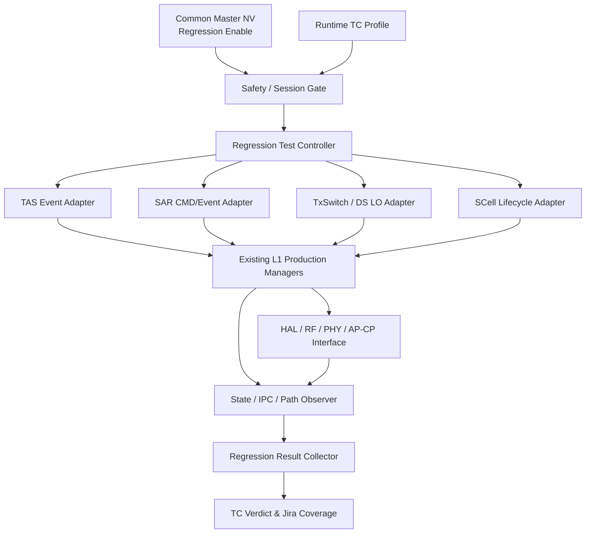

# TX Abnormal / SAR·TAS Postmortem 기반 L1 Regression Test 구축 — 발표 전 상세 검토 문서

- **버전:** v1.0 / 2026-10-15
- **문서 성격:** 발표 자료 작성 전 기술·운영 검토용 원본 (슬라이드가 아닌 상세 근거 문서)
- **추진 범위:** NR ULCA TX, Dual SIM TxSwitch/Abnormal TX, NR SAR, NR TAS/Combined TAS
- **핵심 목표:** 과거 결함을 단발성 수정 이력으로 끝내지 않고, **재현 가능한 Regression Testcase와 공통 NV 기반 반복 검증 환경**으로 전환
- **현 단계:** 1차 선별·사용자 재분류·결함 메커니즘 공유 완료 / Fix CL 실제 Diff·HLD 구현·Regression 실행은 미완료
- **근거 구분:** `[1차 화면]` 2026-10-14 촬영된 사용자 검토 보고서 화면, `[상세 화면]` 개별 Jira 설명 화면, `[사용자 확정]` 이후 대화에서 명시적으로 확정한 번호·원인·수정 내용, `[설계 제안]` 실제 구현 전 검토가 필요한 제안

> **이 문서의 읽는 순서:** 왜 시작했는가 → 처음 39건을 어떻게 정리했는가 → 왜 4개 Jira/5개 결함을 선정했는가 → 각 결함을 어떻게 재현할 것인가 → NV Test Mode로 어떻게 자동화할 것인가 → 무엇을 승인·구현·측정할 것인가.
>
> **자료 완전성:** 현재 제공된 것은 39건의 **전체 원본 MD/개별 행이 아닌 요약 화면**이다. 따라서 기존에 분석했으나 최종 대상이 아닌 Jira는 *화면에서 실제 확인된 정보 모두*를 아래에 수록했다. 보이지 않는 개별 Jira Key·CL·판정 사유를 39건 분량으로 임의 생성하지 않았다. 발표 전 39행 원본 보고서가 제공되면 부록의 `전체 이슈 원장`을 완성해야 한다.

---

## 1. 발표 핵심 메시지와 추진 배경

### 1.1 왜 Postmortem을 수행하는가

최근 확인한 TX Abnormal·SAR/TAS 결함은 단순 조건 오류만이 아니라 **특정 상태 전환 순서에서 자원 정리 누락, Stack 간 상태 불일치, 명령 완료 응답 누락, Callback/IPC 필드 불일치** 등으로 이어졌다. 일부는 CP Crash, 일부는 FBRX 비정상/Throughput 저하, 일부는 SAR Backoff의 복귀 실패로 나타났다.

기존 방식이 `상용 이슈 발생 → Jira 원인 분석 → Fix CL → 이슈별 검증 → 종결`에 머물렀다면, 이번 개선 방향은 `Jira/Postmortem → 실제 결함 시퀀스 추출 → Regression TC → NV Test Mode의 반복 자극 → 조기 실패 판정 → 신규 코드 변경 시 재검증`이다.

**최종 성공 기준:** (1) 과거 결함을 유발했던 전제 조건과 이벤트 순서를 반복 만들 수 있고, (2) 수정 의도에 맞는 중간 상태·출력을 직접 관측해 PASS/FAIL을 판정하며, (3) Jira ↔ Fix CL ↔ TC ↔ 실행 증거의 연결이 지속 유지되는 것.

### 1.2 목표 및 비목표

| 구분 | 내용 |
|---|---|
| 최종 목표 | **Common NV Enable 기반 L1 Regression Test Suite 구축** |
| 1차 범위 | TX Abnormal, NR SAR, TAS/Combined TAS, Dual SIM TxSwitch의 초기 5개 결함 시나리오 |
| 가속화 전략 | SW Event Injection/Sequence Repeat 우선, 안전성이 확인된 SW Timer만 선택적으로 단축 |
| 운영 원칙 | Production State Machine/Conflict Policy/HAL-RF-PHY 제어 경로를 우회하지 않음 |
| 검증 안전 | 실제 Time-Averaged SAR 제한, RF/PHY 필수 Timing, 보호 타이머를 무력화하지 않음 |
| 이번 발표 시점 비목표 | NV ID 실제 할당, Test Controller 코드 완성, 5개 TC 실행 PASS 달성 주장 |

---

## 2. 최초 Jira 39건을 어떻게 분석·정리했는가 — 선별 과정의 기록

### 2.1 최초 입력과 자동 분석 규칙

1. 사용자가 `Jira Issue List.md`를 제공하여 **검색 대상을 명시적으로 제한**했다.
2. Jira의 Description/Comment에서 Fix CL 후보, Re-fix/Backout, 연관 Issue를 수집하도록 했다.
3. `p4-code-owner v0.6.7`의 `jira-fix-cl-scan`과 Jira/Mango MCP를 연계하여 `submitted DEV Fix CL`의 실제 변경 파일을 확인하는 방식을 채택했다.
4. **당시 1차 기계적 L1 판정 기준:** DEV Fix CL 내 `/SMPF/Protocol/Channel/L1/` 경로 수정 포함 여부. 브랜치/Depot prefix 정규화, Simulator 제외. `MAIN/PROD_CI/PB/HE/BASE/Backout` CL은 Fix로 직접 인정하지 않되 이력으로 남김.
5. 근거 미확인 시 자동 판정은 `PENDING`으로 보존했다. `L1 여부 = Jira 라벨/담당자 소속`이 아니라 실제 소스 변경과 CL 역할을 우선했다.

**중요한 한계:** `/Channel/L1/` 경로만으로 L1_CHANNEL 전체 도메인의 모든 수정 이력을 완전히 포괄한다는 보장은 없다. SAR/TAS 구현 위치와 SMP1800/1900 분포, P4/PR 연결을 다시 확인해야 한다.

### 2.2 1차 자동 보고서 통계 — 당시 값 그대로 보존

| 1차 결과 | 건수 | 상세 의미 |
|---|---:|---|
| `INCLUDED_L1` | **2** | SSS9975XBA-7745, SOC-417026 |
| `NON_L1` | **13** | 판정 범위 외 수정 10건 + `RF_RELATED` 속성 3건 포함 |
| `PENDING` | **24** | `NO_CL_FOUND` 9건 / `NO_VERIFIED_FIX_CL_CANDIDATE` 15건 |
| **합계** | **39** | 2026-10-14 1차 화면에 표시된 조사 건수 |

그 당시 세부 분포 (원본 1차 보고서 화면 기준):

- Feature: **TX_ABNORMAL 30 / TAS 7 / SAR 1 / TX_RECOVERY 1** (39건)
- Failure Type: **UNKNOWN 24 / STATE 7 / CONFIG 5 / RESOURCE 2 / TIMING 1** (39건)
- 초기 L1 후보가 재검토 과정에서 **12건 → 2건**으로 줄었다는 기록: `Channel/L1` 경로를 엄격 적용하면서 10건이 NON_L1로 이동했고, RF 관련 3건도 NON_L1로 분류되어 별도 속성을 보존했다.

이 수치는 당시 **자동 규칙에 기반한 결과**이며, 현재 사용자가 확정한 최종 Postmortem 대상과 동일한 통계가 아니다.

### 2.3 사용자 검토 이후 재분류 이력

| 시점 | L1 | NON_L1 | PENDING | 해석 |
|---|---:|---:|---:|---|
| 1차 자동 보고 | 2 | 13 | 24 | 최초 39건 정리 |
| 사용자 재분류 지시 | **3** | **36** | **0** | PENDING 24건을 모두 NON_L1 처리하고 NR SAR 1건을 L1로 관리하는 방향으로 합의한 **39건 기준 잠정 집계** |
| 최종 분석 명세 확장 | **4개 고유 Jira** | 원본 NON_L1 원장과 별도 | 별도 재집계 필요 | SOC-417498을 추가하고 **동일 Jira의 Fix CL 2개를 TC 2개로 분리** |

**집계 시 주의:** 새로 추가한 SOC-417498이 원래 39건의 일부인지 아직 확인되지 않았다. 따라서 `4 + 36 = 40건`을 확정된 전체 검색 결과라고 발표하지 않는다. **발표에서 사용 가능한 확정 수치는 `1차 조사 39건`, `최종 선정 4개 Jira`, `Fix CL 5개`, `초기 Regression TC 후보 5개`**다. 39건의 분모/신규 이슈 포함 여부는 원장으로 확인한다.

**PENDING 정책 구분:** 사용자의 최종 *업무 분류*는 NON_L1이지만, 원래의 P4 증거가 자동으로 완비된 것은 아니다. 감사 추적을 위해 원래의 `NO_CL_FOUND/NO_VERIFIED_FIX_CL_CANDIDATE` 상태는 이력 필드에 남긴다.

### 2.4 제외·보류 이슈도 보존해야 하는 이유

- P4 CL이 있는 것만 보고 Fix로 잘못 판단하면 **Integration/Backout/BASE가 실제 수정으로 오인**될 수 있다.
- 동일 결함이 **중복 Jira, Clone, Re-fix, Backout**으로 나뉘면 추후 Regression Coverage가 과대 집계될 수 있다.
- 이 시점에 NON_L1로 판정됐더라도 RF/PHY/모뎀 관련 **경계 조건이나 Side Effect**는 초기 TC 설계 시 참고할 수 있다.
- 개별 Root Cause를 검증하기 전 `NON_L1 = 발생 원인이 L1과 무관`이라고 단정하지 않는다. 여기서는 **Postmortem 선정 규칙상 L1 Fix가 확인되지 않았음**을 의미한다.

---

## 3. 최초 보고서에 나타난 비대상·보류·관련 Jira 정보 보존

> 아래는 사용자 제공 **요약 화면에서 개별로 확인되는 정보**다. 원본 39개 전체 행을 보았다는 뜻은 아니다. `관련 Jira`나 `이력 참조`의 번호가 최초 39건에 모두 포함된 것인지도 원본 MD 없이는 확정할 수 없다. 이미 최종 대상인 Jira는 신규 비대상 건으로 중복 집계하지 않는다.

### 3.1 RF 관련 NON_L1 그룹 (당시 판정)

| 이슈 번호(화면 표기) | 당시 그룹 | 비고 |
|---|---|---|
| `414207` | NON_L1 / RF_RELATED | RF 관련으로 분류; 정확한 Jira Prefix 및 세부 Root Cause는 화면에 없음 |
| `413901` | NON_L1 / RF_RELATED | RF 관련으로 분류; 아래 중복/종결 참조에서도 언급됨 |
| `413153` | NON_L1 / RF_RELATED | RF 관련으로 분류; 상세 Fix 근거는 원본 확인 필요 |

**조치:** L1 Regression 선정에서는 제외하되 RF 파트 사후 검토 대상으로 전달 가능한 구분을 유지한다. 위 3건을 SAR/TAS L1 TC로 자동 합산하지 않는다.

### 3.2 Fix/Integration/Backout/Re-fix 구분 사례 — 과거 선별 판단을 보여주는 주요 증거

| Jira | 화면에서 확인된 CL/연결 관계 | 당시 해석과 유지할 근거 |
|---|---|---|
| `SSS9975XBA-8388` | 후보 `5324186` ↔ 대상 `SSS9975XBA-7745` Fix `5322160` | `5324186`은 **PROD_CI(T1_M2700) HE 제출**로 설명됨. `ch_L1cBchNr.cpp` 언급이 있어도 직접 DEV Fix로 보지 않아 당시 PENDING 유지; 7745 계열 관련성만 보존 |
| `SSS9975XBA-7980` | Fix `5322052` + `5327981` → 개선 `5342780` → Backout `5354045` → 동일 Title Re-fix `5357550` | **Backout과 Re-fix의 계보 보존**이 중요. Backout 사유는 화면에서 `미확인`이며 임의 추정 금지 |
| `SSS9975XBA-8413` | 자체 Fix CL 없음; Crash Build Base `5334204`; PROD_CI `5334031`, `5334137` (= `5330056` Backout) | 화면 설명상 **SOC-413700 Regression 관련**이며 Channel/L1 파일 수정이 포함됐더라도 이 CL들은 해당 Jira의 **Fix가 아닌 빌드 구성/Backout 이력**. 7980 Fix로 해소됐다는 기록 보존 |
| `SOC-411616` | Fix `5324731` + HE(SMP1900 PR `2075`) | 수정 근거가 있는 별도 이슈. 그러나 당시 선별 기준에서의 L1 포함 여부는 본 요약 화면으로 독립 확인 불가 |
| `411838`, `411829` | `SOC-411616`과 동일 이슈 Fix 상속 | 중복·연관 Jira가 별도 수정 건으로 중복 집계되지 않도록 관계 보존 |
| `SOC-413700` | `SSS9975XBA-8413`의 Regression 설명에 등장 | 원인·CL의 직접 매핑은 요약 화면만으로 불충분; 관계 참조만 유지 |

**중요 원칙:** `실제 코드베이스에 L1 파일이 들어 있다`와 `이 Jira를 해결한 L1 DEV Fix CL이 확인됐다`는 다른 판정이다. 특히 `SSS9975XBA-8413` 같은 빌드 Backout 사례는 대표적인 오분류 방지 예시다.

### 3.3 1차 PENDING 24건의 근거 유형 — 최종 업무 분류가 NON_L1이어도 이력 유지

| 당시 상태/유형 | 건수 | 화면에서 확인된 설명 |
|---|---:|---|
| `NO_CL_FOUND` | 9 | 확정 Fix CL 미탐지 |
| `NO_VERIFIED_FIX_CL_CANDIDATE` | 15 | CL 언급은 있으나 submitted DEV Fix라고 입증 불충분 |
| **합계** | **24** | **사용자 검토 후 업무 분류에서는 NON_L1로 이동** |

화면에 나타난 보류/중복 종결 하위 분류(서로 독립적인 39개 행이 아니라 당시 24건의 원인 분류):

- `로그 불충분` **9건**
- `중복 종결` **9건**: 예시 관계 `418166 → 418177`, `413906 / 413902 → 413901`, `413641 / 413614 / 412741 / 412062 → 411616`, `410349 / 410859 → 409107`
- `분석 불가` **4건**
- `재현 불가` **3건**: 이 중 `SSS9975XBA-8388` 관련 병합 언급
- `미확정·진행 중` **2건**: `412508`, `414962`

> **주의:** 위 하위 분류 수의 단순 합은 24가 아니다. 화면에 기록된 분류가 **서로 겹치거나 분모가 다를 수 있으며**, 원본 보고서의 각 행과 대응 관계는 추가 확인해야 한다. 이 문서에서는 이를 임의로 24건에 맞춰 조정하지 않았다.

**추가 확인이 필요했던 항목 (당시 기록):** `SSS9975XBA-7980`의 Backout `5354045` 사유, 15건의 Side Effect 상태(`UNKNOWN` 다수), Side Fix CL/Dependency CL/APR의 진짜 역할, RF_RELATED 3건의 RF Owner 사후 검토.

### 3.4 SAR 관련 Jira/CPR 번호 혼동 및 다른 개선 이력 분리

화면에서 **두 개의 서로 다른 수정 흐름**이 확인되며, 이후 대화에서 **Postmortem 표시용 Jira Key를 수정**했다. 이는 발표 전 추적성 검증이 필요한 중요 사례다.

| 항목 | 화면의 이력 | 이후 사용자 최종 지시 / 문서상 처리 |
|---|---|---|
| NR Suspend SAR CMD Completion | `CPR-181974`, Fix CL `5347442`, `SAR_LIMIT_POLICY_NR_CMD`에서 CmdDone 누락 | **Postmortem 대표 Jira는 `SOC-415399`로 사용**하고 Fix CL `5347442`를 연계. CPR-181974는 중복 집계하지 않는 관련 이슈/수정 증빙으로 보존 |
| 3G MDVFS / SRNC Recovery | `SOC-415399` 화면에는 `PRE-29988`, DEV CL `5347786`, MAIN `5350020`, `CPR-181979`, PR `#3285`가 **별도 3G Decoder/Clock 수정**으로 기재됨 | **SAR CL `5347442`로 대체해서 쓸 수 없는 별도 이력**. 동일 SOC Key가 서로 다른 기술 내용으로 등장하는 **자료 불일치**로 표시하고, 실제 Jira 링크/댓글/CL 계보 확인 전 두 수정이 같은 Cause라고 주장하지 않음 |

- 3G 이력의 화면 설명: HSDCCH 동작 중 MDVFS RT/NRT Clock 판단 오류 → Decoder stuck → SRNC Recovery/CP Crash; RT/NRT Clock 상태를 모두 고려하도록 수정 (`5347786`). **본 프로젝트의 NR SAR Regression TC 후보로 채택하지 않는다.**
- **발표 전 확인 필수:** 사용자 명시 기준 `SOC-415399 → SAR CL 5347442`를 이 문서의 **작업 관리 Key**로 사용하되, 화면 원문과 충돌함을 그대로 기록한다. Jira 원본 확인 이후 대표 Key 또는 관련 관계를 정정할 수 있어야 한다.
- 이 정보는 유실·숨김 처리하지 않고 **비대상 이력/증거 충돌 사례**로 부록에 유지한다.

### 3.5 제외 원장 완성에 필요한 파일

최초 보고서 전체 원본(예: `39건 요약표`, `NON_L1 상세 13건`, `PENDING 상세 24건`, `CL Index`, `Evidence File Links`)이 제공되면 다음 컬럼으로 39행을 재구성한다.

`Original_Order | Jira_Key | Initial_Status | Final_Business_Status | Feature | Symptom | Candidate_CLs | Verified_DEV_Fix_CL | Integration_Backout_ReFix | Modified_Files | L1_Scope | Exclusion_Reason | Related_Issues | Evidence_Link | Review_Status`

현재 문서만으로는 **39건의 1:1 전체 목록을 재구성할 수 없으며**, 그 빈칸을 임의 Issue Key나 원인으로 채우지 않는다.

---

## 4. 최종 Postmortem 대상 — 4개 Jira / 5개 Fix CL / 5개 Regression TC

| # | 대표 Jira | 영역 | Fix CL | 핵심 결함/영향 | TC ID |
|---|---|---|---|---|---|
| 1 | **SSS9975XBA-7745** | NR ULCA TX | **5322160** | SCell Deactivation 후 Release 없는 ALL STOP → RF TX Release 누락/DB 미초기화 → 신규 SCell Config 실패·Data Abort | `L1_REG_TX_001` |
| 2 | **SOC-417026** | Dual SIM TxSwitch / Abnormal TX | **5359626** | DS SASA n28+n28 공유 DAC 경로의 Stack AS Status 불일치 → Coupler 오설정 → FBRX 측정 실패 반복 → RF Stabilization 강제 Crash | `L1_REG_TXSW_001` |
| 3 | **SOC-415399** | NR SAR | **5347442** | NR RAT Suspend 중 SAR CMD CmdDone 미전송 → CMD Queuing | `L1_REG_SAR_001` |
| 4A | **SOC-417498** | Combined TAS / SAR | **5358982** | C-TAS의 SAR Callback `functionType` 오류 → `COMBINED_TAS_INFO_IND` 미전송 → Throughput 저하 | `L1_REG_CTAS_001` |
| 4B | **SOC-417498** | TAS Abnormal Backoff / SAR | **5362081** | NR Attach의 Abnormal Table AP Event 후 Backoff 함수와 SAR IPC 간 TxPath Index 불일치 → Backoff/No-Backoff 복귀 실패 | `L1_REG_TAS_001` |

- `SOC-417498`은 **고유 Jira 1건**이지만 **수정 CL과 결함 경로가 두 개**이므로 TC는 각각 별도로 관리한다. 두 Root Cause가 동일하다고 가정하지 않는다.
- `SOC-417026` CL은 사용자가 정정 확정한 **5359626**만 사용한다(오타 `5369626` 폐기).
- `SSS9975XBA-7745`의 본질은 앞선 요약의 `stale index` 자체가 아니라 사용자가 이후 공유한 **RF TX Release/RF DB 정리 누락 Sequence**로 기술한다.
- `SOC-415399`의 Key/CL 원문 충돌은 §3.4의 확인 항목을 유지한다.

---

## 5. 개별 Postmortem 및 Regression Testcase 상세 명세 (초안)

모든 TC는 **실제 코드/로그/P4 Diff로 주입 API 및 관측 Signal을 검증하기 전까지 설계 초안**이다. 숫자형 주기/반복 횟수/타이밍 PASS 한계는 정하지 않았다. 초기 재현 성공 여부를 확인한 뒤 성능·안전성 검토를 통해 지정한다.

### 5.1 `L1_REG_TX_001` — NR ULCA SCell ALL STOP / RF TX Resource Release

- **Jira / Fix:** `SSS9975XBA-7745` / DEV `5322160`
- **사용자 제공 결함 메커니즘:** NR ULCA에서 SCell Deactivation 후 **SCell Release 없이 ALL STOP REQ**가 수신되면 Band 정보가 0으로 초기화되고 RF TX Release가 수행되지 않는다. RF DB가 정리되지 않은 상태에서 새 NR UL SCell Config가 진행되면 새 SCell RF TX를 할당하지 못하며, 이후 PHY TX 중 Data Abort가 발생한다.
- **수정 의도:** ALL STOP 시 **SCell이 Config 상태이면 RF TX Release**를 수행하도록 수정.

**시나리오/관측/판정**

| 순서 | 자극/전제 조건 | 필수 Observability / 기대 결과 |
|---:|---|---|
| P1 | NR ULCA PCell + UL SCell 구성 완료 | 초기 SCell Config State, RF TX Allocation 기록 |
| 1 | SCell Deactivation 수행 | Deactivated 상태/구성 상태 구분 기록 |
| 2 | SCell Release 없이 `ALL_STOP_REQ` 전달 | ALL STOP 수신 시점에 해당 SCell이 Config 상태임을 확인 |
| 3 | ALL STOP 처리 경로 관측 | **RF TX Release 호출/완료**와 올바른 대상 경로 확인. Band=0 이후 무효 정보 사용 금지 |
| 4 | RF DB 정리 결과 관측 | 기존 SCell 자원 소유/할당 정보가 다음 Config를 막지 않음 |
| 5 | 새로운 UL SCell Config/Activation 진행 | 새 SCell RF TX Alloc/Config 성공 |
| 6 | PHY TX 동작 및 상태 관측 | 유효한 RF TX Path 사용, Data Abort 미발생 |
| 7 | 복귀 후 다시 반복 | 초기 상태 회복, 자원 누수·Stale DB 누적 없음 |

- **Primary Oracle:** Config SCell의 ALL STOP 시 Release 완료 + 재Config 시 RF TX 재할당 성공.
- **Secondary Oracle:** PHY TX의 유효 Path / Data Abort 없음 / 연속 Loop 후 Resource Leak 없음.
- **Test Hook:** `SCell Deactivation → ALL STOP → New Config` 시퀀스 구동. 기본 TAS/SAR/TxSwitch 이벤트 Adapter **이외에 SCell Lifecycle Scenario Adapter**가 필요할 수 있다.
- **Automation:** `PARTIAL`(초안). 실제 RF DB 상태를 관측/제어할 수 있는 HW·테스트 환경 확인 후 `AUTO` 여부 판정.
- **관련 API·정확한 Event 구조 및 최소 간격:** `5322160` 수정 Diff, HAL/RF 호출 흐름 분석 후 확정.

### 5.2 `L1_REG_TXSW_001` — DS Conn-Conn LO Switching / Cross-Stack AS Consistency

- **Jira / Fix:** `SOC-417026` / DEV `5359626` (이후 MAIN `5362634`는 화면상의 적용 이력)
- **환경:** **SASA DS Conn-Conn, n28+n28**, 두 Stack이 **동일 TX DAC Path** 공유, LO Switching 동작.
- **사용자 제공 결함 메커니즘:** 두 Stack에서 TxSwitch AS Switch Status 불일치 → Front-End Coupler 설정 불일치 → FBRX 비정상 측정 → Abnormal TX(FBRX) 약 20회 반복 → RF Stabilization 강제 Crash.
- **수정 의도:** DS LO Switching 시 **양쪽 Stack의 AS Switch Status를 일치**시키도록 수정.

| 순서 | 자극/전제 조건 | 필수 Observability / 기대 결과 |
|---:|---|---|
| P1 | 두 Stack Conn-Conn, n28+n28, 동일 DAC 공유 확인 | Stack0/1 PCell AS, TX DAC 소유 상태, Coupler Baseline |
| 1 | LO Switching이 가능한 조건 구성 | DS/LO Switching Trigger 충족 여부 |
| 2 | LO Switch/Event 반복 | 양쪽 Stack의 AS Switch Status 수집(동일 시점/동일 Path 기준) |
| 3 | FE Coupler 재설정 동작 확인 | 공유 DAC 경로의 Coupler 설정 **동일 정책/유효 구성** 유지 |
| 4 | FBRX 측정 확인 | FBRX 결과 유효, Abnormal Counter 증가 원인 없음 |
| 5 | 복수 Loop 수행 및 종료 | Crash/강제 Stabilization Recovery 없이 상태 정상 유지 |

- **Primary Oracle:** LO Switching 완료 뒤 두 Stack의 AS 상태와 Coupler 정책 정합성.
- **Secondary Oracle:** FBRX 유효 측정 및 Abnormal Counter 비증가, Crash 미발생.
- **Early Fail:** 20회 누적 Crash를 기다리지 않고 **AS 불일치/Coupler Misconfig/FBRX 연속 오류 최초 검출 시 Fail**.
- **Test Hook:** DS LO Switching 및 각 Stack 상태/Peer Event를 기존 TxSwitch Production Path로 전달해야 함. `Evaluate → ConflictResolver → CommandRunner` 구조는 이전 설계 개념이며 실제 코드 검증 필요.
- **Automation:** `PARTIAL`(초안). DS HW/LO Switching/FBRX 계측 의존도가 높아 실장비 기반 반복 검증 가능성 확인 필요.

### 5.3 `L1_REG_SAR_001` — NR RAT Suspend / SAR CMD CmdDone

- **관리 Jira / Fix:** 사용자 최종 기준 `SOC-415399` / `5347442`; 과거 자료의 수정 항목 `CPR-181974`는 관련 이력으로 보존, §3.4 참조.
- **문제:** NR RAT Suspend 상태에서 `SAR_LIMIT_POLICY_NR_CMD`를 수신해도 `CmdDone`을 전송하지 않아 CMD Queue가 정체됨.
- **수정 의도:** NR Suspend 상태에서도 해당 CMD의 `CmdDone`이 누락되지 않도록 처리.

| 순서 | 자극/전제 조건 | 필수 Observability / 기대 결과 |
|---:|---|---|
| P1 | NR RAT Suspend 진입 | RAT State = Suspend 확인 |
| 1 | `SAR_LIMIT_POLICY_NR_CMD` 전달 | IPC CMD 수신/Trace ID/Seq ID 확인 |
| 2 | CMD 처리/완료 경로 관측 | **대응하는 CmdDone 전송**, 누락·중복 없음 |
| 3 | 후속 SAR CMD 또는 다른 Queue 항목 전달 | 앞선 CMD가 Queue Head에 남아 후속 처리를 막지 않음 |
| 4 | Suspend 상태에서 반복 | Queue Depth 장기 증가 없음, Timeout 없음 |
| 5 | NR Resume 후 정상 처리 검증 | 상태 복귀와 SAR CMD 처리 정상 |

- **Primary Oracle:** 수신 CMD 1개에 대해 올바른 Completion이 정해진 정책에 따라 1개 기록되며, Queue가 정상 진행.
- **Secondary Oracle:** Suspend/Resume 전이 후 Queuing Stall 없음.
- **Test Hook:** NR Suspend 조건 제공 + 합법적 CMD Injection. SAR 제한 값을 무력화하거나 전송 출력 상승을 유발하는 테스트는 제외.
- **Automation:** `AUTO` 후보(초안). 단, 실제 Suspend 유도/IPC 관측 지점 확인 필요.

### 5.4 `L1_REG_CTAS_001` — AP(Wi-Fi)↔CP(NR TAS) Combined TAS Callback

- **Jira / Fix:** `SOC-417498` / `5358982`
- **기능 정의 [사용자 제공]:** Combined TAS는 **AP의 Wi-Fi와 CP의 NR TAS 모듈이 동일 주파수 대역을 사용하는 조합 동작**에서 **Time-Averaged SAR** 요구사항을 만족하기 위한 기능이다.
- **문제:** C-TAS 동작 중 SAR CMD Callback의 `functionType` 오류 → `COMBINED_TAS_INFO_IND` 미전송 → Throughput 저하.
- **수정 의도:** Callback의 올바른 Function Type 흐름을 통해 해당 IND가 정상 전달되도록 보장.

| 순서 | 자극/전제 조건 | 필수 Observability / 기대 결과 |
|---:|---|---|
| P1 | 지원되는 Wi-Fi/NR 동일 대역 조합 구성 | AP Wi-Fi Active, CP NR TAS/Combined TAS 조건 만족 |
| 1 | Combined TAS 시나리오 시작 | Combined TAS 상태 및 SAR Policy Baseline |
| 2 | SAR CMD Event 및 Callback 유도 | CMD ID / Callback ID / **functionType 기대값** 기록 |
| 3 | CP 내부 Callback 분기 검증 | `functionType`이 정확한 경로에 매핑됨 |
| 4 | AP-CP Interface 관측 | 필요한 조건에서 **`COMBINED_TAS_INFO_IND` 전송** |
| 5 | AP 측 반영 여부 확인 | IND 수신·상태 동기화(확인 가능한 경우) |
| 6 | SAR/Throughput 영향 각각 관측 | Time-Averaged SAR 준수와 Throughput Baseline 대비 영향 **독립 판정** |
| 7 | Event 반복/복귀 | IND 누락, 상태 누적, 비정상 Throughput 저하 없음 |

- **Primary Oracle:** 정확한 `functionType` → 조건에 맞는 IND 발행/수신의 종단 추적.
- **Separate Safety Oracle:** 실제 평균 SAR 정책 적용을 검증하며 Throughput 정상화만으로 SAR 준수 판정 금지.
- **Automation:** `PARTIAL` 후보. AP/Wi-Fi와 CP 간 동작/계측 환경 필요.
- **확인 필요:** `5358982`의 실제 기대 `functionType` 값, IND 필드/타이밍/ACK, 기준 Throughput과 Time-Averaged SAR 윈도우.

### 5.5 `L1_REG_TAS_001` — NR Attach Abnormal TAS Backoff / SAR TxPath Consistency

- **Jira / Fix:** `SOC-417498` / `5362081` (**같은 Jira 내 다른 결함/다른 TC**)
- **문제:** NR Attach에서 Abnormal Table에 따른 AP Event 발생 후 **Abnormal Backoff 함수와 SAR IPC가 서로 다른 `txpath index`**를 사용해 SAR Limit 기반 Backoff/No-Backoff 상태가 정상 복귀하지 않음.
- **수정 의도:** SAR Limit 처리에서 **올바른 TxPath Index**를 설정하도록 수정.

| 순서 | 자극/전제 조건 | 필수 Observability / 기대 결과 |
|---:|---|---|
| P1 | NR Attach 환경, Abnormal Table의 해당 조건 활성 | RAT/Stack/TxPath Allocation 및 SAR Limit Baseline |
| 1 | NR Attach 및 AP Event 주입/유도 | AP Event, Abnormal Backoff 조건 트리거 |
| 2 | Abnormal Backoff 수행 | Backoff 함수가 사용하는 TxPath Index 기록 |
| 3 | SAR IPC 전송/적용 | SAR IPC의 TxPath Index가 **실제 대상 Path와 동일** |
| 4 | SAR Limit에 따른 Backoff 상태 변경 | 제한이 올바른 TX Path에 반영 |
| 5 | AP Event/Limit 정상 복귀 조건 제공 | Backoff → No-Backoff 또는 원래 Policy 상태 복귀 |
| 6 | 연속 이벤트 및 반복 검증 | 잘못된 Path 잔존·Backoff 고착·SAR 제한 우회 없음 |

- **Primary Oracle:** 동일 대상 TxPath 사용, 올바른 SAR Limit 적용, 정책에 따른 Backoff/No-Backoff 복귀.
- **Safety Oracle:** 해제 시에도 실제 적용해야 하는 SAR Limit를 초과하지 않음.
- **Automation:** `PARTIAL` 후보. Abnormal Table/AP Event 주입의 가용성, RF/TxPath 관측이 필요.
- **확인 필요:** `5362081`에서 수정된 Index 소스, 대상 TxPath Mapping, AP Event 타이밍 및 Backoff 해제 조건.

---

## 6. 공통 문제 패턴과 Regression 전략

| 결함 패턴 | 이슈/CL | 실패 전 검출해야 할 불변조건(Invariant) | 개선 방향 |
|---|---|---|---|
| **Resource Lifecycle** | 7745 / 5322160 | ALL STOP 이후 기존 Config SCell RF TX 자원이 다음 Config를 막지 않음 | Release/재할당 Lifecycle TC |
| **Cross-Stack State Consistency** | 417026 / 5359626 | 동일 DAC 공유 시 Stack 간 TxSwitch AS 상태와 FE Coupler 설정 일관 | DS LO Switching Loop + FBRX 조기 검사 |
| **Command Completion** | SAR / 5347442 | Suspend 상태에서도 CMD Completion/Queue 진행 보장 | Suspend↔CMD 교차 TC |
| **Callback/IPC Semantics** | 417498 / 5358982 | functionType 정상 분기와 AP-CP IND 전달 | Combined TAS End-to-End TC |
| **TxPath Consistency / Restoration** | 417498 / 5362081 | SAR Limit 대상 Index 정합성과 Backoff 해제 | NR Attach/AP Event 반복 TC |

**공통 관찰:** 특정 **Event Sequence 경계에서 상태(State)·자원(Resource)·명령/IPC(Interface)의 일관성**이 깨지는 유형이 반복됐다. 이것은 **구조적 개선을 검토하기 위한 분석 프레임**이지, 서로 다른 5개 결함의 단일 원인이 코드로 검증됐다는 뜻은 아니다.

**Regression 전략:** Crash/Throughput 결과만 보지 않고 문제의 **첫 번째 중간 상태 위반**(RF Release 누락, AS Status mismatch, CmdDone 누락, functionType 오류, TxPath mismatch)을 조기 검출한다.

---

## 7. 공통 NV 이름 제안 및 운영 정책

### 7.1 NV 명칭 후보

| 순위 | NV 후보 | 장점 / 판단 |
|---:|---|---|
| **1 (권장)** | **`NV_L1_REGRESSION_TEST_ENABLE`** | 사용 목적과 Enable 성격이 가장 명확하며 기존 합의명과 일치. TX뿐 아니라 SAR/TAS/TxSwitch/SCell Lifecycle로 확장 가능 |
| 2 | `NV_L1_CHANNEL_REG_TEST_ENABLE` | L1_CHANNEL Owner/Feature 범위가 명확. 다만 Channel 외 영역과 공용 확장 시 다소 제한적 |
| 3 | `NV_L1_TX_REGRESSION_MODE` | 짧고 TX 중심성이 명확하지만 SAR/TAS와 SCell Lifecycle로의 범위 확장성을 좁게 보이게 함 |

**추천:** 논리 명칭 `NV_L1_REGRESSION_TEST_ENABLE`; 실제 프로젝트의 NV Naming Convention/ID/Owner/읽기 시점은 구현 전 결정한다. 문자열은 **제안**이며 존재하는 플랫폼 NV로 단정하지 않는다.

### 7.2 공통 NV 1개 + Runtime Profile

| 모드 | 동작 |
|---|---|
| NV=0 | Test Controller 비활성, Production Event/Timer/State 변경 없음 |
| NV=1 / Session 없음 | Test Mode 진입 **허용**만, 자동 이벤트 주입 금지 |
| NV=1 / 승인된 Test Start | 선택된 TC Profile의 Event/Sequence 반복 시작 |
| Test Stop/Timeout/Failure | 주입 중단, Pending 정리, 기존 Production State에 안전하게 복귀 |
| RF/SAR 보호 조건 위반 위험 | Event/Action Reject 또는 안전한 Test Sandbox로 전환, 근거 기록 |

기능별 Enable은 NV 추가가 아니라 런타임 Profile에서 처리한다.

```yaml
# 설계 예시. 실제 Config 인터페이스·값·최소 간격 미확정.
regression_test:
  scenario_id: L1_REG_SAR_001
  repeat_count: TBD
  stop_on_failure: true
  source: engineering_test_only
  adapters:
    sar: true
    tas: false
    txswitch: false
    scell_lifecycle: false
  event_period_ms: TBD
  observer_profile: sar_cmd_queue
```

### 7.3 High-Level Block Diagram (논리 설계)



- Adapter는 테스트 자극 발생과 Sequence 재현을 담당한다. **실제 전송 Path 할당과 SAR/RF 제어 결정은 기존 SW에서 수행**한다.
- SCell Lifecycle Adapter가 추가로 필요한 이유는 `L1_REG_TX_001`의 ALL STOP 재현이 TAS/SAR/TxSwitch 단순 주기 가속으로 충족되지 않기 때문이다.
- **Event Acceleration 우선:** Event 생성 빈도를 높이되 처리 완료/Backpressure/State Stable 확인 없이 다음 Event를 강제로 밀어 넣지 않는다.
- **Timer Acceleration 선택:** 기능 SW Timer Owner, RF/PHY 필수 타이밍/안전 최소값, SAR Rolling Average 윈도우를 분리 검토한 후 승인된 Timer만 가속한다.
- **상용 안전:** Engineering/Test 환경 Gate, NV 오작동 방지, Watchdog/Timeout, Run 종료 시 Test Mode 영향 제거.

### 7.4 PASS/FAIL 데이터 수집 공통 필드

`Run_ID`, `TC_ID`, `Jira_Key`, `Fix_CL`, `Branch/Build`, `NV_State`, `Test_Profile`, `RAT/Band/Stack`, `TxPath/Resource Map`, `Event Name`, `Event Timestamp`, `Expected State`, `Actual State`, `IPC Completion`, `Loop Index`, `Measurement Validity`, `Failure Signature`, `Safety Check`, `Result`, `Evidence Link`.

Outcome은 `PASS / FAIL / INCONCLUSIVE / BLOCKED`로 구분한다. **Test Setup이 실행되지 않았거나 관측이 부족하면 PASS 처리하지 않는다.**

---

## 8. 구현·검증 우선순위 및 단계별 완료 기준

| 단계 | 해야 할 일 | Gate / 산출물 |
|---|---|---|
| **Phase 0 — Source Reconciliation** | 39건 원본 확보, 일부 Jira/CL 충돌(특히 SOC-415399) 재확인, 비대상 원장 재구성 | 승인된 Jira↔CL Traceability 및 제외 사유 |
| **Phase 1 — Code Fact** | 5개 Fix CL Diff, 변경 API, Event Source, State/Queue/RF DB/TxPath/Callback의 수정 전후 흐름 | Jira별 Postmortem Report + Evidence |
| **Phase 2 — TC Spec** | 5개 TC별 Precondition, Stimulus, Expected/Observer/Fail-Fast, Recovery, AUTO/PARTIAL 분류 | `Regression_TC_List.md`, 개별 `TC_Spec.md` |
| **Phase 3 — Test Mode HLD/MSC** | NV, Safety Gate, Controller, 4종 Adapter, 관측 구조, Multi-Stack/AP 협조, Timer Ownership | HLD/MSC, 영향 분석, NV 승인안 |
| **Phase 4 — PoC** | 가능하면 `SAR CmdDone`과 같은 관측 신호가 명확한 TC부터 작은 범위의 주입/판정 검증 | PoC 증거 / 성공·제약 기록 |
| **Phase 5 — 확장 구현** | DS LO, C-TAS AP-CP, Abnormal Backoff, ULCA Lifecycle 시나리오 추가 | 승인 범위 구현 / 시나리오 자동화 |
| **Phase 6 — 반복·회귀 검증** | Loop 반복, FAIL Signature, HW별 Auto/Partial 기준, 변경 코드 대상 정기 실행 | Regression Execution Report 및 Jira/TC Coverage |

**개발 승인 정책:** Phase 0~3은 읽기 전용 분석·문서 작성 중심. 코드 수정, 빌드/UT, P4 Submit, Git Push/PR, Jira 신규 작성/Comment는 각각 별도 요청·승인이 있어야 한다. 일반 빌드/UT는 기본 OFF.

**PoC 권장:** `L1_REG_SAR_001`은 CmdDone/Queue의 Oracle이 상대적으로 명확해 1차 후보. 하지만 Suspend Event 생성과 SAR CMD 주입이 불가능하면 다음 후보로 전환하며, 구현 용이성을 아직 검증된 사실로 표현하지 않는다.

---

## 9. 최종 보고 구조 — 선별 과정부터 자동 검증까지

```text
L1_TX_SAR_TAS_Postmortem_Regression/
├── 00_Input/
│   ├── Original_Jira_Issue_List.md
│   └── Screening_Policy_and_Review_History.md
├── 01_Screening/
│   ├── Original_39_Issue_Register.md
│   ├── NON_L1_Excluded_Evidence.md
│   ├── Related_Clone_Backout_ReFix_Index.md
│   └── Final_L1_Target_List.md
├── 02_Postmortem/
│   ├── SSS9975XBA-7745_Postmortem.md
│   ├── SOC-417026_Postmortem.md
│   ├── SOC-415399_Postmortem.md
│   └── SOC-417498_Postmortem.md   # 내부에 CL 2개, TC 2개
├── 03_Regression_TC/
│   ├── Regression_TC_List.md
│   ├── Jira_CL_TC_Traceability_Matrix.md
│   └── TC_Specs/
├── 04_Design/
│   ├── Common_NV_TestMode_HLD.md
│   ├── Adapter_Trigger_Observer_Matrix.md
│   └── MSC/
├── 05_Verification/
│   ├── Regression_Execution_Report.md
│   └── Regression_Coverage.md
└── 06_Presentation/
    ├── Postmortem_Presentation_Brief.md
    └── Action_Items.md
```

### 보고 지표 구분

1. **Screening Coverage:** 최초 조사 cohort 39건 중 결과 분류·근거 보존율. 신구 집계 혼합 금지.
2. **Postmortem Scope:** 고유 Jira 4건, **Fix CL 5개**, 초기 TC 후보 5개.
3. **TC Design Coverage:** 5개 결함 메커니즘 중 검증 가능한 `TC Spec + Oracle` 정의 완료 수.
4. **Automation Coverage:** AUTO/PARTIAL/MANUAL/BLOCKED 및 실제 수행 가능 TC 수.
5. **Execution Coverage:** 실행/관측/PASS 증거가 있는 TC 수. **설계된 TC를 실행 완료로 집계하지 않음.**
6. **Fail-Fast Effect:** Crash·Tput 저하가 나타나기 전에 감지한 상태/IPC 불일치의 수.

---

## 10. 발표용 추천 스토리라인 (6~7장 + Appendix)

| 장표 | 제목 | 포함 내용 / 전달 메시지 |
|---:|---|---|
| 1 | **추진 배경 및 목표** | 상용 결함의 단발성 Fix를 자동화 Regression 자산으로 전환 |
| 2 | **Jira 39건 선별 과정** | 초기 `2/13/24` 구분, DEV Fix/Integration/Backout 구별, 사용자 재분류, 후속 4개 Jira 선정까지 **추적 가능한 과정** |
| 3 | **Postmortem 4개 Jira / 5개 Fix CL** | 각 이슈의 최종 증상·Root Cause·Fix 의도 한 줄 요약 |
| 4 | **5개 결함의 공통 취약점** | Resource Lifecycle / Cross-Stack State / CmdDone / Callback-IPC / TxPath-Restore |
| 5 | **Regression TC 5개** | 각 Trigger Sequence와 Crash 이전 Early Fail/Oracle 중심 |
| 6 | **Common NV 기반 가속 검증 구조** | NV 후보, Controller + TAS/SAR/TxSwitch/SCell Lifecycle Adapter, Safety |
| 7 | **추진 계획·의사결정 요청** | CL 검증/TC Spec → HLD/MSC → PoC → 확장, Tool/HW/Owner/Gate |
| Appendix | **제외·중복·Backout·재분류 근거** | RF 3건, 7980/8413/8388, 411616 관련, PENDING 세부, SAR Jira/CL 화면 충돌, Source Evidence |

**발표에서 하지 말아야 할 주장:** “39건 전체의 P4 원인이 확정되었다”, “NON_L1은 무조건 영향 없음”, “SOC-415399↔5347442의 Jira 원본 매핑 검증 완료”, “NV/HLD/자동화 구현 완료”, “5개 TC PASS” 같은 현재 증거 밖의 표현.

**발표 마무리 권장 메시지:**

> TX Abnormal 및 SAR·TAS 이슈를 Jira/P4 기반으로 선별·분석하고, 유효한 결함 5개를 실제 재현 Sequence와 자동 판정 조건으로 전환한다. 공통 NV 기반 L1 Regression Test Mode를 구축하여 TAS/SAR/TxSwitch 및 SCell Lifecycle 동작을 반복 검증하고, 문제 발생 후 수정에서 **문제 재발 전 검출**로 검증 방식을 발전시킨다.

---

## 11. 발표 전 확인 체크리스트

- [ ] 최초 39건 **전체 원본 MD 및 개별 Evidence** 확보 — 이 문서의 비대상 Jira 원장을 완성
- [ ] SOC-417498이 최초 39건에 포함됐는지 확인 — 전체 분모 중복 방지
- [ ] `SOC-415399` 표기와 `CPR-181974 / 5347442` 및 기존 **3G Recovery `5347786`** 자료 충돌 해소
- [ ] 5개 Fix CL 실제 `describe/diff` 및 변경 API/Branch 적용 여부 검증
- [ ] 5개 TC의 입력 자극 지점과 Oracle/Signal 확보 방안 확인
- [ ] Test HW 필요 조건: DS Conn-Conn, NR ULCA, NR Suspend, Wi-Fi/NR Combined TAS, AP Event/TxPath
- [ ] 공통 NV 명칭/ID/Ownership 및 Test Only Gate 승인
- [ ] SAR 보호와 Time-Averaged SAR 준수, RF/PHY 타이밍 영향 검토
- [ ] Phase 1~3 분석 문서 승인 후 구현·테스트 실행 범위 별도 승인

## 12. 결론

- **선별 과정도 결과의 일부**다. 39건 중 왜 L1 Fix 검증 대상으로 남긴 건수가 적은지, 무엇이 Integration/Backout/중복/증거 부족이었는지 기록을 보존한다.
- 현재 **초기 개발 대상은 4개 Jira / 5개 Fix CL / 5개 TC 후보**이며, 정확한 Root Cause 및 TC Hook은 실제 Fix Diff 확인 후 확정한다.
- **기술적 제안은 `NV_L1_REGRESSION_TEST_ENABLE` + 공통 Test Controller + 기능별 Event Adapter + Early-Fail Observer**다.
- 목표는 ‘보고서 완성’이 아니라 **안전하고 반복 가능하며 증거를 남기는 Regression 검증 체계 구축**이다.
