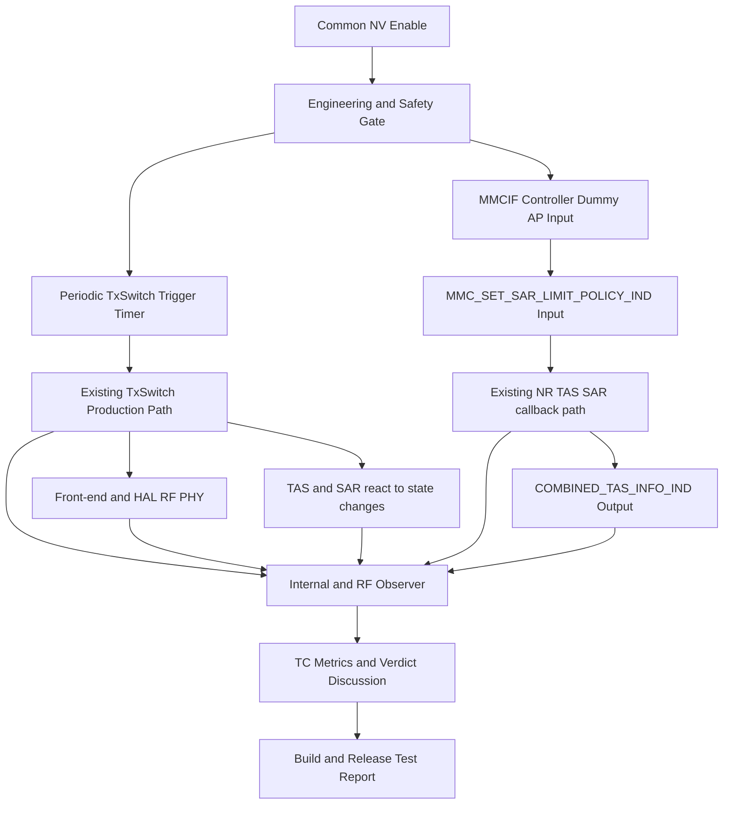
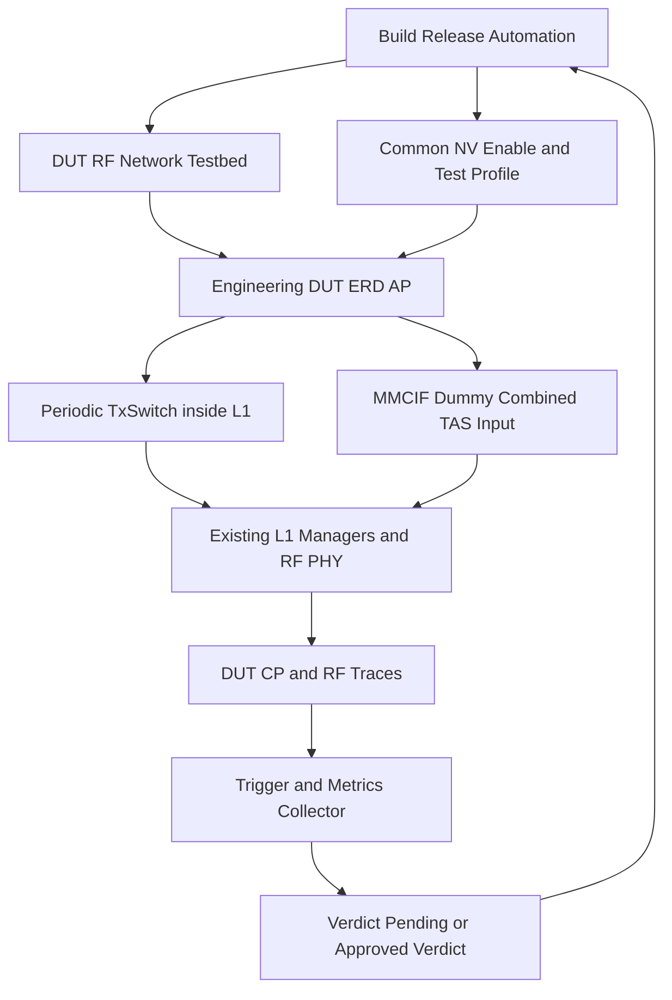

# TX Abnormal / SAR·TAS Postmortem 기반 L1 Regression Test 구축 — 발표 전 상세 검토 문서

- **버전:** v1.3 / 2026-10-15 (최신 사용자 확정사항을 본문·TC·아키텍처·운영 계획에 통합하고 Verdict 협의 표준 추가)
- **문서 성격:** 발표 자료 작성 전 기술·운영 검토용 원본 (슬라이드가 아닌 상세 근거 문서)
- **추진 범위:** NR ULCA TX, Dual SIM TxSwitch/Abnormal TX, NR SAR, NR TAS/Combined TAS
- **핵심 목표:** 과거 결함을 단발성 수정 이력으로 끝내지 않고, **실제 단말 기반 Regression Testcase와 공통 NV 기반 반복 검증 환경**으로 전환하여 **빌드·릴리즈 단계 정기 자동검증**에 정착
- **현 단계:** 최초 39건 1차 선별 이력·업무상 재분류·고유 Jira 4건/수정 CL 5개/TC 후보 5개 정리 완료. NV 주기 TxSwitch 및 MMCIF Dummy IND는 **사용자가 정한 향후 구현 방향**이며, 실제 Fix CL Diff 교차 검증·TC Verdict 합의·코드 구현·실단말 자동 실행은 **미완료**
- **근거 구분:** `[1차 화면]` 2026-10-14 촬영된 사용자 검토 보고서 화면, `[상세 화면]` 개별 Jira 설명 화면, `[사용자 확정]` 이후 대화에서 명시적으로 확정한 번호·원인·수정 내용, `[설계 제안]` 실제 구현 전 검토가 필요한 제안

> **이 문서의 읽는 순서:** 추진 목적 → **39건 전수 선별 경과(비대상·보류·Backout 포함)** → 최종 4개 Jira/5개 Fix CL → **5개 TC별 자극·관측·Verdict 협의** → **공통 NV 주기 TxSwitch와 MMCIF Dummy IND** → 실단말/빌드·릴리즈 운영 → 미결사항 및 발표 메시지.
>
> **자료 완전성:** 현재 제공된 것은 39건의 **전체 원본 MD/개별 행이 아닌 요약 화면**이다. 따라서 기존에 분석했으나 최종 대상이 아닌 Jira는 *화면에서 실제 확인된 정보 모두*를 아래에 수록했다. 보이지 않는 개별 Jira Key·CL·판정 사유를 39건 분량으로 임의 생성하지 않았다. 발표 전 39행 원본 보고서가 제공되면 부록의 `전체 이슈 원장`을 완성해야 한다.

---

## 1. 발표 핵심 메시지와 추진 배경

### 1.1 왜 Postmortem을 수행하는가

최근 확인한 TX Abnormal·SAR/TAS 결함은 단순 조건 오류만이 아니라 **특정 상태 전환 순서에서 자원 정리 누락, Stack 간 상태 불일치, 명령 완료 응답 누락, Callback/IPC 필드 불일치** 등으로 이어졌다. 일부는 CP Crash, 일부는 FBRX 비정상/Throughput 저하, 일부는 SAR Backoff의 복귀 실패로 나타났다.

기존 방식이 `상용 이슈 발생 → Jira 원인 분석 → Fix CL → 이슈별 검증 → 종결`에 머물렀다면, 이번 개선 방향은 `Jira/Postmortem → 실제 결함 시퀀스 추출 → Regression TC → NV Test Mode의 반복 자극 → 조기 실패 판정 → 신규 코드 변경 시 재검증`이다.

**최종 성공 기준:** (1) **실제 검증 단말(ERD AP 기반)**에서 공통 NV Enable에 따른 주기적 TxSwitch 동작과 필요한 L1 시나리오를 반복 생성, (2) Combined TAS는 **MMCIF Controller에서 AP 입력 IND를 Dummy 주입**하여 CP 처리 경로를 검증, (3) TC별 관측 지표 및 PASS/FAIL(이하 Verdict) 정책을 별도 논의·합의하고, (4) Jira ↔ Fix CL ↔ TC ↔ Build/Release ↔ 증거를 연결하여 **빌드·릴리즈 정기 자동검증**을 운영하는 것. 실제 Wi-Fi 동시 동작/실제 AP C-TAS 연동의 종단 검증은 현재 환경에서 수행하지 않는다.

### 1.2 목표 및 비목표

| 구분 | 내용 |
|---|---|
| 최종 목표 | **Common NV Enable 기반 실단말 L1 Regression Test Suite 구축 및 빌드·릴리즈 정기 자동검증** |
| 확정 실행 환경 | **실제 단말(DUT, ERD AP는 C-TAS 미지원)** + 필요한 RF/네트워크 시험 환경. Combined TAS는 **MMCIF 내부 Dummy `MMC_SET_SAR_LIMIT_POLICY_IND`**로 AP 입력을 모사하며 실제 Wi-Fi C-TAS는 본 단계에서 제외 |
| 확정 운영 목표 | **빌드 및 릴리즈 단계에서 자동·정기적으로 Regression TC 실행** (구체 트리거·주기·게이팅 조건은 설계 제안) |
| 1차 범위 | TX Abnormal, NR SAR, TAS/Combined TAS, Dual SIM TxSwitch의 초기 5개 결함 시나리오 |
| 가속화 전략 | **NV Enable → L1 내부에서 TxSwitch를 주기적으로 트리거**(구현 예정). TAS/SAR는 변화한 환경에 따라 기존 생산 로직으로 동작할 것으로 예상하며, 미발생 시 별도 재현 조건 분석 |
| 운영 원칙 | TxSwitch는 기존 State Machine/Conflict Policy/HAL-RF-PHY 경로를 우회하지 않음. MMCIF Dummy는 **AP→CP 입력만 모사**, 출력 `COMBINED_TAS_INFO_IND`를 강제 발생시키지 않음 |
| 검증 안전 | 실제 Time-Averaged SAR 제한, RF/PHY 필수 Timing, 보호 타이머를 무력화하지 않음 |
| 이번 발표 시점 비목표 | NV ID 실제 할당, Test Controller 코드 완성, 5개 TC 실행 PASS 달성 주장 |

### 1.3 추가 확인 질문 4항목에 대한 확정 답변 (2026-10-15)

| 질문 | 사용자 답변 | 문서/프로젝트에 적용할 규칙 |
|---|---|---|
| ① 기존 Jira 39건 전체 MD | **추후 제공 가능 (1-3)** | 현재 화면에서 확인된 1차 선별 통계·제외/중복/Backout 이력은 유지한다. **원본 39행/Comment/Evidence를 아직 전부 열람하지 못했으므로 완전한 NON_L1 상세 원장이라고 주장하지 않는다.** 원본 수령 시 39건 전체 선별 계보를 복원한다. |
| ② SAR Jira/CPR 관계 | **SOC-415399 대표 / CPR-181974 관련 이슈 (2-1)** | Postmortem 및 Coverage에서는 `SOC-415399` **1건**으로 관리하고 `CPR-181974 / CL 5347442`는 수정 근거/관련 이력에 연결한다. 단, 이전 화면의 동일 SOC Key **3G Recovery 기록 충돌은 별도 검증 필요**. |
| ③ Regression 실행 환경 | **실제 단말 + RF/AP·Wi-Fi 시험 환경 (3-1), 이후 사용자 세부 정정** | **실제 단말 검증 목표는 유지**하지만, **ERD AP가 C-TAS를 지원하지 않으므로 Combined TAS는 실제 Wi-Fi 대신 MMCIF Controller Dummy IND로 대체**한다. 즉, CP 내부 Regression 범위이지 실제 AP↔CP Wi-Fi 종단 검증이 아니다. |
| ④ 운영 시점 | **빌드·릴리즈 단계에서 자동 정기 실행 (4-2)** | Test Mode 구현의 완료 기준에 **CI/Build 및 Release 연계, 장비 예약, 결과 수집/품질 게이트 운영**을 포함한다. 구체 트리거·주기 및 차단 정책은 이후 확정한다. |

> **최신 설계 정정(2026-10-15):** (a) 공통 NV Enable 시 **L1 내부에서 TxSwitch를 주기적으로 발생시키는 코드**를 추가할 계획이며 TAS/SAR는 이에 연동 반응할 것으로 예상한다(아직 구현/재현 확인 전). (b) **Verdict는 논의 필요**이며 어떤 신호/지표로 PASS·FAIL을 판정할지 확정하지 않았다. (c) ERD AP는 C-TAS 미지원이므로 MMCIF Controller가 `MMC_SET_SAR_LIMIT_POLICY_IND`를 **AP에서 내려온 것처럼 Dummy 입력**하며, AP 실제 Wi-Fi 연동은 범위에서 제외한다. 이 결정은 위 ③의 초기 외부 Wi-Fi 환경 가정보다 우선한다.

> **경계 구분:** 위 네 항목은 사용자 확정사항이다. `빌드용 Smoke / 릴리즈용 Full Suite`, 장비 예약 방식, DUT 개수, 실행 주기, 임계치 등은 **아래 설계 제안**이며 확정되지 않았다.

### 1.4 사용자 확정 설계 vs PoC 검증 가설 vs 미결 결정 (회의 전 필독)

| 항목 | 구분 | 확정한 사실 또는 남아 있는 질문 |
|---|---|---|
| `NV_L1_REGRESSION_TEST_ENABLE` | **추천 명칭** | 목적/범위를 설명하기 위한 논리 명칭. 실제 NV ID 및 프로젝트 표준 네이밍은 미승인 |
| 공통 NV Enable → **L1 내부 주기 TxSwitch** | **사용자 구현 계획** | 별도의 기능별 가속 NV 없이 주기 TxSwitch 발생 코드 추가 예정. 실행 주기/진입점/중단 조건 미정 |
| TxSwitch 변화에 따른 TAS/SAR 동작 | **검증 가설** | 환경에 따라 자연스럽게 연계 반응할 것으로 예상하나, 5개 TC가 이 자극만으로 모두 재현된다는 근거는 없음 |
| C-TAS 실장비 환경 | **제약 확정** | ERD AP는 실제 C-TAS 미지원. 실제 Wi-Fi 동작 없이 **MMCIF Controller의 Dummy `MMC_SET_SAR_LIMIT_POLICY_IND`**를 AP 기원 입력으로 모사 |
| C-TAS Dummy 생성 시점/주기/Payload | **설계 미결** | NV Enable 시 구동할 계획이라는 범위는 정해졌으나 1회/반복, 조건부 시나리오 선택, Payload와 상관관계 키는 코드 분석 필요 |
| 5개 TC Verdict | **최종 미확정** | 관측 지표·성공/실패/시간창·누락/중복 처리·반복 횟수 등을 기술 회의에서 합의해야 함 |
| 빌드·릴리즈 정기 자동검증 | **최종 운영 목표 확정** | 구체 Smoke/Full 구분, 장비 수, QA Owner, 게이트 Blocking 여부는 아직 제안 단계 |

**검증 경계:** 주기 TxSwitch 및 Dummy는 *결함 재현을 위한 자극*이고, 실제 L1 Manager/IPC/RF 동작과 TC Verdict는 별도 확인 대상이다. 이번 문서의 TC 표에 적힌 ‘정상 기대 동작’은 **결함 기반 후보 Oracle**이며 공식 승인된 PASS/FAIL 규칙이 아니다.

---

## 2. 최초 Jira 39건을 어떻게 분석·정리했는가 — 선별 과정의 기록

### 2.1 최초 입력과 자동 분석 규칙

1. 사용자가 `Jira Issue List.md`를 제공하여 **검색 대상을 명시적으로 제한**했다.
2. Jira의 Description/Comment에서 Fix CL 후보, Re-fix/Backout, 연관 Issue를 수집하도록 했다.
3. `p4-code-owner v0.6.7`의 `jira-fix-cl-scan`과 Jira/Mango MCP를 연계하여 `submitted DEV Fix CL`의 실제 변경 파일을 확인하는 방식을 채택했다.
4. **당시 1차 기계적 L1 판정 기준:** DEV Fix CL 내 `/SMPF/Protocol/Channel/L1/` 경로 수정 포함 여부. 브랜치/Depot prefix 정규화, Simulator 제외. `MAIN/PROD_CI/PB/HE/BASE/Backout` CL은 Fix로 직접 인정하지 않되 이력으로 남김.
5. 근거 미확인 시 자동 판정은 `PENDING`으로 보존했다. `L1 여부 = Jira 라벨/담당자 소속`이 아니라 실제 소스 변경과 CL 역할을 우선했다.

**중요한 한계:** `/Channel/L1/` 경로만으로 L1_CHANNEL 전체 도메인의 모든 수정 이력을 완전히 포괄한다는 보장은 없다. SAR/TAS 구현 위치와 SMP1800/1900 분포, P4/PR 연결을 다시 확인해야 한다.

### 2.2 1차 자동 보고서 통계 — 당시 값 그대로 보존

| 1차 결과 | 건수 | 상세 의미 |
|---|---:|---|
| `INCLUDED_L1` | **2** | SSS9975XBA-7745, SOC-417026 |
| `NON_L1` | **13** | 판정 범위 외 수정 10건 + `RF_RELATED` 속성 3건 포함 |
| `PENDING` | **24** | `NO_CL_FOUND` 9건 / `NO_VERIFIED_FIX_CL_CANDIDATE` 15건 |
| **합계** | **39** | 2026-10-14 1차 화면에 표시된 조사 건수 |

그 당시 세부 분포 (원본 1차 보고서 화면 기준):

- Feature: **TX_ABNORMAL 30 / TAS 7 / SAR 1 / TX_RECOVERY 1** (39건)
- Failure Type: **UNKNOWN 24 / STATE 7 / CONFIG 5 / RESOURCE 2 / TIMING 1** (39건)
- 초기 L1 후보가 재검토 과정에서 **12건 → 2건**으로 줄었다는 기록: `Channel/L1` 경로를 엄격 적용하면서 10건이 NON_L1로 이동했고, RF 관련 3건도 NON_L1로 분류되어 별도 속성을 보존했다.

이 수치는 당시 **자동 규칙에 기반한 결과**이며, 현재 사용자가 확정한 최종 Postmortem 대상과 동일한 통계가 아니다.

### 2.3 사용자 검토 이후 재분류 이력

| 시점 | L1 | NON_L1 | PENDING | 해석 |
|---|---:|---:|---:|---|
| 1차 자동 보고 | 2 | 13 | 24 | 최초 39건 정리 |
| 사용자 재분류 지시 | **3** | **36** | **0** | PENDING 24건을 모두 NON_L1 처리하고 NR SAR 1건을 L1로 관리하는 방향으로 합의한 **39건 기준 잠정 집계** |
| 최종 분석 명세 확장 | **4개 고유 Jira** | 원본 NON_L1 원장과 별도 | 별도 재집계 필요 | SOC-417498을 추가하고 **동일 Jira의 Fix CL 2개를 TC 2개로 분리** |

**집계 시 주의:** 새로 추가한 SOC-417498이 원래 39건의 일부인지 아직 확인되지 않았다. 따라서 `4 + 36 = 40건`을 확정된 전체 검색 결과라고 발표하지 않는다. **발표에서 사용 가능한 확정 수치는 `1차 조사 39건`, `최종 선정 4개 Jira`, `Fix CL 5개`, `초기 Regression TC 후보 5개`**다. 39건의 분모/신규 이슈 포함 여부는 원장으로 확인한다.

**PENDING 정책 구분:** 사용자의 최종 *업무 분류*는 NON_L1이지만, 원래의 P4 증거가 자동으로 완비된 것은 아니다. 또한 39건 전체 원본 MD는 **추후 제공 예정**이므로, 비대상 그룹에 속한 모든 Jira별 증거를 현재 문서만으로 확정할 수 없다. 감사 추적을 위해 원래의 `NO_CL_FOUND/NO_VERIFIED_FIX_CL_CANDIDATE` 상태는 이력 필드에 남긴다.

### 2.4 제외·보류 이슈도 보존해야 하는 이유

- P4 CL이 있는 것만 보고 Fix로 잘못 판단하면 **Integration/Backout/BASE가 실제 수정으로 오인**될 수 있다.
- 동일 결함이 **중복 Jira, Clone, Re-fix, Backout**으로 나뉘면 추후 Regression Coverage가 과대 집계될 수 있다.
- 이 시점에 NON_L1로 판정됐더라도 RF/PHY/모뎀 관련 **경계 조건이나 Side Effect**는 초기 TC 설계 시 참고할 수 있다.
- 개별 Root Cause를 검증하기 전 `NON_L1 = 발생 원인이 L1과 무관`이라고 단정하지 않는다. 여기서는 **Postmortem 선정 규칙상 L1 Fix가 확인되지 않았음**을 의미한다.

---

## 3. 최초 보고서에 나타난 비대상·보류·관련 Jira 정보 보존

> 아래는 사용자 제공 **요약 화면에서 개별로 확인되는 정보**다. 원본 39개 전체 행을 보았다는 뜻은 아니다. `관련 Jira`나 `이력 참조`의 번호가 최초 39건에 모두 포함된 것인지도 원본 MD 없이는 확정할 수 없다. 이미 최종 대상인 Jira는 신규 비대상 건으로 중복 집계하지 않는다.

### 3.1 RF 관련 NON_L1 그룹 (당시 판정)

| 이슈 번호(화면 표기) | 당시 그룹 | 비고 |
|---|---|---|
| `414207` | NON_L1 / RF_RELATED | RF 관련으로 분류; 정확한 Jira Prefix 및 세부 Root Cause는 화면에 없음 |
| `413901` | NON_L1 / RF_RELATED | RF 관련으로 분류; 아래 중복/종결 참조에서도 언급됨 |
| `413153` | NON_L1 / RF_RELATED | RF 관련으로 분류; 상세 Fix 근거는 원본 확인 필요 |

**조치:** L1 Regression 선정에서는 제외하되 RF 파트 사후 검토 대상으로 전달 가능한 구분을 유지한다. 위 3건을 SAR/TAS L1 TC로 자동 합산하지 않는다.

### 3.2 Fix/Integration/Backout/Re-fix 구분 사례 — 과거 선별 판단을 보여주는 주요 증거

| Jira | 화면에서 확인된 CL/연결 관계 | 당시 해석과 유지할 근거 |
|---|---|---|
| `SSS9975XBA-8388` | 후보 `5324186` ↔ 대상 `SSS9975XBA-7745` Fix `5322160` | `5324186`은 **PROD_CI(T1_M2700) HE 제출**로 설명됨. `ch_L1cBchNr.cpp` 언급이 있어도 직접 DEV Fix로 보지 않아 당시 PENDING 유지; 7745 계열 관련성만 보존 |
| `SSS9975XBA-7980` | Fix `5322052` + `5327981` → 개선 `5342780` → Backout `5354045` → 동일 Title Re-fix `5357550` | **Backout과 Re-fix의 계보 보존**이 중요. Backout 사유는 화면에서 `미확인`이며 임의 추정 금지 |
| `SSS9975XBA-8413` | 자체 Fix CL 없음; Crash Build Base `5334204`; PROD_CI `5334031`, `5334137` (= `5330056` Backout) | 화면 설명상 **SOC-413700 Regression 관련**이며 Channel/L1 파일 수정이 포함됐더라도 이 CL들은 해당 Jira의 **Fix가 아닌 빌드 구성/Backout 이력**. 7980 Fix로 해소됐다는 기록 보존 |
| `SOC-411616` | Fix `5324731` + HE(SMP1900 PR `2075`) | 수정 근거가 있는 별도 이슈. 그러나 당시 선별 기준에서의 L1 포함 여부는 본 요약 화면으로 독립 확인 불가 |
| `411838`, `411829` | `SOC-411616`과 동일 이슈 Fix 상속 | 중복·연관 Jira가 별도 수정 건으로 중복 집계되지 않도록 관계 보존 |
| `SOC-413700` | `SSS9975XBA-8413`의 Regression 설명에 등장 | 원인·CL의 직접 매핑은 요약 화면만으로 불충분; 관계 참조만 유지 |

**중요 원칙:** `실제 코드베이스에 L1 파일이 들어 있다`와 `이 Jira를 해결한 L1 DEV Fix CL이 확인됐다`는 다른 판정이다. 특히 `SSS9975XBA-8413` 같은 빌드 Backout 사례는 대표적인 오분류 방지 예시다.

### 3.3 1차 PENDING 24건의 근거 유형 — 최종 업무 분류가 NON_L1이어도 이력 유지

| 당시 상태/유형 | 건수 | 화면에서 확인된 설명 |
|---|---:|---|
| `NO_CL_FOUND` | 9 | 확정 Fix CL 미탐지 |
| `NO_VERIFIED_FIX_CL_CANDIDATE` | 15 | CL 언급은 있으나 submitted DEV Fix라고 입증 불충분 |
| **합계** | **24** | **사용자 검토 후 업무 분류에서는 NON_L1로 이동** |

화면에 나타난 보류/중복 종결 하위 분류(서로 독립적인 39개 행이 아니라 당시 24건의 원인 분류):

- `로그 불충분` **9건**
- `중복 종결` **9건**: 예시 관계 `418166 → 418177`, `413906 / 413902 → 413901`, `413641 / 413614 / 412741 / 412062 → 411616`, `410349 / 410859 → 409107`
- `분석 불가` **4건**
- `재현 불가` **3건**: 이 중 `SSS9975XBA-8388` 관련 병합 언급
- `미확정·진행 중` **2건**: `412508`, `414962`

> **주의:** 위 하위 분류 수의 단순 합은 24가 아니다. 화면에 기록된 분류가 **서로 겹치거나 분모가 다를 수 있으며**, 원본 보고서의 각 행과 대응 관계는 추가 확인해야 한다. 이 문서에서는 이를 임의로 24건에 맞춰 조정하지 않았다.

**추가 확인이 필요했던 항목 (당시 기록):** `SSS9975XBA-7980`의 Backout `5354045` 사유, 15건의 Side Effect 상태(`UNKNOWN` 다수), Side Fix CL/Dependency CL/APR의 진짜 역할, RF_RELATED 3건의 RF Owner 사후 검토.

### 3.4 SAR 관련 Jira/CPR 번호 혼동 및 다른 개선 이력 분리

화면에서 **두 개의 서로 다른 수정 흐름**이 확인되며, 이후 대화에서 **Postmortem 표시용 Jira Key를 수정**했다. 이는 발표 전 추적성 검증이 필요한 중요 사례다.

| 항목 | 화면의 이력 | 이후 사용자 최종 지시 / 문서상 처리 |
|---|---|---|
| NR Suspend SAR CMD Completion | `CPR-181974`, Fix CL `5347442`, `SAR_LIMIT_POLICY_NR_CMD`에서 CmdDone 누락 | **Postmortem 대표 Jira는 `SOC-415399`로 사용**하고 Fix CL `5347442`를 연계. CPR-181974는 중복 집계하지 않는 관련 이슈/수정 증빙으로 보존 |
| 3G MDVFS / SRNC Recovery | `SOC-415399` 화면에는 `PRE-29988`, DEV CL `5347786`, MAIN `5350020`, `CPR-181979`, PR `#3285`가 **별도 3G Decoder/Clock 수정**으로 기재됨 | **SAR CL `5347442`로 대체해서 쓸 수 없는 별도 이력**. 동일 SOC Key가 서로 다른 기술 내용으로 등장하는 **자료 불일치**로 표시하고, 실제 Jira 링크/댓글/CL 계보 확인 전 두 수정이 같은 Cause라고 주장하지 않음 |

- 3G 이력의 화면 설명: HSDCCH 동작 중 MDVFS RT/NRT Clock 판단 오류 → Decoder stuck → SRNC Recovery/CP Crash; RT/NRT Clock 상태를 모두 고려하도록 수정 (`5347786`). **본 프로젝트의 NR SAR Regression TC 후보로 채택하지 않는다.**
- **사용자 확정 관리 관계:** `SOC-415399`를 SAR Postmortem **대표 Jira**, `CPR-181974`를 **관련 이슈**, `5347442`를 **관련 Fix CL**로 관리한다. 단, 이전 화면의 동일 SOC Key와 3G Recovery 내용이 충돌하는 이유는 **원본 Jira 조회로 확인해야 한다**. 관리자 지시로 정한 연계와 Jira 원본에서 검증된 연계를 별도 필드에 보존한다.
- 이 정보는 유실·숨김 처리하지 않고 **비대상 이력/증거 충돌 사례**로 부록에 유지한다.

### 3.5 제외 원장 완성에 필요한 파일

최초 보고서 전체 원본(예: `39건 요약표`, `NON_L1 상세 13건`, `PENDING 상세 24건`, `CL Index`, `Evidence File Links`)이 제공되면 다음 컬럼으로 39행을 재구성한다.

`Original_Order | Jira_Key | Initial_Status | Final_Business_Status | Feature | Symptom | Candidate_CLs | Verified_DEV_Fix_CL | Integration_Backout_ReFix | Modified_Files | L1_Scope | Exclusion_Reason | Related_Issues | Evidence_Link | Review_Status`

현재 문서만으로는 **39건의 1:1 전체 목록을 재구성할 수 없으며**, 그 빈칸을 임의 Issue Key나 원인으로 채우지 않는다.

---

## 4. 최종 Postmortem 대상 — 4개 Jira / 5개 Fix CL / 5개 Regression TC

| # | 대표 Jira | 영역 | Fix CL | 핵심 결함/영향 | TC ID |
|---|---|---|---|---|---|
| 1 | **SSS9975XBA-7745** | NR ULCA TX | **5322160** | SCell Deactivation 후 Release 없는 ALL STOP → RF TX Release 누락/DB 미초기화 → 신규 SCell Config 실패·Data Abort | `L1_REG_TX_001` |
| 2 | **SOC-417026** | Dual SIM TxSwitch / Abnormal TX | **5359626** | DS SASA n28+n28 공유 DAC 경로의 Stack AS Status 불일치 → Coupler 오설정 → FBRX 측정 실패 반복 → RF Stabilization 강제 Crash | `L1_REG_TXSW_001` |
| 3 | **SOC-415399** | NR SAR | **5347442** | NR RAT Suspend 중 SAR CMD CmdDone 미전송 → CMD Queuing | `L1_REG_SAR_001` |
| 4A | **SOC-417498** | Combined TAS / SAR | **5358982** | C-TAS의 SAR Callback `functionType` 오류 → `COMBINED_TAS_INFO_IND` 미전송 → Throughput 저하 | `L1_REG_CTAS_001` |
| 4B | **SOC-417498** | TAS Abnormal Backoff / SAR | **5362081** | NR Attach의 Abnormal Table AP Event 후 Backoff 함수와 SAR IPC 간 TxPath Index 불일치 → Backoff/No-Backoff 복귀 실패 | `L1_REG_TAS_001` |

- `SOC-417498`은 **고유 Jira 1건**이지만 **수정 CL과 결함 경로가 두 개**이므로 TC는 각각 별도로 관리한다. 두 Root Cause가 동일하다고 가정하지 않는다.
- `SOC-417026` CL은 사용자가 정정 확정한 **5359626**만 사용한다(오타 `5369626` 폐기).
- `SSS9975XBA-7745`의 본질은 앞선 요약의 `stale index` 자체가 아니라 사용자가 이후 공유한 **RF TX Release/RF DB 정리 누락 Sequence**로 기술한다.
- `SOC-415399`의 Key/CL 원문 충돌은 §3.4의 확인 항목을 유지한다.

---

## 5. 개별 Postmortem 및 Regression Testcase 상세 명세 (초안)

모든 TC는 **실제 코드/로그/P4 Diff로 주입 API 및 관측 Signal을 검증하기 전까지 설계 초안**이다. 숫자형 주기/반복 횟수/타이밍 PASS 한계는 정하지 않았다. 초기 재현 성공 여부를 확인한 뒤 성능·안전성 검토를 통해 지정한다.

### 5.1 `L1_REG_TX_001` — NR ULCA SCell ALL STOP / RF TX Resource Release

- **Jira / Fix:** `SSS9975XBA-7745` / DEV `5322160`
- **사용자 제공 결함 메커니즘:** NR ULCA에서 SCell Deactivation 후 **SCell Release 없이 ALL STOP REQ**가 수신되면 Band 정보가 0으로 초기화되고 RF TX Release가 수행되지 않는다. RF DB가 정리되지 않은 상태에서 새 NR UL SCell Config가 진행되면 새 SCell RF TX를 할당하지 못하며, 이후 PHY TX 중 Data Abort가 발생한다.
- **수정 의도:** ALL STOP 시 **SCell이 Config 상태이면 RF TX Release**를 수행하도록 수정.

**시나리오/관측/판정**

| 순서 | 자극/전제 조건 | 필수 Observability / 기대 결과 |
|---:|---|---|
| P1 | NR ULCA PCell + UL SCell 구성 완료 | 초기 SCell Config State, RF TX Allocation 기록 |
| 1 | SCell Deactivation 수행 | Deactivated 상태/구성 상태 구분 기록 |
| 2 | SCell Release 없이 `ALL_STOP_REQ` 전달 | ALL STOP 수신 시점에 해당 SCell이 Config 상태임을 확인 |
| 3 | ALL STOP 처리 경로 관측 | **RF TX Release 호출/완료**와 올바른 대상 경로 확인. Band=0 이후 무효 정보 사용 금지 |
| 4 | RF DB 정리 결과 관측 | 기존 SCell 자원 소유/할당 정보가 다음 Config를 막지 않음 |
| 5 | 새로운 UL SCell Config/Activation 진행 | 새 SCell RF TX Alloc/Config 성공 |
| 6 | PHY TX 동작 및 상태 관측 | 유효한 RF TX Path 사용, Data Abort 미발생 |
| 7 | 복귀 후 다시 반복 | 초기 상태 회복, 자원 누수·Stale DB 누적 없음 |

- **Primary Oracle 후보(아직 Verdict 미확정):** Config SCell의 ALL STOP 시 Release 완료 + 재Config 시 RF TX 재할당 성공.
- **Secondary Oracle 후보:** PHY TX의 유효 Path / Data Abort 없음 / 연속 Loop 후 Resource Leak 없음.
- **Test Hook:** `SCell Deactivation → ALL STOP → New Config` 시퀀스 구동. 기본 주기 TxSwitch만으로 ALL STOP 시나리오 재현이 보장되지 않는다. **SCell Lifecycle 별도 자극/시험장비 조건**이 필요할 수 있다.
- **Automation:** `PARTIAL`(초안). 실제 RF DB 상태를 관측/제어할 수 있는 HW·테스트 환경 확인 후 `AUTO` 여부 판정.
- **관련 API·정확한 Event 구조 및 최소 간격:** `5322160` 수정 Diff, HAL/RF 호출 흐름 분석 후 확정.

### 5.2 `L1_REG_TXSW_001` — DS Conn-Conn LO Switching / Cross-Stack AS Consistency

- **Jira / Fix:** `SOC-417026` / DEV `5359626` (이후 MAIN `5362634`는 화면상의 적용 이력)
- **환경:** **SASA DS Conn-Conn, n28+n28**, 두 Stack이 **동일 TX DAC Path** 공유, LO Switching 동작.
- **사용자 제공 결함 메커니즘:** 두 Stack에서 TxSwitch AS Switch Status 불일치 → Front-End Coupler 설정 불일치 → FBRX 비정상 측정 → Abnormal TX(FBRX) 약 20회 반복 → RF Stabilization 강제 Crash.
- **수정 의도:** DS LO Switching 시 **양쪽 Stack의 AS Switch Status를 일치**시키도록 수정.

| 순서 | 자극/전제 조건 | 필수 Observability / 기대 결과 |
|---:|---|---|
| P1 | 두 Stack Conn-Conn, n28+n28, 동일 DAC 공유 확인 | Stack0/1 PCell AS, TX DAC 소유 상태, Coupler Baseline |
| 1 | LO Switching이 가능한 조건 구성 | DS/LO Switching Trigger 충족 여부 |
| 2 | LO Switch/Event 반복 | 양쪽 Stack의 AS Switch Status 수집(동일 시점/동일 Path 기준) |
| 3 | FE Coupler 재설정 동작 확인 | 공유 DAC 경로의 Coupler 설정 **동일 정책/유효 구성** 유지 |
| 4 | FBRX 측정 확인 | FBRX 결과 유효, Abnormal Counter 증가 원인 없음 |
| 5 | 복수 Loop 수행 및 종료 | Crash/강제 Stabilization Recovery 없이 상태 정상 유지 |

- **Primary Oracle 후보(아직 Verdict 미확정):** LO Switching 완료 뒤 두 Stack의 AS 상태와 Coupler 정책 정합성.
- **Secondary Oracle 후보:** FBRX 유효 측정 및 Abnormal Counter 비증가, Crash 미발생.
- **Early Fail:** 20회 누적 Crash를 기다리지 않고 **AS 불일치/Coupler Misconfig/FBRX 연속 오류 최초 검출 시 Fail**.
- **Test Hook:** DS LO Switching 및 각 Stack 상태/Peer Event를 기존 TxSwitch Production Path로 전달해야 함. `Evaluate → ConflictResolver → CommandRunner` 구조는 이전 설계 개념이며 실제 코드 검증 필요.
- **Automation:** `PARTIAL`(초안). DS HW/LO Switching/FBRX 계측 의존도가 높아 실장비 기반 반복 검증 가능성 확인 필요.

### 5.3 `L1_REG_SAR_001` — NR RAT Suspend / SAR CMD CmdDone

- **관리 Jira / Fix:** 사용자 최종 기준 `SOC-415399` / `5347442`; 과거 자료의 수정 항목 `CPR-181974`는 관련 이력으로 보존, §3.4 참조.
- **문제:** NR RAT Suspend 상태에서 `SAR_LIMIT_POLICY_NR_CMD`를 수신해도 `CmdDone`을 전송하지 않아 CMD Queue가 정체됨.
- **수정 의도:** NR Suspend 상태에서도 해당 CMD의 `CmdDone`이 누락되지 않도록 처리.

| 순서 | 자극/전제 조건 | 필수 Observability / 기대 결과 |
|---:|---|---|
| P1 | NR RAT Suspend 진입 | RAT State = Suspend 확인 |
| 1 | `SAR_LIMIT_POLICY_NR_CMD` 전달 | IPC CMD 수신/Trace ID/Seq ID 확인 |
| 2 | CMD 처리/완료 경로 관측 | **대응하는 CmdDone 전송**, 누락·중복 없음 |
| 3 | 후속 SAR CMD 또는 다른 Queue 항목 전달 | 앞선 CMD가 Queue Head에 남아 후속 처리를 막지 않음 |
| 4 | Suspend 상태에서 반복 | Queue Depth 장기 증가 없음, Timeout 없음 |
| 5 | NR Resume 후 정상 처리 검증 | 상태 복귀와 SAR CMD 처리 정상 |

- **Primary Oracle 후보(아직 Verdict 미확정):** 수신 CMD 1개에 대해 올바른 Completion이 정해진 정책에 따라 1개 기록되며, Queue가 정상 진행.
- **Secondary Oracle 후보:** Suspend/Resume 전이 후 Queuing Stall 없음.
- **Test Hook:** NR Suspend 조건 제공 + 합법적 CMD Injection. SAR 제한 값을 무력화하거나 전송 출력 상승을 유발하는 테스트는 제외.
- **Automation:** `AUTO` 후보(초안). 단, 실제 Suspend 유도/IPC 관측 지점 확인 필요.

### 5.4 `L1_REG_CTAS_001` — MMCIF Dummy AP IND 기반 CP Combined TAS Callback

- **Jira / Fix:** `SOC-417498` / `5358982`
- **기능 자체의 목적 [사용자 제공]:** Combined TAS는 AP Wi-Fi와 CP NR TAS 모듈의 동일 주파수 대역 조합에서 **Time-Averaged SAR**를 만족시키기 위한 기능.
- **현 검증 단말 제약 [사용자 확정]:** ERD AP는 C-TAS 미지원. **실제 Wi-Fi 동작을 일으키지 않고**, NV Enable 시 **MMCIF Controller가 `MMC_SET_SAR_LIMIT_POLICY_IND`를 AP에서 수신한 것처럼 Dummy로 발생**하도록 내부 코드를 추가할 예정.
- **입력/출력 구분:** Dummy **입력** `MMC_SET_SAR_LIMIT_POLICY_IND` ≠ 결함에서 누락됐던 **출력** `COMBINED_TAS_INFO_IND`. 출력 IND는 Production Callback/Policy 처리 결과로 발생해야 한다. 테스트 코드가 출력을 직접 강제해서는 안 된다.
- **원 결함:** SAR CMD Callback의 `functionType` 오류 → `COMBINED_TAS_INFO_IND` 미전송 → Throughput 저하.

| 순서 | 자극/상태 | 관측 후보(검토 전) |
|---:|---|---|
| P1 | Engineering DUT, NV Enable, NR TAS 관련 컨텍스트 준비 | 대상 RAT/Stack/Path, Dummy 허용 상태, 입력값이 유효한지 확인 |
| 1 | MMCIF Controller에서 Dummy `MMC_SET_SAR_LIMIT_POLICY_IND` 생성 | AP-origin으로 모사된 **MMCIF 입력 수신/전달 사실**과 Trace ID |
| 2 | 기존 MMCIF→NR TAS/SAR 처리 경로 통과 | Callback 등록/호출, 수신한 `functionType` |
| 3 | `functionType`에 따른 기존 분기 실행 | 정상 분기 및 필요한 `COMBINED_TAS_INFO_IND` 생성/전송 여부 |
| 4 | 설정 변경 및 반복 입력 | 누락/중복 IND, 상태 정합성, TxPath/Limit 관측 |
| 5 | Dummy 입력 중단 및 정상 복귀 | 테스트 인공 입력이 남지 않고 기본 정책으로 복귀 |

- **Verdict 상태:** 미확정. 후보 관측 지표는 `MMCIF Dummy Input Count`, `Callback functionType`, `COMBINED_TAS_INFO_IND` 송신 횟수/조건/필드, CP 상태 및 안전 Limit.
- **가장 유용한 초기 후보 Oracle:** **유효한 Dummy 입력 → 해당 Callback 정상 분기 → 해당 조건에서 출력 IND 생성**의 상관관계. 입력·출력 기대 개수/타이밍/필드와 `functionType` 기대값은 **CL 5358982 Diff 기반 추가 협의 후 확정**.
- **검증 한계:** 실제 AP가 해당 IND를 수신하거나 Wi-Fi Traffic/Throughput이 정상임을 본 TC에서 직접 판정할 수 없다. Dummy 입력 기반 CP 로직 PASS를 실제 AP↔CP End-to-End PASS나 실제 Time-Averaged SAR 적합성 증명으로 표시하지 않는다.
- **자동화 수준:** MMCIF Input → CP 내부 경로 자동 검증의 `AUTO` 후보(아직 미구현·미검증). 실제 AP C-TAS 연동은 `NOT_COVERED`.

### 5.5 `L1_REG_TAS_001` — NR Attach Abnormal TAS Backoff / SAR TxPath Consistency

- **Jira / Fix:** `SOC-417498` / `5362081` (**같은 Jira 내 다른 결함/다른 TC**)
- **문제:** NR Attach에서 Abnormal Table에 따른 AP Event 발생 후 **Abnormal Backoff 함수와 SAR IPC가 서로 다른 `txpath index`**를 사용해 SAR Limit 기반 Backoff/No-Backoff 상태가 정상 복귀하지 않음.
- **수정 의도:** SAR Limit 처리에서 **올바른 TxPath Index**를 설정하도록 수정.

| 순서 | 자극/전제 조건 | 필수 Observability / 기대 결과 |
|---:|---|---|
| P1 | NR Attach 환경, Abnormal Table의 해당 조건 활성 | RAT/Stack/TxPath Allocation 및 SAR Limit Baseline |
| 1 | NR Attach 및 AP Event 주입/유도 | AP Event, Abnormal Backoff 조건 트리거 |
| 2 | Abnormal Backoff 수행 | Backoff 함수가 사용하는 TxPath Index 기록 |
| 3 | SAR IPC 전송/적용 | SAR IPC의 TxPath Index가 **실제 대상 Path와 동일** |
| 4 | SAR Limit에 따른 Backoff 상태 변경 | 제한이 올바른 TX Path에 반영 |
| 5 | AP Event/Limit 정상 복귀 조건 제공 | Backoff → No-Backoff 또는 원래 Policy 상태 복귀 |
| 6 | 연속 이벤트 및 반복 검증 | 잘못된 Path 잔존·Backoff 고착·SAR 제한 우회 없음 |

- **Primary Oracle 후보(아직 Verdict 미확정):** 동일 대상 TxPath 사용, 올바른 SAR Limit 적용, 정책에 따른 Backoff/No-Backoff 복귀.
- **Safety Oracle 후보:** 해제 시에도 실제 적용해야 하는 SAR Limit를 초과하지 않음.
- **Automation:** `PARTIAL` 후보. Abnormal Table/AP Event 주입의 가용성, RF/TxPath 관측이 필요.
- **확인 필요:** `5362081`에서 수정된 Index 소스, 대상 TxPath Mapping, AP Event 타이밍 및 Backoff 해제 조건.

### 5.6 실제 단말 Testcase별 시험환경 및 주기 TxSwitch 연계 여부 (최신 정정)

**공통 자극은 NV Enable에 의해 L1 내부에서 주기적으로 발생하는 TxSwitch**다. TAS/SAR의 연계 동작은 기대하지만, 모든 결함 조건을 자동으로 생성한다고 가정해서는 안 된다. **Combined TAS는 예외적으로 MMCIF Dummy AP 입력을 직접 생성**한다.

| TC | 공통 TxSwitch 자극과 관계 | 추가 선결 조건·입력 | Verdict 논의에 필요한 관측 후보 |
|---|---|---|---|
| `L1_REG_TX_001` | 직접 재현 보장 안 됨 | NR ULCA SCell Deactivation → Release 없는 ALL STOP → 신규 Config | SCell Config State, RF TX Release/DB Reset, 재할당 성공, Data Abort |
| `L1_REG_TXSW_001` | **직접적인 주기 TxSwitch 검증 후보** | SASA DS Conn-Conn n28+n28, 동일 DAC 공유, LO Switching이 실제 발생해야 함 | 양쪽 Stack AS Status, Coupler Setting, FBRX Validity, Abnormal Counter |
| `L1_REG_SAR_001` | 직접 재현 보장 안 됨 | NR RAT Suspend 진입 및 `SAR_LIMIT_POLICY_NR_CMD` 수신 조건 | CmdDone 수신/송신, CMD ID·Seq, Queue 진행, Resume |
| `L1_REG_CTAS_001` | Combined TAS 입력은 별도 Dummy | MMCIF에서 `MMC_SET_SAR_LIMIT_POLICY_IND` Dummy 생성, NR TAS/SAR 콜백 경로 | Dummy 인입, functionType, `COMBINED_TAS_INFO_IND` CP 출력, SAR Policy 상태 |
| `L1_REG_TAS_001` | 환경 연동 가능하나 충분조건 미확정 | NR Attach, Abnormal Table의 AP Event, Backoff/No-Backoff 전이. **위 C-TAS Dummy IND와 동일한 입력인지 미확정** | Abnormal 함수 TxPath, SAR IPC TxPath, SAR Limit 적용, 복귀 |

**TC 실행 상태 분리:** `TRIGGERED`(자극 전제 성립), `OBSERVED`(검증 신호 확보), `VERDICT_DEFINED`(합의된 Pass/Fail 명세 존재), `PASS/FAIL/INCONCLUSIVE/BLOCKED`. Trigger/Observer만 확인해도 Verdict 합의 전에는 PASS로 간주하지 않는다.

**안전:** 실제 RF 송신 출력/Time-Averaged SAR Limit/PHY Timing과 보호 기능 유지. 테스트 입력을 실 AP Origin으로 허위 보고하지 않으며 Synthetic Origin을 로그에 남긴다.

### 5.7 5개 TC를 실단말에서 재현하기 위한 전제 조건과 판정 가능성 분리

**운영 원칙:** ① *시나리오를 일으켰는가?* ② *관측 가능한가?* ③ *판정 기준이 승인됐는가?*를 순서대로 확인한다. 트리거 자체가 발생하지 않았거나 관측 증거가 없으면 `PASS`가 아니라 `INCONCLUSIVE` 또는 `BLOCKED`이다.

| TC | TxSwitch 주기 자극만으로 직접 재현 가능? | 별도 상태·입력 필요사항 | 최초 구현 단계에서 주장할 수 있는 수준 |
|---|---|---|---|
| TX 001 | **아니오/미확인** | NR ULCA SCell Config/Deactivation, Release 없는 ALL STOP, 후속 Config | SCell Lifecycle 자극·RF Release 로그 확인 후 TC 자동화 평가 |
| TXSW 001 | **직접 후보** (단, 실제 LO Switch 발생 조건 필수) | SASA DS Conn-Conn n28+n28, 공유 DAC, FBRX/FE Coupler 관측 | 주기 Trigger와 Stack AS 상태 동기화 재현 여부 PoC 가능 |
| SAR 001 | **아니오/미확인** | NR RAT Suspend + `SAR_LIMIT_POLICY_NR_CMD` 주입 | CMD/Callback/Queue 계측 경로가 마련된 후 독립 TC 가능 |
| CTAS 001 | **별도 Dummy 필요** | MMCIF Dummy `MMC_SET_SAR_LIMIT_POLICY_IND`, Callback 경로 | CP 내부 C-TAS 기능만 대상. AP Wi-Fi E2E 및 실제 Tput 평가는 범위 외 |
| TAS 001 | **환경 변화 반응은 가설** | NR Attach, Abnormal Table 조건, AP Event/TxPath 변동 | 동일 TxPath 정합성과 복귀 조건 확인 후 TC 판정 가능 |

**Testcase별 최소 증거 묶음(공통 양식):** `Run ID`, `Build/Branch`, `DUT/HW`, `NV 상태`, `TC ID`, `선행 상태 성립 로그`, `Trigger 송신 및 실제 처리 로그`, `관측 포인트(전·후 상태)`, `Fix CL/수정 함수`, `판정 기준 버전`, `Verdict 또는 미판정 사유`, `원본 Trace 참조`를 남긴다. 39건 선별용 Jira/P4 Evidence와 Regression 실행 Evidence는 동일 문서에 덮어쓰지 않고 서로 참조한다.

## 6. 공통 문제 패턴과 Regression 전략

| 결함 패턴 | 이슈/CL | 실패 전 검출해야 할 불변조건(Invariant) | 개선 방향 |
|---|---|---|---|
| **Resource Lifecycle** | 7745 / 5322160 | ALL STOP 이후 기존 Config SCell RF TX 자원이 다음 Config를 막지 않음 | Release/재할당 Lifecycle TC |
| **Cross-Stack State Consistency** | 417026 / 5359626 | 동일 DAC 공유 시 Stack 간 TxSwitch AS 상태와 FE Coupler 설정 일관 | DS LO Switching Loop + FBRX 조기 검사 |
| **Command Completion** | SAR / 5347442 | Suspend 상태에서도 CMD Completion/Queue 진행 보장 | Suspend↔CMD 교차 TC |
| **Callback/IPC Semantics** | 417498 / 5358982 | functionType 정상 분기와 AP-CP IND 전달 | Combined TAS CP 내부 Dummy-IND TC (AP E2E 제외) |
| **TxPath Consistency / Restoration** | 417498 / 5362081 | SAR Limit 대상 Index 정합성과 Backoff 해제 | NR Attach/AP Event 반복 TC |

**공통 관찰:** 특정 **Event Sequence 경계에서 상태(State)·자원(Resource)·명령/IPC(Interface)의 일관성**이 깨지는 유형이 반복됐다. 이것은 **구조적 개선을 검토하기 위한 분석 프레임**이지, 서로 다른 5개 결함의 단일 원인이 코드로 검증됐다는 뜻은 아니다.

**Regression 전략:** Crash/Throughput 결과만 보지 않고 문제의 **첫 번째 중간 상태 위반**(RF Release 누락, AS Status mismatch, CmdDone 누락, functionType 오류, TxPath mismatch)을 조기 검출한다.

---

## 7. 공통 NV 이름 제안 및 운영 정책

### 7.1 NV 명칭 후보

| 순위 | NV 후보 | 장점 / 판단 |
|---:|---|---|
| **1 (권장)** | **`NV_L1_REGRESSION_TEST_ENABLE`** | 사용 목적과 Enable 성격이 가장 명확하며 기존 합의명과 일치. TX뿐 아니라 SAR/TAS/TxSwitch/SCell Lifecycle로 확장 가능 |
| 2 | `NV_L1_CHANNEL_REG_TEST_ENABLE` | L1_CHANNEL Owner/Feature 범위가 명확. 다만 Channel 외 영역과 공용 확장 시 다소 제한적 |
| 3 | `NV_L1_TX_REGRESSION_MODE` | 짧고 TX 중심성이 명확하지만 SAR/TAS와 SCell Lifecycle로의 범위 확장성을 좁게 보이게 함 |

**추천:** 논리 명칭 `NV_L1_REGRESSION_TEST_ENABLE`; 실제 프로젝트의 NV Naming Convention/ID/Owner/읽기 시점은 구현 전 결정한다. 문자열은 **제안**이며 존재하는 플랫폼 NV로 단정하지 않는다.

### 7.2 공통 NV 1개 — NV Enable 시 주기 TxSwitch 발생 (사용자 계획)

| 모드 | 의도한 동작 |
|---|---|
| NV=0 | 테스트용 주기 TxSwitch/인공 MMCIF IND 비활성. Production Behavior 유지 |
| **NV=1 + Engineering Gate/초기화 완료** | **주기 TxSwitch 트리거 자동 시작(구현 예정)**. DUT 조건에 맞춰 기존 TxSwitch Path를 호출, TAS/SAR가 그 환경 변화에 반응하도록 유도 |
| NV=1 + C-TAS 시험 조건 | MMCIF Controller에서 **Dummy `MMC_SET_SAR_LIMIT_POLICY_IND`**를 AP 수신처럼 **입력 측**에 발생시키는 코드 추가 예정. **자동 1회/주기 반복/Scenario Profile 조건은 미결**. 다른 TC의 AP Event까지 대체한다고 가정하지 않음 |
| Event 처리 미완료/Busy/위험 조건 | 다음 TxSwitch Trigger를 Skip/Defer하거나 안전 정지. 세부 Backpressure 정책 검토 필요 |
| NV=0 전환/Stop/Timeout/Failure | 추가 인공 트리거/Timer 종료, 기존 상태 안전 복구. NV Runtime 반영 가능 여부는 확인 필요 |

NV Enable이 곧 내부 Trigger 시작 조건이지만, **장비 안전 Gate와 연결 상태 Precondition을 통과해야 한다**. 이를 기존 문서의 ‘NV=1은 단순 사용 허용, 별도 Test Start 전에는 아무 Event도 없음’이라는 설계 제안보다 우선 적용한다. 정확한 실행 시작 시점(부팅 시 읽기/Runtime 반영)은 미정이다.

```yaml
# 논리 예시: 실제 NV 이름/필드/설정 인터페이스와 주기는 미확정
l1_regression:
  nv_enable: NV_L1_REGRESSION_TEST_ENABLE
  engineering_only: true
  periodic_txswitch:
    enabled_on_nv: true
    interval_ms: TBD  # 안정화/완료 조건을 충족하는 최소 주기 협의
    max_cycles: TBD
    wait_for_completion: true
  mmcif_dummy_combined_tas:
    enabled_by_common_nv: true
    activation_policy: TBD  # NV Enable 후 1회 / 주기 / 조건부 시나리오 중 결정 필요
    input_ind: MMC_SET_SAR_LIMIT_POLICY_IND
    origin: SYNTHETIC_AP
    payload_fields: REVIEW_WITH_CL_5358982
  observers:
    verdict_policy: NOT_YET_DEFINED
```

### 7.3 High-Level Block Diagram — 주기 TxSwitch 주도, MMCIF Dummy 보조



- **TxSwitch 트리거의 위치:** 기존 `TxSwitchMngr`의 정책 평가→충돌 해결→실행 경로를 우회하지 않도록 코드 검토 후 결정. 이벤트 강제 주입이 아니라 정상 요청/주기 평가를 유도하는 방식이 적절한지 확인 필요.
- **TAS/SAR의 반응은 검증할 가설**로 취급한다. Event 연계가 없다면 Feature별 최소 추가 Trigger를 검토하되 아직 별도 주기 Adapter 구현으로 확정하지 않는다.
- **MMCIF 입력 경로:** `MMC_SET_SAR_LIMIT_POLICY_IND`의 실제 생산 송신자/수신자, 구조체·필드, Dispatch/Callback Flow는 코드 기반 확인이 필요하다. Dummy Injection 위치는 실제 AP→MMCIF 입력을 처리하는 **기존 내부 전달 경로**가 시작되는 위치가 적절하다. 출력 IND를 강제하지 않는다.
- **독립 자극:** NR Suspend/ALL STOP/Attach/Abnormal Table Event는 주기 TxSwitch가 자동 생성한다는 보장이 없다. 해당 TC들의 전제 조건과 외부 장비 제어를 별도 설계한다.
- **Safety:** 일반 상용 빌드에서 Gate 비활성, SAR Limit 준수, RF/PHY 타이밍/하드웨어 보호 유지, 대기 중 Event 무한 누적 방지.

### 7.4 TC Verdict — 최종 기준 미정, 논의용 지표 후보

이번 단계에서 **PASS/FAIL Rule·Threshold·관측 시그널을 확정하지 않는다**. 이슈별 다음 지표는 토론을 위한 초안으로 보존한다.

| TC | Trigger 성립 확인 | Primary 관측 지표 후보 | Secondary 확인 후보 | 반드시 합의할 부분 |
|---|---|---|---|---|
| TX 001 | Deactivate→ALL STOP→재Config | Config된 SCell에 대한 RF TX Release/DB Reset 후 신규 RF Alloc | PHY Valid Path, Data Abort | Release 확인 API/DB 필드와 필수 Event 순서 |
| TXSW 001 | DS 공유 DAC + 실제 LO Switch | Stack 0/1 AS Status 일치, Coupler 설정 정합 | FBRX Validity, 비정상 측정 Counter | 어느 상태/타이밍에서 비교, FBRX 임계값 |
| SAR 001 | NR Suspend 상태에서 CMD 접수 | `SAR_LIMIT_POLICY_NR_CMD` 별 CmdDone, Queue 진행 | Resume 후 Queue 정체 없음 | CmdDone Timeout, 중복 응답, Queue Depth 기준 |
| CTAS 001 | MMCIF Dummy AP IND 전달 | Callback `functionType`과 `COMBINED_TAS_INFO_IND` 생성 | CP 내부 Policy/Limit 상태 | Dummy Payload, IND 송신 조건·횟수·Timer. AP/Wi-Fi 확인은 범위 밖 |
| TAS 001 | Attach + Abnormal Table AP Event | Abnormal 함수 및 SAR IPC TxPath Index 일치, Backoff 정상 복귀 | 정책상 RF Tx Limit 유지 | Target Path의 정의, Backoff 해제 시점/조건 |

**Verdict 합의 순서 제안:** (1) Trigger가 실제로 성립했는지 → (2) 어느 시그널을 어디서 관측할 수 있는지 → (3) 각 지표의 기대값·허용 오차·시간창을 정의 → (4) Repeat Count/False Fail/Recovery 조건을 합의 → (5) 자동 PASS/FAIL 활성화. **통과 가능한지 보기 어려운 TC는 `INCONCLUSIVE`로 구분**한다.

공통 증거 필드 후보: `Run_ID`, `Jira`, `Fix_CL`, `TC`, `NV`, `TxSwitch_Trigger_Count`, `TxSwitch_Completed_Count`, `Feature_Triggered`, `MMCIF_Dummy_Source`, `MMCIF_Dummy_IND_Count`, `Callback_FunctionType`, `Expected_IND_Count`, `Observed_IND_Count`, `Stack_AS`, `Coupler_Config`, `TxPath_Index`, `CMD_Done`, `Queue_Depth`, `RF_Path`, `Result`, `Evidence_Ref`.

### 7.4.1 Verdict 협의를 위한 공통 표준: 사전 조건·측정 위치·판정 시간창

**합의가 필요한 7개 필드**는 `Trigger`, `Expected Event/State`, `Observation Point`, `Measurement Window`, `Repeat Count`, `Failure Rule`, `Recovery Rule`이다. 숫자는 코드 분석/실단말 로그 없이 임의 지정하지 않는다.

| TC | 초기 논의할 **검출 우선순위** | Failure Rule 후보 *(확정 아님)* | 판정 전에 반드시 확인할 내용 |
|---|---|---|---|
| TX 001 | RF TX Release 호출/완료 → DB 정리 → 재Config | Config SCell ALL STOP 후 미Release 또는 새 SCell Allocation 실패가 확인되면 실패 후보 | Config State 결정 시점, RF Release ACK, RF DB 관측 가능성, 재시도 정책 |
| TXSW 001 | 공유 DAC 양 Stack AS 정합 → Coupler → FBRX | 동일 자원 공유 중 AS 상태 불일치 또는 Coupler 오설정 감지 시 조기 실패 후보 | 어느 Stack·시점 비교인지, LO 완료 이벤트와 FBRX 유효 표본 기준 |
| SAR 001 | Suspend 중 CMD 수신 ↔ CmdDone 상관 → Queue drain | 해당 CMD가 처리됐지만 CmdDone이 없는 상황 또는 Queue Head 정체 시 실패 후보 | CmdDone 예외 정책, Trace ID 대응, 필수 Timeout과 Queue 진행 확인 방식 |
| CTAS 001 | Dummy MMCIF 입력 → SAR Callback `functionType` → **CP 출력 IND** | 유효 Dummy 입력과 정상 Callback 후 전송 조건을 충족했는데 출력 IND 누락 시 실패 후보 | `functionType` 유효 값, 출력 조건/필드, 중복 허용, Synthetic Origin 추적 |
| TAS 001 | Abnormal/AP Event → 두 TxPath Index → Backoff/복귀 | 대상 TxPath Index 불일치 또는 정상 해제 조건에서도 Backoff 고착 시 실패 후보 | 유효 TxPath Mapping, SAR Limit 보호, 해제 조건/우선순위 정책 |

**권장 상태 모델(설계안):**

- `NOT_RUN`: TC 미실행.
- `BLOCKED`: DUT/장비/사전 상태/보안 Gate 등으로 자극 자체를 수행할 수 없음.
- `INCONCLUSIVE`: 자극은 있었으나 필요한 관측이 누락되거나 Verdict가 아직 승인되지 않음.
- `PASS`: 사전 조건 충족, 근거 신호 확보, **승인된** Oracle/시간창/반복 조건 충족.
- `FAIL`: 사전 조건 충족 및 신호 확보 후, **승인된** Oracle의 위반 확인.

**핵심 제한:** PoC에서 TxSwitch 이벤트 횟수나 Dummy IND 수신 횟수가 증가했다는 사실만으로 *5개 TC의 Regression PASS* 또는 *Time-Averaged SAR 적합성 확인*을 선언하지 않는다.

### 7.5 실제 단말 Test Harness — ERD AP 제약 반영



- **외부 환경:** 실단말과 필요한 RF/네트워크 에뮬레이터 및 로그 수집. ERD AP에서는 실제 C-TAS/Wi-Fi 기능 검증을 전제하지 않는다.
- **내부 테스트 코드(계획):** NV Enable 후 주기 TxSwitch Timer와 MMCIF Dummy IND 생성 경로. 기존 Manager/IPC/Callback 경유 및 Event Origin 명시.
- **자동화 완료 주장 금지:** Test Mode 코드 구현 후에도 반복 재현/관측 확인이 선행되어야 하고, Verdict가 미정인 TC는 빌드·릴리즈 품질 판정에 사용하지 않는다.

### 7.6 빌드·릴리즈 정기 자동검증 운영안 (사용자 목표 + 제안 세부)

| 구간 | 실행 정책 제안 | TC 구성 제안 | 결과 사용 | 상태 |
|---|---|---|---|---|
| **Build 단계** | 해당 빌드 Artifact를 Test DUT에 적용하고 장비 예약 후 자동 실행 | 재현·관측 안정성이 확인된 **핵심 Smoke TC**부터 시작. 빠른 경로 위주 | Build ID와 PASS/FAIL/Evidence 연결. 초기에는 알림/트렌드, 안정화 후 품질 Gate 검토 | **정기 자동실행 목표 확정**, TC별 범위·주기 미정 |
| **Release 후보 단계** | 후보 릴리즈 빌드에 **전체 승인된 Regression Suite** 자동 실행 | 5개 TC 중 지원 환경 구축·승인 완료 항목 모두, 반복 Loop 포함 | 릴리즈 판단 자료에 Jira/CL/TC Coverage, 미실행·실패·장비 문제 표시 | **자동실행 목표 확정**, Gate 강제 정책 미정 |
| **추가 검증/Debug** | 특정 Fix CL/회귀 위험 변경 시 재실행 | 영향 기능의 선택적 TC, 심층 로그/재현 Loop | 원인 분석용. 자동화 결과와 수동 결과 구분 | 운영 보조 경로 **제안** |

- **실행 단위:** `Build ID / Target / HW Revision / SW Branch / NV Value / TC Version / RF Config / TxSwitch Trigger Profile / MMCIF Dummy Payload Profile / Run ID`를 묶어 남긴다.
- **결과 상태:** `PASS`, `FAIL`, `INCONCLUSIVE`(조건/관측 부족), `BLOCKED`(장비/환경), `NOT_RUN`을 구별한다. 장비 미준비가 SW PASS로 집계되면 안 된다.
- **Fail-Fast:** AS Status/Coupler mismatch, CmdDone timeout, TxPath Index mismatch 등 **원인 시점에서 종료·증거 수집**. 비정상 RF 송신·안전 우려 이벤트는 즉시 중지한다.
- **릴리즈 품질 게이트(제안):** **실행 커버리지·안정성·False Fail 수준**이 검증된 뒤에만 Blocking 도입. 초기에는 Informational/Warning 보고로 운영하고, `BLOCKED/INCONCLUSIVE`가 있으면 별도 승인 정책을 정의한다.
- **스케줄/담당 미정:** 빌드마다인지 Nightly인지, 릴리즈 검증 담당자, 장비 수, 전체 실행 시간, 반복 횟수, 출력·Tput 임계치, 리트라이 정책은 실제 환경 실측 후 확정한다.

---

### 7.7 구현 경계 및 모듈별 최소 변경 범위 (최신 사용자 방향 반영)

| 레이어/모듈 | 변경/역할 계획 | 변경하지 말아야 할 기존 책임 |
|---|---|---|
| 공통 NV 초기화/설정 | Engineering 전용 Enable 상태 관리, Enable→Disable 시 Timer 및 Dummy 경로 종료 | 상용 모드의 TX 정책 및 보호 기능 |
| **TxSwitchMngr 또는 적합한 L1 Scheduling 지점** | 안전 Gate를 통과하면 **주기적 TxSwitch 요청/평가를 발생**시키는 내부 코드 신규 추가 (정확한 위치는 분석 후 결정) | `Evaluate/ConflictResolver/CommandRunner` 정상 정책을 우회한 TxPath 직접 강제 |
| TAS/SAR 기존 Manager | TxSwitch 후 환경/상태가 바뀌면 **기존 알고리즘대로 동작하는지 관찰**, 부족한 자극은 별도 TC 전제로 분리 | 상용 SAR 제한, 보호 및 명령 완료 정책 |
| **MMCIF Controller** | ERD AP의 C-TAS 미지원 보완을 위해 **AP 입력을 모사한 Dummy `MMC_SET_SAR_LIMIT_POLICY_IND`** 생성. 기존 Dispatch/Callback으로 전달 | `COMBINED_TAS_INFO_IND` 출력 성공을 시험 코드가 직접 강제하는 행위 |
| CP/RF Trace Observer | 트리거·상태·Index·Callback·CmdDone·RF/FBRX 관측 기록 | 테스트 결과 값을 생성하거나 미관측 상태를 정상으로 가정 |
| 외부 Harness/Build·Release | NV 적용, DUT 환경 구성, 로그 회수, 검증 보고, 후속 자동 Gate 연계 | 아직 합의되지 않은 Verdict를 기준으로 빌드 자동 차단 |

**권장 설계 절충:** 초기 PoC에는 대형 `RegressionTestController` 클래스를 선행 제작할 필요가 없다. **NV Gate + 주기 TxSwitch 최소 Hook + MMCIF Dummy Hook + 공통 증거 로깅**으로 시작하고, 반복/환경제어·Result Collector가 필요해질 때 Test Controller로 확장한다. 이는 *구현 범위를 줄이기 위한 제안*이며 구조 확정은 실제 코드 검토 후 한다.

## 8. 구현·검증 우선순위 및 단계별 완료 기준

| 단계 | 해야 할 일 | Gate / 산출물 |
|---|---|---|
| **Phase 0 — Source Reconciliation** | 39건 원본 확보, 일부 Jira/CL 충돌(특히 SOC-415399) 재확인, 비대상 원장 재구성 | 승인된 Jira↔CL Traceability 및 제외 사유 |
| **Phase 1 — Code Fact** | 5개 Fix CL Diff, 변경 API, Event Source, State/Queue/RF DB/TxPath/Callback의 수정 전후 흐름 | Jira별 Postmortem Report + Evidence |
| **Phase 2 — TC Spec** | 5개 TC별 Precondition, Stimulus, Expected/Observer/Fail-Fast, Recovery, AUTO/PARTIAL 분류 | `Regression_TC_List.md`, 개별 `TC_Spec.md` |
| **Phase 3 — Test Mode HLD/MSC** | NV, Engineering Safety Gate, 주기 TxSwitch Trigger, MMCIF Dummy 입력, 필요시 독립 Scenario Hook, 관측·Verdict 협의, Timer Ownership | HLD/MSC, 영향 분석, NV 승인안 |
| **Phase 4 — PoC** | 가능하면 `SAR CmdDone`과 같은 관측 신호가 명확한 TC부터 작은 범위의 주입/판정 검증 | PoC 증거 / 성공·제약 기록 |
| **Phase 5 — 확장 구현** | DS LO, C-TAS CP 내부 Dummy, Abnormal Backoff, ULCA Lifecycle 시나리오 추가 | 승인 범위 구현 / 시나리오 자동화 |
| **Phase 6 — 실장비 자동화 연동** | DUT/RF 장비 준비·예약, ERD AP 제약 대응 MMCIF Dummy, Host Orchestrator, Trace Sync, CI Build/Release 트리거 구현 | Test Harness Qualification Report, 실행 파이프라인 및 Evidence 보존 |
| **Phase 7 — 정기 Regression 운영** | Build Smoke / Release Full Suite 단계적 운영, Fail/Blocked 구분, 운영 지표·Quality Gate 정착 | 자동 Regression Execution Report, Jira/TC/Build Coverage, 운영 기준 |

**개발 승인 정책:** Phase 0~3은 읽기 전용 분석·문서 작성 중심. 코드 수정, 빌드/UT, P4 Submit, Git Push/PR, Jira 신규 작성/Comment는 각각 별도 요청·승인이 있어야 한다. 일반 빌드/UT는 기본 OFF.

**PoC 권장 (수정):** 공통 인프라 검증을 먼저 한다. **PoC-A: NV Enable → L1 주기 TxSwitch → 기존 TxSwitch 처리/완료 관측**. **PoC-B: MMCIF Dummy `MMC_SET_SAR_LIMIT_POLICY_IND` → NR TAS/SAR Callback → `COMBINED_TAS_INFO_IND` CP 출력 관측**. 두 결과가 확보되면 각 Jira TC 조건을 추가하고 공식 Verdict를 합의한다. `L1_REG_SAR_001`의 Suspend/CmdDone 검증은 독립 자극 조건이 있어 다음 단계로 두되, 계측이 쉽다면 병행 가능하다. PoC를 완료라고 부르려면 최소한 해당 신호가 실제 DUT에서 재현되고 Build ID/Trace로 추적 가능해야 한다.

---

## 9. 최종 보고 구조 — 선별 과정부터 자동 검증까지

```text
L1_TX_SAR_TAS_Postmortem_Regression/
├── 00_Input/
│   ├── Original_Jira_Issue_List.md
│   └── Screening_Policy_and_Review_History.md
├── 01_Screening/
│   ├── Original_39_Issue_Register.md
│   ├── NON_L1_Excluded_Evidence.md
│   ├── Related_Clone_Backout_ReFix_Index.md
│   └── Final_L1_Target_List.md
├── 02_Postmortem/
│   ├── SSS9975XBA-7745_Postmortem.md
│   ├── SOC-417026_Postmortem.md
│   ├── SOC-415399_Postmortem.md
│   └── SOC-417498_Postmortem.md   # 내부에 CL 2개, TC 2개
├── 03_Regression_TC/
│   ├── Regression_TC_List.md
│   ├── Jira_CL_TC_Traceability_Matrix.md
│   └── TC_Specs/
├── 04_Design/
│   ├── Common_NV_TestMode_HLD.md
│   ├── Adapter_Trigger_Observer_Matrix.md
│   └── MSC/
├── 05_Verification/
│   ├── Testbed_and_DUT_Qualification.md
│   ├── Build_Release_Automation_Plan.md
│   ├── Regression_Execution_Report.md
│   ├── Regression_Coverage.md
│   └── Build_Release_Result_Index.md
└── 06_Presentation/
    ├── Postmortem_Presentation_Brief.md
    └── Action_Items.md
```

### 보고 지표 구분

1. **Screening Coverage:** 최초 조사 cohort 39건 중 결과 분류·근거 보존율. 신구 집계 혼합 금지.
2. **Postmortem Scope:** 고유 Jira 4건, **Fix CL 5개**, 초기 TC 후보 5개(자동화 및 Verdict 아직 미확정).
3. **TC Design Coverage:** 5개 결함 메커니즘 중 검증 가능한 `TC Spec + Oracle` 정의 완료 수.
4. **Automation Coverage:** AUTO/PARTIAL/MANUAL/BLOCKED 및 실제 단말 시험 장비에서 무인 수행 가능한 TC 수. 시뮬레이션/테스트 모드만으로 E2E 자동화로 집계하지 않음.
5. **Execution Coverage:** 실행/관측/PASS 증거가 있는 TC 수. **설계된 TC를 실행 완료로 집계하지 않음.**
6. **Fail-Fast Effect:** Crash·Tput 저하가 나타나기 전에 감지한 상태/IPC 불일치의 수.
7. **Build·Release Regression 운영 지표:** 대상 Build/Release 중 자동 Test를 실행한 비율, TC PASS/FAIL/INCONCLUSIVE/BLOCKED, 시험장비 가동/대기 시간, 로그 재현성과 Flaky Test 발생률.

---

## 10. 발표용 추천 스토리라인 (6~7장 + Appendix)

| 장표 | 제목 | 포함 내용 / 전달 메시지 |
|---:|---|---|
| 1 | **추진 배경 및 목표** | 상용 결함의 단발성 Fix를 자동화 Regression 자산으로 전환 |
| 2 | **Jira 39건 선별 과정** | 초기 `2/13/24` 구분, DEV Fix/Integration/Backout 구별, 사용자 재분류, 후속 4개 Jira 선정까지 **추적 가능한 과정** |
| 3 | **Postmortem 4개 Jira / 5개 Fix CL** | 각 이슈의 최종 증상·Root Cause·Fix 의도 한 줄 요약 |
| 4 | **5개 결함의 공통 취약점** | Resource Lifecycle / Cross-Stack State / CmdDone / Callback-IPC / TxPath-Restore |
| 5 | **Regression TC 5개** | 각 Trigger Sequence와 Crash 이전 Early Fail/Oracle 중심 |
| 6 | **실단말 기반 Common NV 가속 검증 구조** | **L1 주기 TxSwitch Hook → TAS/SAR 환경 반응 관찰**, MMCIF Dummy `MMC_SET_SAR_LIMIT_POLICY_IND`, CP/RF Observer + Safety Gate |
| 7 | **빌드·릴리즈 자동검증 추진 계획·의사결정 요청** | CL 검증/TC Spec → HLD/MSC → **실단말 PoC → Build Smoke/Release Full** → 운영, 장비·Owner·품질 게이트 |
| Appendix | **제외·중복·Backout·재분류 근거** | RF 3건, 7980/8413/8388, 411616 관련, PENDING 세부, SAR Jira/CL 화면 충돌, Source Evidence |

**발표에서 하지 말아야 할 주장:** “39건 전체의 P4 원인이 확정되었다”, “NON_L1은 무조건 영향 없음”, “SOC-415399↔5347442의 Jira 원본 매핑 검증 완료”, “NV/HLD/자동화 구현 완료”, “5개 TC PASS” 같은 현재 증거 밖의 표현.

**발표 마무리 권장 메시지:**

> TX Abnormal 및 SAR·TAS 이슈를 Jira/P4 근거로 선별해 4개 Jira·5개 수정 경로를 정리했다. 공통 NV로 **주기적 TxSwitch를 유도하고 기존 TAS/SAR 반응을 확인**하며, ERD AP에서 지원되지 않는 C-TAS 입력은 **MMCIF Dummy IND**로 대체해 CP 내부 경로를 검증하고자 한다. 각 TC의 판정 지표·시간창·검증 환경을 협의한 뒤 빌드·릴리즈 단계 정기 자동 Regression으로 발전시키겠다.

---

## 11. 발표 전 확인 체크리스트

- [ ] 최초 39건 **전체 원본 MD 및 개별 Evidence** 추후 수령 — 비대상 Jira 원장 완성 (현재는 화면 확인 가능한 일부만 수록)
- [ ] SOC-417498이 최초 39건에 포함됐는지 확인 — 전체 분모 중복 방지
- [x] **업무상 관리 관계 확정:** `SOC-415399` 대표 ↔ `CPR-181974` 관련 이슈 / Fix `5347442`
- [ ] **원본 증거 충돌 검증:** 동일 SOC Key에 나타난 기존 3G Recovery `5347786` 자료와 실제 Jira/CL 연계 확인
- [ ] 5개 Fix CL 실제 `describe/diff` 및 변경 API/Branch 적용 여부 검증
- [ ] 5개 TC의 입력 자극 지점 및 Verdict 후보 Signal 확보 방안 확인(최종 PASS/FAIL 기준 미확정)
- [x] **Regression 목표 환경 정정:** 실제 DUT 기반. Combined TAS는 ERD AP 미지원으로 실제 Wi-Fi 대신 MMCIF Dummy AP IND 적용
- [ ] Test HW 및 상태 구성 조건: DS Conn-Conn, NR ULCA, NR Suspend, MMCIF Dummy C-TAS, Abnormal Table AP Event/TxPath, 계측/제어 SDK 및 장비 예약
- [ ] 공통 NV 명칭/ID/Ownership 및 Test Only Gate 승인
- [ ] SAR 보호와 Time-Averaged SAR 준수, RF/PHY 타이밍 영향 검토
- [x] **최종 운영 목표 확정:** 빌드·릴리즈 단계 정기 자동검증
- [ ] Build Smoke / Release Full Suite 범위·주기·장비·Owner·Gate(Blocking 여부) 결정
- [ ] 시험 실행 로그·RF/CP 관측 정보·Dummy 입력 Origin의 Run ID 연계 및 **TC별 Verdict 기준 협의**
- [ ] Phase 1~3 분석 문서 승인 후 구현·테스트 실행 범위 별도 승인

## 12. 결론

- **선별 과정도 결과의 일부**다. 39건 중 왜 L1 Fix 검증 대상으로 남긴 건수가 적은지, 무엇이 Integration/Backout/중복/증거 부족이었는지 기록을 보존한다.
- 현재 **초기 개발 대상은 4개 Jira / 5개 Fix CL / 5개 TC 후보**이며, 정확한 Root Cause 및 TC Hook은 실제 Fix Diff 확인 후 확정한다.
- **기술적 방향은 `NV_L1_REGRESSION_TEST_ENABLE` → 내부 주기 TxSwitch → TAS/SAR 환경 연동 관측, MMCIF Dummy `MMC_SET_SAR_LIMIT_POLICY_IND` → CP Combined TAS Callback/출력 IND 관측**이다. TC Verdict는 별도 합의 대상이다.
- 목표는 ‘보고서 완성’이 아니라 **실제 단말에서 안전하고 반복 가능하며 증거를 남기는 Regression 검증 체계를 빌드·릴리즈 프로세스에 정기 자동 연동**하는 것이다.

---

## Appendix A. 발표용 1차 계획보고 핵심 주장/제약 정리 (v1.1)

### A.1 그룹장 보고 시 제시할 진행 경로

1. **왜 하는가:** 상용 단계에서 뒤늦게 발견되거나 실험실 재현이 어려운 결함, 유사 문제 반복 위험을 **빌드·릴리즈 정기검증**으로 앞당겨 발견하려는 개선 활동.
2. **무엇을 했는가:** 1차 Jira 39건을 조회·선별했고, 초기 `L1 2 / NON_L1 13 / PENDING 24`로 분류. 사용자 재검토에 따라 미확정 24건을 업무상 NON_L1로 분류했으며, 후속 논의에서 **고유 Jira 4 / Fix CL 5 / TC 후보 5**를 초기 Postmortem 범위로 정리.
3. **무엇을 배웠는가:** SCell RF 자원 반환, DS Cross-Stack AS 상태, NR Suspend CmdDone, AP-CP Combined TAS Callback, SAR TxPath/Backoff 복귀 등 **시퀀스 경계의 일관성** 문제 유형을 확인(공통 원인 단정은 보류).
4. **무엇을 만들 것인가:** **공통 NV 기반 L1 주기 TxSwitch 트리거 + MMCIF Dummy AP IND + 실단말 RF/CP Observability 및 Verdict 합의**.
5. **어디에 쓸 것인가:** **빌드·릴리즈 단계 자동 정기 Regression 검증**. 초기 PoC 후 시나리오 안정성·장비 가용성에 따라 단계 확대.
6. **무엇이 필요할까:** (a) 원본 39건과 5개 Fix CL 근거, (b) 실단말/듀얼심/ULCA RF 시험 장비 및 MMCIF Dummy 생성·CP 송신 관측 지원, (c) Test Controller 구현 승인, (d) CI/릴리즈 운영 주체와 기준.

### A.2 발표 전 사실과 계획을 나누는 2단 표기

| 발표에서 확정 사실로 말할 수 있는 내용 | 아직 계획·검증이 필요한 내용 |
|---|---|
| 최초 조사 결과 39건과 당시 분류 2/13/24, 선별 판단 이력 | 39건 원본 전체의 행별 P4 검증과 신규 Jira 포함 관계 |
| 사용자 지정 최종 Postmortem 범위: 4 Jira / 5 Fix CL / 5 TC 후보 | 5개 TC가 동일 TxSwitch 자극만으로 모두 재현되거나 자동 Verdict 가능하다는 주장 |
| SAR 관리 관계: SOC-415399 대표, CPR-181974 관련, CL 5347442 | 동일 SOC Key의 과거 3G 화면/CL 불일치 원본 정합성 해소 |
| 실제 DUT 기반 검증, ERD AP C-TAS 미지원에 대응한 MMCIF Dummy 방식, 빌드·릴리즈 정기 자동검증을 **목표로 확정** | 주기 TxSwitch·MMCIF Dummy 구현 완료, TC Verdict 확정, 빌드 게이트 실제 연동 완료 |
| NV 논리명 권장안: `NV_L1_REGRESSION_TEST_ENABLE` | 실제 NV ID, TxSwitch 주기, MMCIF Dummy Payload, TC Verdict/재현성/QA 승인 |

### A.3 다음 의사결정 목록 (상위 리더 보고용)

| 결정 사항 | 제안 | 결정 기준/확인 대상 |
|---|---|---|
| 초기 PoC | **NV 주기 TxSwitch + MMCIF Dummy C-TAS CP 경로** 우선 | 실제 DUT에서 Trigger/Callback/출력 IND 관측 및 Trace 확보 여부 |
| NV 명칭 | `NV_L1_REGRESSION_TEST_ENABLE` | 사내 NV Naming Rule/Engineering Gate 및 NV ID 할당 |
| 자동화 운영 | **Build Smoke + Release Full Suite**의 2-Tier 제안 | 장비 수, 총 TC 소요 시간, Flaky Rate, 품질 게이트 정책 |
| 실험실 인프라 | 실단말 RF/네트워크/계측 + MMCIF Dummy C-TAS | 장비 공유/예약, MMCIF Injection 위치, ERD AP 제약 |
| 39건 전체 이력 | 추후 원본 MD 수령 즉시 보강 | 별도 이슈의 중복, Backout, NON_L1 분류 근거 |
| 데이터 불일치 해소 | SOC-415399/CPR-181974 원본 관계 교차 확인 | Jira Issue 본문·링크·댓글·P4 Describe/Diff |

> **본 문서는 계획보고 준비자료이다.** 구현/장비/일정/Owner가 승인되기 전에는 정식 프로젝트 일정이나 완료된 자동화로 서술하지 않는다.


---

## Appendix B. v1.2 당시 변경 로그 / 발표 검토 시 유의사항 (2026-10-15)

### B.1 이전 v1.1과 달라진 핵심 전제

| 항목 | v1.1 가정/제안 | v1.2 사용자 확인 내용 |
|---|---|---|
| Test Trigger | 공통 NV는 허용 Gate, 별도 Test Start 후 Feature별 Adapter | **NV Enable 시 내부 주기 TxSwitch 추가 예정**, TAS/SAR는 환경 연계 동작 예상 |
| Combined TAS 환경 | AP Wi-Fi + CP NR 동시 실제 연동 | **ERD AP C-TAS 미지원**, MMCIF Dummy `MMC_SET_SAR_LIMIT_POLICY_IND`로 AP 입력 모사 |
| Test Result | 초기 Primary Oracle 후보로 PASS/FAIL 설명 | **지표/상태/시간창 기준 협의가 필요**, 공식 Verdict 미확정 |
| Coverage | Wi-Fi/NR 실연동 End-to-End 검증 지향 | **CP 내부 Combined TAS Regression 범위**. AP 수신/실제 Wi-Fi 동시동작/실 SAR 적합성은 별도 검증 |

### B.2 다음 기술 논의 질문 (결정되지 않은 사항)

1. NV Enable 후 TxSwitch Trigger 시작 시점(부팅/Runtime), **주기 최소값**, Busy/진행 중 처리, Stop 조건은 무엇인가?
2. 주기 TxSwitch만으로 TAS/SAR가 실제로 얼마나 반응하는가? 안 되는 TC(ALL STOP, NR Suspend 등)는 어떻게 독립 자극을 만들 것인가?
3. MMCIF Dummy가 생성할 `MMC_SET_SAR_LIMIT_POLICY_IND`의 실제 Payload, Origin 표시, 필요한 Callback Sequence는 무엇인가?
4. 각 TC에서 **어떤 시그널/로그/IPC/상태 지표로 Verdict**를 판단할 것인가? 비교 시점, 반복 횟수, 허용 시간/횟수는 어떻게 정할 것인가?
5. CP 내부 Combined TAS PASS와 AP Wi-Fi 실제 End-to-End 미검증 상태를 빌드·릴리즈 보고서에 어떻게 구분 표기할 것인가?

### B.3 실무자에게 전달할 검증 경계

- Actual Result 없이 기대만으로 PASS 처리하지 않는다.
- Synthetic AP 입력은 테스트 주입이므로 AP 실제 송신/수신 성공으로 기술하지 않는다.
- TxSwitch 주기적 구동이 모든 TAS/SAR 이벤트를 보장한다는 결론은 PoC 전 확정하지 않는다.
- Full Build/Release Gate는 합의된 Verdict와 반복 재현 데이터가 있는 TC부터 적용한다.

---

## Appendix C. v1.3 갱신 사항 및 변경 영향 점검 (2026-10-15)

### C.1 v1.2 → v1.3 개정 포인트

| 개정 지점 | v1.3에서 분명히 한 내용 |
|---|---|
| 39건 선별 이력 | 최초 2/13/24와 사용자 업무상 3/36/0 재분류를 **서로 다른 시점의 분모**로 보존. 원본 개별 39행 없이 4+36을 전체 확정 통계로 주장하지 않음 |
| 대상 Jira/CL | 4개 Jira/5개 Fix CL/5개 TC의 상세 결함 및 수정 목적을 본문 유지. `SOC-417498` CL 2개를 2 TC로 분리 |
| NV/Test Mode | 공통 NV Enable 후 **내부 주기 TxSwitch**가 핵심 자극. TAS/SAR는 환경 연계 *가설*이며 필요 조건을 TC별로 구분 |
| C-TAS/ERD AP | **실제 Wi-Fi 없이** MMCIF Controller에서 AP처럼 Dummy `MMC_SET_SAR_LIMIT_POLICY_IND` 입력. 실제 AP Wi-Fi E2E 검증 주장 금지 |
| 판정/운영 | TC별 Trigger/Observation/Oracle/시간창/반복/Recovery를 확정하기 전 자동 PASS/FAIL 또는 품질 Gate를 주장하지 않음 |
| 구현 최소화 | 초기 PoC를 `NV Gate + TxSwitch 주기 Hook + MMCIF Dummy Hook + 계측`으로 구성하고 추후 재사용 구조 확대 제안 |

### C.2 발표·개발 착수 전에 결정해야 할 우선 질문

1. **TxSwitch Timer/Request:** 어느 L1 함수에 Hook을 둘지, NV의 읽기 시점/주기/중복 요청·Busy/Stop 정책은 무엇인가?
2. **Scenario 연계:** TxSwitch 주기만으로 발생하는 TAS/SAR 이벤트는 무엇이며, NR Suspend/ULCA ALL STOP/NR Attach AP Event는 어떤 추가 외부/내부 조건으로 재현하는가?
3. **C-TAS Dummy:** MMCIF에서 생성하는 입력 IND의 정확한 구조체/필드·Origin·호출 지점·Dummy 반복 정책과 출력 IND까지의 상관관계 키는 무엇인가?
4. **TC Verdict:** 5개 TC 각각 어떤 시그널을 어디서 수집하고, 어떤 시점·한계·허용 오차·반복 횟수로 PASS/FAIL을 합의할 것인가?
5. **실단말 및 릴리즈 운영:** DUT/장비 점유와 빌드마다 검증 가능 시간, 자동 결과 보고 Owner, Gate Blocking 도입 기준은 무엇인가?
6. **자료 정합성:** 원본 39개 Jira MD 수령 이후 `SOC-415399 / CPR-181974 / CL 5347442`의 대표·관련 이력과 별도 3G CL 기록을 어떻게 문서에 병기할 것인가?

### C.3 단계별 보고 시점

- **계획보고:** 배경, 39건 선별 과정, 4개 Jira·5개 결함 유형, NV/주기 TxSwitch/MMCIF Dummy 방식과 Verdict 협의 필요사항 보고.
- **PoC 중간보고:** TxSwitch 발생·TAS/SAR 실제 연계 정도, Dummy 입력~출력 경로, TC별 관측 지표의 수집 성공/실패 보고. *Regression PASS 완료라고 하지 않음.*
- **TC 확정 보고:** Trigger/Expected/Observation/시간창/반복/Recovery 합의 후 승인된 TC Spec 및 Verdict Rule Version 보고.
- **정기검증 운영보고:** 빌드·릴리즈 단위의 실행 증거, 자동화 Coverage, PASS/FAIL/INCONCLUSIVE/BLOCKED, Flaky Rate, 변경 관리 이력.
