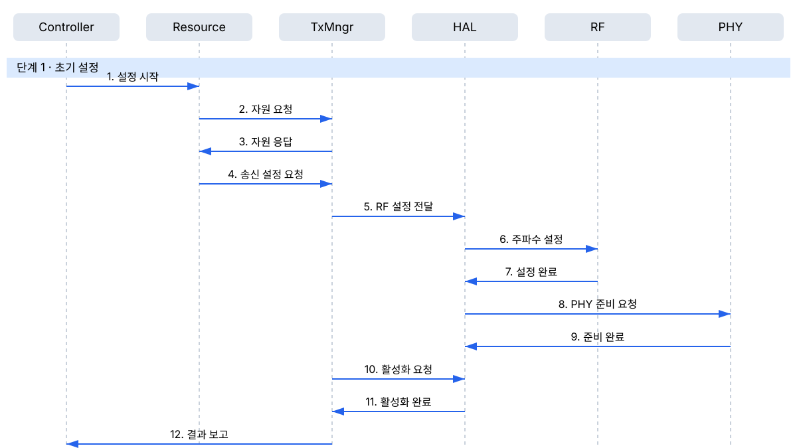

# CODE_FACTS · 설정 흐름 가상 분석

> **공개 UI 샘플** — 실제 L1 소스·로그를 분석한 문서가 아니에요. 모든 메시지와 모듈 관계는 기존 B안 시안의 가상 예시예요.

| 항목 | 값 |
|---|---|
| Work | `DEMO-MSC-001` (가상) |
| 분석 기준 | `DEMO-r0001` (실제 source commit 아님) |
| 근거 | [기존 B안 공개 가상 샘플](https://wonhwipark.github.io/L1Work/msc-samples/#b) |
| 검증 범위 | 화면·링크·그림 열람 예시. 실제 코드/런타임 분석 아님 |

## 분석 요약

설정 시작 → 자원 준비 → 설정 전달 → 준비·완료 응답 → 결과 보고의 형태를 가상 메시지로 설명하는 예시예요. 2·3단계는 단계 이동 기능을 보여주기 위한 반복이며 실제 변경/해제 동작의 근거가 아니에요.

## MSC 미리보기와 확대 보기

**[MSC 확대 보기 · HTML 뷰어](https://wonhwipark.github.io/L1Work/sample/msc-workspace/works/DEMO-MSC-001/artifacts/analysis/msc/r0001/viewer.html)** · [HTML 분석 문서](https://wonhwipark.github.io/L1Work/sample/msc-workspace/) · [SVG 원본](artifacts/analysis/msc/r0001/msc.svg)

아래는 첫 단계 메시지 1–12의 미리보기예요. 그림을 선택하면 전체 36개 메시지가 있는 HTML 뷰어를 열어요.

## 단계와 확인 한계

| 단계 | 메시지 | 설명 |
|---|---|---|
| 1 · 초기 설정 | 1–12 | 가상 요청·준비·완료 회수 패턴 |
| 2 · 설정 변경 | 13–24 | 같은 패턴을 반복한 비교용 단계 |
| 3 · 해제 후 재설정 | 25–36 | 단계 이동용 반복. 실제 해제 절차를 나타내지 않음 |

실제 적용에서는 확인한 source revision·분석 범위·조건·근거·미확인을 같은 Work에 남기고 converter의 MSC 입력/출력을 사용해야 해요.

[MSC 목록](MSC_VIEW.md) · [텍스트 원본](artifacts/analysis/msc/r0001/msc.txt) · [HTML 파일 원본](artifacts/analysis/msc/r0001/viewer.html) · [Work 요약](README.md)
