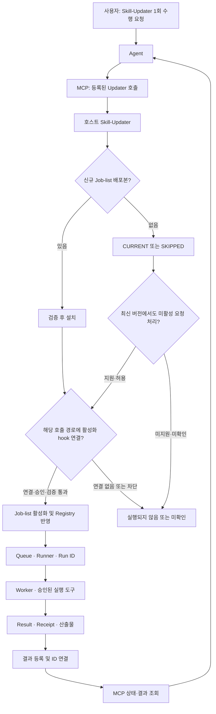

# Agent → MCP → Skill-Updater → Job-list 운용 구조 및 검증 안내

- 버전: r0001 / PUBLIC 전달본
- 공개 범위: 운용 구조·읽기 전용 점검 안내. 사용자별 실행 결과와 호스트 관측값은 제외
- 작성 기준: 2026-11-13 21:57 KST
- 대상: 호스트 운영 구조를 검토하는 GPT 및 로컬 실행 Agent
- 목적: 사용자의 Skill-Updater 1회 수행 요청이 Job-list 실제 실행과 결과 조회로 연결되는 구조를 설명하고, 현재 구현과의 차이를 확인
- 성격: 구조 설명 및 읽기 전용 검증 인계. 이 문서 전달만으로 운영 변경·Job 실행을 승인하지 않음

## 1. 가장 중요한 사용자 의도

사용자는 다음 방식으로 작업을 요청하려 함.

> 사용자가 Agent에게 “MCP를 통해 Skill-Updater를 한 번 수행해줘”라고 요청하면, 호스트의 Skill-Updater가 신규 Job-list 배포본을 확인·설치하고, 연결된 활성화 경로를 통해 승인된 One-shot 작업이 실행되며, 이후 Agent가 MCP로 같은 작업의 상태와 결과를 확인하는 구조.

이것은 **목표 운용 구조**임. 현재 호스트에서 MCP의 일반 1회 호출이 Job-list 활성화까지 연결돼 있다는 사실은 아직 검증되지 않음.

- **Skill-Updater 1회 호출**: 업데이트 확인/설치 절차를 한 번 호출한다는 의미
- **Job-list One-shot**: 특정 작업을 중복 소비하지 않도록 관리하는 실행 정책
- 두 개념은 다름. Updater 1회 호출 성공이 Job 1회 실행 성공을 뜻하지 않음
- 정기 실행을 기다리지 않고 시작할 수 있는지는 MCP 호출 → 활성화 hook → Runner 연결의 실제 구현·권한에 달림

## 2. 전체 구조와 중요한 분기

그림의 분기는 검증할 항목을 표현한 것임. 최신 버전에서도 미활성 요청을 처리하는 기능이나 자동 Catalog 등록이 현재 구현돼 있다고 가정하지 말 것.

## 3. 각 구성요소의 역할

| 구성 | 역할 | 확인할 실제 근거 |
|---|---|---|
| Agent | 사용자 의도를 등록된 MCP 도구 호출로 변환하고 결과 조회 | 노출된 도구, 실제 호출 인자와 응답 |
| MCP | 허용된 요청 전달 및 상태·결과 조회 | 서버 등록, 권한, 실제 호출 대상, ID·조회 정책 |
| Skill-Updater | 신규 배포본 확인·검증·설치 및 연결된 후속 절차 | 실제 설치본·실행 진입점·호출 모드·설치/활성화 영수증 |
| Job-list | 활성 요청 및 Profile 검증, Registry·중복/소비 상태 관리, 실행 연계 | 현재 로드 파일, Job별 검증 결과, Registry·Queue |
| Runner | 작업을 실행하고 Run ID 및 Worker 실행 상태 추적 | Run ID, 시작/종료 시각, 실행 사용자와 환경 |
| Worker | 승인된 대상과 스킬·도구로 실제 작업 수행 | preflight, 도구 실행 결과, 작업의 의미상 결과 |
| 결과 조회 계층 | Job–Run–Result–Evidence 연결 및 허용된 조회 | Result·Catalog·검색·Agent 원본 재조회 |

MCP가 Job-list를 임의 shell로 직접 실행하는 구조로 바꾸거나, 등록되지 않은 도구·CLI 인자를 만들어 호출하지 말 것. 기존 계약을 먼저 확인하고 재사용할 것.

## 4. 배포본과 작업의 라이프사이클

| 단계 | 의미 | 이 단계만으로 주장하면 안 되는 것 |
|---|---|---|
| REQUEST_DESIGNED | 대상·Profile·허용 범위·완료 기준 정의 | 호스트 접수·실행 |
| CANDIDATE_BUILT / SELF_TESTED | 신규 ZIP 생성 및 개발자 시험 | 독립 리뷰·호스트 성공 |
| RELEASE_APPROVED / POSTED | 승인된 배포본 게시·원격 검증 | 호스트 설치 |
| SKILL_UPDATER_INSTALLED | 호스트 설치 증거 확보 | Job 활성화 |
| JOB_ACTIVATED | Job별 게이트 통과 및 Registry 등록 | Worker 시작 |
| RUNNER / WORKER_STARTED | 대상 Job과 연결된 실제 Run·시작 근거 | 분석·산출물 완료 |
| RESULT / RECEIPT_RECONCILED | 실제 작업 결과와 영수증 연결 | Agent에서 검색·조회 가능 |
| CATALOG / AGENT_READBACK | 동일 ID로 검색·원본 결과 조회 | 별도 승인 대상의 지식 정본 게시 |
| KNOWLEDGE_PUBLISHED | 소유자 승인과 검증을 거친 지식 반영 | 문서·분석 생성만으로 이 상태 선언 |

위 상태명은 설명을 위한 단계 구분임. 기존 코드의 enum을 임의로 변경하거나, 존재하지 않는 상태/API를 실제 기능처럼 사용하지 말 것.

### Job-list 요청 구분

- 활성 요청: 패키지의 `requests/one-shot-jobs.json`
- `staged` 또는 `preserved`: 준비·보관 자료로, 활성 큐나 실행 증거와 다름
- 배포 계약상 신규 버전당 활성 One-shot 최대 1건
- `jobs: []`이면 활성 요청 0건
- 소비된 Job을 재설치·재큐잉해 다시 실행하지 않음
- 기존 Queue/Registry/Receipt/Run 및 영구 데이터·출력 이력 보존
- 실제 소비 시점과 실패 후 처리 정책은 설치된 코드에서 확인. BLOCKED라고 자동 재시도 가능한 것으로 판단하지 말 것
- 새로운 실행이 필요하면 원인과 기존 소비 상태를 먼저 판정한 후, 별도로 승인된 신규 요청 절차를 사용할 것

## 5. 일반 1회 호출과 예약 실행을 반드시 비교

| 확인 항목 | MCP를 통한 1회 호출 | OS 예약 실행 |
|---|---|---|
| 실제 진입점 | 현재 MCP Wrapper가 호출하는 경로/인자 확인 | 실제 예약 unit/스크립트/인자 확인 |
| 사용자·HOME·PATH·CWD | MCP 및 자식 프로세스의 실제 환경 확인 | 예약 서비스의 실제 환경 확인 |
| 신규 버전 설치 | 호출 모드별 동작 확인 | 예약 모드별 동작 확인 |
| 설치 후 활성화 | hook 호출 여부를 Job별로 확인 | 예약 전용 후속 절차 유무 확인 |
| 최신 버전일 때 | CURRENT/SKIPPED 후 활성화 여부 확인 | 동일 버전 재확인 시 처리 여부 확인 |
| 실행 결과 | Updater 응답과 Job 결과를 분리 | 예약 성공과 Worker 성공을 분리 |

**핵심 검증 질문:** 현재 MCP가 호출하는 Skill-Updater 1회 실행 경로가 Job-list 활성화까지 수행하는가? 설치가 필요 없는 CURRENT 상태에서도 허용된 미활성 요청을 처리하는가?

자동 실행 주기는 이 문서에서 고정하지 않음. 실제 호스트 예약 설정을 확인할 것. Updater 자기 업데이트의 STAGED/Bootstrap 절차와 Job-list 설치 후 활성화 절차도 별개로 조사할 것.

## 6. 현재 대상과 관측된 장애

### 배포 기준

- 저장소: `wonhwipark/L1Work`
- 브랜치: `main`
- 배포 경로: 루트 `job-list_v0_4_36_1112.zip`
- 이번 GitHub 확인 시 PUBLIC 루트의 최신 Job-list 버전: **0.4.36**
- 크기: 1,563,658 bytes
- 배포 기록의 SHA-256: `cbe17dc15199593e2a9bce6aa2b8857c1f011336ebd2cd3d4c8ee3cce0eee3f6`
- GitHub 루트 메타데이터의 blob SHA: `4357594be4cdae26a4fd19788fb3a35d7de3b5d5`
- 이번 확인에서는 루트 파일 메타데이터와 배포 기록을 대조했으며, ZIP 전체 바이트를 새로 다운로드해 SHA-256을 재계산한 것은 아님
- 호스트 설치 버전·로드 파일·실제 ZIP 동일성은 별도 확인 필요

### 호스트에서 확인할 대상

- 대상 Job ID와 Profile은 설치된 활성 요청 및 기존 영수증에서 확인할 것.
- 과거 예제 ID를 복사해 실제 대상 대신 사용하거나 새 Job ID를 임의로 만들지 말 것.
- 실제 분석 목적·산출물 기준은 해당 Job의 승인된 요청에서 확인할 것.
- 설치·분석 결과 생성과 Knowledge 정본 게시는 별개로 판정할 것.

### CLI 차단을 만난 경우의 진단 예시

다음은 일반적인 점검 예시이며, 특정 호스트의 실제 장애·복구 상태를 주장하지 않음.

1. `opencode cli not found`가 있으면 미설치, 서비스 PATH, 실행 경로, 권한 문제를 구분.
2. systemd 사용자 unit과 터미널의 실행 사용자·HOME·PATH·CWD가 다를 수 있으므로 실제 실행 환경을 비교.
3. Run ID 관련 파일이 있어도 대상 Job과 연결된 Worker 시작·분석 성공의 증거인지 별도 확인.
4. 해당 파일의 Job ID·Run ID·시각·Receipt·실행 상태를 대조.
5. Registry/활성화 결함, 결과 조회 등록 누락, Run ID 불일치를 각각 독립적으로 추적.
6. 격리 변경·합성시험 PASS를 운영 반영·실제 분석 성공으로 해석하지 말 것.
7. 과거 DONE/SUCCESS와 이후 BLOCKED가 같은 Run인지 다른 시점인지 확인.

v0.4.36의 배포 당시 정적 기록상 Worker는 `opencode run --dir <source>`를 새 자식 프로세스로 호출하도록 구성됨. OpenCode Web이 정상이라는 사실은 이 CLI 실행 경로의 정상 동작을 증명하지 않음.

## 7. GPT·로컬 Agent에 요청할 읽기 전용 점검

운영 변경 없이 가능한 범위에서 다음을 한 번에 조사해줘.

1. **호출 계약 확인:** 실제 노출된 MCP Tool과 Wrapper, Skill-Updater 진입점·버전·모드·인자를 확인.
2. **활성화 연결:** MCP 1회 호출과 예약 실행 경로의 차이, 설치 후 hook, CURRENT/SKIPPED 이후 처리 분기를 소스와 기존 기록에서 대조.
3. **설치 및 요청 정합성:** 현재 Job-list 버전/로드 경로, 활성 요청·Profile·Worker 내부 Job ID가 일치하는지 확인.
4. **실행 추적:** 대상 Job의 Catalog → Registry → Queue → Run ID → Worker → Receipt → Result를 기존 기록으로 연결.
5. **CLI 장애 분리:** systemd 사용자 unit의 필요한 환경과 터미널 환경을 비교. 전체 환경변수·비밀값을 출력하지 말 것. 소스/설정 읽기와 실행 파일 경로·권한 확인을 우선하고, 안전성이 확인된 비모델 버전 조회만 사용. 분석 Job이나 모델을 새로 실행하지 말 것.
6. **결과 조회:** 실제 등록된 읽기 전용 MCP 도구로 대상 상태·결과 조회. allowlist/ID 매핑·결과 파일 부재를 분리.
7. **완료 수준:** CLI 접근 복구 / Job 활성화 / Worker 실행 / 분석·MSC 생성 / MCP 결과 조회를 각각 판정.

도구·권한이 없으면 해당 항목만 BLOCKED/NOT_VERIFIED로 남길 것. 같은 제한된 상태 조회를 반복하지 말고 실제 필요한 접근 범위를 명시할 것.

### 이번 점검에서 수행하지 않을 동작

- Skill-Updater 실업데이트·설치 또는 Job-list 활성화 명령 실행
- 기존 Job 재실행·재등록·재큐잉
- 서비스 수정·재시작, CLI 설치·업데이트
- 운영 Queue/Registry/DB/allowlist 변경
- 기존 소스·Knowledge 정본 수정
- 신규 모델 호출 또는 원문 소스·로그·비밀정보 외부 전송

이 문서는 구조 전달과 읽기 전용 확인용임. 이후 운영 수정·실제 실행은 확인된 원인과 구체 변경안을 바탕으로 별도 승인 범위에서 처리.

## 8. 결과 보고 형식

숫자만 보고하지 말고, 원본 상세 근거는 호스트에 보존하며 비민감 요약을 아래 표로 제공해줘.

| 항목 | PASS / FAIL / NOT_VERIFIED / NOT_RUN | 근거 시각·참조 또는 차단 이유 |
|---|---|---|
| MCP → Skill-Updater 실제 호출 계약 | | |
| Skill-Updater → Job-list 설치 계약 | | |
| MCP 1회 호출 → Job-list 활성화 연결 | | |
| CURRENT/SKIPPED 상태의 미활성 Job 처리 | | |
| 대상 Job Registry·Queue 정합성 | | |
| 대상 Job–Run ID 연결 | | |
| 서비스 환경의 OpenCode CLI 접근 | | |
| 대상 Worker 실행 및 의미상 결과 | | |
| 분석·MSC 산출물 | | |
| MCP 상태·결과 원본 조회 | | |

마지막에 **첫 실패 단계 / 확인된 원인과 미확정 가설 / 기존 Job 소비 여부 / 다음 한 조치**를 작성.

전체 복구 완료는 CLI 발견 성공만으로 판정하지 않음. 실제 작업 결과와 조회 증거가 부족하면 그 범위를 명확히 남길 것.

## 9. 확인한 PUBLIC 참고 문서

모두 저장소 `wonhwipark/L1Work`, 브랜치 `main` 기준.

1. `MCP_Joblist_RunCatalog_E2E_Standard_20261107.md`
   - https://github.com/wonhwipark/L1Work/blob/main/MCP_Joblist_RunCatalog_E2E_Standard_20261107.md
   - 결과·Run Catalog·검색·Agent 재조회 완료 기준. 운영 표준 제안이며 상시 자동 적용을 증명하지 않음.
2. `INTERNAL_LLM_MCP_OneShot_Fix_Deploy_JobList_Remote_Design_v1_1_20261026.md`
   - https://github.com/wonhwipark/L1Work/blob/main/INTERNAL_LLM_MCP_OneShot_Fix_Deploy_JobList_Remote_Design_v1_1_20261026.md
   - 특히 §4.2~4.6. 요청·조회·계획·접수 경계와 라이프사이클 설계. 가칭 Tool/API를 실제 구현으로 취급하지 말 것.
3. `ho/MCP_JobList_Integrated_Analysis_Recovery_Prompt_r0002_PUBLIC_20261113.md`
   - https://github.com/wonhwipark/L1Work/blob/main/ho/MCP_JobList_Integrated_Analysis_Recovery_Prompt_r0002_PUBLIC_20261113.md
   - 기존 MCP 연결 비교 및 Job-list 실행·조회 경계 진단 참고. 본 문서의 현재 읽기 전용 범위를 확대하는 실행 지시로 사용하지 말 것.
4. `job-list_v0_4_36_1112.zip`
   - https://github.com/wonhwipark/L1Work/blob/main/job-list_v0_4_36_1112.zip
   - 배포본 식별 기준. 이 문서만으로 재설치·재실행하지 말 것.

참고: 루트의 `automation/job-list.json`은 과거 스킬 복사·검증 작업용 자료이며, 현재 NR L1 Tx 활성 요청을 대신하지 않음.

