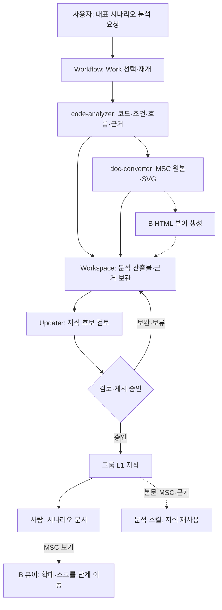

# L1 Knowledge MSC B 뷰어 — 생성·축적·게시·열람 연계 GPT 리뷰 인계서

- Revision: **r0001 / 2026-11-14 KST**
- 문서 상태: **설계 리뷰 입력 준비 / 구현·통합·호스트 검증 전**
- 리뷰 주제 ID: `L1-MSC-B-VIEWER-DESIGN-20261114-001` — 이 문서의 주제 식별자이며 실제 Kernel Work ID가 아님
- 정확한 전달 위치: **저장소 `wonhwipark/L1Work` / 브랜치 `main` / 경로 `handoffs/L1_KNOWLEDGE_MSC_B_VIEWER_GPT_REVIEW_HANDOFF_r0001_20261114_KST.md`**
- 이번 요청: 기존 L1 지식 설계에 B 방식의 MSC 열람을 연결하는 컨셉·책임·입출력·단계별 적용 범위를 검토
- 허용 작업: 이 문서와 접근 가능한 기존 스킬·정책·출력 계약의 읽기 전용 검토, 비민감 리뷰 결과 작성
- 실행 제외: 코드·스킬·기존 지식·metadata·Work 원장/DB·Job·설치·배포·호스팅 설정 변경, 실제 코드 분석·모델/Job 재호출·게시 실행
- 공개 범위: 일반화한 요구·역할·운용 시나리오와 공개 가상 샘플만 포함. 회사 코드·상세 MSC·로그·업무 경로·인증정보는 포함하지 않음

> 기존 설계의 결론을 정답으로 전제하지 말고, 반례·책임 중복·자료 유실·사용자 열람 실패를 먼저 검토해 주세요. 현재 1단계의 모듈·Feature 목록 검토와 향후 실제 분석·게시·AI 활용 검증을 구분해 주세요.

## 1. 사용자 목적과 확정한 방향

### 1.1 지금의 1단계

현재 우선 목적은 **담당 모듈과 Feature 목록·경계를 검토하는 것**. 전체 Procedure/Scenario 분석, 실제 지식 ID 대조 완료, 모든 MSC 생성, RAG 실행 검증을 이 단계의 선행 완료 조건으로 만들지 않음.

담당 모듈은 NR BCH(= NR L1 Channel Controller), NR L1 Tx, LTE ChCfg, LTE L1 Tx. 기존 Module → Feature → Scenario 지식 구조를 유지하고 Procedure·운용 맥락은 교차 탐색 뷰로 사용.

분류표의 215개 항목은 검토행이며 실제 지원 기능·지식 문서·Feature/Scenario ID의 확정 목록이 아님. 신규 후보를 포함해 전 항목을 일괄 분석하는 요청도 아님.

### 1.2 후속 지식 축적과 활용

1. 대표 시나리오·프로시저를 선정.
2. 기존 코드 분석 기능으로 코드·문서·이력 근거와 실제 흐름을 확인.
3. 기존 doc-converter 표현 기준으로 MSC 텍스트·SVG 및 사용자 열람 결과를 생성.
4. 분석·근거·산출물을 기존 l1-workspace Work에 축적.
5. 검토·승인된 기술 지식을 l1sw-dev-knowledge의 해당 Module/Feature/Scenario에 게시·연결.
6. 일반 사용자는 설명 문서와 MSC 뷰어로 공부하고, 분석 스킬은 같은 시나리오의 지식 본문·MSC 원본·코드 근거를 재사용.

Work 원본·Evidence·진행 이력은 보존하고 그룹 게시 revision을 연결. 그룹 게시를 이유로 원본을 이동·삭제하거나 두 개의 독립적인 최신 기술 정본을 만들지 않음.

### 1.3 사용자 선호 B

사용자는 다음 **B 방식**을 선호한다고 확인:

- 주요 메시지를 읽기 좋게 표현한 **SVG를 HTML 뷰어 안에서 열람**.
- 확대·축소, 가로·세로 스크롤, 단계 이동 제공.
- 긴 코멘트·근거·설명은 그림 밖의 문서나 설명 영역으로 분리.
- 실제로 서로 다른 모듈인 participant는 유지. 화면 폭을 줄이려고 임의로 합치지 않음.
- Git 웹의 시나리오 문서에서 **‘MSC 보기’ 링크를 클릭하면 렌더링된 B 화면으로 이동**.
- 문서의 MSC 텍스트와 원본·근거 참조도 계속 확인 가능.
- 향후 사람의 기본 열람 경로는 Git 문서·B 뷰어로 구성하고, Confluence 설치·플러그인·동기화를 필수 전제로 두지 않음.

SVG는 그림 산출물이고 HTML은 그 그림을 읽기 좋게 보여주는 화면. 두 형식 중 하나를 고르는 문제가 아니라 같은 분석 결과의 원본·그림·열람 화면을 일관되게 연결하는 요구.

## 2. 확인 수준과 미확인 구분

| 구분 | 현재 근거·설명 | 이번 리뷰에서의 취급 |
|---|---|---|
| 기존 역할 계약 | Workflow의 요청/Work 연결, Kernel의 Work/Evidence, analyzer의 코드 사실, converter의 표현 변환, Updater의 기술 후보·분류·Preview·승인 연결 | 기존 책임을 재사용하는 출발점 |
| doc-converter 표현 정책 | 기존 패키지 정적 확인 자료에 폴더 기반 participant, alias·stack 구분·근거 추적, PUML/SVG 등 표현·변환 기능이 기술돼 있음 | 실제 설치본의 원문·지원 범위를 확인할 대상. 해당 호스트의 호출 성공으로 승격하지 않음 |
| 기존 지식/연계 기능 | 2026-11-14까지 일부 기능이 호스트 조사에서 확인됐다는 보고가 확보됨 | **부분 확인 보고**를 재사용. 전체 G0 미수행 또는 전체 통합 PASS로 단정하지 않음 |
| B 가상 샘플 | 공개 비교 샘플에 6 participant·36 message·3단계, HTML+SVG와 확대·스크롤·단계 이동이 표현돼 있음 | 사용자 선호를 설명하는 시안. 실제 converter 출력·실제 제품 동작의 검증 결과가 아님 |
| B 자동 생성·등록·열람 연결 | 실제 설치 converter가 해당 HTML과 단계 정보를 만들고 게시 링크까지 연결하는지 미확인 | 문서 검토로 존재/계약 확인. 미확인을 곧 기능 부재로 확정하지 않음 |
| 첫 실제 분석·게시·AI 사용 | 저장 위치·실제 ID·source/MSC/Evidence 정합·게시/readback·역링크·Provider 본문 활용의 첫 사례 검증은 후속 예정 | 이번 모듈/Feature 분류·컨셉 설계 완료의 차단으로 삼지 않음. 실제 E2E 완료는 검증 뒤 판정 |

이 인계서는 현재 설치 버전·함수·API·record·stage를 새로 확정하는 문서가 아님. 기존 보고에서 확보한 내용을 먼저 재사용하고, 필요한 미확인 계약만 좁혀 확인.

## 3. 제안하는 책임 분담

| 구성요소 | 맡을 책임 | 경계·확인할 사항 |
|---|---|---|
| **l1-fix-workflow** | 요청 의도 분류, 기존 Work 선택/재개, 필요한 분석·변환 연결, 기존 산출물 참조의 Updater 인계 | HTML/SVG 렌더러를 별도 구현하지 않음. 기존 분석을 이유 없이 재호출하거나 중복 Work를 만들지 않음 |
| **code-analyzer** | 고정 입력의 Code Facts, 메시지·조건·분기·상태·단계 근거, AS-IS MSC 입력 | 그림의 미관·호스팅·그룹 게시 승인 책임과 분리. 정적 호출 관계와 실제 런타임 순서·타이밍 주장을 구분 |
| **doc-converter** | 기존 participant/표현 규칙, MSC 텍스트·SVG, 같은 입력을 사용하는 **B HTML 열람 산출물** 및 설명/단계 연결 | HTML 생성 책임을 두는 설계 제안. 기존 지원 범위를 확인한 뒤 필요한 부분만 보완. 소스 사실을 임의로 추가·승인하지 않음 |
| **work-ledger-kernel** | 실제 Work ID·상태, 허용된 Evidence·Artifact 참조·이력, 기존 export/연결 계약 | MSC 렌더링·웹 호스팅을 소유하지 않음. 새 필드·Evidence 종류·stage를 추정 삽입하지 않음 |
| **l1-workspace** | 분석 문서·MSC·원본 근거·결정·시험·검토의 업무 이력 보존 | 물리 파일 저장과 Kernel 참조 등록의 기존 소유권 구분. 그룹 게시 뒤에도 Work 원본 유지 |
| **l1-knowledge-updater** | 기존 Module/Feature/Scenario와 기술 후보 연결, 중복·적용 범위·정책 확인, Preview·승인·기존 writer 조정, 목차/문서의 ‘MSC 보기’ 연결 | B 화면 생성은 converter 재사용. Work/Evidence 원장 대체·별도 Work ID 발급 금지 |
| **기존 Git 제공자·승인된 호스팅 경로** | 실제 파일 게시·revision 확인·브라우저 열람 URL 제공 | HTML 파일 생성/저장과 웹 호스팅은 별개. Updater가 조정하는 기존 게시 경로와 연결하고, 미확인 호스팅을 자동 도입하지 않음 |
| **지식 reader / 분석 스킬** | 접근·적용 범위에 맞는 지식 본문·MSC 원본·근거 조회 및 분석 입력 사용 | HTML 링크 발견을 실제 본문 소비 또는 분석 성공으로 간주하지 않음 |

**핵심 제안:** B 생성의 주담당은 doc-converter, 지식 후보·목차·게시 연결의 주담당은 l1-knowledge-updater. Workflow는 같은 출력 경로를 조정하고 Kernel은 기존 근거·참조·이력을 관리.

이 역할 분담이 실제 설치 계약과 맞는지 검토하고, 기존 기능으로 충족되는 부분과 확인된 최소 보완 부분을 나눠 주세요.

## 4. 운용 흐름

아래 실선은 기존 역할을 연결한 운용 설계, 점선은 B 생성·연결 또는 후속 활용 검증 대상. 실선도 전체 자동 실행 실측 PASS를 뜻하지 않음.

Kernel은 위 흐름의 Work·허용 Evidence·참조·상태를 기존 계약으로 관리. 그룹 게시 완료와 Work 역링크 완료는 별도로 확인.

### 4.1 입력 유형별 분기

| 사용자 요청 | 분석·변환 연결 | 축적·후속 |
|---|---|---|
| 모듈·Feature 목록 검토 | 분류·범위 검토 | 실제 코드 분석·MSC 생성·전체 ID 대조를 지금 강제하지 않음 |
| “선정 시나리오를 코드 분석하고 MSC 작성” | 필요한 고정 소스 분석 → 기존 MSC 입력 → converter | 관련 Work에 Code Facts·원본·그림·B 후보 연결 |
| “기존 MSC를 B 화면으로 보기 좋게 변환” | 기존 원본·근거·적용 범위 확인 → converter 재사용 | 근거가 충분한 기존 분석을 화면 생성 때문에 반복하지 않음 |
| 기존 Work 대화 중 MSC 추가 요청 | 기존 Work와 필요한 source/scope를 유지·확인 | 새 Work·새 분석을 무조건 만들지 않음 |
| CL/merged PR 목록의 이슈 분석 | 기존 Git/P4·analyzer로 이슈·변경 근거 정리 | MSC가 필요한 사례에만 기존 선택 정책을 적용하고 같은 converter 경로 재사용 |

단순 문서 변환·스터디에 Work를 강제할지는 현행 계약을 확인. 모든 converter 요청에 업무 Work 생성·DB 쓰기를 강제하는 설계로 확대하지 않음.

## 5. 같은 시나리오의 산출물 연결

다음은 역할별 산출물 설명이며 신규 파일명·schema·필드를 의무화하는 명세가 아님. 실제 설치된 출력명·참조·manifest·writer를 우선 사용.

| 산출물·참조 | 주 생성/관리 책임 | 이용 목적 |
|---|---|---|
| Code Facts·분석 근거 | code-analyzer / 기존 SCM·Evidence 제공자 | 어떤 소스와 조건에서 확인한 흐름인지 추적 |
| 시나리오 설명 | 기존 분석·문서 작성 기능, Updater의 후보 연결 | 목적·시작 조건·핵심 분기·결과·한계 설명 |
| MSC 텍스트·구조 원본 | 기존 analyzer→converter 입력/출력 계약 | 사람의 원문 확인, 재변환·분석 스킬 재사용 |
| SVG | doc-converter | 선명한 MSC 그림 |
| B HTML·단계/설명 연결 | doc-converter의 기존 기능 재사용 또는 최소 보완 후보 | 사람이 확대·스크롤·단계 이동하며 열람 |
| 지식 목차·문서의 보기 링크 | Updater + 기존 writer/문서 생성 소유자 | Module → Feature → Scenario → B 화면 연결 |
| Work/Evidence·그룹 게시 revision 참조 | Kernel/Updater의 기존 계약 | 분석 이력과 게시 지식의 관계 보존 |

### 5.1 보존할 의미와 근거

- 실제 기존 Module/Feature/Scenario 식별·설명 절·기준 본문을 재사용. 표의 임시 검토 ID를 실제 지식 ID로 치환하지 않음.
- Git full SHA 또는 P4 실제 파일 revision·분석 scope·제품/Release/build 조건을 기존 근거 계약으로 연결.
- AS-IS 코드 사실, TO-BE 설계, 추론, 미확인을 구분. 화면이 보기 좋다는 이유로 미확인 메시지까지 검증됐다고 표시하지 않음.
- 원인 확인·수정 반영·시험 성공·현재 적용성·게시 상태를 구별.
- participant의 논리 식별과 표시 alias, 서로 다른 stack/모듈의 구분을 보존.
- 중요한 메시지·조건·분기·상태·종료 경로와 근거 연결을 보존.
- 문서·MSC 원본·SVG·B HTML이 같은 입력·적용 범위·지식 게시 revision에 대응하게 연결.

converter 변환 후 추가된 표현·설명은 원래 코드 사실과 구별. 중요한 메시지·분기 유실을 가독성 개선으로 정당화하지 않음.

### 5.2 기존 정책 존중

기존 대표 MSC 선택·재사용·NO_MSC_REQUIRED/HOLD 판단을 확인 없이 해제하지 않음. 모든 분류행에 MSC를 강제하거나 이미 검증된 동일 입력의 분석을 중복 호출하지 않음. 기존 기능으로 충족하지 못하는 실제 요구만 최소 보완 후보로 제시.

## 6. B의 가독성 기준

| 항목 | 요구·검토 기준 |
|---|---|
| 참여자 | 서로 다른 모듈은 유지. 기존 SOURCE_PARENT_DIR_V1·alias·stack 구분 계약 재사용 여부 확인. TxCfgMngr/TxCmdMngr→TxMngr 등은 확인된 기존 매핑만 적용 |
| 주요 메시지 | 시나리오 의미에 필요한 요청·응답·이벤트·조건 중심. 표시를 줄여도 중요한 호출·분기·오류 경로의 근거는 남김 |
| 내부 self 메시지 | 단순 구현 세부는 기존 표현 정책으로 숨길 수 있으나, 핵심 상태·조건을 설명하는 유일한 근거까지 삭제하지 않음 |
| 긴 코멘트 | MSC 그림 밖의 설명 영역·문서로 분리하고 메시지/단계와 연결 |
| 글자 크기 | 긴 시나리오·6 participant를 한 화면에 넣으려고 자동 축소하지 않음. 읽을 수 있는 기본 크기와 원래 비율을 유지 |
| 화면 조작 | 확대·축소, 가로·세로 스크롤, 단계 이동. ‘전체 맞춤’은 사용자가 선택할 수 있게 검토 |
| 단계 분리 | 의미 있는 구간으로 나누되 기존 메시지 순서·분기·상태·교차 단계 연결을 보존. 긴 흐름은 개요와 상세를 함께 연결 가능 |
| 원문·근거 | 설명 문서에서 MSC 텍스트 또는 원문 링크를 확인 가능. 그림·HTML만 남는 구성이 되지 않도록 연결 |
| 재현성 | 같은 원본·converter/표현 규칙으로 다시 만들 수 있게 기존 산출물 계약 재사용 |
| 적용 상태 | 코드 근거·미확인·설계 상태를 표현 변환 뒤에도 유지 |

6 participant·36 message·3단계는 공개 샘플의 비교 조건. 실제 MSC의 참여자 수·메시지 수·단계 수를 이 값으로 제한하거나 맞추라는 요구는 아님.

## 7. 사람이 여는 경로와 AI가 사용하는 경로

### 7.1 일반 사용자

1. 업무용 Git의 Module/Feature 목차 열기.
2. 대표 Scenario 문서에서 목적·트리거·조건·결과·MSC 텍스트·근거 확인.
3. ‘MSC 보기’를 클릭.
4. 웹으로 렌더링되는 B 화면에서 SVG 확대·스크롤·단계 이동.
5. 필요하면 원문·그림·설명·근거로 되돌아가기.

**HTML 파일이 저장소에 존재하는 것과 브라우저에서 렌더링되는 URL이 제공되는 것은 별도 조건**. 파일 소스 화면, raw/download, 렌더링된 열람 URL을 구별해 검토.

실제 열람은 업무용 Git·조직이 허용한 기존 호스팅·접근 경로에 맞춰 설계. 지식 문서·SVG·HTML·원문·내장 설명은 같은 정보등급·접근 범위를 따라야 함. 공개 샘플 주소를 실제 업무 지식의 기본 배포 위치로 전용하지 않음. 이번 요청은 호스팅 설정·서비스 도입·접근 권한 변경 승인이 아님.

### 7.2 분석 스킬

- 같은 Scenario의 지식 본문·MSC 텍스트/구조·적용 조건·코드 근거를 조회해 사용.
- HTML 화면을 직접 읽는 것 또는 SVG 픽셀 분석에 의존하는 것을 기본 경로로 만들지 않음.
- source/제품/Release/build·권한이 맞는 자료인지 확인.
- 링크 발견·검색 성공·뷰어 열람과 실제 Provider 본문 입력·분석 활용을 구분.
- 개인 Work/Evidence에 접근 권한이 없으면 승인된 그룹 설명과 허용된 근거만 사용.
- 실제 본문 소비·근거 응답 검증은 첫 승인된 대표 분석의 후속 확인 항목. 이번 설계 리뷰에서 새 분석·모델 호출을 시작하지 않음.

## 8. 게시·갱신·부분 실패 시나리오

| 상황 | 검토할 기존 처리·책임 |
|---|---|
| 코드·적용 조건 변경 | 기존 source/현재성 판단으로 영향 범위를 확인하고, 필요한 분석·MSC·그림·HTML을 같은 기준으로 갱신 |
| MSC 원본만 바뀌고 SVG/HTML은 이전 버전 | 동일 지식의 현재 화면으로 오인하지 않도록 불일치 표시 또는 관련 게시 보류. 기존 revision/manifest/readback 계약 재사용 |
| B 생성 기능 미확인·실패 | MSC 텍스트·SVG·Code Facts·Work 근거 보존. HTML 제공 상태를 별도로 표시하고 자동 성공 처리하지 않음 |
| 보기 URL이 코드 화면·404·권한 오류 | 열람 완료로 표시하지 않음. 생성/게시/브라우저 열람 상태를 구분 |
| 일부 산출물만 게시 | 승인된 필수 게시 집합·기존 writer 보장에 따라 정합성 판정. 필수 화면이 없는데 전체 B 제공 완료로 표시하지 않음 |
| 지식 게시 성공, Work 역링크 실패 | 게시 결과를 보존하고 기존 링크 경로만 복구. 같은 지식을 다시 게시하지 않음 |
| 동일 분석 재사용 | source·입력·적용 scope·근거가 동등한지 확인. 제목만 같다는 이유로 다른 제품/브랜치의 결과를 혼용하지 않음 |
| converter·표현 규칙 변경 | 기술 사실과 표현 변경을 구별. 중요한 메시지·조건·근거 보존을 확인한 뒤 필요한 파생물만 재생성 |

B가 옵션인 게시와 필수인 게시의 구분은 기존 정책·승인 범위에 매핑해 검토. 새 상태 enum·CAS 엔진·복구 원장·영수증 체계를 먼저 구현하지 않음. 불명확한 쓰기 경로는 추가 확인 대상으로 두되 모듈·Feature 목록 검토 전체를 중단시키지 않음.

## 9. 재사용·연결·최소 보완 판단

| 영역 | 우선 판단 | 후속 확인 |
|---|---|---|
| 코드 분석·고정 source·기존 Work/Evidence | REUSE | 현행 입출력·근거·소유권 확인 |
| MSC 원본·PUML/SVG·participant/alias·근거 trace | REUSE | 설치본이 실제 지원하는 원문·옵션·출력 확인 |
| 기존 MSC 읽기 문서·뷰어·HTML 생성 | 존재 여부 먼저 확인 | 있으면 REUSE/CONNECT. 자료가 없다는 이유만으로 미지원 확정 금지 |
| B의 확대/스크롤/단계·그림 밖 설명 | 기존 템플릿·viewer 기능에 매핑 | 요구를 못 채우는 실제 gap 확인 시 converter의 최소 보완 후보 |
| Workflow의 analyzer→converter 인계 | CONNECT | 기존 artifact/참조 전달 재사용; 변환을 위해 재분석하지 않도록 확인 |
| Updater의 문서·목차·B 보기 링크 | CONNECT | 기존 writer·경로·revision·접근·승인 계약 확인 |
| Kernel의 산출물 등록 | 기존 슬롯/참조 우선 | 새 Evidence kind·stage·record 필드 강제 없이 가능한지 확인 |
| 신규 전용 viewer 스킬·RAG 엔진·DB | 기본 도입하지 않음 | 기존 기능으로 요구 충족 불가가 입증된 최소 범위만 후보로 검토 |

함수 이름·명령·새 API·필드를 상상해서 실행 가능한 계약처럼 제시하지 말아 주세요. 존재 확인, 실제 호출 성공, 운영 검증을 구분해 주세요.

## 10. 리뷰 질문

| ID | 검토 질문 |
|---|---|
| Q01 | B HTML 생성은 converter, 기술 후보·목차·게시 연결은 Updater라는 책임 분리가 기존 설치 계약과 맞는가? 중복 소유·누락 책임은 무엇인가? |
| Q02 | 코드 분석 요청, 기존 MSC 변환 요청, 기존 Work 중 추가 요청을 구분할 수 있는가? 중복 Work/분석/게시 위험은 없는가? |
| Q03 | 실제 analyzer→converter 입력이 메시지·조건·단계·source/anchor·검증 상태를 충분히 보존하는가? 이미 있는 계약으로 연결 가능한가? |
| Q04 | 기존 participant 폴더·alias·stack 규칙이 6개 이상 참여자와 동명 모듈에서도 정체성을 유지하는가? 임의 병합 위험은 없는가? |
| Q05 | 주요 메시지·필수 분기·상태·근거를 보존하면서 긴 코멘트를 밖으로 옮기고 내부 self 표현을 줄일 수 있는가? |
| Q06 | 긴 MSC에서 읽을 수 있는 기본 크기·확대/스크롤·단계 이동·전체/상세 연결이 가능한가? B에서 필요한 최소 보완은 무엇인가? |
| Q07 | 같은 Scenario의 문서·MSC 원본·SVG·HTML을 하나의 적용 source/게시 revision과 연결할 수 있는가? source drift·표현 변경은 어떻게 구별하는가? |
| Q08 | Git 문서의 ‘MSC 보기’가 실제 렌더링된 URL로 이어지는가? 파일 생성·게시·호스팅·접근 권한의 책임 공백은 없는가? |
| Q09 | Workspace 원본·Evidence는 보존하고 그룹 지식 게시·Work 역링크를 분리해 정산할 수 있는가? 이중 최신 정본 위험은 없는가? |
| Q10 | HTML 생성 실패·링크 오류·산출물 일부 게시에도 근거를 보존하고 상태를 구분할 수 있는가? 기존 writer/기록으로 충분한가? |
| Q11 | 다른 분석 스킬이 같은 지식 본문·MSC 원본·근거를 재사용할 수 있는가? 뷰어 링크와 실제 Provider 입력을 혼동하지 않는가? |
| Q12 | 1단계 목록 검토, 연결 계약 점검, 후속 최소 구현, 첫 대표 시나리오 E2E 검증을 적절히 분리했는가? 과도한 선행 게이트는 없는가? |

전체 설계를 기존 결론에 맞춰 승인하는 방식보다 구체적인 반례를 들어 개선해 주세요.

## 11. 후속 검증 계획 — 이번에는 실행하지 않음

| ID | 확인할 사례·수용 기준 | 현재 |
|---|---|---|
| T01 | 6 participant·긴 흐름에서 기본 글자가 읽히고 가로/세로 이동·확대·단계 이동 가능 | NOT_RUN |
| T02 | 긴 코멘트 분리 전후 주요 메시지·분기·조건·근거 보존 | NOT_RUN |
| T03 | 중요한 self 상태 변화와 단순 내부 구현 호출을 구별해 표현 | NOT_RUN |
| T04 | TxMngr 등 확인된 alias, 동명 폴더·복수 stack 구분 보존 | NOT_RUN |
| T05 | 같은 원본의 텍스트·SVG·HTML과 source/게시 revision 일치 | NOT_RUN |
| T06 | ‘MSC 보기’가 렌더링 화면으로 연결되고 문서와 동일 접근 범위 적용 | NOT_RUN |
| T07 | HTML 미생성/실패 시 원본·SVG·Evidence 유지, 완료 오표시 방지 | NOT_RUN |
| T08 | 게시 일부 실패·응답 불명·역링크 실패를 기존 처리로 정산하며 중복 게시 0 | NOT_RUN |
| T09 | 제품·RAT·Release/build·source가 다른 결과의 오재사용 방지 | NOT_RUN |
| T10 | Workspace 근거를 보존하고 그룹 지식과 동일 사실의 독립 최신본 중복 관리 방지 | NOT_RUN |
| T11 | 다른 reader가 허용된 본문·MSC·근거를 실제 입력으로 사용하는 첫 사례 확인 | NOT_RUN |
| T12 | 분류표·모듈/Feature 목록 검토만 할 때 분석·MSC 생성·전체 ID 대조 강제 0 | NOT_RUN |
| T13 | 기존 대표 MSC 선택·NO_MSC_REQUIRED/HOLD·재사용 정책 존중 | NOT_RUN |
| T14 | 기존 MSC의 B 변환만 요청했을 때 불필요한 코드 분석·Work 생성·Job 재실행 0 | NOT_RUN |

현재 설계 리뷰에서 수행할 검증은 기존 원문·계약의 읽기와 문서 정합성 대조. 위 사례의 코드/호스트/게시/Provider 실험을 실행하라는 승인이 아님.

## 12. 리뷰 결과 작성 형식

한국어·표 중심으로 다음 순서로 작성해 주세요. 회사 코드·실제 MSC·로그·절대 경로·인증정보를 공개 가능한 결과에 포함하지 말아 주세요. 상세 근거는 허용된 업무 환경에 보관하고 비민감 요약만 별도로 작성.

### 12.1 종합 판정

- 권고: `ACCEPT / ACCEPT_WITH_CHANGE / REVISE / ADDITIONAL_CHECK_REQUIRED` 중 선택하고 이유 명시.
- BLOCKING / MAJOR / MINOR 건수.
- 기존 기능 재사용으로 충분한 부분, 실제 연결 누락, 확인된 최소 보완, 자료 미확인을 구분.

BLOCKING은 해당 구현·게시·열람 실행 경로에 필요한 정합성/권한 조건이 충족되지 않는 경우에 한정해 설명. 아직 수행하지 않은 첫 분석·RAG 검증이나 전체 항목 ID 매핑을 현재 목록·컨셉 검토 전체의 차단으로 확대하지 않음.

### 12.2 실제 확인과 가정 분리

| 항목 | 확인된 문서/설치 사실·근거 종류 | API/호스트 실행 여부·한계 | 미확인 |
|---|---|---|---|
| 리뷰 후 작성 | 기존 근거를 그대로 사용 | 실행하지 않았으면 NOT_RUN | 추가 확인 대상 |

문서/패키지 정적 확인, 설치 원문 읽기, 사용자/호스트 보고, 실제 실행 관측을 구분. 기존 부분 확인 보고를 재사용하고 전체 조사를 반복하지 않음.

### 12.3 지적·수정안

| ID | 수준 | 위치/계약 | 반례·문제·영향 | 구체적 수정안 | 담당 스킬 | REUSE/CONNECT/최소 EXTEND/추가 확인 |
|---|---|---|---|---|---|---|
| 리뷰 후 작성 | BLOCKING/MAJOR/MINOR | 문서 절·허용된 근거 참조 | 실제 근거와 가정 구분 | 최소 범위 | 실제 책임자 | 판단 근거 |

### 12.4 단계별 다음 조치

| 시점 | 할 일 | 지금 실행 여부 |
|---|---|---|
| 지금 | 모듈·Feature 목록 검토, B 컨셉·역할·기존 출력/링크 계약 확인 | 문서 검토만 |
| 후속 명세 | 확인된 gap의 최소 변경·호환·검증 계획 | 제안만 |
| 별도 승인된 구현·시험 | 필요한 converter/연결 최소 보완 | 이번 미실행 |
| 첫 대표 시나리오 | 실제 분석→변환→Work 축적→지식 게시→사람 열람→AI 입력 확인 | 후속 검증 |

기존 스킬 전체 재설계, 신규 viewer/RAG 스킬·원장·schema 선행 도입, 215항목 일괄 분석으로 확대하지 말아 주세요.

## 13. 참고 샘플과 기존 인계

### 13.1 공개 가상 샘플

- [A/B 비교 문서](https://github.com/wonhwipark/L1Work/blob/main/docs/msc-samples/README.md)
- [B HTML + SVG 비교 화면](https://wonhwipark.github.io/L1Work/msc-samples/#b)
- [샘플 HTML 소스](https://github.com/wonhwipark/L1Work/blob/main/docs/msc-samples/index.html)
- 샘플 참고 소스 기준: `wonhwipark/L1Work`, `main` 확인 시점 commit `1b0af6930411b74226e2d6b7b485a0a5c4485bdf`. 이 값은 제품 코드나 실행 호스트 revision이 아님.
- 샘플은 실제 converter 출력·업무 지식·제품 시나리오를 포함하지 않는 사용자 비교용 시안. 이 인계 작성만으로 샘플 페이지의 현재 접속·호스트 통합 성공을 주장하지 않음.

기존 [Updater × Workflow 인계 r0005](https://github.com/wonhwipark/L1Work/blob/main/handoffs/L1_KNOWLEDGE_UPDATER_WORKFLOW_INHOUSE_HANDOFF_r0005_1111.md)는 보존. 그 문서의 과거 G0 전체 미수행 표기는 당시 상태로 읽고, 이번 문서의 부분 확인 보고·첫 실제 분석 후속 구분을 함께 적용. 기존 행·필드·정책은 원문과 실제 설치 계약을 확인.

### 13.2 복사용 리뷰 요청

저장소 `wonhwipark/L1Work`의 `main` 브랜치에서 `handoffs/L1_KNOWLEDGE_MSC_B_VIEWER_GPT_REVIEW_HANDOFF_r0001_20261114_KST.md`를 읽고, L1 지식 설계 관점에서 B HTML+SVG MSC 생성·축적·게시·열람 컨셉을 독립적인 관점으로 리뷰해 주세요. 파일 접근이 어려우면 이 MD 첨부 본문을 기준으로 검토해 주세요.

기존 결론을 정답으로 전제하지 말고, analyzer/converter/Workflow/Kernel/Updater의 책임, 기존 기능 재사용, 중요한 메시지·근거 보존, 사람의 보기 URL과 AI의 원문 활용, Work 이력 보존·그룹 정본 연결을 중점 확인해 주세요. 실제 설치 사실·부분 보고·설계 가정을 구분하고, 자료가 없는 항목은 추가 확인으로 남겨 주세요.

모듈·Feature 목록 검토는 현재 1단계로 유지하고, 실제 분석·게시·AI 본문 활용은 첫 대표 시나리오 후속으로 구분해 주세요. **이번에는 설계 리뷰 결과만 작성**하고 코드·스킬·지식·metadata·Work DB·Job·설치·배포·호스팅 설정을 변경하거나 실제 분석·모델/Job 재호출을 시작하지 말아 주세요.

결과는 §12 형식의 한국어 표로 작성하고, 마지막에 최소 보완 대상 스킬과 다음 한 동작을 제시해 주세요.

