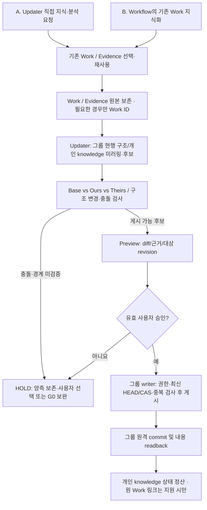

# 업무 GPT 인계 — L1 Knowledge Updater ↔ Workflow ↔ 개인/그룹 Knowledge 동기화·충돌 처리 상세 설계 및 G0 실측 요청

- 작성일: **2026-11-17 KST**
- 문서: `L1_KNOWLEDGE_UPDATER_R1_G0_DETAILED_HANDOFF_r0002_20261117_KST.md`
- 대상: **업무 GPT** (현재 설치된 업무 스킬, 업무용 `l1-workspace`, 그룹 `l1sw-dev-knowledge`의 접근 가능한 원본을 실제 조회할 수 있는 담당자)
- 작업 유형: **READ_ONLY G0 기능·설치·권한·호출 계약 검증 + G1 설계 정합성 의견 회신**
- 설계 단계: `DESIGN=ACCEPT_WITH_CHANGE`, `SKILL_PATCH=NOT_RUN`, `HOST_E2E=NOT_VERIFIED`, `KNOWLEDGE_WRITE=NOT_RUN`
- 리뷰 경과: Windows Claude Code의 **독립 설계 리뷰 R1 1회 완료**. 원판정 `ACCEPT_WITH_CHANGE` (BLOCKING 1건, MAJOR 4건, MINOR 2건). GPT가 7건 모두 수용 또는 수정 수용해 설계 r0002에 반영. **정적 Markdown 설계 리뷰이며 실제 스킬 코드 실행·설치·그룹 게시 검증은 아님**.
- 이전 공개 인계 r0001(2026-11-16)의 ‘독립 리뷰 미수신’ 표기는 **작성 당시 기록**으로 보존. 현재는 이 문서의 상태를 우선 적용.
- 범위: 회사 업무 자료·코드·토큰·상세 MSC 원문을 이 공개 인계 문서에 포함하지 않음. 실제 분석 자료의 저장·공유·게시 권한은 기존 업무 통제를 따름.

> **업무 GPT가 이번에 해야 할 일:** 현 설치본의 SKILL.md·실제 구현·Git/Kernel writer·저장소 구조를 **읽기 전용**으로 확인하고, 아래 G01~G16에 대해 `REUSE / CONNECT / 입증된 최소 EXTEND / BLOCKED / NOT_VERIFIED`를 파일·함수·허용 I/O·버전·근거와 함께 회신. **수정·설치·저장소 쓰기·Job·그룹 Knowledge 게시·새 유료 호출은 이번 요청에서 실행하지 말 것.**

---

## 1. 전체 목표와 원칙

사용자는 개인 업무용 `l1-workspace`에 수행한 코드 분석·이슈 조사·MSC·설계·검토의 원본을 보존하면서, 활용 가능한 내용을 개인 `knowledge/`에서 사람 중심으로 탐색·수정하고, 검증·승인된 내용만 그룹 공용 `l1sw-dev-knowledge` 정본에 반영하려고 함. 여러 담당자가 그룹 Knowledge를 갱신하는 동안 개인도 수정할 수 있으므로, **그룹의 타인 변경을 보존하고 개인 수정도 덮어쓰지 않는 충돌 처리**가 필수.

1. **개인 Work 정본**: `l1-workspace/works/<work_id>/` 및 기존 Evidence·Source Revision·결정/시험/리뷰 이력. 기존 `work-ledger-kernel` 소유, 원본 보존.
2. **개인 Knowledge 작업 공간**: `l1-workspace/knowledge/`. 그룹 Knowledge의 **실제 현재 파일 계층/ID/배치 규칙과 같은 구조**를 사용. `l1-knowledge-updater`가 콘텐츠와 탐색 인덱스 작성의 유일한 허용 주체. 업무 흐름 `l1-fix-workflow`는 이 경로를 **READ_ONLY**로 사용.
3. **그룹 검증 지식 정본**: `l1sw-dev-knowledge`가 관리하는 실제 지식 저장 위치. 지식은 Module→Feature→Scenario로 탐색하고 Procedure/Feature 교차 관점 유지. **HLD·상세설계·AS-IS MSC·재사용 가능한 이슈 해결 지식도 검증 후 그룹에 포함 가능**하며 문서 상세도가 개인/그룹 경계를 결정하지 않음.
4. **원본과 정본 구별**: 개인 Work의 분석 원본/근거, 개인 Knowledge의 후보/동기화 상태, 그룹의 승인 게시 지식은 서로 다른 책임. 이름이 같은 GitHub 저장소가 있더라도 업무 호스트의 실제 저장 위치/권한을 확인 전 확정하지 않음.
5. **기존 기능 우선**: Workflow / Kernel / Updater / analyzer / doc-converter / Git writer / 그룹 writer에서 `REUSE → CONNECT → 검증된 gap만 최소 EXTEND`. 신규 Knowledge Work Profile, 2차 원장/DB, 신규 merge 엔진, 임의 필드/API를 미리 설계·설치하지 않음.

### 사용자 확정 설계 ①~④ (변경 금지 기준)

| 번호 | 고정 결정 | 이번 검증 쟁점 |
|---|---|---|
| ① 개인 Knowledge 폴더 구조 | 그룹 현행 지식 파일의 물리적 구조·ID와 동일하게 미러링 | 실제 그룹 root·파일 규칙·예외/variant·READ 권한 확인 |
| ② 소유권/쓰기 금지 | 개인 `knowledge/` 콘텐츠 WRITE는 Updater만; Workflow는 READ_ONLY | 문서 정책 vs 실제 raw Git·shell·경로 우회 차단을 구분하여 검증 |
| ③ Work ID 선택적 연결 | 지식 자체에 Work ID를 강제하지 않음. Work 유래 시만 origin N:M 연결 | Kernel의 기존 허용 참조 타입 제약과 실제 역링크 수단 확인 |
| ④ 동기화/충돌 | Base/Ours/Theirs, Preview, 사용자 승인, 최신 HEAD/CAS, 그룹 게시 readback, 부분실패 복구 | 타인 변경, 구조 변경, 같은 checkout 경합, 응답 유실, 중복 게시 방지 확인 |

---

## 2. 현재까지 외부 설계 측에서 정적으로 확인한 사실 (현 설치본이 아님)

| 관리 스킬/영역 | 확인된 범위 | 미확인/한계 |
|---|---|---|
| `l1-fix-workflow` 개발 후보 v1.6.69 | 기존 Work/그룹 Knowledge READ bridge 및 `github_docs.docs_sync`의 dirty/untracked checkout 차단, `docs_push` 게시 경로 | 업무 호스트 설치 버전, 모든 writing helper, raw Git 우회 차단, 실제 caller 권한 미확인 |
| `work-ledger-kernel` 공개 ZIP v0.7.42 | `work_ux.export_docs`가 `works/`, `index/`, root `README.md`를 생성. `work_reference_add` 허용 type은 `jira`, `alias`, `github_pr`, `p4_cl`, `code_root` | 개인 `knowledge/` 보존/README 링크 E2E, Knowledge 역링크에 맞는 기존 이벤트/문서 append 계약 미확인 |
| `l1-github` 개발 후보 v0.3.57 | `push_guard`의 repo role/root/remote 검증; 이것만으로 folder-level actor WRITE 권한이 입증되지는 않음 | 스테이지 최종 경로 allowlist, 검증된 actor, Git credential 격리, lock/CAS 및 실제 설치본 미확인 |
| `l1-knowledge-updater` / `l1sw-dev-knowledge` | 두 진입 경로·승인/게시/복구에 대한 **TO-BE 목표 계약만** 제시 | 설치 스킬 실제 I/O, 함수, 경로, 구조, 그룹 writer, 원격 영수증·readback 모두 **G0 실측 필요** |
| `code-analyzer` / `doc-converter` | 분석 사실·Source Revision/Evidence, PUML/MD 원본과 HTML/SVG 파생 산출물 재사용 방향 | 설치 API·호출·입력 revision·실제 Evidence 회수는 G0 또는 최초 승인 사례로 확인 |

**금지된 추론**: 위 개발 후보 버전이 업무 호스트에 설치됐다고 가정하지 말 것. 설계 리뷰 PASS를 코드/API/E2E PASS로 승격하지 말 것. 이 문서의 `Base`, `CAS`, `Preview`, `operation` 명칭을 신규 구현 함수·메타데이터 키가 존재한다는 사실로 해석하지 말 것.

---

## 3. 두 진입 경로와 동일 책임 흐름

### 경로 A — Updater 직접 조사/개인 Knowledge 갱신

`사용자 Module/Procedure/Feature/Scenario 요청 → 기존 Knowledge 항목·현재 그룹 지식 조회 → 필요하면 관련 기존 Work 검색/재개 → 기존 analyzer와 Source Revision 기반 조사 또는 재사용 → 원본 분석/Evidence는 기존 Kernel 허용 경로로 개인 Work에 기록(실제 Work가 있는 경우) → Updater가 개인 knowledge/ 후보/변경 작성 → 그룹 정본과 대조·Preview → 승인된 변경만 그룹 writer 게시/readback → 개인 상태·기존 Work 연결 정산`

- 단순 조회나 독립 Knowledge 편집에 새 Work ID를 강제하지 않음.
- 직접 분석에서도 실제로 업무 분석 Work가 필요하고 등록 조건을 충족한다면 **기존 Work 검색/재개 우선**, 없을 때 기존 Kernel 생성 계약 사용. 단순 Knowledge 편집과 실제 코드 분석 Work는 구분.
- 이미 유효한 Evidence가 있으면 중복 code-analyzer 실행 금지. Source Revision/scope·유효성 일치 여부 확인.

### 경로 B — Workflow Work를 지식화

`기존 Work ID 선택 → Work/Evidence/Source Revision/원본 PUML·MD·시험/결정 조회 → 지식화 후보와 기존 Knowledge ID/variant 대조 → 개인 knowledge/에 출처·변경 후보 기록 → 동일 Preview·승인·그룹 게시/readback/정산 흐름`

- 원 Work ID, 기존 Work/Evidence 원본과 과거 결정 보존. Updater의 결과도 Kernel의 **실제로 허용된 writer**로 같은 Work에 기록 가능해야 함. 전체 Workflow 파이프라인 재실행 강제 금지.
- N:M 관계: 하나의 Work가 여러 Knowledge 항목을 만들거나, 하나의 Knowledge가 여러 Work에서 근거를 받을 수 있음. 자동 합치기 금지.
- AS-IS(코드/실측 사실)와 TO-BE(설계/권고), Procedure(업무 수행 단계)와 Feature(기술 기능), 원본 PUML/MD와 표현용 HTML/SVG를 분리.

### 목표 전체 동작 (설계 흐름; 자동 실행 입증 아님)

---

## 4. 경로/권한 및 동시성 설계

### 책임별 쓰기 행렬 (실제 권한 강제는 G0 결과 필요)

| 대상 | Workflow | Updater | 기존 Kernel/Git writer | 그룹 Knowledge writer |
|---|---|---|---|---|
| 개인 `works/<id>/`/Evidence | 기존 허용 경로로 기록 | 기존 Kernel 경로에 분석·검토 이력 기록 가능 | 정본의 검증된 writer | 직접 갱신하지 않음 |
| 개인 `knowledge/` 콘텐츠/탐색 인덱스 | **READ_ONLY** | **유일한 WRITE 요청자** | 실제 actor/path를 강제하고 Git push | 직접 갱신하지 않음 |
| 개인 `index/` 및 root README | 기존 exporter 정책 범위만 | 독자적 덮어쓰기 금지 | Kernel exporter 소유/충돌 검사 | 갱신하지 않음 |
| 그룹 Knowledge | READ | 읽기/기존 writer에 승인된 변경 요청 | 그룹 실제 writer의 Git 제어 구현만 | **검증·승인된 공유 지식 게시 담당** |

**Claude R1 MAJOR 보완 (강제 계층):** 프롬프트의 "READ_ONLY", `SKILL.md`, CODEOWNERS, pre-commit hook, 일반 push guard만으로 같은 OS 계정·동일 write Git credential을 가진 Workflow의 raw `git add/commit/push`를 완전히 차단할 수 없음. *정책 고정*과 *실제 하드 권한 구현*을 분리해야 함.

- 기존 전용 writer/경로 권한·caller 인증 기능을 최우선 확인. actor는 임의 환경변수나 사용자 문구만으로 신뢰 불가.
- 실현 가능한 기존 수단 후보: 실행 계정/credential 분리, Workflow의 읽기 전용 checkout, Updater 전용 write checkout/worktree, 보호 경로 OS ACL 및 전용 writer(실제 설치·권한·롤백 승인과 시험 후 결정). 필요 이상의 시스템 재설계 요구는 아님.
- writer 단계의 핵심 검사: canonical repo/root/realpath, staged/unstaged/untracked 변경, rename의 old/new path, symlink/path escape, caller별 final changed-path allowlist, dirty check, stage 직전/직후 diff 재검증, 원격 HEAD/CAS, readback.
- 동일 clone에서 Workflow `docs_sync`와 Updater commit/push가 경쟁할 수 있음. 기존 lock/직렬화와 재진입 방지, checkout별 Git index 및 remote ref 경합 처리를 확인. **lock이 검증되지 않았으면 쓰기 중단**, 단순히 폴더가 다르다는 이유로 안전 판단 불가.
- Workflow가 raw Git로 개인 `knowledge/`에 쓰기 가능한 상태라면 `HARD_GUARD=NOT_VERIFIED`. 이는 **설계 실패 단정이 아니라 구현 보호 게이트 미충족**이며 실제 게시 전 차단 조건.

---

## 5. Work ID와 Knowledge origin/역링크 — BLOCKING 해소 방향

Claude R1의 **BLOCKING**: 현재 정적으로 확인한 Kernel `work_refs.REF_TYPES`는 `jira`, `alias`, `github_pr`, `p4_cl`, `code_root`만 허용. 그럼에도 이전 설계는 해당 기존 계약 안에서 Knowledge 역링크를 필수라고 서술해 모순이 있었음. `alias`/`code_root`를 Knowledge 링크처럼 오용할 수 없음.

**수정된 책임 분리:**

1. **지식 → 원래 Work(Origin)**: Work에서 유래한 지식의 개인 Knowledge 쪽에 **기존에 허용된 파일 본문/메타데이터 표현**으로 Work ID(복수 가능), 근거 Evidence/MSC, Source Revision을 연결. Work 없는 개인 지식은 origin Work 생략. 실제 저장 형식이 없으면 새 frontmatter 키/sidecar를 발명하지 않고 **G0 BLOCKED**.
2. **원래 Work → 지식(Work-side backlink)**: Kernel의 기존 `context`, `record_evidence` 또는 Work 문서 허용 append 중 **정확히 지식 링크라는 의미를 수용하는 경로**가 실재할 경우에만 기록. 적절한 API/타입이 없다면 `WORK_SIDE_LINK=PENDING_UNSUPPORTED`로 남기고, 그룹 게시 성공 자체를 재실행하지 않음. 이 상태를 "양방향 링크 완료"로 보고하지 않음.
3. 개인 전용 Work/Evidence 경로·상세 MSC·코드 원문이 그룹 게시 대상으로 자동 포함되지 않도록 **write set/정보등급/권한** 검토. 그룹에는 승인된 기술 지식과 허용된 출처 표현만 반영.
4. 신규 Kernel `knowledge` ref_type/Profile/원장·새 registry schema는 **기존 표현 수단이 실제로 부족함이 입증될 때까지 금지**. 부족함이 확인되면 별도 최소 EXTEND 제안과 Backward Compatibility/시험 근거를 회신.

---

## 6. 그룹 동기화 기준과 충돌 처리 계약

### 6.1 revision·hash의 정확한 의미

- **그룹 Base commit**: 개인이 해당 지식을 가져왔을 당시의 **그룹 전체 commit SHA**. 게시 직전 대상 그룹 branch HEAD 비교/CAS 기준. branch 이름·실제 remote는 호스트 G0에서 확인.
- **파일 단위 Base**: 그룹 파일의 실경로·지식 ID·variant, 해당 파일 Git blob ID 및/또는 **내용 SHA-256**, 재현 가능한 Base 내용. SHA는 비교 단위와 알고리즘을 구분해 명기해야 함. 기존 Git refs/Updater 저장 방식 재사용 우선. Base 자체가 소실됐다면 임의 2-way overwrite 금지.
- **Ours**: 개인의 현재 수정본(그룹 원본 기준 개인 변경량 포함). **Theirs**: 게시 직전 그룹 최신 HEAD의 동일 항목.
- 원격 그룹 변경을 가져와도 개인의 미게시 수정이 있으면 자동 덮어쓰지 않음.

### 6.2 충돌 처리 표

| 상황 | 판단 | 허용되는 동작 |
|---|---|---|
| Base commit과 원격 그룹 HEAD 동일 | 기본 차이 없음 | 개인 변경 Preview → 기존 승인/범위/HEAD 확인 → 그룹 writer 게시 → readback |
| HEAD는 달라졌지만 파일 실내용 동일 | 그룹의 다른 변경 존재 | 파일 대상 관계·구조/ID 검증 + 전체 HEAD 재확인, 승인된 Preview; 단순 동일 파일이라고 전체 branch force-push 금지 |
| 그룹 파일의 **비중첩 내용 변경** | 병합 후보 가능 | Git 3-way merge를 **Preview 후보 생성**에만 활용. Markdown 의미·링크/문맥 확인과 사용자의 **새 승인** 후 CAS 재검증 |
| 그룹 파일의 **중첩 변경** | CONTENT_CONFLICT | 자동 게시 0, Base/Ours/Theirs 및 충돌 위치 제시, 개인·그룹 변경 모두 보존 |
| 파일 **rename/move/delete** 또는 Knowledge ID/variant/경로 변경 | STRUCTURAL_CONFLICT | Git 자동 rename/merge 성공과 무관하게 **무조건 HOLD**. 사용자 선택·새 Preview/승인 전 게시 0 |
| Preview/승인 후 그룹 HEAD 재변경 | STALE_PREVIEW | 이전 승인으로 push 금지. 최신 group 비교부터 재시도하고 다시 승인 받음 |
| Base 복원 실패, 파일 hash 불일치, path/caller 권한 미검증 | INPUT_UNCERTAIN | 임의 병합/게시 금지, 근거 복구 또는 추가 확인 |
| 개인 미게시 수정 중 일반 Sync | LOCAL_DIRTY | 개인 변경 보존, 그룹 최신본 대조만 수행. 덮어쓰기 0 |

### 6.3 게시 후 복구 및 멱등성

1. **게시 전**: 정확한 대상 Knowledge ID/path, write set, 그룹 현재 HEAD, 유효 승인·권한, 중복/구조 충돌 검사. 실제 writer가 승인/expected HEAD를 지원하는지 G0 확인.
2. **게시 후**: 그룹 원격 commit SHA 및 실제 파일 본문/내용 hash **readback PASS**일 때만 게시 완료 판정.
3. **그룹 성공 + 개인 상태 기록 실패**: 그룹 재게시 **0회**. 원격 정본/영수증 확인 후 개인 상태만 복구.
4. **그룹 성공 + Work-side 링크 실패**: 링크 복구만 시도. `WORK_SIDE_LINK=PENDING`으로 구분하며 그룹 재게시 금지.
5. **게시 응답 유실/불확실**: 원격 이력/게시 영수증과 해당 대상의 실제 내용 정산 전 **UNKNOWN/HOLD**. 임의 2차 push 또는 새 요청 발급 금지.
6. **복구 재시도**: 실제 기존 승인된 retry/backoff 정책이 있으면 우선 재사용. 없으면 **개인 상태/링크 복구에 한정 최대 3회** 지수 backoff 후 수동 정산. 그룹 게시 자동 재시도는 0.
7. 기존의 요청/commit/receipt를 상관키로 재사용할 수 있는지 확인; 신규 operation ID·DB·journal을 먼저 만드는 설계 금지.

---

## 7. 업무 GPT G0 읽기 전용 검증 목록 (실제 원본 근거 필수)

각 항목에 `확인한 원본 경로 또는 설치 스킬의 상대 경로`, `버전/파일 SHA 또는 source revision`, `실제 entrypoint/함수/CLI`, `지원 입력/출력`, `오류·제약`, `REUSE/CONNECT/EXTEND/BLOCKED 판정`을 작성. 없는 기능은 **실제 원본을 조사한 다음에만** 부재로 판정.

| ID | 확인할 질문 | 필요한 회신 근거 |
|---|---|---|
| G01 | 실제 개인 `l1-workspace`의 canonical root/remote/branch, `works/`,`index/`,`knowledge/` 존재·현재 소유자는? | 안전한 경로 구조·read-only Git 메타·ACL(비밀 제외) |
| G02 | 그룹 `l1sw-dev-knowledge`의 **실제 지식 데이터 root**, Module→Feature→Scenario 계층/ID/variant/파일명 규칙은? | 샘플 1~2개 경로의 **비민감 구조만**; 내용·제한 경로 공개 금지 |
| G03 | 현재 설치된 `l1-knowledge-updater`의 버전/SKILL.md/실제 진입점과 A/B 두 경로/Work 선택 기능은? | 함수/명령·입력/출력, 실제 가능한지 |
| G04 | Updater가 개인 `knowledge/`만 WRITE하고 기존 `works/`에는 Kernel 경유로 기록하는 기능이 있는가? | 실제 path writer, 허용 caller, 실패/중복 처리 |
| G05 | Updater의 개인 Knowledge 기준 Base commit/file hash/원본 내용 보존 방식은? | 기존 저장 위치/함수/복구 가능 여부; 신규 schema 제안 금지 |
| G06 | Updater의 기존 Knowledge ID/variant 검색·중복/기존 그룹 항목 비교·Preview/승인·충돌 처리는? | 설치본 함수별 REUSE/CONNECT/GAP |
| G07 | 그룹 `l1sw-dev-knowledge` 스킬의 실제 **게시 writer**, 승인 contract, content hash·revision 반환·readback은? | 승인 검증·권한·응답·실패·중복 처리 근거 |
| G08 | 그룹 게시 시 expected HEAD/CAS, README/다른 파일 rename/move/delete 탐지와 원격 상태 고정은? | 실제 원자성·구조 충돌 제약, 없다면 BLOCKED |
| G09 | `l1-fix-workflow` 실 설치본의 Bootstrap/`docs_sync`,`docs_push`, group/개인 Knowledge READ 및 직접 WRITE 우회는? | 모든 stage/push helper와 경로 정책, raw Git 가능 여부 |
| G10 | `l1-github` 또는 실제 단일 Git writer에서 **인증된 actor**, allowlist, staging lock, same-clone 경합, HEAD/push/readback을 강제하는가? | 동일 OS 계정/credential 공유 여부, 우회 반례, 보호 등급 |
| G11 | Kernel exporter가 개인 `knowledge/`를 보존하는가? root README/link/index 갱신이 어떤 영향을 주는가? | 원문 범위 기반 정적 확인; **실제 T01/T02는 이 단계에서 실행 금지**, 후속 시험 필요 |
| G12 | `work_refs` 제한 타입 외 기존 Work 문서/`context`/evidence에 지식 origin/게시 결과 역링크를 의미 정합하게 기록 가능한가? | 허용 enum/kind/stage/provider 정확한 타입, N:M, 실패 상태 표현 |
| G13 | 기존 code-analyzer, doc-converter, Source Revision, MSC PUML/MD 원본·HTML/SVG 파생을 원래 Work에서 재사용 가능한가? | 기존 Evidence ID/hash/revision 조회 경로, 중복 분석 제어 |
| G14 | 그룹 게시 응답 유실, 원격 commit 판별, 개인 상태/Work 링크만 재시도할 기존 recovery·영수증은? | 기존 멱등성 키/조회·오류 구분/재시도 정책 |
| G15 | 개인→그룹 게시 대상의 민감정보/권한·상세 코드/MSC 보호, 허용되는 공유 Evidence 링크 정책은? | 원본 필터/writer 범위, 알 수 없으면 BLOCKED |
| G16 | 현재 설치된 각 스킬 버전이 위 정적 검토 버전과 다른가? 실제 요구 변경은 어느 소유 스킬의 최소 범위인가? | 버전 비교, 호환성, 실행 가능 게이트 및 다음 테스트 권고 |

### 판정 기준

- **G0 VERIFIED**: 실제 설치본/원본 확인, 호출 조건과 지원 I/O를 구체적으로 제시. 문서상의 문구만으로 PASS 처리 금지.
- **G1 DESIGN ASSUMPTION**: 의도/요구이나 설치본 기능 미검증.
- **REUSE**: 확인한 기존 계약으로 그대로 충족. **CONNECT**: 기존 제공자가 있지만 호출/연결 필요. **EXTEND**: 실제 누락이 원본으로 입증되고 최소 변경 대안·회귀가 명확. **BLOCKED/NOT_VERIFIED**: 접근권/원본/계약 미확인.
- 전부 확인할 수 없더라도 조회 가능한 G0는 계속 진행하고, 미확인 기능은 누락된 근거와 담당자를 적어야 함.

---

## 8. 이후 단계의 수락 시험 T01~T10 — 이번에 실행하지 말 것

| ID | 시나리오 | 추후 실제 시험의 합격 조건 |
|---|---|---|
| T01 | 기존 Knowledge 파일이 있는 개인 Workspace에서 Kernel exporter 전체 재생성 | `knowledge/` 파일 내용/hash 유지, 삭제·변조·이동 0 |
| T02 | root README 재생성 | `knowledge/` 탐색 링크 유효, 기존 root/Work 링크·사용자 문서 훼손 0 |
| T03 | Workflow 외 raw Git/shell 경유 개인 `knowledge/` WRITE/commit/push 시도 | OS/Git credential/전용 writer 보호 경계에서 차단, 기존 동일 credential 우회면 FAIL |
| T04 | Workflow에서 rename, symlink, path traversal로 개인 지식 WRITE 시도 | 파일/스테이징/commit/push 전 단계 DENY |
| T05 | Workflow docs_sync dirty check와 Updater stage/commit 동시 실행 | 스테이징 혼합·유실 0, lock/직렬화/HEAD 충돌 정확히 감지 |
| T06 | Work-origin 지식에 Work ID/Evidence 기록, 지식→Work/Work→지식 링크 확인 | 지원 경로만 진실하게 기록; 지원 안 되면 PENDING, `alias/code_root` 오용 0 |
| T07 | Base v10, 그룹 v11의 내용 비중첩 변경 | 3-way 후보·문맥 Preview·명시 승인·HEAD CAS·게시/readback 성공, 자동 승인 0 |
| T08 | Base v10, 그룹 v11의 중첩 변경 | 그룹 자동 게시 0, Base/Ours/Theirs 모두 보존하고 사용자 판단 요청 |
| T09 | 그룹 게시 성공 후 개인 상태 실패 또는 원격 응답 유실 | 원격 readback/영수증으로 판별, **그룹 재게시 0**, 미완료 개인 단계만 복구 |
| T10 | 개인 편집 중 그룹 파일 rename/move/delete/ID 변경 | 구조 충돌로 무조건 HOLD, Git 자동 병합 성공만으로 게시 금지 |

실제 테스트·코드 패치는 **사용자 승인된 별도 실행 범위**와 실제 접근 가능한 호스트·격리 자원에서만 수행. 이번 요청의 T01~T10 결과는 모두 **NOT_RUN**으로 유지.

---

## 9. 회신 형식 (개별 회신에 그대로 사용)

### A. 현재 상태 요약

- 확인 시각(KST):
- 접근한 실제 설치본/데이터 저장소(비민감 식별 범위만):
- 검증 스킬명/버전/스냅샷 Source Revision:
- 실제 수정·호스트 실행·그룹 게시 여부: **0 / READ_ONLY**
- 기존 설계 ①~④와 설치 기능 정합성: `SUPPORTED / PARTIAL / GAP_VERIFIED / BLOCKED`

### B. G0 항목별 검증 결과

| ID | 설치본 원본·함수·버전/근거 | 지금 지원 | REUSE / CONNECT / GAP / BLOCKED | 정확한 제약·필요한 최소 조치 |
|---|---|---|---|---|
| G01~G16 | 각각 별도 행 | VERIFIED/NOT_VERIFIED | 분류 | 구체적인 기존 API/I/O, 출처 |

### C. 충돌·위험 및 최소 보완

| 우선순위 | 지적 사항 | 실제 반례/근거 | 소유 스킬 | 기존 수단 재사용 | 최소 EXTEND가 필요한 이유 | 후속 시험 |
|---|---|---|---|---|---|---|
| P0/P1/P2 | | | | | | |

**특별히 다음 네 질문에 명확히 답할 것:**
1. `knowledge/`에 대한 Workflow의 **실제 Git/OS WRITE 우회**를 막을 기술적 경계가 설치돼 있는가? 미설치면 무엇이 남는가?
2. 그룹 구조가 실제 개인에 **그대로 mirror 가능한가**? ID/variant/경로 규칙 중 불확실한 부분은?
3. Kernel에 새 `knowledge` ref_type 없이 **origin·Work-side backlink를 의미 정합하게 보존**할 수 있는 실제 기존 함수/타입이 있는가?
4. 그룹 대상이 다른 담당자에 의해 변경됐을 때 **Base/Ours/Theirs → Preview → 승인 → CAS/readback → 부분 복구**를 기존 기능으로 얼마나 충족하는가?

### D. 분리 판정과 다음 한 행동

- `G0_INSTALL_FACTS=...`
- `G1_DESIGN_ASSUMPTIONS=...`
- `READ_ONLY_G0=PASS / PARTIAL / BLOCKED`
- `SKILL_PATCH=NOT_RUN`
- `T01_TO_T10=NOT_RUN`
- `GROUP_KNOWLEDGE_PUBLISH=NOT_RUN`
- `WORK_EVIDENCE_MUTATION=NOT_RUN`
- `HOST_CONFIG_OR_CREDENTIAL_CHANGE=NOT_RUN`
- **NEXT_ONE_ACTION:** [실측으로 확인된 최소 조치 하나, 소유 스킬, 필요한 승인/시험]

## 10. 금지·유지 조건

- 이번 핸드오프 자체를 스킬 수정·패키징·PUBLIC ZIP 배포·업무 호스트 설정·실제 코드 분석·Job·Knowledge 게시·새 모델 리뷰 실행 지시로 해석 금지.
- 읽기 전용 G0 확인에도 회사 자료의 외부 복제, 제한 MSC/코드/토큰/로컬 비밀 첨부 금지. 회신은 **비민감 기술 구조·경로 형태·API 명세·지원/미지원·근거 요약**만 전달.
- 실제 그룹 writer·원본 저장 위치는 설치 계약으로 확인하고, 동명 GitHub.com 저장소로 위치 추정 금지.
- 사용자 확정 ①~④ 및 과거 Work/Knowledge 결과 이력 보존. 잘못된 Knowledge ref_type 오용, 무단 auto merge, group force push, 중복 원격 게시, 개인 미게시 원본 overwrite 금지.
- 확인하지 않은 함수·호출 플래그·metadata·registry/schema·Approval/CAS API를 만들어 사실처럼 답하지 말 것.

**완료 기준:** 업무 GPT가 설치본 원본 기반 G01~G16 결과, 4개 핵심 질문 답, REUSE/CONNECT/입증된 GAP와 최소 패치 대상, 실제 미검증·BLOCKED 목록, 다음 한 행동을 **읽기 전용 회신**으로 제공. 이후 설계 GPT가 그 회신을 이용해 기존 관리 스킬의 최소 수정 범위를 확정.