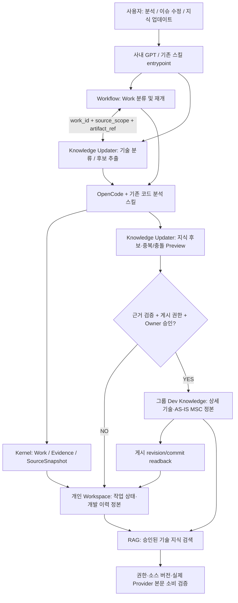

# L1 Knowledge Updater × Workflow — 사내 GPT / OpenCode 연동 검토 인계서

- 문서 버전: `r0002` / 2026-11-11
- 용도: 사내 GPT에 직접 전달하는 **독립형 원샷 인계 문서**
- 작업 범위: **G0 READ_ONLY(실제 설치 기능 확인) + G1 DESIGN(최소 연동 설계)**
- 공개 범위: 스킬 역할·인터페이스 제안·합성시험 기준으로만 구성. 회사 소스, 고객 자료, 사내 경로, 접근 토큰 및 실제 운영 로그는 포함하지 않음.
- 주의: 이 문서는 **설계 및 확인 요청**이며 사내 스킬 수정, 운영 저장소 쓰기, 자동 게시, 실제 배포 또는 RAG 검증 완료를 뜻하지 않음.

## 1. 추진 목적

사내에서 이미 개발한 **L1 Knowledge Updater**와 기존 **`l1-fix-workflow`(Workflow)** 및 **`work-ledger-kernel`**의 중복 기능을 조사하고, 변경량이 가장 적은 방식으로 연계한다.

원칙은 **기존 스킬 재사용**이다. 새로운 오케스트레이터나 RAG 엔진을 바로 만드는 대신 실제 설치본의 entrypoint, 입력/출력, 호출 관계, 정본 소유권을 확인한다.

### 정보 저장 역할

| 대상 | 정본 책임 | 보존할 핵심 정보 |
|---|---|---|
| **개인 Eron Workspace** | Work/진행 상태/개발 이력의 정본 | Work ID, ISSUE/FEATURE/CODE_ANALYSIS 등 분류 후보, 분석 초안, 소스 근거, 수정·시험·리뷰 이력, 미해결 항목, 지식 게시 링크 |
| **그룹 Eron Software Dev Knowledge** | 승인·검증된 기술 지식의 정본 | `module → feature → scenario` 구조의 모듈 설명, 상세 설계, 현행 코드 동작, 검증된 AS-IS MSC, 재사용 가능한 이슈 해결 지식 |

**상세 설계 및 AS-IS MSC도 그룹 기술 지식에 포함될 수 있다.** 이는 *내용 범위*를 의미하며, 무심사 자동 업로드/덮어쓰기 권한이 아니다. 그룹 정본 게시 전 검증·중복·버전·소유자 승인 정책을 별도로 확인한다. Work 및 Evidence 원본 기록은 개인 Workspace에 계속 남긴다.

## 2. 전체 연동 목표



**설계상 역할이며 구현 사실을 나타내지 않는다.** Knowledge Updater에서 먼저 시작한 요청도 Workflow의 기존 Work ID를 찾아 재사용해야 한다. 동일한 입력이 중복 Work, 중복 게시 후보 또는 중복 커밋을 만들면 안 된다.

## 3. 스킬별 담당과 확인 사항

| 구성요소 | 목표 책임 | G0 실측할 사항 |
|---|---|---|
| **L1 Knowledge Updater** (기존 사내 개발 스킬) | 지식 요청 해석, 기술 분류, 그룹 게시 후보·검증·Preview, 학습 | 실제 설치 버전, entrypoint, 그룹/개인 경로 선택 규칙, 중복/충돌 검사, 승인 기능, Workflow 연계 여부 |
| **`l1-fix-workflow`** | 사용자 요청 intent/Work 유형 분류, Work 시작·재개, 분석 단계 지휘 | Work ID 생성 경로, 현재 프로필/분류 필드, Updater 호출 여부, 중복 side effect |
| **`work-ledger-kernel`** | Work ID, 상태, 기록 원장, Evidence, Snapshot 및 문서 export | 허용된 Evidence provider/kind, 생성 README/index 소유권, 구버전 호환 |
| **`code-analyzer`** | CODE_FACTS, 원인 분석, AS-IS/TO-BE MSC | 입력 source revision, anchor/Evidence와 출력물 연결, 실제 MSC 형식 |
| **`l1-github`** | Git branch/commit/PR diff 및 Work 문서 연계 | 전체 commit SHA pin, dirty/untracked, base/head 비교, 쓰기 guard |
| **P4/Issue 분석 스킬** | 관련 변경 이력 및 소유권 단서 조회 | 실제 file revision/CL/issue 증거와 원인 추론을 구별 |
| **문서 변환/HLD 스킬** | 설계·MSC·HTML 문서 변환 재사용 | 새 변환기를 만들 필요가 있는지 확인 |
| **Job/RAG driver** | 작업 실행 경계 및 검색 결과의 실제 모델 입력 | source/owner/root/권한, 본문·digest/receipt, 호출 차단 조건 |

설치 여부가 확인되지 않은 기능에는 `NOT_VERIFIED`, 실행하지 않은 항목에는 `NOT_RUN`을 부여한다. 기존 Kernel record 스키마나 Evidence registry에 등록되지 않은 종류/필드는 임의로 넣지 않는다.

## 4. 분류를 4개 축으로 독립 유지

1. **Work 목적 (`work_category` 제안):** `ISSUE / FEATURE / REFACTOR / DESIGN / CODE_ANALYSIS / UNCLASSIFIED`. 현재 설치 구현이 아닌 *신규 메타데이터 후보*이다. 기술 지식 분류와 혼동하지 않는다.
2. **산출물 종류 (`artifact_kind` 제안):** `CODE_FACTS / MSC_AS_IS / MSC_TO_BE / HLD / TEST_RESULT`.
3. **기술 탐색 분류:** `module / feature / scenario` 및 지식 ID. Knowledge Updater가 기술 후보를 분류한다.
4. **기존 실행 계약:** Kernel의 `work_purpose / profile / status`. 새 분류 값을 실행 권한이나 상태로 간주하지 않는다.

예를 들어, 이슈 수정 중 만든 MSC는 **Work=`ISSUE`, artifact=`MSC_AS_IS`**이다. 변경 없이 현재 브랜치 코드 흐름만 분석한 경우 **Work=`CODE_ANALYSIS`, artifact=`MSC_AS_IS`**이다. 구현 전 예상 흐름은 `MSC_TO_BE`이며 검증 없이 `MSC_AS_IS`로 승격하지 않는다.

## 5. 사내 G0 읽기 전용 원샷 조사

- **설치 기능 인벤토리:** Knowledge Updater, Workflow, Kernel 및 관련 스킬의 실제 버전/entrypoint/명령, 처리 가능한 요청, 읽기/쓰기 부작용 확인.
- **진입점 추적:** 지식 업데이트 요청과 이슈/코드 분석 요청이 각각 어느 스킬로 들어가고, 기존 Work ID를 어떻게 전달·재사용하는지 확인.
- **정본 소유권:** Work 상태/Evidence는 Kernel·개인 Workspace가, 검증된 기술 본문은 그룹 Dev Knowledge가 보유하는지 확인. 기존 출력과 저장 구조를 임의로 변경하지 않음.
- **소스 원본성:** Git 전체 고정 commit SHA 또는 P4 실제 file revision, 브랜치/제품/모듈 scope, dirty/untracked 정보, 소스 anchor가 결과에 함께 연결되는지 확인.
- **그룹 게시 게이트:** 지식 중복/충돌, Owner 및 게시 권한, Preview·승인, version readback, Work 역링크·부분 실패 처리 검토. **운영 그룹 정본에 쓰지 않음.**
- **RAG 동작:** 검색 링크 확보와 본문 실제 검색을 구별하고, **실제 Provider 입력 본문 소비**까지 확인할 수 없으면 `RAG_M1=BLOCKED` 유지.
- **최소 변경량 판정:** 기능별 `REUSE / CONNECT / EXTEND / DEFER`와 근거, 변경 시 필요한 파일/테스트/롤백 범위를 표로 정리.

## 6. 제안 최소 인터페이스 (실제 API가 아님)

```text
classify_or_resume_request(intent, scope, existing_work_id?)
    -> work_id, work_category_candidate, existing_or_created, receipt

analyze_source(work_id, pinned_source_revision, scope)
    -> artifacts[], evidence_refs[], validation_state

propose_knowledge(work_id, artifacts)
    -> candidates[] {module, feature, scenario, artifact_kind,
                     pinned_source_revision, evidence_refs}

preview_and_authorize(candidate)
    -> duplicate_conflict_result, permission_result,
       owner_approval OR BLOCKED

publish_group_knowledge(approved_candidate)
    -> knowledge_id, publication_revision, commit_readback_receipt

link_work_to_knowledge(work_id, knowledge_id, publication_revision)
    -> link_receipt OR PUBLISHED_LINK_PENDING
```

실제 설치본의 인터페이스에 이미 같은 기능이 있으면 그대로 사용한다. Work ID/source revision/idempotency key를 일관되게 전달하고, **게시 성공 후 역링크 실패** 시에는 중복 게시하지 않고 별도 복구 상태를 남긴다.

## 7. 합성·부정 테스트 시나리오

| ID | 입력/조건 | 합격 조건 |
|---|---|---|
| S01 | 진행 중 ISSUE 분석 | 개인 Workspace에 Work/근거 이력 유지; 미승인 그룹 게시 0 |
| S02 | 기존 코드에서 검증된 AS-IS MSC | 고정 revision+anchor+근거 확인 후 후보화; 승인 전 미게시 |
| S03 | 구현 전 TO-BE MSC | 설계 초안으로 유지; 현행 AS-IS로 게시 거부 |
| S04 | Branch A 자료를 Branch B 질문에 재사용 | source revision/scope/dirty 불일치 발견, VERIFIED 차단 |
| S05 | Workflow/Updater 양쪽에서 동일 요청 시작 | Work ID·지식 게시 후보 중복 생성 0 |
| S06 | 그룹 지식 충돌/권한 없음 | 기존 정본 변경 0; BLOCKED 또는 Preview |
| S07 | 그룹 게시 성공·Workspace 역링크 실패 | 게시 영수증 유지, 링크 재시도/정산, 중복 게시 0 |
| S08 | 검색 성공·실제 Provider 본문 소비 미입증 | 검색과 RAG 성공을 분리; M1 BLOCKED |
| S09 | 기존 Work에 새 분류 필드 없음 | 무손실 읽기, UNCLASSIFIED fallback, 구버전 호환 |

G0 단계는 **읽기 전용 코드/계약 확인**이다. 합성시험·운영/네트워크 호출을 실제로 수행하지 않은 경우 `NOT_RUN`이라고 보고한다. 회귀시험은 승인된 격리 복사본에서만 수행한다.

## 8. 사내 보고 산출물

**A. 사내 상세 보고서 `L1_WORKFLOW_KNOWLEDGE_UPDATER_G0_INTERNAL.md`**

실제 설치된 스킬/버전, entrypoint와 I/O, 정본 소유자, 중복 기능, `REUSE/CONNECT/EXTEND/DEFER`, 최소 수정 파일 후보, S01~S09 검증 결과, 미해결 위험·승인 필요 사항 및 다음 한 동작을 작성한다. 내부 소스·로그·경로·상세 MSC는 인가된 사내 공간에만 보관한다.

**B. 선택적 비민감 추상 보고 후보 `L1_WORKFLOW_KNOWLEDGE_UPDATER_ABSTRACT_CANDIDATE.md`**

`WORKFLOW_INTEGRATION / KNOWLEDGE_ROUTING / CONTRACT_GAP / EVIDENCE_GAP`, `PASS/FAIL/SKIP/NOT_RUN` 등 범주형 상태만 담는다. 내부 보안 승인과 전송 경로가 없으면 **외부 전송 금지**.

보고 순서: **현재 상태 → 실제 설치 스킬/입출력 → 소유권·라우팅 → 재사용/연결/확장/보류 → 시험 결과 → 미검증·승인 필요 → 다음 한 동작**.

## 9. 사내 GPT에 바로 입력할 원샷 프롬프트

> 이 문서를 기준으로, 현재 사내에 설치된 **L1 Knowledge Updater**와 **l1-fix-workflow**, **work-ledger-kernel** 및 관련 코드 분석·Git/P4·문서화 스킬의 실제 기능과 입출력을 읽기 전용으로 비교해 줘. 개인 Workspace는 **Work/진행 상태/개발 이력 정본**, 그룹 Dev Knowledge는 **검증된 모듈 상세 설계·AS-IS MSC·기술 지식 정본**이라는 기준을 적용해. Workflow는 **작업 분류와 Work ID 관리**, Knowledge Updater는 **기술 지식 분류·중복/충돌·게시 후보 검증**을 우선 가설로 두되 실제 기능이 다르면 소스 근거에 맞춰 조정해 줘. 인가된 OpenCode/Agent를 활용해 G0 읽기 전용 인벤토리를 수행하고, 기존 기능 **REUSE / CONNECT / EXTEND / DEFER**, 최소 호출 계약과 S01~S09 회귀시험 기준을 도출해 줘. 사내 원본 결과와 비민감 요약 후보를 분리하고, 소스 수정·운영 그룹 정본 게시·외부 전송은 실행하지 마. 실행하지 않은 항목은 NOT_RUN, 미확인 항목은 NOT_VERIFIED로 표시해.

**완료 판정:** 실제 설치본 근거를 가진 기능 소유권 표와 **최소 연동 설계 및 시험 계획**을 제시한 상태. 이는 자동 연동/코드 적용/운영 배포/독립 리뷰 완료가 아니다.
