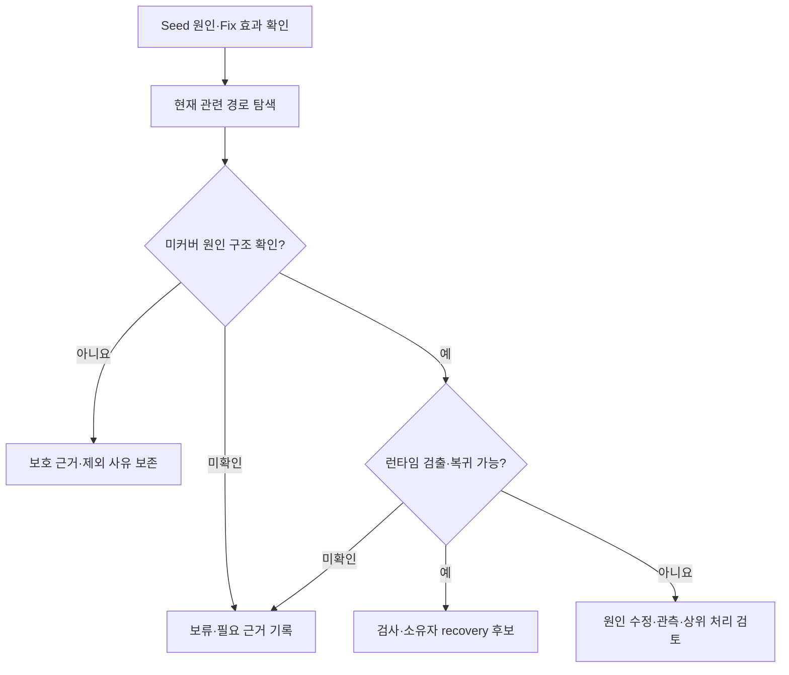

# 수정 CL 기반 미커버 유사 결함 탐색과 검사·Recovery 판단 — 업무 GPT 인계

- 개정: r0002 / 2026-11-19 KST
- 전달 저장소: GitHub PUBLIC `wonhwipark/L1Work`
- 브랜치: `main`
- 인계 파일 상대 경로: `handoffs/L1_RECOVERY_POINT_ANALYSIS_DETAILED_DESIGN_AND_IMPLEMENTATION_HANDOFF_r0002_20261119_KST.md`
- 수신 대상: 업무 GPT 및 허용된 업무 LLM·로컬 Agent
- 목적: 수정 CL에서 배운 원인 구조를 기준으로 현재 코드의 미커버 유사 경로를 찾고, 원인 수정·사전 검사·국소 recovery·상위 이관의 적합성을 근거로 판단
- 이전 문서: [사례 분석 프롬프트 r0001](L1_CL_JIRA_RECOVERY_ANALYSIS_PROMPT_r0001_20261117_KST.md) / [상세 설계·구현 인계 r0001](L1_RECOVERY_POINT_ANALYSIS_DETAILED_DESIGN_AND_IMPLEMENTATION_HANDOFF_r0001_20261119_KST.md)
- 적용 관계: 위 문서를 보존하고, 이번 목적·탐색 절차·커버 판정은 r0002를 우선해요. 기존 근거·revision·소유 경계·시험 원칙은 이어받아요.
- 실제 검증 수준: 컨셉·설계 인계. 실제 업무 설치본 G0, Seed 분석, 현재 코드 탐색, 분석 기능 구현·시험, 제품 recovery 효과는 이 문서 작성 단계에서 NOT_RUN

## 0. 업무 GPT에 전달할 요청

수정 CL을 확인하고, 그 변경이 해결한 오류의 발생 조건·빠진 보호·상태/자원 관계를 실제 코드로 정리해줘. 이를 기준 사례(Seed)로 삼아 현재 대상 revision의 관련 경로에서 같은 원인 구조가 아직 커버되지 않은 후보를 찾아줘.

비슷한 코드가 있다는 사실만으로 결함을 확정하지 말고, 실제 실행 조건과 호출자·callee·공통 wrapper·상위 절차의 보호를 대조해줘. 미커버 가능성이 확인된 후보에 대해 원인 수정·사전 검사·소유자 경계의 recovery·상위 이관·추가 관측 중 적절한 조치를 비교해줘.

이미 수정된 Seed에 recovery를 더 넣는 것을 기본 목표로 삼지 말아줘. Seed의 Fix가 현재 적용돼 있어도 다른 관련 경로를 확인하는 이번 분석은 계속할 수 있어. 신규 후보에 원래 Jira를 그대로 붙여 실제 장애가 발생한 것처럼 보고하지 말아줘.

기존 P4·Git·Jira·code-analyzer·조건부 issue-analyzer·Workflow/Kernel·converter를 우선 재사용해줘. 유효한 업무 지시 범위에서 필요한 최소 연결·시험을 진행하고, 아직 확인하지 않은 API·설치 기능·스키마를 가정하지 말아줘.

이 파일을 게시했다는 사실만으로 업무 호스트 실행·제품 코드 변경·설치·유료 호출·운영 전환 승인이 생기지는 않아. 기존 유효 지시·위임이 있으면 같은 승인을 반복 요청하지 말고 그 범위에서 계속해줘. 업무 GPT가 직접 실행하지 못하면 허용된 로컬 Agent가 작업하고 근거·결과를 회수해줘.

## 1. 작성 전 확인한 이전 recovery 상황

2026-11-19 KST에 기존 공개 인계와 관련 최신 진행 기록을 조회한 뒤 작성했어요.

| 시점·자료 | 확인한 기존 내용 | 실제 상태와 이번 의미 |
|---|---|---|
| 2026-11-17 사례 분석 프롬프트 r0001 | CL→Jira/PR→Problem/Cause/Solution→소스 revision→정상/실패 시나리오→검출부·소유자 복구 경로 | 공개 게시·목록 연결 확인. 단건 분석의 입력·근거 수집 기반으로 재사용 |
| 2026-11-19 상세 설계·구현 인계 r0001 | 필수 근거 9항목, G0 기능 대조, 분석 입출력·후보 판정·최소 구현·시험 계획 | 공개 게시·본문 해시 확인 기록. 실제 recovery 업무 분석·구현·시험은 미실행으로 기록 |
| 사용자 확정 제외 | REQ에 대한 CNF 미수신 timeout은 기존 recovery 구현 완료 | 해당 메커니즘과 기존 커버 범위를 제외. 사용자 확인과 GPT 직접 소스 검증은 구분 |
| 사용자 문제 제기 | 이미 수정된 이슈에 사후 recovery를 넣으려면 검출할 수 있는가? | 수정 이력, 현재 미커버 문제, 런타임 관측, 안전한 복귀를 별도 판단해야 함 |
| 최신 방향 | Fix CL을 보고 현재 커버되지 않은 유사 문제 지점을 찾고 검사·recovery 적용 가능성을 검토 | 이번 r0002의 주목적. Seed를 학습 기준으로 사용하고 현재의 다른 후보를 검증 |

이전 r0001도 기존 Fix로 충분하다는 결론과 원인 수정·보류를 허용했어요. 이번 변경은 그 원칙을 폐기하는 것이 아니라, Seed와 현재 탐색 후보를 나누고 유사 결함 발견·보호 커버 확인을 명시적인 단계로 추가하는 것이에요.

위 기록은 문서 작성·게시·해당 범위의 마지막 확인 상태예요. 실제 업무 호스트에서 실행된 새로운 근거가 있다면 업무 GPT가 먼저 대조해 갱신하고, 과거 NOT_RUN을 설치·호스트 실행의 절대 부재로 해석하지 않아요.

## 2. 왜 분석의 중심을 바꾸는가

### 2.1 기존 방식이 가질 수 있는 한계

수정된 CL의 동일 위치만 계속 보면 이미 원인이 제거된 경로에 새 recovery를 억지로 제안할 수 있어요. 수정 후에는 같은 오류가 발생하지 않아 정상 시험만으로 추가 검출부를 검증하기 어렵기도 해요.

반면 과거 이슈의 발생 조건과 Fix의 효과는 현재 코드에서 어떤 보호가 필요한지를 설명하는 실제 근거가 될 수 있어요. 따라서 수정 CL은 미해결 대상으로 단정할 것이 아니라, 같은 원인 구조를 찾는 기준으로 사용해요.

### 2.2 이번 논리

1. Seed의 수정 전 경로에서 오류가 왜 가능했는지 확인해요.
2. 수정 후 무엇이 보장돼 그 경로가 안전해졌는지 확인해요.
3. 현재 코드의 관련 경로에 같은 오류 전제가 존재하는지 찾고, 동등한 보호가 있는지 조사해요.
4. 보호가 없고 발생 가능한 경로가 남아 있으면 현재 미커버 후보로 분리해요.
5. 해당 후보의 실제 관측·소유권·복귀 조건에 따라 조치를 선택해요.

Seed가 이미 수정됐다는 사실은 정상적인 출발점이에요. 그 자체로 다른 경로의 탐색을 끝내지 않아요. 또한 Seed의 수정 한 줄을 다른 함수에 복사하는 것을 해답으로 삼지 않아요.

### 2.3 세 가지 판단을 구분

| 판단 | 질문 | 필요한 근거 |
|---|---|---|
| 정적·설계상 유사 결함 탐색 | 현재 코드에 같은 위험 원인 구조가 남아 있는가? | 실제 대상 코드·전제·실행 경로·기존 보호 조사 |
| 런타임 검출 가능성 | 실행 중 정상과 오류를 구분할 수 있는 신호가 있는가? | 해당 순간의 반환값·상태·이벤트·신뢰 가능한 관측 |
| recovery 적합성 | 검출 시점에 소유자가 안전한 상태로 되돌릴 수 있는가? | 정리 권한·부분 부작용·복귀 조건·공유 영향·실제 검증 |

첫 번째가 성립해도 두 번째나 세 번째가 자동 성립하지 않아요. 오류를 실행 중 구분할 수 없다면 원인 수정·사전 검증·관측 보강이 적합할 수 있어요. 모든 후보를 recovery로 해결하지 않아요.

## 3. 확정 범위·대상 구분

### 3.1 탐색 대상

| 대상 | 의미 | 결과 처리 |
|---|---|---|
| Seed | 이슈·Fix 전후·효과를 배우는 기준 CL/PR | 원인 패턴과 알려진 보호 근거 |
| 동일 위치의 직접 미반영 | 대상 branch에 원본 수정 또는 동등한 해결이 빠짐 | 유사 변형과 구분해 직접 누락·적용성 후보로 기록 |
| 다른 미커버 유사 경로 | Seed와 같은 원인 전제·오류 결과가 가능한 다른 코드 경로 | 이번 주요 분석 대상 |
| 이미 보호된 유사 경로 | 상위/하위/공통 코드·다른 설계로 동등하게 커버 | 보호 anchor와 함께 제외 |
| 판단 부족 경로 | 전제·실행·보호 범위를 확인하지 못함 | 보류. 보호됨 또는 결함 확정으로 바꾸지 않음 |

현재 대상에서 Seed 위치가 수정됐다고 전체 안전을 선언하지 않아요. 반대로 대상 코드가 다른 정상 설계를 사용하면 같은 검사가 없다는 이유만으로 미커버라고 하지 않아요.

### 3.2 제외 유지

- REQ→CNF 미수신 timeout과 기존 recovery가 이미 처리하는 해당 범위
- 동일 timeout 이슈를 상태 경쟁·늦은 CNF 등 다른 이름으로 새 후보화
- 회사 제한 소스·로그·상세 MSC·고객자료·비밀의 공개 전달
- 별도 지시 없는 제품 코드 자동 변경·설치·Job·유료 리뷰·운영 전환

단순한 timeout 단어 검색으로 범위를 결정하지 않아요. 실제 실패 메커니즘이 독립된지 확인해요. 새 후보가 기존 recovery와 자원을 공유하면 중복 진입·정리 책임만 필요한 범위에서 대조해요.

## 4. 전체 흐름과 각 단계 결과

아래 단계명은 논리 설계예요. 실제 CLI·함수·JSON·Kernel 필드가 이미 존재한다고 가정하지 않아요.

| 단계 | 입력·처리 | 다음 단계에 넘길 결과 |
|---|---|---|
| V0 기존 상태·범위 | 기존 Work·입력 CL·현재 대상·제외·유효 실행 범위 확인 | 중복 방지, source 기준, 범위·미확인 |
| V1 Seed 해석 | CL/Jira/PR의 Problem/Cause/Solution·전후 코드를 대조 | 원인과 Fix 효과의 확인 수준 |
| V2 원인 패턴 정리 | 발생 전제·위험 처리·필요 보호·정상 반례 추출 | 근거가 연결된 탐색·판정 조건 |
| V3 현재 후보 생성 | 관련 API·절차·자원·전이 범위에서 후보 수집 | source anchor와 검색 이유가 있는 후보 목록 |
| V4 미커버 검증 | 실행 가능성·호출자/하위/공통 보호·빌드·소유 관계 확인 | 미커버/보호됨/직접 누락/보류의 근거 |
| V5 조치 판정 | 원인 수정·검사·관측·recovery·상위 이관 비교 | 위치·조건·책임·복귀 상태·보류 이유 |
| V6 검증·보존 | 규칙·연결·실제 사례·제품 효과를 분리 시험·기록 | 실제 결과·범위·누락·다음 한 행동 |

## 5. 시작 입력과 실제 환경 확인

### 5.1 최소 입력

- 기준 수정 CL 번호 1개
- 선택: Jira key·관련 merged PR URL·현재 대상 제품/branch/revision·기존 Work·추가 범위
- 선택: 실제 문제 빌드·로그·재현/검증 자료
- 실제 조사가 필요한 값: P4 authority·stream/depot, 코드 루트·빌드 옵션, 업무 Work 저장소·branch·산출물 위치

CL 번호 하나로 이력 수집을 시작해요. 빠진 값은 승인된 설정·기존 Work에서 확인하고 추정하지 않아요. 현재 대상 revision이 불명확하면 탐색 결과를 현재 코드의 확정 결론으로 보고하지 않아요.

### 5.2 업무 GPT의 최초 확인

1. 기존 recovery 관련 Work·결과·설치본·실제 실행 이력을 확인해요. 이미 완료된 같은 분석을 재실행하지 않아요.
2. 현재 허용된 P4/Git/Jira provider와 historical source·코멘트 수집 가능 범위를 확인해요.
3. 실제 제품 source 저장소·branch·revision·빌드 옵션·dirty 상태를 확인해요.
4. 기존 code-analyzer의 변경 scope·관련 사용처·호출/상태/자원 분석 기능을 필요한 범위에서 확인해요.
5. 기존 Work 검색·artifact/Evidence writer·readback·converter와 허용 실행 범위를 확인해요.

문서 전달 저장소는 위에 명시한 PUBLIC L1Work예요. 실제 업무 코드·산출물 저장소는 현장에서 확인해야 해요. 실행 지시를 만들 때는 확인한 실제 저장소·branch·파일/인계 상대 경로를 기재하고, 동명 저장소로 위치를 추정하지 않아요.

## 6. V1 — Seed를 올바르게 이해

### 6.1 수집할 자료

| 자료 | 확인 내용 |
|---|---|
| CL description·상태·파일 목록 | 실제 Fix인지, integration·backout·재적용·진단·참고 변경인지 |
| Jira 본문·코멘트 | Problem, 발생 조건, Cause 주장, Solution, 실제 검증과 정정 |
| 관련 PR 설명·일반/리뷰 댓글 | 수정 의도·반례·적용 범위·landing 및 후속 되돌림 |
| 실제 수정 전후 코드 | 원인 조건과 제거/보완된 보호, 무관한 refactor 구분 |
| 문제 빌드·로그가 있으면 | 실제 발생 조건·순서와 코드의 일치 범위 |

여러 이슈가 들어 있는 CL은 원인별로 나눠요. 주 이슈를 임의로 선택하거나 전체 diff를 하나의 결함 패턴으로 일반화하지 않아요. 댓글·파일·diff가 누락되면 완전성·제한을 남겨요.

P4 파일별 실제 revision을 사용하고 CL 번호 - 1을 부모 revision으로 가정하지 않아요. Git의 PR head와 실제 landing, merge/squash/rebase 및 현재 대상의 후속 변경을 구분해요.

### 6.2 Seed의 확인 수준

| 상태 | 처리 |
|---|---|
| 원인·Fix 전후 효과를 코드로 확인 | 원인 패턴 후보를 만들고 현재 경로 탐색 가능 |
| Cause가 댓글 주장에만 있음 | 탐색 가설로 사용. 신규 결함 확정의 유일한 근거로 사용하지 않음 |
| 변경이 진단 로그·증상 완화뿐임 | 원인이 제거됐다고 가정하지 않음. 기준의 한계 보존 |
| historical 내용·핵심 전제가 부족 | 가능한 자료 조사·합성 설계는 계속하고 Seed 검증은 보류 |

Seed가 안전성을 완전히 보장하는 정답이라는 가정도 피해야 해요. 해결 효과가 부분적이면 그 범위만 학습해요.

## 7. V2 — 원인 패턴을 추출하고 보정

### 7.1 문법이 아니라 원인 구조

아래 내용은 기존 분석 문서에 기록할 의미 항목이에요. 신규 스키마·DB·원장을 만들라는 뜻이 아니에요.

| 항목 | 예시 수준의 질문 |
|---|---|
| 발생 전제 | 어떤 입력·상태·자원 소유·부분 성공·순서가 필요한가? |
| 위험 처리 | 실패 무시·잘못된 상태 확정·수명 종료 후 사용·누락된 반납 중 무엇인가? |
| 필요 보호 | 어떤 검사·오류 전파·소유 조정·정리·직렬화가 요구되는가? |
| 위반 결과 | 어떤 정상 상태·자원 관계가 깨지고 후속 동작에 영향을 주는가? |
| Fix 효과 | 수정 전과 비교해 무엇이 보장됐고 적용 한계는 무엇인가? |
| 다른 정상 설계 | 호출자 검사·자원 비획득·실패 불가능 계약 등 안전한 반례는 무엇인가? |
| 탐색 단서 | API/오류 타입·자원·상태 전이·호출 구조 중 무엇을 찾을 것인가? |
| 검증 근거 | 해당 판단을 지지하는 코드/댓글/시험과 미확인은 무엇인가? |

예를 들어 '함수 X에 if문이 추가됐다'만으로는 원인 패턴이 아니에요. '예약 성공 후 후속 설정이 실패할 수 있는데, 실패를 무시하고 완료 상태를 확정한다'처럼 전제·상태/자원·제어 흐름을 묶어야 해요.

### 7.2 후보 생성과 위험 판정 규칙을 구분

동일 API 호출을 찾는 후보 생성 검색은 수정 전후 코드 모두를 매치할 수 있어요. 그 자체는 오탐이 아니에요. 안전성 판정이 실제 보호를 반영해 위험 여부를 구분해야 해요.

원인이 제거됐다고 확인된 Seed라면 다음 대조를 수행해요.

- 수정 전: 원인 전제와 미커버 위험을 설명할 수 있어야 해요.
- 수정 후: 새 보호가 원인 구조를 어떻게 커버하는지 설명하고 같은 위험으로 오판하지 않아야 해요.
- 안전한 유사 예: 문법이 비슷해도 다른 보호·자원 계약이면 제외할 수 있어야 해요.

보정이 실패하면 패턴·전제·판정 조건을 다시 확인해요. 원인 제거가 입증되지 않은 변경에 대해 '수정 후는 반드시 안전'이라는 정답을 임의로 주지 않아요.

## 8. V3 — 현재 코드에서 후보를 생성

### 8.1 초기 범위

1. Seed와 같은 API·자원 종류·오류 반환 계약의 다른 사용처
2. 같은 모듈·절차의 다른 분기·객체·채널·실패 처리
3. 동일 제품에서 역할이 대응되는 관련 절차·구성
4. 근거가 있을 때만 다른 모듈·제품/branch로 확장

LTE/NR·Stack·CC별 코드가 비슷해도 상태·자원 계약이 다를 수 있어요. 대응 이름만으로 같은 패치를 적용하지 않아요.

### 8.2 단계적 탐색

기존 텍스트/심볼 검색·관련 사용처·코드 사실 기능으로 후보를 좁힌 뒤 제어 흐름·상태·자원을 정밀 분석해요. 저사양 모델에 전체 저장소·모든 diff를 한 번에 넣지 않아요.

검색식·대상 revision·빌드 맥락·실제 읽은 범위·제외/미분석 범위를 보존해요. 너무 많은 후보가 나오면 전제·자원·API 계약으로 범위를 좁히고 후보를 순차 처리해요. 상위 몇 개만 보고 나머지를 안전하다고 보고하지 않아요.

### 8.3 후보가 있다는 사실의 의미

문자열/AST/호출 형태가 매치됐다는 것은 조사 시작 근거예요. 실제 결함이나 runtime 검출 가능성의 증거는 아니에요. 실제 매치만으로 새 Jira를 발행하거나 제품 코드를 자동 변경하지 않아요.

## 9. V4 — 미커버 여부 검증

후보마다 아래 항목을 대조해요. 읽지 못한 보호 경계는 없음으로 처리하지 않아요.

| 검증 항목 | 확인할 내용 |
|---|---|
| 원인 전제 | Seed에서 필요했던 입력·상태·자원·순서가 후보에도 가능한가? |
| 실행 경로 | 현재 빌드에서 활성이고 해당 분기까지 진행할 코드 근거가 있는가? |
| 실패 계약 | 실제 실패 가능한 API·반환값인가, 실패 의미가 Seed와 같은가? |
| 자원·수명 | 실제 획득·소유·부분 적용·종료 관계가 같은가? |
| 호출자 보호 | 호출 전에 검증·직렬화·오류 처리·정리가 이미 수행되는가? |
| callee·wrapper 보호 | 하위 함수·공통 계층이 실패·상태·자원을 이미 처리하는가? |
| 상위 절차 보호 | 후속 실패/cancel/release 경로가 해당 자원을 정리하는가? |
| 빌드·설계 차이 | 옵션 비활성·다른 자원 모델·실패 불가 조건 등 반례가 있는가? |
| 기존 해결·이력 | 다른 Fix·backport·공통화·요구 변경으로 이미 해결됐는가? |
| 정상 영향 | 제안한 검사가 정상 중간 상태·허용된 재진입을 오류로 볼 위험이 있는가? |

호출자가 같은 검사를 하더라도 그 보호가 해당 오류 경로까지 적용되는지 확인해요. 함수가 하나만 검사한다고 모든 호출 경로가 보호되는 것은 아니에요. 반대로 후보 함수 안에 검사가 없더라도 모든 유효 호출 경로에서 보장되면 미커버가 아닐 수 있어요.

### 9.1 후보 처리 결과

- 직접 수정 누락: 동일 위치/기능에 원래 Fix 또는 동등한 해결이 빠짐
- 미커버 유사 원인 구조: 다른 경로에 전제·위험·보호 공백이 코드 근거로 확인됨
- 이미 보호됨: 동등한 보호 위치와 적용 범위가 확인됨
- 전제 불성립: 해당 자원을 사용하지 않거나 실패 계약·빌드·설계가 다름
- 보류: 실행·보호·소유 계약의 필수 근거 부족

분류는 기존 artifact의 내용으로 기록해요. 새로운 Kernel enum·상태 전이·Evidence kind를 추가하라는 뜻이 아니에요.

### 9.2 세 가지 커버를 혼동하지 않기

| 커버 의미 | 기록할 것 | 보장하지 않는 것 |
|---|---|---|
| 분석 범위 커버 | 실제 조사한 파일·호출 경계·옵션·revision·남은 범위 | 조사 밖 코드의 안전성 |
| 보호 커버 | 해당 실패 경로에 적용되는 실제 검사·정리·대체 설계 | 다른 입력·수명·공유 상황까지 전부 안전 |
| 시험 커버 | 실제 수행한 조건·주입 지점·실행 환경·결과 | 미시험 HW·경쟁·제품 효과 |

특정 범위에서 새 후보를 찾지 못했다면 '해당 기준·조사 범위에서 미커버 근거를 찾지 못함'으로 보고해요. 전체 결함 부재를 선언하지 않아요.

## 10. V5 — 검사·수정·Recovery 조치 선택

### 10.1 원인 수정·예방을 먼저 비교

| 방향 | 적합한 조건 |
|---|---|
| 원인 수정 | 잘못된 계산·상태 전이·오류 누락을 직접 제거할 수 있음 |
| 사전 검사·거부·지연 | 부작용 전 유효 입력·상태를 판별하고 보존 가능 |
| 관측 보강 | 중요한 차이를 현 시점의 관측값으로 구분하지 못함 |
| 국소 recovery | 검출 신호와 정리 권한·안전한 복귀 상태가 존재 |
| 상위 이관 | 국소적으로 HW/PHY·공유 상태 일치를 보장할 수 없음 |
| 추가 확인·불필요 | 근거 부족 또는 기존 보호가 충분 |

알려진 원인을 직접 고치는 것이 적합하면 recovery를 덧붙이는 것으로 대체하지 않아요. 다만 정상적으로 발생할 수 있는 실패에 대한 정리·복구가 빠졌다면 원인 수정과 recovery 보완이 함께 필요할 수 있어요.

### 10.2 런타임 검출 조건

- 해당 순간에 실제 읽을 수 있는 반환값·상태·이벤트인지 확인해요.
- Jira Cause·사후 로그·미래 결과를 알아야만 성립하는 조건을 검출부에 넣지 않아요.
- 정상 지연·정상 중간 상태·허용된 다른 절차와 구분해야 해요.
- 기존 보호나 HW 오류 처리에 이미 포함된 조건인지 확인해요.
- 오류 확산 또는 신뢰 가능한 복구 기회를 잃기 전에 검출할 수 있는지 확인해요.

정적 분석으로 잘못된 계산을 발견했어도 runtime 값이 모두 정상 범위이고 독립 판별 근거가 없으면 recovery 후보로 확정하지 않아요.

### 10.3 실제 복구 수행 경계

복구 책임자는 해당 시점의 상태·자원을 변경·반납하고 종료 결과를 책임질 런타임 소유자예요. CL 작성자·공식 담당자·최초 감지자·최초 할당 함수와 구분해요. 소유권 이전·공유 조정자·task/IRQ·lock·객체 수명을 확인해요.

검출부와 소유 경계가 같고 호출 계약이 맞으면 직접 기존 실패 처리를 사용할 수 있어요. 다르면 기존 반환값·이벤트·작업 전달을 사용해 소유자에게 넘겨요. 새 메시지·task·전역 manager를 기본 요구로 만들지 않아요.

같은 작업·객체·세대의 정리·최종 통지가 중복 성립하지 않도록 기존 직렬화·식별·수명 관리를 검증해요. 단순 전역 boolean이나 분산 exactly-once 보장을 답으로 삼지 않아요.

### 10.4 국소 recovery 후보의 필수 조건

| 조건 | 입증할 근거 |
|---|---|
| 신뢰할 오류 신호 | 정상 경로와 구분 가능한 현재 관측값·분기 |
| 정리 권한 | 실제 자원 소유·오류 전파·종료 책임 |
| 부분 부작용 처리 | 실제 획득·HW 적용·참조 상태와 정리/재설정 지원 |
| 복귀 상태 | SW/HW·자원 일치와 확인 수단 |
| 경쟁·공유 통제 | 중복·release·새 작업·다른 Stack/CC 영향 |
| 제한과 실패 종료 | 시간·고정 자원·재시도·복구 중 오류·상위 이관 |

정상 release 함수도 부분 실패 상태·현재 문맥·공유 자원 범위에 맞는지 확인한 뒤 재사용해요. flag 초기화만으로 HW 상태가 정상이라고 보고하지 않아요. 신뢰할 수 있는 복귀 상태를 입증 못 하면 국소 recovery는 보류해요.

## 11. 항목별 필수 근거 — Seed와 후보를 구분

| 항목 | Seed에서 얻을 근거 | 현재 후보에서 확인할 근거 |
|---|---|---|
| 증상 | Jira Problem·기대/실제 차이·실제 로그가 있으면 대조 | 예상 영향과 코드 경로. 실제 발생 확인과 구분 |
| 조건·순서 | 재현·입력·원래 상태·사건 순서 | 동일 전제·빌드·현재 실행/상태 경로 |
| 버전 | 문제 빌드·Fix 전후 파일 revision·PR landing | 정확한 대상 source·옵션·dirty·후속 변경 |
| 원인 | Cause 주장과 실제 수정 전후 효과 | 같은 위험 구조·필요 보호 부재·반례 배제 |
| 검출 | 과거에 관측된 신호와 Fix의 검사 | 현재 순간에 사용 가능한 값·정상 구분·삽입 anchor |
| 책임 | Seed의 자원·오류 전달·정리 경계 | 후보의 실제 소유자·이전·문맥·종료 책임 |
| 정리 | Seed가 보완한 단계·순서·한계 | 후보의 실제 부분 성공·공유 영향·기존 실패 경로 |
| 복귀 | Seed의 정상 상태와 검증 근거 | 후보의 안전한 상태·SW/HW 확인·상위 이관 |
| 검증 | Seed Fix의 실제 시험과 미확인 | 후보의 합성/실제 재현·runtime 검증 상태 |

원본 Jira는 Seed의 근거예요. 새 후보에 실제 장애 이력이 없으면 '유사 발생 가능성'으로 보고해요. 코드 구조가 확인됐다는 사실과 실제 제품에서 발생했다는 사실은 따로 표시해요.

## 12. 가상 예시 — 같은 수정의 다른 미커버 경로 찾기

실제 함수·CL·Jira·제품 결함을 뜻하지 않는 설명용 사례예요.

### 12.1 Seed

- 자원 예약은 성공해요.
- 후속 설정 함수가 명시적 실패를 반환할 수 있어요.
- 기존 코드는 실패를 무시하고 전체 완료 상태를 확정했어요.
- 수정 CL은 실패를 확인하고 소유자의 정리 경로로 이동하도록 바꿨어요.

원인 패턴은 특정 if문의 부재가 아니라 '유효한 예약·부분 설정 뒤 실패가 가능한데, 필요한 실패 전파·정리 없이 완료로 진행함'이에요.

### 12.2 현재 관련 사용처 비교

| 현재 경로 | 대조 결과 | 판단 |
|---|---|---|
| Seed의 수정된 위치 | 새 실패 분기·정리 확인 | 이미 보호됨. 같은 위치에 추가 recovery를 강요하지 않음 |
| 다른 경로 B | 같은 예약·실패 계약인데 실패 후 완료로 진행, 상위 정리도 확인되지 않음 | 추가 보호 조사 후 미커버 후보. 신뢰할 실패 반환과 소유자 정리 검토 |
| 다른 경로 C | 함수 내부 정리가 없어 보이나 호출자가 모든 해당 실패를 정리 | 보호 범위가 확인되면 제외 |
| 다른 경로 D | 비슷한 API지만 해당 자원을 예약하지 않고 실패 계약도 다름 | Seed 전제 불성립 |
| 다른 경로 E | 값은 정상 범위인데 선택 논리가 잘못됐을 가능성 | 정적 원인 수정 검토. runtime 판별 근거 없이 recovery 권장하지 않음 |

B에서 정리가 없다는 결론은 호출자·하위·공통 wrapper·비동기 종료 경계를 실제로 확인한 범위로 제한해요. 아직 읽지 못한 경계가 있으면 미확인으로 보류해요.

정상 수정이 적용된 Seed를 되돌려 현재 제품에 결함을 재도입하지 않아요. 규칙 보정은 역사 코드 읽기·합성 자료·허용된 격리 시험으로 수행해요.

## 13. 기존 스킬 연결과 최소 구현

| 책임 | 우선 사용할 기존 기능 | 이번 컨셉의 추가 내용 |
|---|---|---|
| Seed CL·Jira·계보 | p4-code-owner + 승인된 Jira/P4 provider | 원본 Fix·의미별 변경·전후 근거 정리 |
| Git·PR·현재 포함 상태 | l1-github | Seed head/landing과 현재 후보 revision 분리 |
| 원인 패턴·관련 사용처·후보 분석 | code-analyzer | 원인 조건·반례·보호 경계·V3/V4/V5 비교 |
| 로그 근거 | issue-analyzer | 로그가 있을 때만 실제 사건·코드 교차 확인 |
| 요청·범위·Work | l1-fix-workflow | 단건 Seed 분석 다음에 현재 범위의 후보 탐색·판정 연결 |
| 기록·Evidence·export | work-ledger-kernel | 기존 허용 artifact·source 참조에 Seed→패턴→후보·근거 보존 |
| 시나리오 표현 | doc-converter | Seed 전후와 후보 AS-IS·새 조치 TO-BE를 구분 |
| 후속 제품 수정 | code-fix 또는 기존 개발 절차 | 근거·대상·유효한 구현 지시가 구체화된 뒤 사용 |

스킬 목록은 실제 설치·호출 성공을 보증하지 않아요. 필요한 SKILL/help·기존 인계·출력·실제 provider 계약만 확인해요. Mango가 선택돼 있으면 임의 direct P4로 우회하지 않아요.

### 13.1 처음부터 새로운 엔진을 만들지 않기

CodeQL·Coccinelle은 원인 기반 유사 문제 탐색의 공개 참고 사례예요. 이번 작업에서 새로 설치하거나 사용을 필수화하지 않아요. 기존 관련 사용처·scope·검색·코드 사실 기능으로 먼저 시범 분석해요. C++·빌드·provider·성능의 실제 지원을 모르는 도구를 기본 의존성으로 넣지 않아요.

같은 패턴에서 반복되는 수작업이 실제로 확인되면 기존 책임의 adapter·템플릿·요청 연결에 필요한 최소 변경을 해요. 기존 기능이 충분하면 구현 변경 불필요라는 결론도 허용해요.

### 13.2 논리 항목과 실행 API 분리

이 문서의 V0~V6, 후보 분류·원인 패턴은 분석 내용이에요. 미확인 CLI 명령·Kernel 필드·profile·provider/kind/stage·새 DB·별도 원장을 만들어 넣지 않아요. 실제 저장 계약은 G0에서 확인해 매핑하고 미지원 부분은 같은 artifact의 표로 먼저 표현해요.

## 14. 저사양 모델 운영·범위·재개

1. Seed 하나에서 원인 패턴 하나씩 확인해요. 여러 원인이 있으면 분리해요.
2. 결정적인 자료 수집·revision·검색은 기존 도구/스크립트를 사용해요.
3. 후보 생성으로 범위를 좁힌 뒤 후보별 필요한 코드·보호 경계를 순차 분석해요.
4. 같은 Seed 패턴은 재사용하되 후보의 API·자원·수명·보호 차이는 각각 확인해요.
5. 문맥이 길어지면 아래 근거를 보존하고 남은 후보부터 재개해요.

보존할 내용은 Seed·패턴 근거, 대상 revision·검색 범위, 실제 확인한 후보와 처리 이유, 미분석 후보·보호 경계, 조치 후보·안전 조건, 다음 한 행동이에요.

처리량·후보 수 한도에 도달하면 잔여 범위를 미분석으로 표시해요. 미분석을 보호됨으로 처리하지 않아요. 전체 저장소를 여러 Agent로 병렬 분석하는 구성을 선행조건으로 삼지 않아요.

결과 기록·게시 실패 때문에 Seed 분석이나 모델 호출·Job을 다시 실행하지 않아요. 이미 만든 결과의 저장·전달 단계만 기존 계약으로 처리해요. source나 입력이 바뀌면 영향받는 단계만 갱신하고 과거 근거·판정을 보존해요.

## 15. 업무 GPT 적용·구현 순서

| 순서 | 수행 | 완료 근거 |
|---|---|---|
| 1. 실제 기능·기존 상태 대조 | 설치본·provider·Work·source·실행 범위 확인 | 필요한 기능·누락·미확인과 실제 경로/revision |
| 2. Seed/규칙 시범 | 대표 비-timeout 수정 CL의 V1/V2 | 전후 원인·Fix 효과·안전 반례·판정 조건 |
| 3. 좁은 범위 시범 탐색 | V3/V4로 현재 관련 경로 확인 | 매치·보호됨·보류·미분석을 포함한 근거 |
| 4. 조치 선별 | V5의 검출·복구 적합성 검토 | 후보별 원인 수정/검사/recovery/상위/보류 |
| 5. 최소 연결 구현 | 허용된 업무 지시 안에서 실제 반복 gap만 기존 책임에 반영 | 실제 diff·버전·관련 회귀·원복 범위 |
| 6. 실제 사례·회수 | 허용된 입력에서 저장·readback·실제 효과를 구분 | 산출물·실행 상태·독립 검토·다음 한 행동 |

실제 CL이 없으면 Seed 전후·보호된 유사 경로·미커버 후보를 포함한 합성 fixture로 분석 연결을 검증해요. 실제 업무 사례·제품 효과는 NOT_RUN으로 남겨요.

업무 GPT가 실행 지시를 만들기 전에 실제 분석 소스 저장소·branch·revision, 후보 코드 루트, Work 산출물 경로와 이 인계 파일 상대 경로를 명시해요. 현재 입력으로 알 수 없는 업무 저장소·명령을 미리 하드코딩하지 않아요.

제품 코드 변경은 분석 기능 구현과 구분해요. 안전 조건과 구체적인 변경·관련 시험이 정해진 뒤 기존 유효 승인 범위로 진행해요. 이 문서는 자동 설치·운영 전환·새 유료 호출·그룹 Knowledge 게시를 포함하지 않아요.

## 16. 검증 계획 — 규칙·연결·제품 효과 분리

아래 항목은 계획이에요. 실제 실행하지 않은 항목은 NOT_RUN이며, 문서 QA로 PASS 처리하지 않아요. ID는 문서상의 시험 식별자예요.

### 16.1 원인 패턴·커버 판정·연결 검증

기존 r0001의 source·Work 보존·부작용 통제·저장 실패 등 공통 회귀 항목은 실제 변경 영향에 따라 재사용하고, 아래 V-T 항목은 이번 탐색 컨셉의 추가 검증으로 적용해요. 이전 시험 계획을 이미 실행된 결과로 승격하거나 무조건 전체 재실행하지 않아요.

| ID | 상황 | 확인할 결과 |
|---|---|---|
| V-T01 | 원인 제거가 확인된 Seed 수정 전/후 | 위험 판정이 전후 보호 차이를 설명. 단순 검색 매치와 구분 |
| V-T02 | CL 안의 무관한 refactor·복수 이슈 | 원인별 hunk·맥락 구분, 통째 일반화 없음 |
| V-T03 | Cause가 댓글 주장·진단/완화 변경 | Seed 신뢰 수준 제한, 수정 후 무조건 안전 오표시 없음 |
| V-T04 | Seed는 현재 수정됐고 다른 경로는 미커버 | Seed 완료만으로 탐색 종료하지 않음 |
| V-T05 | 동일 위치의 Fix 미반영·backout | 직접 누락과 유사 변형 구분 |
| V-T06 | 호출자 또는 callee/wrapper가 동등 보호 | 실제 적용 범위 확인 후 제외 |
| V-T07 | 비슷한 문법이지만 자원·실패 계약이 다름 | 전제 불성립으로 구분 |
| V-T08 | 정상 중간 상태·다른 유효 설계 | 검사 부재만으로 위험 확정 없음 |
| V-T09 | 보호 경계·historical 파일·페이지 누락 | 미확인·부분 수집 보존, 없음/안전으로 확정 금지 |
| V-T10 | 대상 branch·landing·dirty·빌드 옵션 차이 | 정확한 대상 제한·source 혼합 없음 |
| V-T11 | 정적으로 의심되나 runtime 신호 없음 | 원인 수정/관측 검토, recovery 자동 권장 없음 |
| V-T12 | 신호는 있지만 복귀·소유·HW 상태 불명 | 국소 recovery 보류·상위 대안 |
| V-T13 | 기존 CNF 미수신 timeout 커버 범위 | 신규 탐색/개선 대상으로 재등록하지 않음 |
| V-T14 | 후보가 많아 예산·문맥 한도 도달 | 실제 조사·보류·미분석 범위 회수 |
| V-T15 | 같은 Seed·후보 재조회·input 추가 | 기존 Work·이력 재사용, 중복/불필요 재실행 방지 |
| V-T16 | 로그·converter 없음 또는 writer 오류 | 가능한 분석 보존, 미실행 상태 구분, 게시 실패로 분석 재실행 없음 |

Seed 전후 하나를 맞혔다는 사실만으로 모든 유사 결함을 찾는 정확도가 입증되지는 않아요. 별도의 안전한 유사 예와 미커버 가상 예를 함께 대조하고, 실제 사례에서는 탐색 범위·확인 결과를 보고해요.

### 16.2 선택 조치의 제품 동작 검증

| 항목 | 확인할 것 |
|---|---|
| 정상·반례 경로 | 오탐·불필요 reset·기능 손상 없음 |
| 대상 오류·검출 신호 | 실제 시점의 관측값으로 판별·전파 |
| 부분 성공 단계 | 획득·HW 적용된 실제 범위만 안전하게 정리 |
| 중복·release·재진입 | 같은 자원·작업의 종료/반납 책임 보존 |
| 다른 Stack/domain/CC | 허용 범위 밖 공유 자원 손상 없음 |
| 복구 중 실패·지속 오류 | 기존 제한 내 중단·상위 이관, 무한 반복 없음 |
| 복구 후 다음 작업 | SW flag뿐 아니라 정의된 정상 절차·HW/자원 조건 충족 |
| 실시간·고정 자원·빌드 | 실제 대상 요구 충족, heap new/delete 금지 유지 |

모의 함수가 시작부터 실패를 반환하면 실제 부분 HW 부작용을 생략할 수 있어요. 실제 실패 계약을 보존하는 주입 위치·부작용·관측을 사용하고 그 한계를 남겨요. 과거 제품 코드를 현재 환경에 임의 복원하거나 결함을 재도입하지 않아요.

## 17. 산출물·판정·업무 GPT 회신

기존 Work의 문서·artifact/Evidence를 재사용하고 항목마다 새 원장을 만들지 않아요.

| 산출물 내용 | 반드시 포함할 것 |
|---|---|
| Seed 요약 | 실제 CL/Jira/PR·변경 역할·Problem/Cause/Solution·전후 source·확인 수준 |
| 원인 패턴 | 전제·위험·필요 보호·Fix 효과·정상 반례·보정 결과 |
| 탐색 범위 | 현재 source·옵션·검색/분석 방법·실제 조사·미분석 |
| 후보 대조 | 후보 anchor·Seed와의 관계·실행 조건·보호 위치·미커버/제외/보류 이유 |
| 조치 제안 | 원인 수정/검사/관측/recovery/상위·검출부·소유자·복귀 조건 |
| 검증·구현 | 실제 변경·시험·환경·한계·독립 리뷰·원복 범위 |
| 보존·회수 | 실제 저장 위치·writer/readback·미게시·다음 한 행동 |

코드로 확인 / 로그로 확인 / 문서 주장 / 추론 / 미확인을 구분하고 시험 PASS/FAIL/SKIP/NOT_RUN과 섞지 않아요. 후보의 줄 번호 외에 저장소·revision·파일·함수·분기/주변 호출 anchor를 남겨요.

MSC가 필요하면 Seed 수정 전후와 후보 AS-IS·새 조치 TO-BE를 구분해 기존 converter로 표현해요. 변환을 못 하면 단계 표로 보존하고 생성되지 않은 HTML/SVG 링크는 만들지 않아요.

업무 GPT의 회신은 다음 순서면 충분해요.

1. 컨셉 적용 판단과 기존 기능 재사용/실제 최소 gap
2. Seed 원인 패턴·현재 대상·탐색 범위
3. 미커버/직접 누락/보호됨/전제 불성립/보류·미분석과 근거
4. 조치별 후보와 runtime 검출·복구 조건
5. 실제 구현·시험·저장/readback·미실행·다음 한 행동

외부 전달에는 허용된 비민감 요약만 사용해요. 업무 소스·로그·상세 MSC·고객자료·비밀·미승인 파생물은 이 PUBLIC 전달 저장소에도 게시하지 않아요.

## 18. 공개 근거와 적용 한계

- [CodeQL — About variant analysis](https://codeql.github.com/docs/codeql-overview/about-codeql/#about-variant-analysis): 알려진 취약점을 Seed로 유사 문제를 찾는 접근을 설명해요. 이번 L1 신뢰성 결함 분석은 그 원리를 적용하는 설계 제안이며 보안 취약점과 동일하다고 단정하지 않아요.
- [Coccinelle — Semantic Patch Examples](https://coccinelle.gitlabpages.inria.fr/website/rules/): Linux의 유사 코드 패턴·오류 처리 관련 문제를 찾고 수정한 사례를 제공해요. 실제 지원·설치·C++ 처리·성능은 별도 확인이며 도입 요구가 아니에요.
- [C++ Core Guidelines E.4](https://isocpp.github.io/CppCoreGuidelines/CppCoreGuidelines#Re-invariant): recovery 후 유효한 상태 보존 원칙을 참조해요. 새 예외 체계·동적 할당 도입을 요구하지 않아요.

관측·소유·복귀·실시간 조건은 실제 업무 코드와 시험으로 확인해요. 공개 도구 사례로 이번 방법의 탐색 정확도·모뎀 복구 효과·처리시간을 보장하지 않아요.

## 19. 완료 기준·첫 행동

첫 행동은 기존 recovery Work·설치본·source·현재 실행 근거를 확인하고, timeout과 독립적인 수정 CL 하나에서 Seed 원인·Fix 효과와 현재의 관련 탐색 범위를 정하는 것이에요.

이 컨셉의 완료는 이미 수정된 Seed에 새 recovery를 넣는 것이 아니에요. 근거가 있는 원인 패턴으로 현재 코드를 조사해 후보·보호·반례·미분석을 구분하고, 실제로 가능한 검사·수정·recovery·상위 처리와 안전 조건을 제시하는 것이에요. 미커버 후보가 없거나 runtime 검출이 불가능하다는 결론도 조사 범위와 근거가 있으면 유효해요.

분석 컨셉/문서 게시, 분석 연결 구현·시험, 실제 제품 recovery 변경·효과를 각각 보고해요. 새 REQUEST·자동 감시·Job·유료 호출·운영 변경·그룹 Knowledge 게시를 이 문서의 부수 작업으로 시작하지 않아요.
